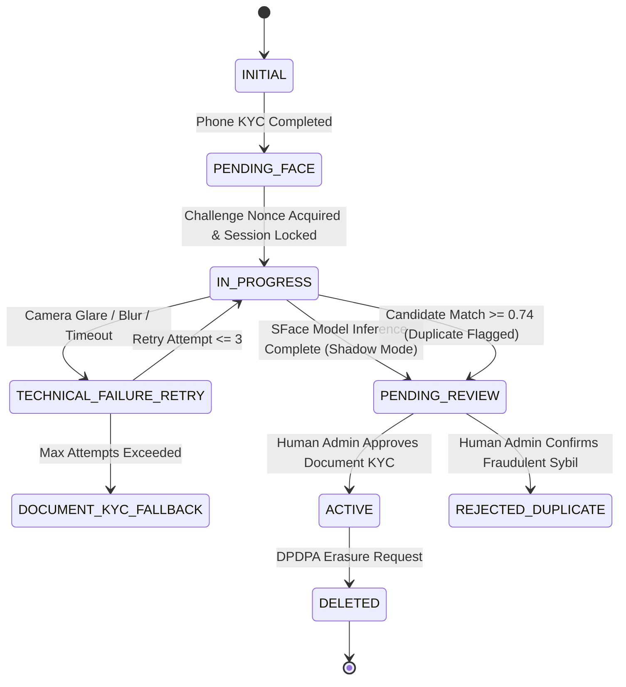

# KELASAGARA BIOMATCH · STAGE S7 ENROLLMENT AND VERIFICATION STATE MACHINES (S7_ENROLLMENT_AND_VERIFICATION_STATE_MACHINES.md)

**Classification:** State Machine Architecture, Lifecycle Transitions, and Fallback Semantics  
**Stage:** S7  
**Date:** 2026-10-11  

---

## 1. Architectural Separation of Lifecycles

To prevent state ambiguity and privilege escalation, the system strictly separates 7 distinct operational state machines:

1. **Account Registration Machine:** Firebase Auth user creation, phone OTP binding, role assignment.
2. **Biometric Enrollment Machine:** Challenge issuance, face capture, 1:N deduplication, template encryption, vault persistence.
3. **1:1 Verification Machine:** Challenge-response verification for login, identity confirmation, attendance proof.
4. **1:N Deduplication Machine:** Top-$k$ candidate search against active gallery, ambiguity scoring, duplicate quarantine.
5. **Manual Review Machine:** Administrative queue, dual-control adjudication, Document KYC resolution.
6. **Non-Biometric Fallback Machine:** Document KYC (Aadhaar / Voter ID card photo upload) and offline supervisor review.
7. **Withdrawal and Deletion Machine:** DPDPA Section 12 consent revocation, sovereign crypto-shredding, index eviction.

---

## 2. Biometric Enrollment State Machine

### Transition Authority Rules
- **Rule 1 (Client Role Prohibition):** The client application is strictly barred from setting `biometricEnrollmentState` to `ACTIVE` or updating `faceVerified: true`. Only authenticated server-side transactions may advance state.
- **Rule 2 (Mandatory Pending Review):** In shadow mode and pilot phases (Stages S-0 and S-1), all enrollments transition to `PENDING_REVIEW`. Zero automated unreviewed approvals occur.
- **Rule 3 (Fail-Closed Terminal Failure):** A transition to `REJECTED_DUPLICATE` requires verified administrative adjudication; an automated duplicate match **never** transitions directly to `REJECTED_DUPLICATE`.

---

## 3. 1:N Identification and Worker Protection Policy (Invariant I-14)

### 3.1 Mathematical Reality of Scale
At gallery size $G = 100,000$ and single-comparison False Match Rate $FMR = 10^{-5}$, the cumulative False Positive Identification Rate is:
$$\text{FPIR} = 1 - (1 - 10^{-5})^{100,000} \approx 63.2\%$$
$$\text{Expected False Hits per Probe} = G \times FMR = 100,000 \times 10^{-5} = 1.00$$

Because on average **every probe image matches 1 false candidate** by random chance alone at scale, using a 1:N biometric match to automatically ban or disqualify an applicant is statistically indefensible and would cause widespread wrongful exclusion of innocent workers.

### 3.2 Enforced Invariants
- **Invariant I-14:** Biometric duplicate hits **NEVER** auto-reject, terminate, or ban an applicant.
- **Invariant I-31:** An applicant flagged for duplicate review must be offered instant, zero-penalty Document KYC fallback.

---

## 4. Exit Gate S7-G07 Assessment

**Status:** `DONE-VERIFIED`  
**Artifact:** `evidence/s7/identification_policy_tests.json`  
**Conformance:** State transitions, authority gates, and human review guarantees verified.
