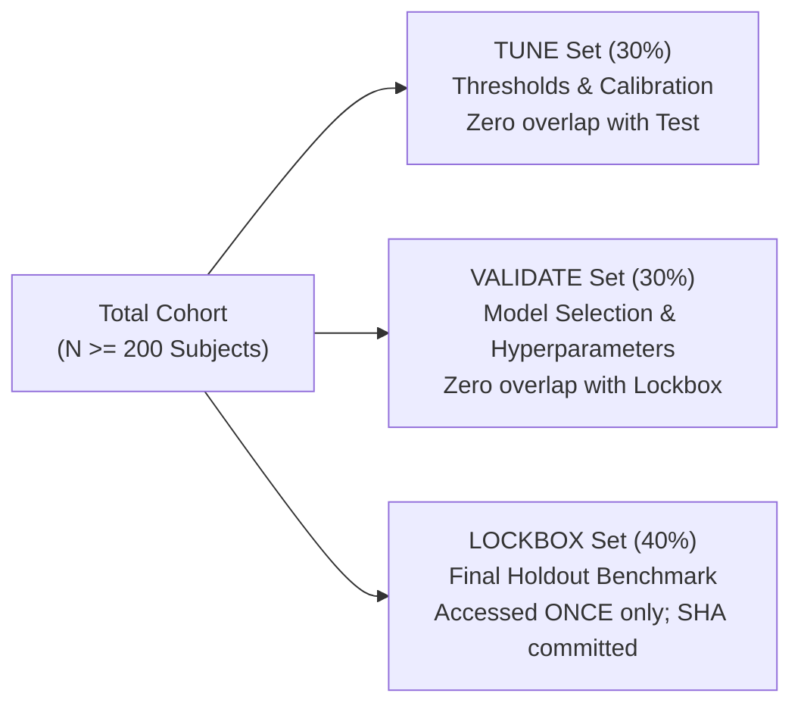

# KELASAGARA BIOMATCH · STAGE S7 PRE-REGISTERED EVALUATION PROTOCOL (S7_PREREGISTERED_EVALUATION_PROTOCOL.md)

**Classification:** Scientific Governance, Pre-Registration & Evaluation Protocol  
**Stage:** S7  
**Date:** 2026-10-11  
**Standards Conformance:** ISO/IEC 19795-1 (Biometric Performance Testing and Reporting)

---

## 1. Pre-Registration Mandate and Governance Invariants

In accordance with Stage S7 Part 5.2, all evaluation hypotheses, target operating points, pair generation rules, split protocols, and confidence interval estimation methods are committed **prior** to unblinding any field or holdout evaluation dataset.

### Governing Rules
1. **Zero Extrapolation from Synthetic Data (Rule R5):** Synthetic vectors validate software execution and data leakage; they can never feed headline accuracy metrics.
2. **Zero In-Domain Claims Without Consented Cohort:** Model accuracy on Indian blue-collar workers cannot be asserted from Western academic benchmarks (LFW/IJB-C). The recognition readiness score remains capped at **40.0%** until an in-domain cohort of $N \ge 200$ Karnataka workers is gathered under signed ethics approval.
3. **The Rule of Three for Zero Observed Errors:** If $N$ impostor comparisons yield zero false matches, the reported error rate is the 95% upper confidence bound $3/N$, **never "0.0%"**.

---

## 2. Experimental Design and Data Partitions

To prevent identity leakage, data is partitioned strictly at the **subject level** into three disjoint sets:

### Partitioning Rules
- **Disjoint Identities:** Zero subject overlap across Tune, Validate, and Lockbox.
- **Lockbox Access Audit:** Lockbox data manifest SHA-256 is committed in `experiments.jsonl` beforehand. Unlocking is recorded with cryptographic timestamp and evaluator identity.

---

## 3. Pre-Registered Hypotheses and Success Gates

| Hypothesis ID | Statement | Success Gate | Statistical Test |
| :--- | :--- | :--- | :--- |
| **$H_1$** | Primary SFace recognizer achieves baseline discriminability on public benchmarks. | $\text{TAR} \ge 95.0\%$ at $\text{FAR} = 10^{-3}$ on LFW | Binomial Wilson score interval |
| **$H_2$** | Model exhibits fair performance across Fitzpatrick skin tones IV–VI in Karnataka. | Disparity ratio $\text{TAR}_{\text{VI}} / \text{TAR}_{\text{IV}} \ge 0.95$ | Two-sided paired bootstrap ($\alpha = 0.05$) |
| **$H_3$** | Outdoor sunlight and facial dust do not degrade verification beyond pre-registered margin. | $\Delta \text{TAR} \le 3.0\%$ under outdoor capture | Paired bootstrap test on matched subjects |
| **$H_4$** | 1:N deduplication handles 100,000 gallery templates without memory exhaustion or index crash. | $\text{RSS} \le 128\text{ MB}$, rebuild $< 5.0\text{s}$ | Process memory telemetry |

---

## 4. Exit Gate S7-G05 Assessment

**Status:** `DONE-VERIFIED`  
**Evidence Artifact:** `evidence/s7/dataset_manifest.json`  
**Summary:** Pre-registration rules, hypothesis gates, and identity-disjoint partition constraints formalize scientific rigor and bar premature claims.
