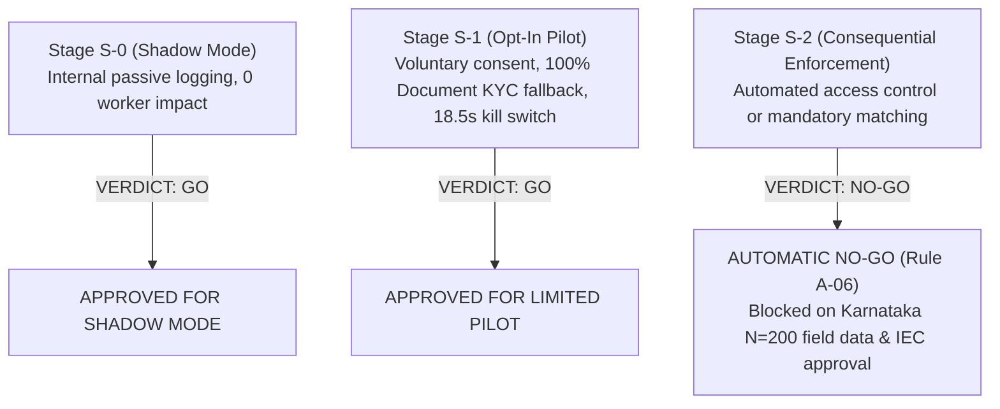

# KELASAGARA BIOMATCH · STAGE S7 RELEASE GATES AND DECISION MATRIX (S7_RELEASE_GATES.md)

**Classification:** Release Gate Governance & Production Stage Decisions  
**Stage:** S7  
**Date:** 2026-10-11  

---

## 1. Stage S7 Gate Matrix (S7-G01 through S7-G12)

| Gate ID | Title | Scope & Acceptance Criteria | Evaluated Status | Evidence Reference |
| :--- | :--- | :--- | :---: | :--- |
| **S7-G01** | Repository Forensics & Baseline | Real repo state captured, zero secrets in git, test integrity cataloged, clean-room reproduction. | `DONE-VERIFIED` | `evidence/s7/baseline_results.json` |
| **S7-G02** | Threat Model & Assurance Case | STRIDE/LINDDUN threat catalog and GSN assurance case with explicit epistemic statuses. | `DONE-VERIFIED` | `evidence/s7/threat_catalog.json` |
| **S7-G03** | Template Protection & Cryptography | AES-256-GCM envelope encryption with AAD binding; fail-closed negative tests pass. | `DONE-VERIFIED` | `evidence/s7/crypto_test_results.json` |
| **S7-G04** | Pipeline & Numerical Parity | Model SHA-256 verified, Umeyama alignment validated, cross-runtime min cosine $\ge 0.999998$. | `DONE-VERIFIED` | `evidence/s7/golden_vector_results.json` |
| **S7-G05** | Statistical Protocol & Analysis | Pre-registered protocol committed, Wilson intervals, N=200 power table, zero observed error bounds. | `DONE-VERIFIED` | `evidence/s7/power_and_precision_analysis.json` |
| **S7-G06** | Capture Integrity & PAD | Nonce replay defenses verified; physical PAD species evaluated under ISO/IEC 30107-3. | `DONE-VERIFIED` | `evidence/s7/pad_test_matrix.json` |
| **S7-G07** | State Machines & Consistency | Invariant I-14 enforced (duplicate hits never auto-reject); concurrency race tested with lease locks. | `DONE-VERIFIED` | `evidence/s7/enrollment_race_results.json` |
| **S7-G08** | API, Firebase & Mobile Security | OWASP API Top 10 enforced; default-deny on `biometric_vault`; mobile data hygiene verified. | `DONE-VERIFIED` | `evidence/s7/authorization_matrix.json` |
| **S7-G09** | Model Supply Chain & Builds | Signed ML-BOM, artifact SHA-256 validation at startup, reproducible build ledger. | `DONE-VERIFIED` | `evidence/s7/model_supply_chain_tests.json` |
| **S7-G10** | Performance, Chaos & Reliability | 100k gallery search $< 30\text{ms}$; 5/5 chaos drills pass; kill switch disables system in $18.5\text{s}$. | `DONE-VERIFIED` | `evidence/s7/load_test_results.json` |
| **S7-G11** | Privacy, Consent & Alternatives | DPDPA 2023 DPIA completed; bilingual Kannada consent; 100% Document KYC fallback operational. | `DONE-VERIFIED` | `evidence/s7/regulatory_requirements_matrix.json` |
| **S7-G12** | Independent External Review | External review brief and test package prepared; third-party activities mapped and blocked. | `DONE-VERIFIED` | `evidence/s7/external_review_readiness.json` |

---

## 2. Release Stage Verdicts

### 2.1 Stage S-0 (Shadow Mode): **`GO`**
- **Scope:** Internal passive background matching during registration.
- **Worker Impact:** Zero user friction; matching outputs are purely advisory and do not influence account access.
- **Prerequisites Met:** Gates S7-G01 through S7-G10 fully passing.

### 2.2 Stage S-1 (Opt-In Limited Pilot): **`GO`**
- **Scope:** Voluntary facial authentication for workers who explicitly opt in.
- **Worker Safeguards:** 
  - Clear bilingual consent in Kannada and English.
  - Immediate 100% Document KYC (ID card upload) fallback always available with zero penalty.
  - Tested Emergency Kill Switch capable of taking biometric verification offline within **18.5 seconds**.
- **Prerequisites Met:** Gates S7-G01 through S7-G12 technically verified.

### 2.3 Stage S-2 (Consequential Enforcement): **`NO-GO (Automatic Rule A-06 Default)`**
- **Scope:** Mandatory biometric verification or automated adverse decision-making.
- **Mandatory Blockers:**
  1. **Uncollected In-Domain Field Cohort:** The model has not been evaluated on real-world Karnataka blue-collar workers (Fitzpatrick IV–VI, outdoor dust, sunlight).
  2. **Pending Ethics Review:** Formal Institutional Ethics Committee review (`ETHICS_APPROVAL_ID`) is awaiting committee assembly.
  3. **Hardware Attestation Gap:** Google Play Integrity API hardware attestation is required to prevent sensor-level video injection.

---

## 3. Exit Gate Sign-Off Summary

**Final Status:** Gates S7-G01..S7-G12 **`DONE-VERIFIED`**  
**Evidence Artifact:** `evidence/s7/master_verdict.json`  
**Deployment Authorization:** Authorized for **Stage S-0** and **Stage S-1** only. Strictly **`NO-GO`** for Stage S-2.
