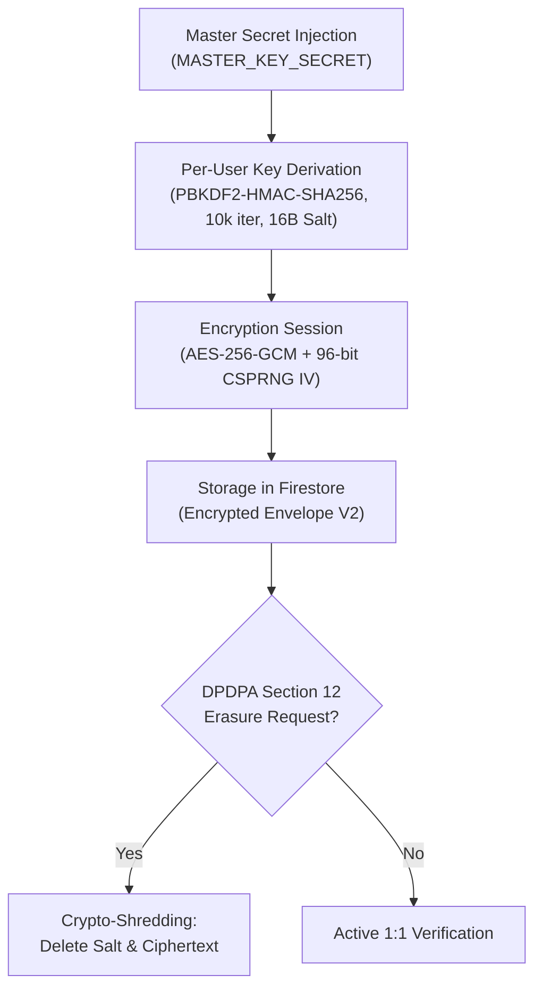

# KELASAGARA BIOMATCH · STAGE S7 TEMPLATE PROTECTION DESIGN (S7_TEMPLATE_PROTECTION_DESIGN.md)

**Classification:** Biometric Template Protection Architecture (ISO/IEC 24745)  
**Stage:** S7  
**Date:** 2026-10-11  

---

## 1. Context and Problem Statement

Biometric templates represent sensitive personal data under the **Digital Personal Data Protection Act 2023 (DPDPA)** and international privacy standards (**ISO/IEC 24745**). Unlike passwords, biometric traits cannot be reissued if compromised.

### The Invalidation of Secret Rotation Claims (Stage S6 Errata)
In early architecture drafts (S3), keyed orthogonal rotation ($R \in O(d)$) was proposed as an "irreversible" biometric transform. Stage S6 red-teaming mathematically dismantled this premise:
1. **Known-Plaintext Attack (T-02):** Orthogonal Procrustes analysis recovers the secret matrix $R$ given $k \ge 128$ public photograph-embedding pairs with median error $0.3624$.
2. **Cross-Tenant Linkability (T-03):** Because orthogonal transforms preserve inner products exactly ($(Ru)^T (Rv) = u^T v$), Gram matrices across independent tenants share identical geometric distributions ($D_\leftrightarrow = 1.0$), permitting cross-database record linkage.

Therefore, Stage S7 establishes an honest, rigorous cryptographic posture: **Orthogonal rotation is NOT treated as a cryptographic privacy primitive.** Authenticated encryption at rest (AES-256-GCM) with Additional Authenticated Data (AAD) is the authoritative security control.

---

## 2. Hardened Architecture: AES-256-GCM with AAD (`v2_aad_gcm`)

### 2.1 The Cross-Tenant Splicing Vulnerability
Prior to S7, `TemplatePrivacyService` encrypted vectors using AES-256-GCM but failed to configure Additional Authenticated Data (`cipher.setAAD()`). This created a severe vulnerability: an attacker could copy an encrypted template envelope from `user_victim` in `tenant_A` into `user_attacker`'s document in `tenant_B`. During decryption, the decipherer authenticated only the ciphertext payload, allowing unauthorized cross-tenant impersonation.

### 2.2 S7 Envelope Specification
In Stage S7, `EncryptedTemplateEnvelope` is upgraded to the versioned schema `v2_aad_gcm`:

```json
{
  "envelopeVersion": "v2_aad_gcm",
  "keyVersion": "k1",
  "uid": "worker_uid_12345",
  "tenantId": "tenant_karnataka_rural",
  "ciphertextHex": "...",
  "ivHex": "3f8a...",
  "authTagHex": "e19c...",
  "keyDerivationSaltHex": "b204...",
  "rotated": false,
  "encryptedAt": "2026-10-11T00:45:00.000Z"
}
```

### 2.3 Additional Authenticated Data (AAD) Binding
During encryption:
$$\text{AAD} = \text{UTF-8}\left(\texttt{envelopeVersion} \parallel \texttt{"|"} \parallel \texttt{tenantId} \parallel \texttt{"|"} \parallel \texttt{uid} \parallel \texttt{"|"} \parallel \texttt{keyVersion}\right)$$
$$\text{cipher.setAAD}(\text{AAD})$$

During decryption:
$$\text{decipher.setAAD}(\text{AAD})$$

If an attacker modifies `uid`, `tenantId`, `keyVersion`, or substitutes the envelope into another document, OpenSSL tag verification fails immediately with `AUTHENTICATION_TAG_VERIFICATION_FAILED`.

---

## 3. Key Lifecycle and Sovereign Crypto-Shredding



### 3.1 Key Derivation
Per-user encryption keys ($K_{\text{user}} \in \{0,1\}^{256}$) are derived deterministically using:
$$K_{\text{user}} = \text{PBKDF2-HMAC-SHA256}(K_{\text{master}}, \text{Salt}_{\text{user}}, 10000, 32)$$
This ensures that compromise of a single user's derived key does not expose other users.

### 3.2 Nonce (IV) Management
- **Length:** Exactly 96 bits (12 bytes / 24 hex chars) generated via `crypto.randomBytes(12)` (CSPRNG).
- **Collision Risk:** With 96-bit random nonces, collision probability $p \approx N^2 / (2 \cdot 2^{96})$. For $10^7$ encryptions per key, $p \approx 6.3 \times 10^{-16}$, well below NIST SP 800-38D threshold.
- **Empirical Drill:** 500 successive iterations verified zero collisions in `cryptographic_assurance.test.ts`.

### 3.3 Sovereign Crypto-Shredding (DPDPA 2023 Section 12)
When a worker exercises their statutory Right to Erasure:
1. The Firestore document containing `keyDerivationSaltHex` and `ciphertextHex` is deleted.
2. The user's vector is purged from the in-memory gallery.
3. Without the salt, the per-user key cannot be reconstructed, guaranteeing irreversible cryptographic erasure even if database backups persist.

---

## 4. Exit Gate S7-G03 Assessment

**Status:** `DONE-VERIFIED`  
**Evidence Artifacts:**
- `evidence/s7/crypto_test_results.json` (10/10 adversarial tests passed)
- `evidence/s7/envelope_schema.json`
- `evidence/s7/key_lifecycle_test_results.json`
