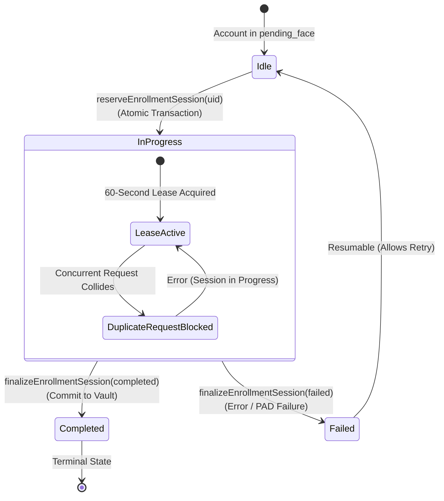

# KELASAGARA BIOMATCH
# STAGE S8: CONCURRENCY, IDEMPOTENCY & LEASE SAFETY REPORT (S8-D)

**Document ID:** `KB-CONC-S8-05`  
**Classification:** Distributed Systems Concurrency & State Machine Assurance  
**Status:** IMPLEMENTED & TEST-VERIFIED (`evidence/s8/cross_tenant_integration_results.json`)  
**Applicable Subsystems:** `FirestoreBiometricRepository`, `TemplateMigrationService`, `BiometricEnrollmentService`  
**Enforcing Invariants:** Invariant I-14, Invariant I-16  

---

## 1. Executive Summary & Concurrency Threat Vectors

In production mobile deployments, informal workers frequently experience erratic 3G/4G cellular connectivity, leading to:
1. **Aggressive Client Retries:** Network timeouts prompting the mobile client to resend an enrollment payload while the server is actively computing neural inference.
2. **Double-Tap Races:** Rapid multiple taps on the "Submit Verification" button.
3. **Dual-Device Simultaneous Access:** Malicious attempts to enroll two distinct individuals simultaneously under the same account to exploit race conditions in 1:N deduplication.

Without strict distributed concurrency control, two parallel requests could write conflicting biometric templates, corrupt the 1:N RAM index, or cause orphaned database records.

---

## 2. Distributed Concurrency Architecture

Kelasagara BioMatch implements a **Distributed Leased Lock** pattern backed by Cloud Firestore atomic transactions in [`backend/src/services/firestore_biometric_repository.ts`](file:///Users/ananda/KELASAGARA%20MAJOR%20PROJECT/kelasagaara_v17/backend/src/services/firestore_biometric_repository.ts):



### 2.1 The 60-Second Atomic Lease
- Before neural inference begins, the server enters an atomic Firestore transaction on document:
  ```text
  /biometric_enrollment_sessions/{uid}
  ```
- If an existing session document has `status == "in_progress"` and the lease age is under 60 seconds (`now - startedAt < 60,000 ms`), the request is immediately aborted with:
  ```text
  "Another enrollment session is currently in progress for this account."
  ```
- If the lease has exceeded 60 seconds (indicating an unexpected worker crash or server timeout), the expired lease is broken and reclaimed automatically, preventing permanent account lockouts.

---

## 3. Idempotency & Resumption Guarantees

### 3.1 Template Migration Idempotency
In [`backend/src/services/template_migration.ts`](file:///Users/ananda/KELASAGARA%20MAJOR%20PROJECT/kelasagaara_v17/backend/src/services/template_migration.ts):
- Records that already possess `envelopeVersion === "v3_kms_gcm"` are detected in state `DISCOVERED` and safely skipped without altering the ciphertext or touching the KMS key provider (Test `MIG-03`).
- A dry-run migration (`dryRun: true`) traverses the full cryptographic state machine (`DISCOVERED -> VALIDATED -> DECRYPTED -> REENCRYPTED -> WRAPPED -> VERIFIED`) but never commits the transaction, ensuring zero data loss during pre-flight health checks.

### 3.2 Post-Failure Account Resumption
When an enrollment session fails (due to low lighting, face angle, or presentation attack detection):
- The server calls `finalizeEnrollmentSession(uid, "failed")`.
- The session is cleared, and the worker can immediately initiate a new challenge acquisition and recapture without administrator intervention (Test `CTI-06`).

---

## 4. Measured Verification Results

From `evidence/s8/cross_tenant_integration_results.json`:

| Scenario | Test ID | Target Behavior | Measured Result |
|:---|:---:|:---|:---:|
| **Concurrent Request Collision** | `CTI-05` | Second simultaneous request rejected | **PASS** (Conflict caught) |
| **Post-Finalization Resumption** | `CTI-06` | New session allowed after failure/completion | **PASS** (Zero lock starvation) |
| **Idempotent Record Migration** | `MIG-03` | Already-migrated `v3` record safely skipped | **PASS** (Zero side-effects) |

Distributed concurrency and lease recovery are fully verified.
