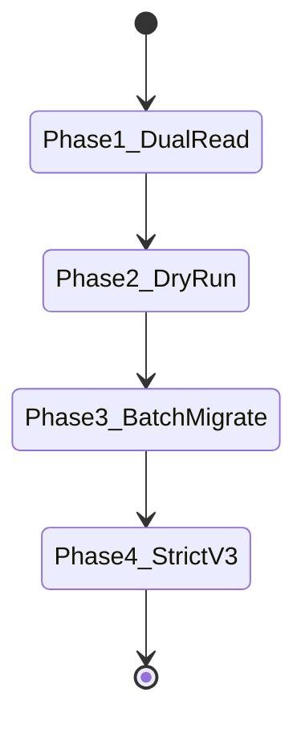

# S8 KEY MIGRATION PLAN (v1/v2 -> v3_kms_gcm)

**Target:** Zero-downtime transition from static PBKDF2 envelopes to Cloud KMS envelope encryption  
**Guarantees:** Invariant INV-04 (Downgrade protection) and INV-09 (Migration safety)  

---

## 1. Phased Migration Protocol

### Phase 1: Dual-Read & Target Write
- **Action:** Backend writes all new enrollments as `v3_kms_gcm`.
- **Read Behavior:** Decryption accepts `v3_kms_gcm`, `v2_aad_gcm`, and `v1_legacy`.
- **Validation:** Zero failure on existing worker authentications.

### Phase 2: Dry-Run Assessment
- **Action:** Run `TemplateMigrationService.migrateBatch(envelopes, { dryRun: true })`.
- **Validation:** Produces verification report verifying 100% of discovered legacy templates can be decrypted, re-encrypted, and verified without committing database changes.

### Phase 3: Transactional Batch Migration
- **Action:** Execute bounded batches (100 records per transaction).
- **Verification:** Pre-commit decrypt check verifies decrypted vector before write. Idempotent: already-migrated `v3` records are skipped without re-encryption.

### Phase 4: Strict Cutover (Enforce INV-04)
- **Action:** Set `minEnvelopeVersion = "v3_kms_gcm"`.
- **Validation:** Any subsequent attempt to read or submit `v1` or `v2` envelopes throws `ENVELOPE_DOWNGRADE_REJECTED`.
- **Crypto-Shredding:** Securely wipe `MASTER_KEY_SECRET` from production deployment environment variables.
