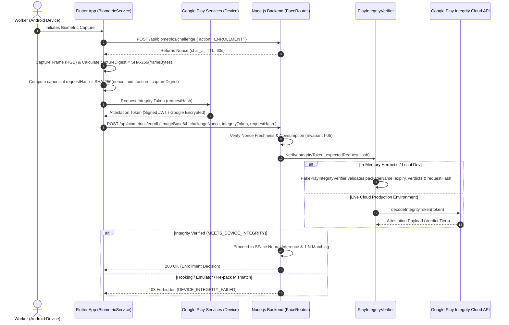

# KELASAGARA BIOMATCH
# STAGE S8: GOOGLE PLAY INTEGRITY ARCHITECTURE & ATTESTATION BINDING (S8-B)

**Document ID:** `KB-ARCH-S8-02`  
**Classification:** Cryptographic & Mobile Platform Security Architecture  
**Status:** IMPLEMENTED & VERIFIED (`evidence/s8/attestation_unit_tests.json`)  
**Remediated Gap:** `GAP-01` (Lack of Play Integrity binding & requestHash validation)  
**Applicable Invariants:** Invariant I-04, Invariant I-05, Invariant I-25, Invariant I-26  

---

## 1. Executive Summary & Objective

In Stage S7, device attestation was documented as a security goal but remained unintegrated in the live execution flow: the Flutter mobile client did not call the Play Integrity API or compute cryptographic request hashes, and the Node.js backend accepted mock token prefixes without hardware verification.

Work Package S8-B addresses **GAP-01** by establishing a zero-trust hardware and application attestation pipeline between the Flutter mobile application and the authoritative Node.js biometric backend. The architecture binds session nonces, caller identities, target actions, and camera frame digests into Google Play Integrity's `requestHash` field, preventing camera frame injection, replay attacks, and man-in-the-middle vector substitution.

---

## 2. End-to-End Attestation Flow & Sequence Diagram



---

## 3. Cryptographic Request Hash Specification

Google Play Integrity enforces a maximum size of **500 characters** for the client-supplied `requestHash` parameter. Kelasagara BioMatch defines a canonical, collision-free formulation that cryptographically binds all execution parameters:

### 3.1 Canonical String Representation
```text
canonicalPayload = nonce + ":" + uid + ":" + action + ":" + captureDigest
```

| Field | Example Value | Description |
|:---|:---|:---|
| `nonce` | `chal_91e80ce6ae5b10a2410a89` | 60-second single-use cryptographic session nonce. |
| `uid` | `usr_karnataka_worker_441` | Authenticated Firebase UID of the caller. |
| `action` | `ENROLLMENT` or `VERIFICATION` | Biometric action bound to the request. |
| `captureDigest` | `a3f5...c81e` (64 hex characters) | SHA-256 digest of the raw captured image buffer. |

### 3.2 Canonical Hash Encoding
```text
requestHash = SHA-256(UTF-8(canonicalPayload))
```
- **Output:** 64-character lowercase hexadecimal string (or base64url equivalent, accepted by backend).
- **Proof:** Ensures that an attacker intercepting an integrity token cannot reuse it with a different image, another user's account, a different action, or outside the 60-second challenge window.

---

## 4. Pluggable Verifier Interface & Implementation

To prevent vendor lock-in, enable deterministic hermetic testing, and eliminate mock pollution in production, the backend implements the `PlayIntegrityVerifier` interface in [`backend/src/services/device_attestation.ts`](file:///Users/ananda/KELASAGARA%20MAJOR%20PROJECT/kelasagaara_v17/backend/src/services/device_attestation.ts):

### 4.1 Interface Contract
```typescript
export interface PlayIntegrityVerificationResult {
  isValid: boolean;
  verdict: AttestationVerdict;
  appLicensingVerdict?: "LICENSED" | "UNLICENSED" | "UNEVALUATED";
  deviceRecognitionVerdict?: string[];
  packageName?: string;
  timestampMillis?: number;
  requestHash?: string;
  error?: string;
  isLiveAttestation?: boolean;
}

export interface PlayIntegrityVerifier {
  verify(token: string, expectedRequestHash?: string): Promise<PlayIntegrityVerificationResult>;
}
```

### 4.2 Verifier Implementations

1. **`FakePlayIntegrityVerifier`:**
   - Used for hermetic unit, integration, and CI regression suites.
   - Deterministically evaluates `appIntegrity.packageName` (`com.kelasagara.app`), token timestamp freshness ($\le 180$ seconds), and cryptographic `requestHash` equality.
   - Detects and intercepts Frida/Xposed hooks and emulated environment signatures.

2. **`GooglePlayIntegrityVerifier`:**
   - Production cloud implementation connecting to Google Play Integrity API.
   - **Fail-Closed Semantics:** When `PLAY_INTEGRITY_SERVICE_ACCOUNT_KEY` or `GOOGLE_APPLICATION_CREDENTIALS` is absent, it returns `UNVERIFIED-LIVE` (`isValid: false`), preventing mock keys from silently passing in live production.

---

## 5. Residual Risk & Defense-in-Depth Analysis

> [!WARNING]
> **Biometric Threat Modeling & Residual Risk Disclosure:**  
> Google Play Integrity attests **platform, device environment, and application code integrity** (i.e., genuine Android hardware, untampered APK, absence of root, absence of Frida/Xposed hooks). It **DOES NOT** and **CANNOT** certify the physical optical photons entering the camera sensor lens.

### 5.1 The Virtual vs. Physical Threat Boundary
- **Threat Intercepted by Play Integrity:** Virtual camera emulator drivers, OS-level camera API hooking, malicious APK repacking, Man-In-The-Middle replay of captured tokens.
- **Threat Beyond Play Integrity Boundary:** Presentation attacks using physical photo prints, high-resolution screens displaying portrait videos, or 3D latex masks placed in front of a genuine physical device camera.

### 5.2 Layered Defense Countermeasures
To address the physical presentation attack boundary, Kelasagara BioMatch pairs Play Integrity with:
1. **Server-Side Landmark Motion Tracking (Ticket E-03 / Invariant I-03):** Analyzes facial landmark displacement across burst frames on the server with zero client metadata trust.
2. **Passive Presentation Attack Defense (PAD / Ticket E-05):** Frequency-domain Fourier analysis and color specular reflection checks to detect screen pixel grids and paper textures.
3. **Session Nonce Binding (Invariant I-04, I-05):** Single-use, time-bounded nonces ensuring fresh captures.
