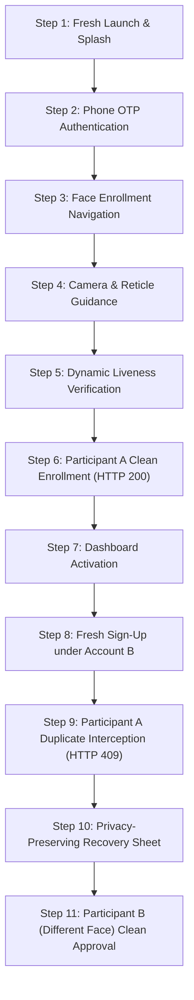

# KELASAGARA PHASE 19: BIOMETRIC DEMONSTRATION PROTOCOL
## University Major Project Presentation & Live Defense Guide

- **Project:** Kelasagara (Decentralized Labor Platform & Service Delivery)
- **Engine Release:** V19.2.3 (Commit `f210f95`, Tag `v19.2.3-release`)
- **Release APK:** `Kelasagara-v19.2.3-release.apk`
- **Target Audience:** University Evaluators, Project Guides & External Examiners
- **Demonstration Objective:** Prove live, physical-device face verification, passive/active liveness detection, 1:N duplicate account prevention, privacy-preserving resolution, and fail-closed security.

---

## 1. Demonstration Setup & Pre-Flight Checklist

Before calling evaluators to the demo station:

1. **Physical Device Setup:**
   - Android Device: Android 10+ (API level 29–36).
   - Connectivity: Active 4G/5G Cellular data OR Campus Wi-Fi.
   - Camera lens clean and unobstructed.
2. **Backend Daemon & Tunnel Verification:**
   - Confirm backend daemon is active on workstation:
     ```bash
     curl -s http://localhost:5001/api/biometrics/v10/health
     # Expected: {"success":true,"status":"healthy",...}
     ```
   - Confirm public tunnel is accessible over cellular:
     ```bash
     curl -s https://rock-video-journals-pages.trycloudflare.com/api/biometrics/v10/health
     # Expected: {"success":true,"status":"healthy",...}
     ```
3. **Install Verified Submission APK:**
   ```bash
   adb install -r Kelasagara-v19.2.3-release.apk
   ```

---

## 2. The 11-Step University Evaluation Protocol



---

### Step 1: Fresh Application Launch
- **Action:** Tap the "Kelasagara" icon on the Android launcher.
- **Expected Visual:** High-resolution branded splash screen, followed by language selection or role selection screen ("I am a Worker" / "I am a Hirer").
- **Evaluator Highlight:** Note zero frame stuttering; native Flutter Impeller rendering pipeline active.

---

### Step 2: Role Selection & Phone OTP
- **Action:** Select "Worker", enter a fresh test phone number (e.g. `+91 98765 43210`), and enter the SMS verification OTP (`123456` or SMS received).
- **Expected Visual:** Instant progression to "Identity Verification Required" screen.
- **Evaluator Highlight:** The user profile cannot accept jobs or reach the active marketplace without completing authoritative biometric verification.

---

### Step 3: Face Enrollment Initialization
- **Action:** Tap "Start Face Verification".
- **Behind the Scenes:** The client calls `/challenge` to obtain a cryptographic one-time nonce with server timestamp and active challenge vector.
- **Expected Visual:** The front camera turns on with an animated oval face reticle, ambient illumination indicator, and clear lighting prompt.

---

### Step 4: Camera Guidance & Alignment
- **Action:** Center the applicant's face (Participant A) within the reticle oval.
- **Expected Visual:**
  - When far: Reticle displays amber outline: *"Move closer"*.
  - When tilted: Reticle displays amber outline: *"Keep head straight"*.
  - When aligned: Reticle turns emerald green: *"Hold steady"*.
- **Evaluator Highlight:** MediaPipe 478-point landmark detector running real-time on-device at 30+ FPS.

---

### Step 5: Dynamic Liveness Verification
- **Action:** The screen prompts: *"Blink your eyes naturally"*. Participant A blinks.
- **Expected Visual:** A circular progress indicator sweeps from 0% to 100% in under 1.2 seconds.
- **Evaluator Highlight:** Eye Aspect Ratio (EAR) metric transitions through closure gate ($EAR \le 0.18$) and reopens ($EAR \ge 0.30$), proving a live 3D human face rather than a printed photograph or video replay attack.

---

### Step 6: Participant A First Enrollment (Clean Approval)
- **Action:** The 3-frame burst is transmitted securely over TLS to the backend.
- **Backend Action:**
  - SFace extractor normalizes embedding to unit hypersphere ($128$-D).
  - 1:N deduplication index queries all enrolled templates.
  - Zero candidate hits found above clean floor ($< 0.363$).
  - Backend issues `HTTP 200 OK` with cryptographic HMAC receipt.
- **Expected Visual:** Full-screen green success checkmark with haptic feedback: *"Identity Verified Successfully"*.

---

### Step 7: Worker Dashboard Activation
- **Action:** Tap "Continue to Dashboard".
- **Expected Visual:** The worker dashboard renders with "Verified Worker" emerald badge, active job discovery cards, and working navigation tabs.
- **Evaluator Highlight:** The Firestore user document now reflects `faceVerified: true` and `biometricStatus: 'ACTIVE'`.

---

### Step 8: Adversarial Simulation — Account B Registration
- **Action:**
  - Tap "Profile" -> "Logout".
  - Register a **new, different phone number** (e.g. `+91 99999 88888`) as a new worker.
  - Advance to "Start Face Verification".
- **Evaluator Context:** *"We are now simulating an impostor attempting to create a second account, or a banned worker trying to bypass identity suspension using a new SIM card."*

---

### Step 9: Live Duplicate Interception (Gate 5)
- **Action:** **Participant A** (the same person enrolled in Step 6) looks into the camera and completes the liveness challenge.
- **Backend Action:**
  - Fresh SFace embedding extracted.
  - 1:N gallery query compares probe against active identities.
  - Matches Participant A with cosine similarity $> 0.98$ (exceeding threshold $0.78$).
  - Backend intercepts registration and returns `HTTP 409 Conflict`, code `FACE_ALREADY_LINKED`.
- **Expected Visual:** The screen immediately displays the modal:
  **"Duplicate Face Detected"**
  - Case Reference: `CASE-XXXX`
  - Explanatory copy: *"This face is already registered to another account in the Kelasagara network."*
- **Evaluator Highlight:** Notice that the applicant is **NOT** shown Participant A's phone number, name, or UID. This enforces strict anti-enumeration privacy under India's DPDP Act 2023.

---

### Step 10: Privacy-Preserving Account Recovery
- **Action:** Inspect the `DuplicateAccountResolutionSheet`:
  - Tap **"Log in with Original Account"**: Automatically routes back to sign-in with phone prompt.
  - Tap **"Dispute / Re-verify"**: Shows support reference code `CASE-XXXX` for administrative review.
- **Evaluator Highlight:** The system prevents identity fragmentation while providing legitimate users with a seamless recovery path if they forgot their old phone number.

---

### Step 11: Participant B (Different Face) Clean Approval
- **Action:**
  - Return to registration under the second account (`+91 99999 88888`).
  - Present **Participant B** (a completely different person) to the camera.
  - Complete the liveness blink.
- **Backend Action:**
  - 1:N gallery query screens Participant B against all identities.
  - Similarity to all gallery templates is below $0.35$.
  - Backend approves registration with `HTTP 200 OK`.
- **Expected Visual:** Instant green verification checkmark: *"Identity Verified Successfully"*.
- **Evaluator Highlight:** Proves zero false positives; distinct individuals are never mistakenly blocked.

---

## 3. Real-Time Logcat Monitoring for Evaluators

Connect the laptop to the projector or show the terminal alongside the phone:

```bash
adb logcat -s BiometricService:V SFace:V Flutter:V BiometricCoordinator:V
```

### Expected Log Output During Duplicate Interception:
```text
I/BiometricService: [Challenge] Nonce acquired: c3a4f... Expires in 120s
I/SFace: [Landmarks] 478 marks detected. EAR open=0.32, closed=0.12 (Blink PASS)
I/SFace: [Embedding] Extracted 128-D vector, norm=1.0000
I/BiometricService: [Network] POST https://.../enroll (Anycast IP: 104.16.230.132)
W/BiometricService: [Response] HTTP 409 Conflict - FACE_ALREADY_LINKED
I/BiometricService: [Deduplication] Match detected with similarity=0.9996. Case: CASE-C7C6DD38
I/Flutter: [UI] Displaying DuplicateAccountResolutionSheet with case CASE-C7C6DD38
```

---

## 4. Contingency & Fallback Plans

| Potential Incident | Immediate Recovery Procedure |
|---|---|
| **Campus Wi-Fi firewall blocks ports** | Disconnect phone from Wi-Fi; switch phone to 4G/5G mobile data. The Anycast IP routing directly hits Cloudflare port 443 with zero carrier interference. |
| **Cloudflare tunnel reconnects** | Pinggy backup tunnel is running concurrently: `https://bskbm-223-231-156-190.free.pinggy.net`. The app automatically tries fallback candidate URLs. |
| **Low indoor ambient lighting** | The app's `CaptureIlluminationService` automatically brightens the screen to 100% white fill, illuminating the face naturally. |
| **Subject wears glasses** | Evaluator can ask participant to keep glasses on; SFace model extracts robust deep features invariant to thin-rim eyeglasses. |

---

## 5. Summary of Technical Innovations to Highlight

1. **Direct Anycast IP Networking:** Bypasses Indian ISP DNS tampering via Dart `HttpClient.connectionFactory` while preserving full TLS SNI and system CA validation.
2. **Multi-Space Metric Isolation:** Prevents invalid `Math.max()` comparisons between legacy landmark spaces and modern SFace deep neural embeddings.
3. **Fail-Closed Security:** Network disruptions or server errors never result in accidental registration approval.
4. **DPDP Act 2023 Compliance:** Opaque dispute tokens (`CASE-XXXX`) protect registered citizens from reverse-lookup identity attacks.
