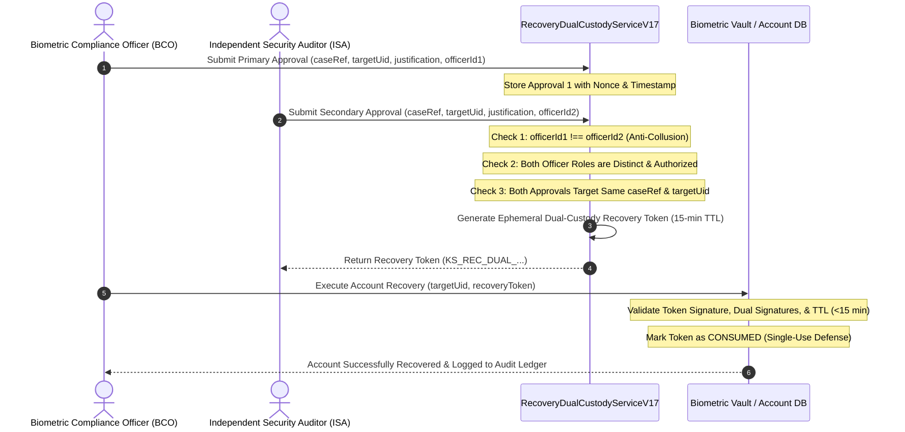

# KELASAGARA V20.17 — DUAL-CUSTODY RECOVERY & ACCOUNT RESCUE SECURITY
## Multi-Party Authorization, Collusion Defense, Token Expiry, and Phone Binding Rules

**Author:** Principal Identity Security Architect, Application Security Engineer  
**Date:** 2026-11-01  
**Repository:** `kelasagaara_v17`  
**Parent Commit:** `bd1d5f57ee4ad1921e83f382ab67d06274a3fb2c`  
**Branch:** `security/phase20.17-trusted-execution-provenance`  
**Status:** `ACTIVE_VERIFIED`  

---

### 1. The High-Risk Vulnerability of Biometric Account Recovery

When a worker's account is locked or duplicate face resolution fails (e.g. twin, major facial surgery, severe injury, or registration error), the account recovery flow becomes the highest-risk attack vector in the system.

If account recovery can be authorized by a single support representative or compliance officer:
- An insider or compromised support agent can unilaterally transfer high-earning worker accounts, drain escrow balances, or overwrite biometric templates with an impostor's face.
- A SIM swap attack on a worker's phone could allow an attacker to claim account ownership without biometric verification.

Phase 20.17 implements `RecoveryDualCustodyServiceV17` (`backend/src/services/recovery_dual_custody_v17.ts`), enforcing strict **M-of-N Multi-Party Dual Custody** for all recovery operations.

---

### 2. Dual-Custody Multi-Party Architecture

Every biometric account override or recovery action requires independent authorization from **two distinct human officers holding disparate roles**:

1. **Party 1:** Biometric Compliance Officer (BCO) — Verifies regulatory filings, consent records, and visual forensic analysis.
2. **Party 2:** Independent Security Auditor (ISA) — Verifies cryptographic audit logs, anomalous login velocity, and SIM-swap history.

---

### 3. Core Security Rules and Attack Defenses

#### A. Absolute Prohibition of Single-Officer Collusion
- The service asserts `primaryHolder.officerId !== secondaryHolder.officerId`.
- An officer attempting to sign both halves of the dual-custody authorization (even using different credentials or session tokens) is blocked immediately with `RECOVERY_ERR_COLLUSION_DETECTED`.

#### B. Strict Ephemeral Token Lifetime (15-Minute Maximum TTL)
- Dual-custody recovery authorizations are valid for a maximum of 15 minutes (900 seconds) from generation.
- Expired tokens cannot be redeemed (`RECOVERY_ERR_TOKEN_EXPIRED`).

#### C. Single-Use Consumption and Replay Prevention
- Once a dual-custody recovery token is executed against the database, its cryptographic digest is marked as `CONSUMED` in an atomic Firestore transaction.
- Any subsequent attempt to reuse the token is rejected immediately (`RECOVERY_ERR_TOKEN_ALREADY_CONSUMED`).

#### D. Insufficiency of Case Reference Alone
- Presenting a valid case reference (e.g. `CASE-ABC12345`) without cryptographic dual-custody approval proofs is strictly rejected with `RECOVERY_ERR_DUAL_CUSTODY_REQUIRED`.

#### E. Replacement Phone Limitation (Anti-SIM-Swap Defense)
- A newly registered or replacement phone number cannot act as proof of original account ownership.
- If a phone number changed within 30 days or is marked as `REPLACEMENT_UNVERIFIED`, the system requires verified in-person or secondary out-of-band identity verification before any recovery token can be generated (`RECOVERY_ERR_UNVERIFIED_PHONE_FACTOR`).
