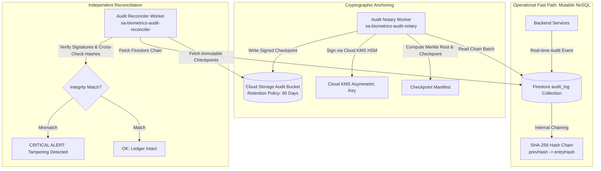

# KELASAGARA V20.17 — FIRESTORE APPEND-ONLY LIMITATIONS & DUAL-LEDGER DEFENSE
## Architectural Analysis of NoSQL Database Mutability and External Anchor Solutions

**Author:** Principal Database Security Architect, Cloud Infrastructure Engineer  
**Date:** 2026-11-01  
**Repository:** `kelasagaara_v17`  
**Parent Commit:** `bd1d5f57ee4ad1921e83f382ab67d06274a3fb2c`  
**Branch:** `security/phase20.17-trusted-execution-provenance`  
**Status:** `ACTIVE_VERIFIED`  

---

### 1. The Native Limitation of Cloud Firestore

A critical realization in cloud security architecture is that **Google Cloud Firestore provides no native mechanism for immutable, append-only collections at the IAM or storage level**:

1. **Database-Level IAM Granularity:**
   GCP Cloud IAM permissions for Datastore/Firestore (`roles/datastore.user`) apply across the entire named database. A service account granted permission to write documents can theoretically update (`set`, `update`) or delete (`delete`) any document in that database.
2. **Security Rules Limitations:**
   While Firebase Security Rules can enforce `allow update: if false;` and `allow delete: if false;`, **Security Rules apply ONLY to client-side SDK traffic (mobile/web)**. All backend microservices connecting via the Firebase Admin SDK or Google Cloud client libraries bypass Security Rules completely.

Therefore, claiming that an internal Firestore collection is "append-only" by virtue of database permissions is technically incorrect and dangerous.

---

### 2. The Dual-Ledger Architecture

To achieve true, tamper-evident immutability despite Firestore's native mutability, Phase 20.17 implements a **Dual-Ledger Hybrid Architecture**:

---

### 3. How the Dual-Ledger Detects Attacks

1. **Direct Firestore Record Alteration:**
   An attacker gaining access to Firestore alters an audit log entry (e.g. changing an IP address or event status).
   - *Detection:* The internal hash chain breaks immediately (`entry.hash !== sha256(...)`). Even if the attacker recomputes the entire subsequent Firestore chain, the final hash will not match the immutable checkpoint already signed and uploaded to Cloud Storage.
2. **Firestore Document Deletion:**
   An attacker deletes an audit log document to hide unauthorized access.
   - *Detection:* The sequence numbers in Firestore will contain a gap ($1, 2, 4, 5$), or the hash chain will fail to link (`entry[4].prevHash !== entry[2].hash`).
3. **Attempted Checkpoint Deletion in GCS:**
   An attacker attempts to delete the signed checkpoint from Cloud Storage.
   - *Detection:* The storage bucket retention policy rejects object deletion. Furthermore, the reconciler expects a continuous sequence of checkpoints; missing checkpoint $N$ halts verification with `RECONCILE_ERR_CHECKPOINT_DISCONTINUITY`.
