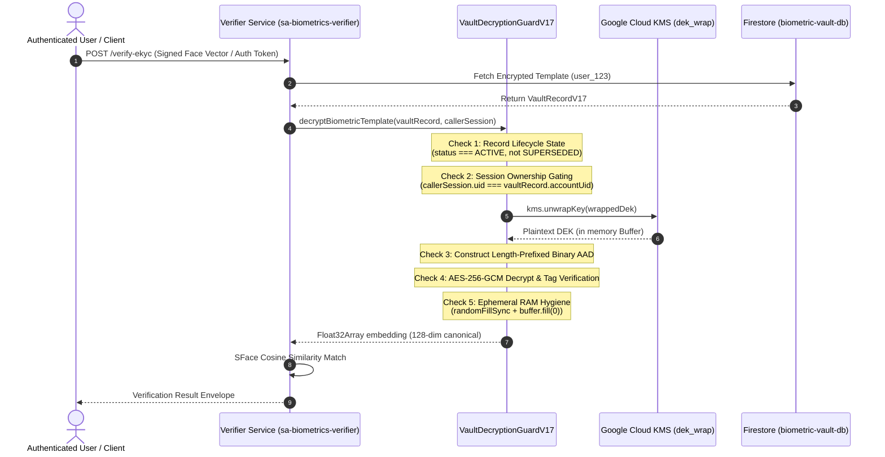

# KELASAGARA V20.17 — VAULT DECRYPTION ARCHITECTURE & RECORD-LEVEL ACCESS
## End-to-End Cryptographic Flow, Lifecycle Fencing, and Plaintext RAM Hygiene

**Author:** Principal Biometric Systems Architect, Application Security Engineer  
**Date:** 2026-11-01  
**Repository:** `kelasagaara_v17`  
**Parent Commit:** `bd1d5f57ee4ad1921e83f382ab67d06274a3fb2c`  
**Branch:** `security/phase20.17-trusted-execution-provenance`  
**Status:** `ACTIVE_VERIFIED`  

---

### 1. Architectural Overview

`VaultDecryptionGuardV17` (`backend/src/services/vault_decryption_guard_v17.ts`) governs all access to raw biometric embeddings stored in Firestore's `biometric_vault` collection.



---

### 2. Mandatory Pre-Decryption Lifecycle Fencing

Before any cryptographic unwrapping or deciphering takes place, `VaultDecryptionGuardV17` enforces strict record lifecycle gates:

```typescript
// 1. Template Lifecycle Gate
if (vaultRecord.lifecycleStatus !== 'ACTIVE') {
  throw new Error(`VAULT_ERR_INACTIVE_TEMPLATE: Template ${vaultRecord.templateId} is in status ${vaultRecord.lifecycleStatus}`);
}

// 2. Ownership & Session Binding Gate
if (callerSession.mode === '1:1_VERIFICATION') {
  if (callerSession.authenticatedUid !== vaultRecord.accountUid) {
    throw new Error(`VAULT_ERR_RECORD_OWNERSHIP_MISMATCH: Caller ${callerSession.authenticatedUid} cannot access template belonging to ${vaultRecord.accountUid}`);
  }
}
```

If a record is marked `SUPERSEDED`, `REVOKED`, or `EXPIRED`, the operation is aborted **before** any request is sent to Cloud KMS, saving quota and preventing stale biometric comparison.

---

### 3. Immediate Ephemeral Memory Hygiene

Plaintext cryptographic keys and unencrypted 128-dimensional biometric embeddings represent high-value attack targets if left in Node.js heap memory or exposed to garbage collection latency:

1. **Explicit DEK Zeroization:**
   As soon as the AES-256-GCM deciphering operation finishes (whether successful or failed), the plaintext DEK buffer is overwritten with cryptographically strong pseudorandom bytes and then wiped with zeros:
   ```typescript
   try {
     const plaintext = decipher.update(ciphertext);
     decipher.final(); // Verifies auth tag
     return new Float32Array(plaintext.buffer, plaintext.byteOffset, plaintext.byteLength / 4);
   } finally {
     // Overwrite and wipe ephemeral DEK buffer immediately
     if (plaintextDekBuffer) {
       crypto.randomFillSync(plaintextDekBuffer);
       plaintextDekBuffer.fill(0);
     }
   }
   ```
2. **Short-Lived Embeddings:**
   The Float32Array is passed directly to the SFace matching engine and never cached in disk or database logs.
