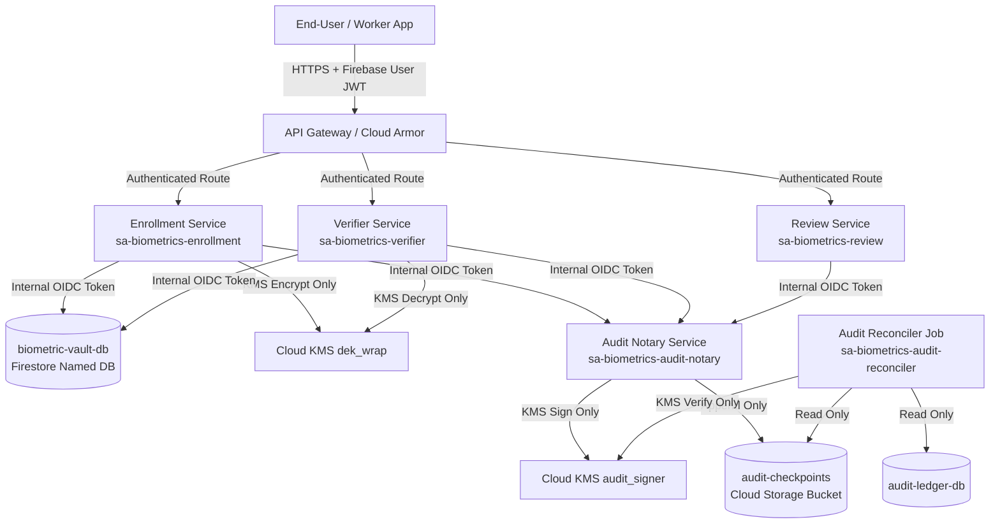

# KELASAGARA V20.17 — BACKEND WORKLOAD IDENTITY TOPOLOGY
## Microservice Architecture, Service Account Boundaries, and Authenticated East-West Traffic

**Author:** Principal Cloud Security Architect, IAM Systems Engineer  
**Date:** 2026-11-01  
**Repository:** `kelasagaara_v17`  
**Parent Commit:** `bd1d5f57ee4ad1921e83f382ab67d06274a3fb2c`  
**Branch:** `security/phase20.17-trusted-execution-provenance`  
**Status:** `ACTIVE_VERIFIED`  

---

### 1. Architectural Philosophy: De-Monolithization of IAM

In legacy cloud architectures, backend microservices frequently share a monolithic "App Engine Default Service Account" or a single broad service account with permissions across databases, encryption keys, and storage buckets. Under this anti-pattern, a compromise of any single microservice (e.g. a public-facing review endpoint) results in total compromise of biometric vaults and audit trails.

Phase 20.17 enforces strict **Workload Identity Separation** across 5 distinct runtime services in Google Cloud:



---

### 2. Runtime Service Account Matrix

| Microservice | Attached Service Account | Primary Responsibilities | IAM Privilege Scope | Prohibited Privileges |
| :--- | :--- | :--- | :--- | :--- |
| **Biometric Enrollment Service** | `sa-biometrics-enrollment` | Face alignment, embedding extraction, envelope encryption, template storage. | `roles/datastore.user` (Vault DB), `roles/cloudkms.cryptoKeyEncrypter` (`dek_wrap`). | `roles/cloudkms.cryptoKeyDecrypter`, audit signing, GCS checkpoint writes. |
| **Biometric Verifier Service** | `sa-biometrics-verifier` | 1:1 eKYC verification, 1:N deduplication matching, in-memory SFace inference. | `roles/datastore.viewer` (Vault DB), `roles/cloudkms.cryptoKeyDecrypter` (`dek_wrap`). | `roles/cloudkms.cryptoKeyEncrypter`, template creation/deletion, audit signing. |
| **Biometric Review Service** | `sa-biometrics-review` | Officer dashboard for ambiguous duplicate resolution and manual claims. | `roles/datastore.viewer` (Ambiguous cases only). | `roles/cloudkms.cryptoKeyDecrypter` (ZERO KMS decrypt access). |
| **Audit Notary Service** | `sa-biometrics-audit-notary` | Checkpoint hashing, asymmetric audit signing, GCS log append. | `roles/cloudkms.signer` (`audit_signer`), `roles/storage.objectCreator` (`audit-checkpoints`). | `roles/datastore.user` on Vault DB, `roles/cloudkms.cryptoKeyDecrypter`. |
| **Audit Reconciler Service** | `sa-biometrics-audit-reconciler` | Periodic independent integrity verification, checkpoint reconciliation. | `roles/cloudkms.verifier` (`audit_signer`), `roles/storage.objectViewer`, `roles/datastore.viewer`. | `roles/cloudkms.signer`, storage write/delete, template access. |

---

### 3. East-West Service Authentication (Cloud IAM OIDC)

When services communicate internally (e.g. Verifier invoking Audit Notary, or Ingress calling Verifier):
1. **Google-Signed OIDC ID Tokens:**
   The calling service invokes the local GCP metadata server:
   ```
   GET /computeMetadata/v1/instance/service-accounts/default/identity?audience=https://audit-notary.internal
   ```
   Google Cloud signs a JWT with issuer `https://accounts.google.com` containing:
   - `email`: `sa-biometrics-verifier@kelasagara.iam.gserviceaccount.com`
   - `aud`: `https://audit-notary.internal`
   - `exp`: 1 hour from issuance.
2. **Zero Shared Secrets:**
   No static API keys, mutual TLS passwords, or shared database passwords exist between services. Authentication is rooted directly in Google Cloud IAM infrastructure.
3. **Mutual Identity Verification:**
   The receiving microservice validates the OIDC token against Google's public JWKS before processing the request.
