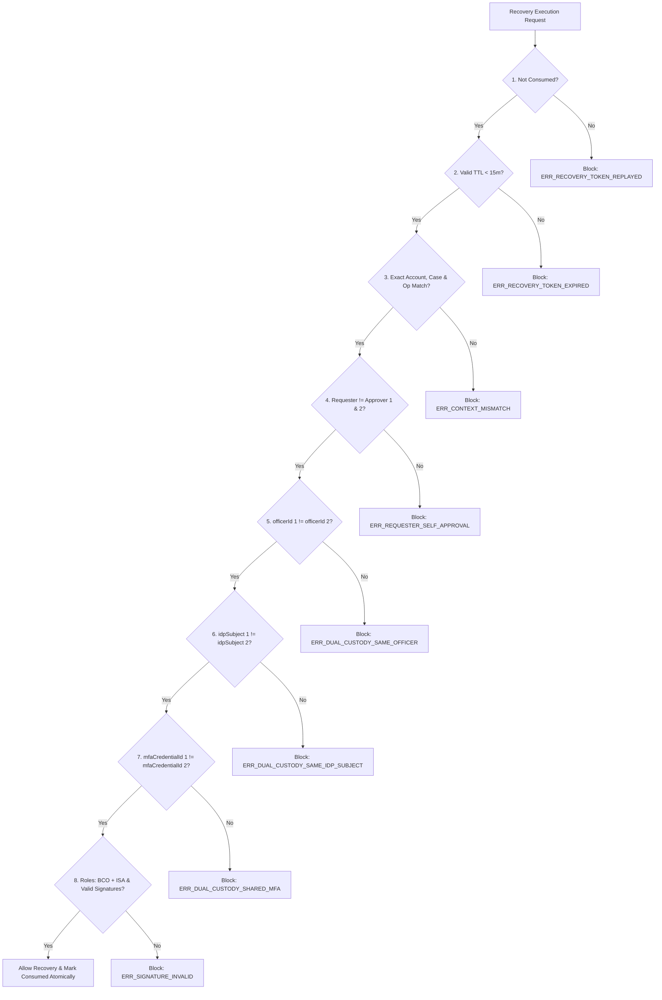

# KELASAGARA V20.18 — TWO-PERSON DUAL-CUSTODY INDEPENDENCE
## Multi-Party Authorization, Identity Independence, and Context-Bound Signatures

**Author:** Principal Identity Security Architect, Cryptographic Auditor  
**Date:** 2026-11-01  
**Repository:** `kelasagaara_v17`  
**Parent Commit:** `2233327` (`security/phase20.17-trusted-execution-provenance`)  
**Branch:** `security/phase20.18-pilot-readiness-corrections`  
**Status:** `ACTIVE_VERIFIED`  

---

### 1. Two-Person Authorization vs Collusion Limits

In security engineering, dual-custody controls are designed to prevent unilateral compromise by requiring independent authorization from two distinct human actors.

**Accurate Technical Claim:** Kelasagara describes this mechanism as **Two-Person Authorization (2PA)**. Technical controls can strictly verify that two different identity accounts, two distinct Identity Provider subjects, and two independent MFA credentials signed an approval. However, technical systems **cannot mathematically guarantee freedom from human collusion** (e.g. two officers physically agreeing to coordinate outside the system).

---

### 2. Multi-Party Approval Verification Gates (`RecoveryDualCustodyEngineV18`)

Every sensitive biometric account recovery request must satisfy 8 independent gates:



---

### 3. Canonical Approval Context Binding

Each custody holder independently signs the exact canonical payload:
```
targetUid | caseReference | operationType | proposedReplacementPhone | issuedAtEpochMs | expiresAtEpochMs
```

If an attacker modifies:
- The target account UID,
- The opaque case reference,
- The operation type (e.g. switching from unlock to template replacement),
- Or the proposed replacement phone number,
the cryptographic signature check fails immediately, invalidating the authorization.

---

### 4. Verified Defensive Assertions (Tests 31–38)

- **Test 31:** Same officer signing twice rejected (`ERR_DUAL_CUSTODY_SAME_OFFICER`).
- **Test 32:** Distinct officer IDs resolving to the same underlying IdP subject rejected (`ERR_DUAL_CUSTODY_SAME_IDP_SUBJECT`).
- **Test 33:** Distinct authorized BCO + ISA officers with separate MFA accepted.
- **Test 34:** Requester self-approving their own case rejected (`ERR_REQUESTER_SELF_APPROVAL`).
- **Test 35:** Single-use token replay rejected (`ERR_RECOVERY_TOKEN_REPLAYED`).
- **Test 36:** Expired tokens (>15 min) rejected (`ERR_RECOVERY_TOKEN_EXPIRED`).
- **Test 37:** Modified operation rejected (`ERR_OPERATION_TYPE_MISMATCH`).
- **Test 38:** Concurrent race conditions blocked; exactly one execution succeeds.
