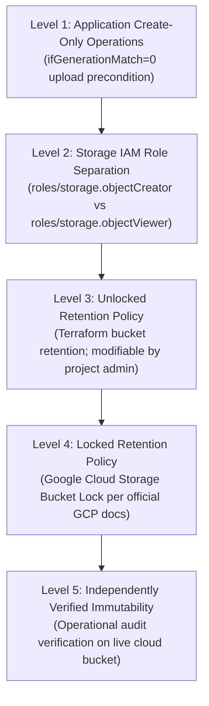

# PHASE 20.19: EXTERNAL AUDIT CHECKPOINT RECONCILIATION & NOTARY SECURITY

## 1. External Audit Checkpoint Architecture

Biometric audit records (enrollment events, deduplication decisions, template migrations, account recoveries) are written locally to Firestore. To protect against insider threat, database truncation, or ledger manipulation, checkpoints are exported to an external Cloud Storage bucket.

---

## 2. Clarified Audit Storage Protection Hierarchy

To prevent misleading claims regarding "immutable storage", the Kelasagara architecture formally distinguishes five levels of audit protection:

### 2.1 The Five Separate Dimensions of Audit Storage Protection & IAM Reality

To ensure complete accuracy against official Google Cloud Storage documentation, the architecture documents five separate dimensions:

#### 1. Predefined Role Permissions (`roles/storage.objectCreator`)
According to official Google Cloud IAM documentation, the predefined role `roles/storage.objectCreator` contains **exactly 4 permissions** (not 5; it omits `resourcemanager.projects.get`):
- `storage.multipartUploads.abort`
- `storage.multipartUploads.create`
- `storage.multipartUploads.listParts`
- `storage.objects.create`

> [!IMPORTANT]
> **Official GCS Object Replacement Specification:**
> Official Google Cloud Storage documentation states: *"Replacing an existing object requires `storage.objects.create` and `storage.objects.delete`."*
> Because predefined `roles/storage.objectCreator` does **not** grant `storage.objects.delete`, **it does not provide permission to overwrite or replace existing live objects**. An attempt to replace an existing object without `storage.objects.delete` is rejected with HTTP 403 Forbidden by Cloud Storage.

#### 2. Custom Audit Upload Role Permissions (`roles/kelasagara.auditUploadOnly`)
- **Multipart Permission Verification:** The implemented audit upload workflow in `AuditNotaryService` exclusively uploads serialized JSON checkpoint objects ($<50\text{ KB}$) via atomic, single-shot HTTP media uploads (`putObject`). It does not invoke chunked or resumable multipart uploads (which Google Cloud Storage reserves for files $>5\text{ MB}$).
- **Removal of Unnecessary Permissions:** Because multipart operations are never used by the notary, `storage.multipartUploads.abort`, `storage.multipartUploads.create`, and `storage.multipartUploads.listParts` are unnecessary.
- **Minimal Justified Custom Role:**
  The custom role `roles/kelasagara.auditUploadOnly` contains **only 1 permission**:
  - `storage.objects.create`
  It strictly withholds:
  - `storage.objects.delete` (preventing object replacement and deletion)
  - `storage.objects.get` (preventing checkpoint data reading/exfiltration)
  - `storage.objects.list` (preventing bucket enumeration)
  - `storage.multipartUploads.*` (omitting unused multipart capabilities)

#### 3. Effective Permissions Inherited Through Hierarchy (Project, Bucket, Managed Folders)
- In Google Cloud IAM, permissions are additive and inherited down the resource hierarchy:
  $$\text{Organization} \longrightarrow \text{Folder} \longrightarrow \text{Project} \longrightarrow \text{Bucket} \longrightarrow \text{Managed Folder}$$
- If a service account is accidentally granted a broad role (such as `roles/editor` or `roles/storage.objectAdmin`) at the project or folder level, it inherits `storage.objects.delete` regardless of bucket-level restrictions.
- **Architectural Safeguard:** Kelasagara strictly prohibits project-level or folder-level storage bindings for `sa-biometrics-audit-notary`. The custom role is bound exclusively at the individual bucket resource level (`google_storage_bucket_iam_member`), ensuring effective permissions remain create-only without inheritance bypass.

#### 4. Application-Level Generation Preconditions (`If-Generation-Match: 0`)
- As an active defense-in-depth layer, `AuditNotaryService` sets the HTTP precondition header:
  `x-goog-if-generation-match: 0`
- If an object with the same name already exists in the bucket, Google Cloud Storage evaluates the precondition prior to processing and immediately terminates the request with **HTTP 412 Precondition Failed**, blocking replacement before IAM delete checks or storage writes occur.

#### 5. Bucket Retention Policy Protections (Bucket Lock)
- At the storage engine level, a bucket retention policy locked via Google Cloud Storage Bucket Lock (Locked Retention Policy) guarantees that even if an identity held `storage.objects.delete` and bypassed preconditions, the storage engine rejects any overwrite, metadata alteration, or premature deletion until the retention period (90 days) elapses.

> [!NOTE]
> **No Live IAM Verification Claim:** Because Gate B remains **BLOCKED** and no non-production GCP project credentials exist (`BLOCKED_SANDBOX_IAM_NOT_AVAILABLE`), all IAM role restrictions, precondition checks, and overwrite protections have been verified via software integration suites (`SimulatedGcsAuditBucket`), not against live GCP IAM.

### 2.2 Critical Distinction: Source Configuration vs Live Immutability
> [!WARNING]
> Static Terraform source code declaring `retention_policy` or application logic using `ifGenerationMatch=0` **does NOT constitute live immutable storage**.
> Until Gate B passes and a real Google Cloud Storage bucket is provisioned with a formally locked retention policy, external audit immutability remains a **source-level specification and unit-tested contract**, not live immutable cloud storage.

---

## 3. Operational Status: Sandbox Blocked

> [!NOTE]
> All cryptographic verification routines (`verifySha256RsaSignature`), hash-chain continuity checks (`previousCheckpointHash`), and role separation boundaries are verified locally in test suites (`Track E` in `phase20_18_pilot_readiness_corrections.test.ts`).
> Live deployment against real Cloud Storage remains:
> **`BLOCKED_SANDBOX_IAM_NOT_AVAILABLE`**
> No live cloud resources or GCP buckets have been created in Phase 20.19.
