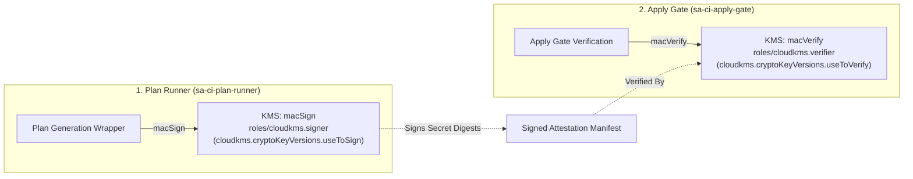

# KELASAGARA V20.19: CLOUD KMS HMAC IDENTITY MAPPING & OPERATIONAL SPECIFICATION

**Document Version:** 20.19.2
**Date:** 2026-11-01
**Phase:** `security/phase20.19-pilot-gate-a-closure`
**Operational Status:** `BLOCKED_SANDBOX_IAM_NOT_AVAILABLE`
**Gate B Boundary:** REAL NON-PRODUCTION CLOUD INFRASTRUCTURE (BLOCKED)

---

## 1. Executive Summary

This specification establishes the canonical cryptographic relationship between the logical plan secret HMAC identifier (`plan-secret-hmac`) used in OpenTofu execution attestation manifests and the underlying Google Cloud KMS resource hierarchy.

It explicitly maps key purpose, algorithm, and least-privilege IAM separation between the Plan Runner and the Apply Gate, while formally documenting the boundary between Gate A software readiness and Gate B live cloud infrastructure qualification.

---

## 2. Canonical Cloud KMS HMAC Identity Mapping

The logical key identifier used in `ExecutionProvenanceManifestV19` maps to a fully qualified, version-pinned Google Cloud KMS resource:

| Attribute | Canonical Value | Description / Constraint |
| :--- | :--- | :--- |
| **Logical Key Identifier** | `plan-secret-hmac` | Logical reference used across wrapper and manifest schemas |
| **GCP Project ID** | `kelasagara-sandbox` | Hyphenated lowercase project ID (no underscores permitted) |
| **KMS Location / Region** | `asia-south1` | Pinned Mumbai primary cryptographic region |
| **KMS KeyRing** | `kelasagara-infra-keyring` | Pinned infrastructure keyring |
| **KMS CryptoKey** | `plan-secret-hmac` | Dedicated symmetric HMAC key |
| **CryptoKeyVersion** | `1` | Immutable positive integer version |
| **Full Canonical Resource Name** | `projects/kelasagara-sandbox/locations/asia-south1/keyRings/kelasagara-infra-keyring/cryptoKeys/plan-secret-hmac/cryptoKeyVersions/1` | Unambiguous URI bound in attestation manifests |
| **Key Purpose** | `MAC` | Purpose strictly restricted to Message Authentication Codes |
| **Algorithm** | `HMAC_SHA256` | 256-bit Keyed-Hash Message Authentication Code |

---

## 3. Least-Privilege IAM Separation

To prevent privilege escalation and ensure separation of duties across CI/CD execution stages, distinct IAM roles and permissions are enforced according to Google Cloud KMS specifications:

### 3.1. Plan Runner Role Binding
- **Identity:** `sa-ci-plan-runner@kelasagara-sandbox.iam.gserviceaccount.com`
- **Assigned Role:** `roles/cloudkms.signer`
- **Effective Permission:** `cloudkms.cryptoKeyVersions.useToSign`
- **Scope:** Allows computing HMAC fingerprints for sensitive variable inputs (`-var=...`, `TF_VAR_...`) embedded in execution manifests during plan creation.
- **Combined Exception:** If both operations are needed by one principal, the documented combined role is `roles/cloudkms.signerVerifier`.

### 3.2. Apply Gate Role Binding
- **Identity:** `sa-ci-apply-gate@kelasagara-sandbox.iam.gserviceaccount.com`
- **Assigned Role:** `roles/cloudkms.verifier`
- **Effective Permission:** `cloudkms.cryptoKeyVersions.useToVerify`
- **Scope Restriction:** Strictly read-only verification. The Apply Gate is **prohibited** from signing or forging new secret fingerprints (`roles/cloudkms.signer` strictly denied; cannot obtain `cloudkms.cryptoKeyVersions.useToSign`).

---

## 4. Operational Boundary Declaration: Gate A vs Gate B

> [!IMPORTANT]
> **OPERATIONAL STATUS: `BLOCKED_SANDBOX_IAM_NOT_AVAILABLE`**
> Under Gate A (Software and Security Readiness), all cryptographic primitives, key managers, variable resolution layers, secret reference validators, and mock Cloud KMS verifiers have been implemented and validated through automated unit and integration tests with zero failures.
> However, **NO live Cloud KMS API calls (`macSign`, `macVerify`) can or will be executed against real GCP infrastructure until Gate B (Real Non-Production Cloud Infrastructure) is officially unblocked by provisioning authorized cloud credentials.**

### Gate Qualification Matrix

| Pilot Gate | Canonical Name | Current Status | Cloud KMS / Secret Manager Scope |
| :--- | :--- | :--- | :--- |
| **Gate A** | Software and Security Readiness | **ACCEPTED** | Local software emulation, `PlanEncryptionKeyManagerV19`, `InMemorySecretManagerMetadataResolver`, unit test validation |
| **Gate B** | Real Non-Production Cloud Infrastructure | **BLOCKED** | Live GCP KMS KeyRing, live Secret Manager versions, Cloud Storage bucket lock, WIF federation |
| **Gate C** | Physical Android Device Qualification | **PENDING** | Physical Android device qualification (awaiting hardware deployment) |
| **Gate D** | Institutional, Legal and Human Pilot Authorization | **WITHHELD** | Live human facial enrollment, DPDPA consent, institutional pilot authorization |

---

## 5. Architectural Invariants Enforced

1. **Deterministic Mapping:** Any call to `getCanonicalCloudKmsHmacMapping(projectId, version)` deterministically generates the canonical resource name and IAM permission tuple.
2. **Untrusted Key Injection Defense:** Untrusted API callers attempting to inject raw HMAC keys via `request.secretFingerprintHmacKey` without trusted key manager privilege are rejected with `ERR_UNTRUSTED_HMAC_KEY_OVERRIDE`.
3. **Key Rotation Invalidation:** Rotating the active HMAC key immediately invalidates stale approvals under `STRICT_ACTIVE_ONLY` policy (`ERR_HMAC_KEY_ROTATED_APPROVAL_INVALID`).
4. **Historical Recovery Governance:** Historical key versions are only permitted if explicitly authorized under `PERMIT_AUTHORIZED_HISTORICAL_VERSIONS`; revoked keys fail closed unconditionally.
