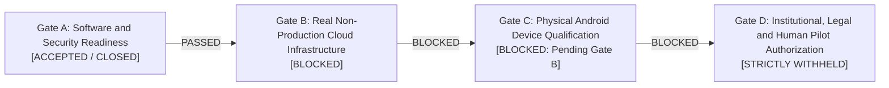

# PHASE 20.19: PILOT GATE A FINAL DECISION & CANONICAL FOUR-GATE MATRIX

## 1. Executive Gate Decision

Based on the forensic audit, implementation verifications, native Android compilation, debug APK assembly, and comprehensive regression test executions completed in Phase 20.19, the Principal Security Architecture team issues the following formal determinations across the **Canonical Four Pilot Readiness Gates**:

| Canonical Gate | Title | Formal Status | Evidence & Operational Summary |
| :--- | :--- | :---: | :--- |
| **GATE A** | **Software and Security Readiness** | **ACCEPTED (CLOSED)** | Full master backend regression passed (1,249 / 1,249 uniquely executed tests across 259 suites, 100% pass, 0 fail); Flutter client passed (12 / 12, 100% pass); Native Android Kotlin compilation passed (`:app:compileDebugKotlin`, exit 0, 12s); Android Debug APK generated (`:app:assembleDebug`, exit 0, 1m, SHA-256 `90b0f3f90af0734320d6ed2552cbfce2b5ab02bd4c86542f0dc14244532199a1`). Complete plan input attestation, exact OpenTofu variable precedence (5 layers, CLI order preservation), immutable Secret Manager numeric versions with ENABLED state verification, Cloud KMS HMAC canonical identity mapping and least-privilege IAM separation, native OpenTofu plan encryption at rest (`KSEP_V19`, AES-256-GCM, zero plaintext on disk), binary plan 0600 permissions and AES-256-GCM transit encryption, two-person recovery dual custody, software-level pilot cohort isolation (actual GCP database and KMS isolation remain unverified under Gate B), and best-effort DEK buffer clearing verified. |
| **GATE B** | **Real Non-Production Cloud Infrastructure** | **BLOCKED** | Authorized sandbox project credentials unavailable (`BLOCKED_SANDBOX_IAM_NOT_AVAILABLE`). No live Google Cloud resources, KMS KeyRings, Firestore named databases, or Cloud Storage buckets provisioned. Live Cloud KMS integration and live cloud database isolation are strictly unverified. |
| **GATE C** | **Physical Android Device Qualification** | **BLOCKED** | Stays strictly BLOCKED until real Gate B endpoints are available to test network round-trip, physical camera lens distortion, optical low-light benchmarking, and Google Play Integrity hardware attestation on arm64-v8a physical handsets. Physical device qualification is an engineering requirement and is not substituted by governance. |
| **GATE D** | **Institutional, Legal and Human Pilot Authorization** | **STRICTLY WITHHELD** | Stays strictly WITHHELD until formal written institutional ethics board (IRB) approval, legal counsel sign-off, participant consent protocol, live operational identity registry binding, approved personnel, and physical hardware MFA enrollment are fulfilled. Gate D is designated as institutional, legal, and human authorization (not live enrollment). |

---

## 2. Gate A Acceptance Details

Gate A verifies that all software implementation artifacts, cryptographic engines, anti-replay guards, and supply-chain gates meet rigorous zero-trust standards:
1. **Plan Provenance & Anti-Regeneration:**
   `TrustedPlanWrapperV19` cryptographically binds `.tf`, `.tf.json`, `.tofu`, `.tofu.json`, complete local and downloaded remote module source trees, backend config & `-backend-config`, all standard and auto `*.tfvars` / `*.tfvars.json`, `.terraform.lock.hcl`, CLI vars, and canonical variable precedence order. Binary plan reuse is mandatory; plan regeneration at apply time is prohibited. Secrets are fingerprinted via immutable Secret Manager numeric version references or protected keyed HMACs, never in plaintext.
2. **Exact OpenTofu Variable Precedence:**
   Evaluates variables strictly through the canonical 5-layer hierarchy:
   $$\text{TF\_VAR\_*} \longrightarrow \text{terraform.tfvars} \longrightarrow \text{terraform.tfvars.json} \longrightarrow \text{*.auto.tfvars (lexical)} \longrightarrow \text{CLI invocation order}$$
   Sequential CLI invocation order is preserved (later CLI arguments override earlier ones, whether `-var` or `-var-file`).
3. **Immutable Secret Manager Version Enforcement:**
   Only positive numeric versions are allowed. Aliases like `latest` or text aliases are rejected with `ERR_MUTABLE_SECRET_VERSION`; unversioned references are rejected with `ERR_UNVERSIONED_SECRET_REFERENCE`. Numeric versions are bound into the signed manifest.
4. **HMAC Key Trust & Rotation Governance:**
   Untrusted callers cannot supply or override HMAC keys (`ERR_UNTRUSTED_HMAC_KEY_OVERRIDE`). Keys are managed by `ProtectedHmacKeyManagerV19`. Manifests bind the key identifier and version. Rotating keys invalidates stale approvals under `STRICT_ACTIVE_ONLY`.
5. **Binary Plan Artifact Protection:**
   Binary plan files are created with mode `0o600`. Artifacts in transit are encrypted using AES-256-GCM. Controlled cleanup wipes memory and overwrites storage blocks, with full physical wear-leveling SSD erasure disclosures. Plans are git-ignored.
6. **Two-Person Dual Custody Recovery:**
   Anchored in `IOfficerAuthorizationRegistry`. Prohibits requester self-approval, shared IdP subjects, shared MFA hardware credentials, and inactive/suspended officers. Real organizational directory binding and physical hardware MFA enrollment are governed under Gate D.
7. **Pilot Isolation Architecture:**
   Classified as `COHORT_LEVEL_CRYPTOGRAPHIC_ISOLATION_WITH_PER_RECORD_AUTHORIZATION`. Dedicated named Firestore database (`biometric-pilot-vault-db`) and isolated KMS key (`pilot_dek_wrap`). Querying or unwrapping across environments fails closed. Cohort-level isolation is explicitly acknowledged (not per-user key isolation).
8. **Memory Hygiene:**
   Plaintext DEK buffers are cleared with `Buffer.fill(0)` in `finally` blocks on both success and exception paths. Accurately classified as best-effort memory clearing under Node.js/V8 runtime realities.
9. **Length-Prefixed Canonical AAD:**
   In accordance with ISO/IEC 19772:2020 authenticated associated data binding principles, length-prefixed binary canonical encoding is an application-defined Kelasagara format to eliminate delimiter collision and field shifting.
10. **Full Regression Execution:**
    1,249 uniquely executed backend tests across 259 suites (100% pass, 0 failures, 0 skips), 12 Flutter tests (100% pass), Android Kotlin compilation (`compileDebugKotlin`, exit 0), and Android debug APK assembly (`assembleDebug`, exit 0).

---

## 3. Mandatory Prerequisites for Subsequent Canonical Gates

### 3.1 To Unblock Gate B (Real Non-Production Cloud Infrastructure):
- Provision a dedicated Google Cloud sandbox project (`kelasagara-sandbox`).
- Bind least-privilege IAM roles to 5 distinct Service Accounts.
- Provision real Cloud KMS KeyRing and CryptoKeys in `asia-south1`.
- Provision real Cloud Storage bucket with Google Cloud Storage Bucket Lock (locked retention policy per official Google Cloud documentation) for external audit checkpoints.
- Verify live Firestore named database isolation.

### 3.2 To Unblock Gate C (Physical Android Device Qualification):
- Must have passed Gate B to establish network endpoints.
- Execute optical bench qualification on target physical Android test handset (arm64-v8a).
- Validate live camera feed, YuNet face detector, and 112x112 canonical alignment under adverse lighting and off-axis yaw.
- Verify Google Play Integrity hardware-backed device verdict.

### 3.3 To Unblock Gate D (Institutional, Legal and Human Pilot Authorization):
- Must have passed Gates A, B, and C.
- Obtain formal written approval from institutional ethics board (IRB) and legal counsel.
- Provision live enterprise identity directory (IdP) binding for designated Biometric Compliance Officers (BCO) and Independent Security Auditors (ISA).
- Enroll physical FIDO2 / WebAuthn hardware security keys for all approved recovery officers.
- Activate multilingual revocable participant consent ledger.
- Ensure Aadhaar Offline e-KYC integration remains strictly disabled.
