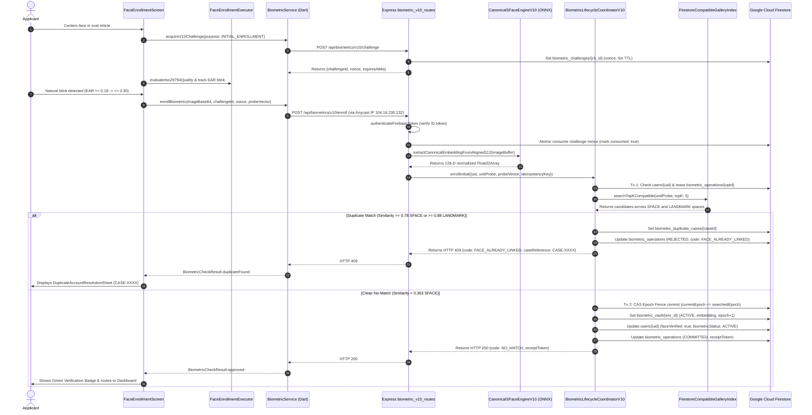

# KELASAGARA V20.0 — PHASE 20.0 SOURCE CODE MAP
## Authoritative Architecture Mapping & End-to-End Biometric Execution Pipeline

- **System:** Kelasagara Biometric Platform
- **Date:** 31 October 2026
- **Auditor Role:** Principal Biometric Systems Architect & Senior Flutter Engineer
- **Baseline Git Commit:** `4892bb6` (Tagged release parent `f210f95`)

---

## 1. Biometric Source Code Inventory

### 1.1 Flutter Client Files (`lib/`)

| File Path | Primary Class / Component | Architectural Responsibility |
|---|---|---|
| [`lib/screens/auth/face_enrollment_screen.dart`](file:///Users/ananda/KELASAGARA%20MAJOR%20PROJECT/kelasagaara_v17/lib/screens/auth/face_enrollment_screen.dart) | `FaceEnrollmentScreen`, `_FaceEnrollmentScreenState` | Full-screen front camera preview, reticle guidance, EAR blink UI orchestration, challenge acquisition, enrollment submission. |
| [`lib/screens/auth/face_enrollment_executor.dart`](file:///Users/ananda/KELASAGARA%20MAJOR%20PROJECT/kelasagaara_v17/lib/screens/auth/face_enrollment_executor.dart) | `FaceEnrollmentExecutor`, `IsoQualityReport` | ISO/IEC 19794-5 / 29794-5 quality checking, 5-point ArcFace landmark alignment, Play Integrity hash binding, isolate dispatch. |
| [`lib/services/biometric_service.dart`](file:///Users/ananda/KELASAGARA%20MAJOR%20PROJECT/kelasagaara_v17/lib/services/biometric_service.dart) | `BiometricService`, `BiometricCheckResult` | Singleton HTTP client (Dio), direct Anycast IP `connectionFactory`, challenge acquisition, enrollment failover, duplicate parsing. |
| [`lib/biometrics/biomatch_ffi_bridge.dart`](file:///Users/ananda/KELASAGARA%20MAJOR%20PROJECT/kelasagaara_v17/lib/biometrics/biomatch_ffi_bridge.dart) | `BiomatchNativeBridge` | FFI bridge to C++ native library (`libbiomatch_native.so`) with fallback to pure-Dart landmark feature generation. |
| [`lib/biometrics/landmark_embedding.dart`](file:///Users/ananda/KELASAGARA%20MAJOR%20PROJECT/kelasagaara_v17/lib/biometrics/landmark_embedding.dart) | `LandmarkEmbedding` | Pure-Dart whitened Procrustes 128-D differential face embedding engine (`kelasagara_biomatch_v3_whitened`). |
| [`lib/biometrics/sface_inference.dart`](file:///Users/ananda/KELASAGARA%20MAJOR%20PROJECT/kelasagaara_v17/lib/biometrics/sface_inference.dart) | `SFaceInference` | On-device SFace ONNX runtime scaffolding (`assets/models/sface.onnx`). |
| [`lib/widgets/biometric_v11_liveness_scanner.dart`](file:///Users/ananda/KELASAGARA%20MAJOR%20PROJECT/kelasagaara_v17/lib/widgets/biometric_v11_liveness_scanner.dart) | `BiometricV11LivenessScanner` | Real-time eyelid EAR tracker and circular progress indicator for active blink challenge. |
| [`lib/widgets/duplicate_account_resolution_sheet.dart`](file:///Users/ananda/KELASAGARA%20MAJOR%20PROJECT/kelasagaara_v17/lib/widgets/duplicate_account_resolution_sheet.dart) | `DuplicateAccountResolutionSheet` | Privacy-preserving modal displaying opaque case reference (`CASE-XXXX`) and routing to account recovery or login. |

---

### 1.2 TypeScript Backend Files (`backend/src/`)

| File Path | Primary Class / Component | Architectural Responsibility |
|---|---|---|
| [`backend/src/server.ts`](file:///Users/ananda/KELASAGARA%20MAJOR%20PROJECT/kelasagaara_v17/backend/src/server.ts) | Express Server Instance | Entry point: security headers, CORS, Firebase Admin initialization, route mounting for `/api/biometrics/v10`. |
| [`backend/src/routes/biometric_v10_routes.ts`](file:///Users/ananda/KELASAGARA%20MAJOR%20PROJECT/kelasagaara_v17/backend/src/routes/biometric_v10_routes.ts) | `createBiometricV10Router` | Canonical HTTP router: `/health`, `/challenge`, `/enroll`, `/verify-1to1`, `/replace`, `/redeem-receipt`. |
| [`backend/src/services/biometric_lifecycle_coordinator_v10.ts`](file:///Users/ananda/KELASAGARA%20MAJOR%20PROJECT/kelasagaara_v17/backend/src/services/biometric_lifecycle_coordinator_v10.ts) | `BiometricLifecycleCoordinatorV10` | Authoritative state machine: operation leasing, gallery search, multi-space thresholding, CAS epoch commit. |
| [`backend/src/biometrics/canonical_sface_engine_v10.ts`](file:///Users/ananda/KELASAGARA%20MAJOR%20PROJECT/kelasagaara_v17/backend/src/biometrics/canonical_sface_engine_v10.ts) | `CanonicalSFaceEngineV10` | Authoritative SFace feature extractor using ONNX Runtime: input preprocessing, unit hypersphere normalization. |
| [`backend/src/services/firestore_compatible_gallery_index.ts`](file:///Users/ananda/KELASAGARA%20MAJOR%20PROJECT/kelasagaara_v17/backend/src/services/firestore_compatible_gallery_index.ts) | `FirestoreCompatibleGalleryIndex` | In-memory 1:N gallery cache: multi-space candidate screening, RAM warm-up, and candidate exclusion filtering. |
| [`backend/src/biometrics/identity_contract_v10.ts`](file:///Users/ananda/KELASAGARA%20MAJOR%20PROJECT/kelasagaara_v17/backend/src/biometrics/identity_contract_v10.ts) | `BiometricOperationReceiptService` | Cryptographic HMAC-SHA256 receipt generation, signing, and verification. |
| [`backend/src/auth/firebase_auth.ts`](file:///Users/ananda/KELASAGARA%20MAJOR%20PROJECT/kelasagaara_v17/backend/src/auth/firebase_auth.ts) | `authenticateFirebaseToken` | Middleware: verifies Firebase ID token via Admin SDK; injects `req.user.uid`. |

---

## 2. End-to-End Biometric Request Pipeline

The following sequence diagram illustrates the complete execution path from physical camera frame capture to Firestore database commit:

---

## 3. Database Collection & IAM Schema Map

| Collection Name | Document Key | Client Access (`firestore.rules`) | Admin SDK Access | Purpose |
|---|---|---|---|---|
| `users` | `{uid}` | Read own / Create own / Restricted update | Full read/write | User profile, role, and biometric verification flags (`faceVerified`). |
| `biometric_vault` | `{enrollmentId}` | `allow read, write: if false;` | Full read/write | Authoritative 128-D biometric embeddings and lifecycle status (`ACTIVE`, `SUPERSEDED`). |
| `biometric_challenges` | `{challengeId}` | `allow read, write: if false;` | Full read/write | Single-use challenge nonces with 5-minute TTL. |
| `biometric_operations` | `{operationId}` | `allow read, write: if false;` | Full read/write | Idempotent operation leases and audit logs. |
| `biometric_duplicate_cases`| `{caseId}` | `allow read, write: if false;` | Full read/write | Opaque dispute tickets (`CASE-XXXX`) generated during duplicate interception. |
| `biometric_system_meta` | `gallery_epoch_v10`| `allow read, write: if false;` | Full read/write | Global monotonic integer `epochVersion` for optimistic CAS concurrency. |
| `step_up_proofs` | `{token}` | `allow read, write: if false;` | Full read/write | Single-use authorization proofs for account recovery and face replacement. |
| `person_identities` | `{personId}` | `allow read, write: if false;` | Full read/write | Canonical legal identity records bound to one or more marketplace roles. |
