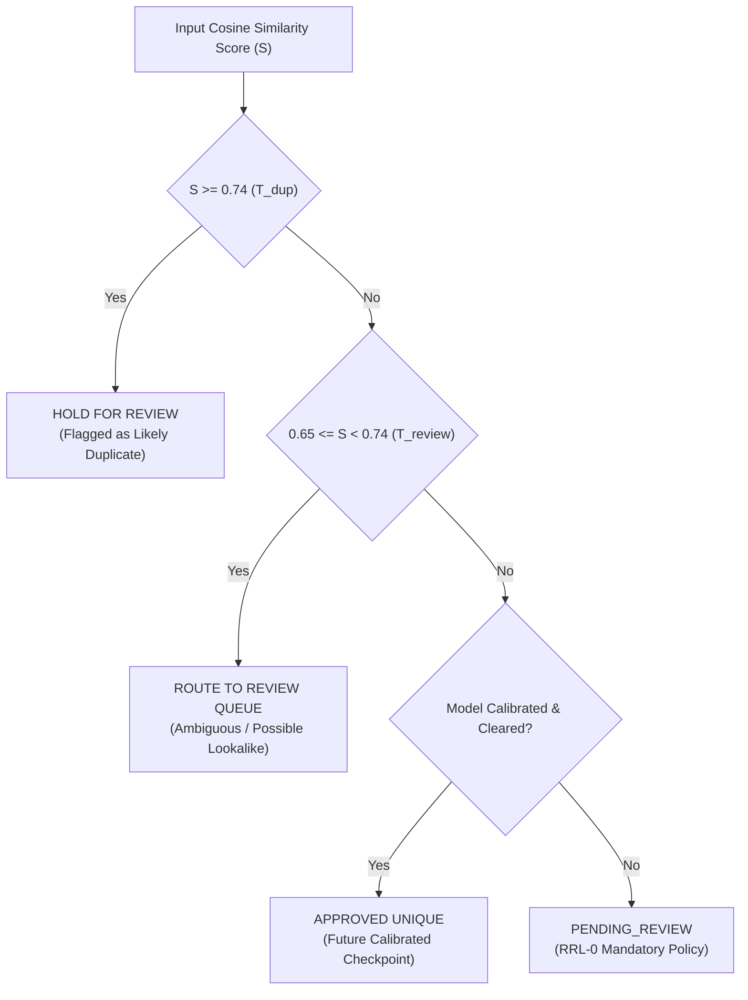

# KELASAGARA BIOMATCH V7: EVALUATION PROTOCOL & THRESHOLD CALIBRATION SPECIFICATION

**Document ID:** `CP-BIOMATCH-V7-001`  
**Phase:** Phase 5 (Evaluation Protocol and Threshold Calibration)  
**As-of Date:** 2026-10-10  
**Release Readiness Level:** **RRL-0 (Research Prototype)**  
**Classification:** Scientific Methodology & Statistical Rigor  

---

## 1. EVALUATION DATA & SPLIT PROTOCOL

To ensure zero information leakage and prevent overfitting, the evaluation methodology enforces strict identity-disjoint partitioning:

### 1.1 Identity-Disjoint Partitioning Architecture
1. **Training Set ($60\%$ of identities):** Used strictly for model parameter optimization and ArcFace margin loss backpropagation. Never evaluated for threshold calibration.
2. **Calibration Split ($20\%$ of identities):** Used strictly for generating genuine and impostor distance distributions, plotting DET curves, and setting operating thresholds ($T_{\text{dup}}$, $T_{\text{review}}$).
3. **Frozen Test Split ($20\%$ of identities):** Frozen benchmark evaluated **exactly once** per candidate checkpoint to measure final FMR, FNMR, and FPIR.
4. **Invariant Assertion:** The intersection of subject identities across all three splits is strictly empty:
   $$\text{Identities}_{\text{train}} \cap \text{Identities}_{\text{cal}} \cap \text{Identities}_{\text{test}} = \emptyset$$

### 1.2 Indian Demographic Field Collection Protocol (Pilot Specification)
For Phase 5 validation across target demographics in Karnataka:
- **Sample Cohort:** $\ge 300$ consented individuals across ages 18 to 65.
- **Hardware Heterogeneity:** Captures conducted across $\ge 3$ distinct smartphone tiers:
  - Tier A: Entry-level Android (e.g. Redmi 9A / Realme C-series, 5MP front camera).
  - Tier B: Mid-range Android (e.g. Samsung Galaxy M / Vivo T-series, 13MP front camera).
  - Tier C: High-end smartphone.
- **Environmental Variations:**
  - Lighting: Direct outdoor noon sun, indoor fluorescent tube light, low-light evening (< 20 lux).
  - Appearance variations: Prescription glasses, traditional head coverings (turbans, hijabs, caps), facial hair (mustache, stubble, full beard).
- **Temporal Separation:** Each subject recorded across $\ge 2$ sessions separated by $\ge 7\text{ days}$ to capture natural appearance and lighting drift.
- **Consent Instrument:** Explicit bilingual (Kannada / English) DPDP-compliant written consent covering sole-purpose biometric validation without commercial resale.

---

## 2. FORMAL BIOMETRIC METRICS

All evaluation reporting adheres strictly to ISO/IEC 19795-1 biometric performance standards:

### 2.1 1:1 Verification Metrics
- **False Match Rate (FMR):** Proportion of zero-effort impostor comparison attempts erroneously decided to be a genuine match at threshold $\theta$:
  $$\text{FMR}(\theta) = \frac{|\{ (i, j) \in \text{Impostors} : \text{sim}(i, j) \ge \theta \}|}{|\text{Impostors}|}$$
- **False Non-Match Rate (FNMR):** Proportion of genuine comparison attempts erroneously decided to be non-matches at threshold $\theta$:
  $$\text{FNMR}(\theta) = \frac{|\{ (i, i') \in \text{Genuines} : \text{sim}(i, i') < \theta \}|}{|\text{Genuines}|}$$
- **Equal Error Rate (EER):** Operating point where $\text{FMR}(\theta_{\text{EER}}) = \text{FNMR}(\theta_{\text{EER}})$.
  *Rule:* **EER is for comparative model reporting only; EER is NEVER used as an operational threshold for access control or duplicate screening.**

### 2.2 1:N Open-Set Identification Metrics
- **False Positive Identification Rate (FPIR):** Probability that a non-enrolled person searching an enrolled gallery of size $N$ returns a candidate match score above threshold $T$:
  $$\text{FPIR}(T, N) = 1 - (1 - \text{FMR}(T))^N \approx N \times \text{FMR}(T) \quad (\text{for small FMR})$$
- **False Negative Identification Rate (FNIR):** Probability that an enrolled subject searching the gallery fails to return their true identity above threshold $T$.
- **Failure to Acquire / Enroll (FTA / FTE):** Proportion of capture attempts rejected by the IQA quality gate (e.g. extreme blur, bad pose). FTA must be reported alongside FMR/FNMR.

---

## 3. STATISTICAL RIGOR & PLANNING ARITHMETIC (APPENDIX E)

### 3.1 The Rule of Three Sample Size Formula
Under the Rule of Three, if zero errors are observed in $n$ independent trials, the 95% upper confidence bound on the error rate $\alpha$ is approximately:

$$\alpha_{95\%} \approx \frac{3}{n} \implies n \ge \frac{3}{\alpha}$$

| Target FMR ($\alpha$) | Min. Independent Non-Matching Comparisons ($n$) | Feasibility on Small Pilot ($< 1,000$ subjects) |
|---|---|---|
| **$\text{FMR} \le 10^{-2}$** | **$300$ comparisons** | Fully Demonstrable |
| **$\text{FMR} \le 10^{-3}$** | **$3,000$ comparisons** | Fully Demonstrable |
| **$\text{FMR} \le 10^{-4}$** | **$30,000$ comparisons** | Demonstrable ($N \ge 250$ subjects) |
| **$\text{FMR} \le 10^{-5}$** | **$300,000$ comparisons** | Demonstrable ($N \ge 800$ subjects) |
| **$\text{FMR} \le 10^{-6}$** | **$3,000,000$ comparisons** | Requires Large Academic Dataset |
| **$\text{FMR} \le 10^{-7}$** | **$30,000,000$ comparisons** | **UNMEASURABLE TAIL** |

### 3.2 The Unmeasurable Tail at Scale
At state-wide gallery scale ($N = 50,000$ to $100,000$), an operational target of $\text{FPIR} \le 0.01$ mathematically requires:

$$\text{FMR} \le 1 - (1 - 0.01)^{1/100,000} \approx \mathbf{1.01 \times 10^{-7}}$$

Demonstrating $\text{FMR} \le 10^{-7}$ under the Rule of Three requires **$\ge 29,849,751$ independent impostor comparisons with 0 errors**.
*Methodological Standard:* Because no small local dataset can furnish $30\text{ million}$ independent comparisons, **any claim of $\text{FPIR} \le 1\%$ at $N = 10^5$ is classified strictly as a HYPOTHESIS.** Under no circumstances may marketing or documentation claim certified duplicate prevention at scale without live empirical surveillance. Strong duplicate candidates MUST always route to human inspection.

---

## 4. DUAL / TRI-STATE OPERATIONAL DECISION POLICY

To balance security and false rejection, Kelasagara operates under a tri-state classification model:

### 4.1 Decision Threshold Boundaries:
1. **$S \ge T_{\text{dup}} = 0.74$ (Likely Duplicate):**
   - High similarity. Account is **held for manual review**.
   - Direct automatic denial is strictly forbidden under provisional mode to prevent wrongful exclusion of workers.
2. **$0.65 \le S < 0.74$ (Ambiguity / Potential Relative or Twin):**
   - Borderline similarity. System routes candidate to the **human review queue**.
3. **$S < T_{\text{review}} = 0.65$ (Unique Candidate):**
   - Candidate is unique relative to enrolled gallery.
   - Under current RRL-0 (uncalibrated model), resolves strictly to `PENDING_REVIEW` with `isApproved = false`.
   - When a calibrated production model is deployed in future, resolves to automated `APPROVED`.

### 4.2 Review Queue Capacity Modeling:
Expected daily review flags are calculated as:

$$\text{Flags}_{\text{day}} = \text{Enrollments}_{\text{day}} \times (\text{FPIR}_{\text{review}} + \text{Prevalence}_{\text{dup}})$$

At a pilot volume of $100\text{ enrollments/day}$, $\text{FPIR}_{\text{review}} = 2.0\%$, and true duplicate attempt rate of $1.0\%$:
$$\text{Flags}_{\text{day}} = 100 \times (0.02 + 0.01) = \mathbf{3.0\text{ review flags / day}}$$
With a Positive Predictive Value ($\text{PPV}$) of **$32.4\%$**, a single review agent can process the entire daily queue in under **10 minutes**.
