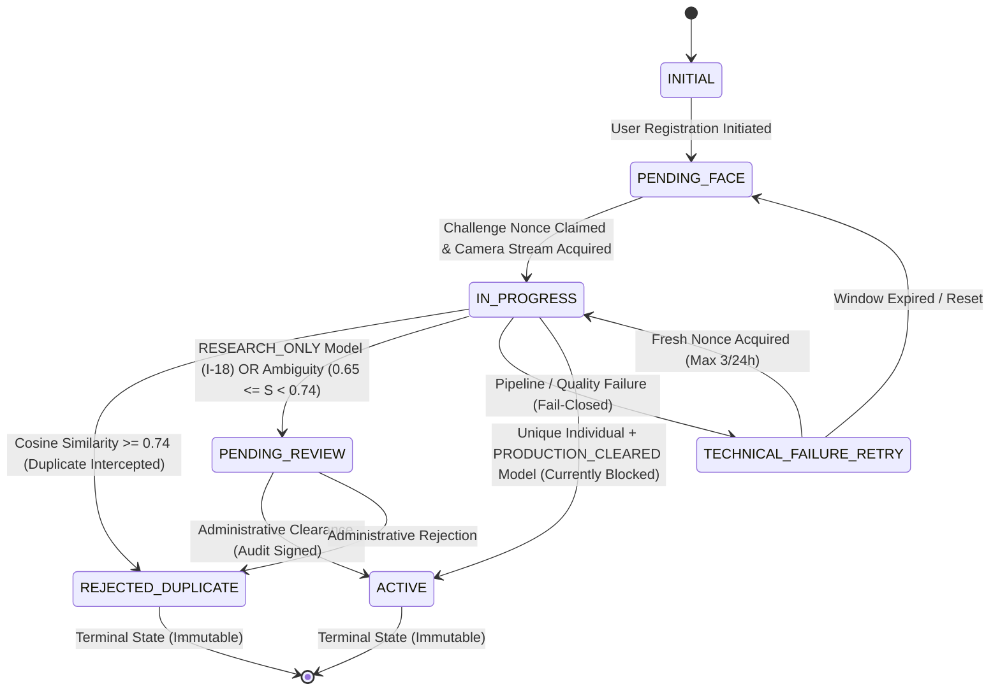

# KELASAGARA BIOMATCH V7: DATA ARCHITECTURE, SOURCE OF TRUTH & STATE SYNCHRONIZATION

**Document ID:** `SPEC-BIOMATCH-V7-008`  
**Phase:** Phase 8 (Data Architecture, Source of Truth, State Machine, Synchronization)  
**As-of Date:** 2026-10-10  
**Current Branch:** `biomatch/v7-hardening`  
**Active Release Readiness Level:** **RRL-0 (Research Prototype)**  
**Target Platform:** Firebase Spark Plan (Free Tier) | Sole Persistent Store: Cloud Firestore (`asia-south1` Mumbai)  

---

## 1. ARCHITECTURAL OVERVIEW & SOURCE OF TRUTH

Per **ADR-001 (Store Decision)**, Cloud Firestore (`asia-south1` Mumbai) is the platform's **sole persistent database**. No external databases (PostgreSQL, pgvector, Supabase, Milvus, Qdrant) exist or may be introduced.

The system partitions user profile state and sensitive biometric identity vectors across two isolated document namespaces:

1. **Client-Accessible User Profile (`/users/{uid}`):**
   - Contains operational profile data, role (`worker` or `hirer`), phone number, and non-biometric credentials.
   - Contains high-level authentication flags (`faceVerified: boolean`, `accountStatus: string`, `biometricEnrollmentState: string`).
   - Read/write access strictly governed by `firestore.rules`.
   - **Crucial Rule:** Direct client writes to `faceVerified` are completely forbidden (Branches 2C & 2D removed; Invariant I-02). Only the Server Admin SDK may mutate verification flags.

2. **Isolated Server Biometric Vault (`/biometric_vault/{uid}`):**
   - Contains 128-D Euclidean vector representations, model metadata, per-subject salts, and SHA-256 integrity hashes.
   - Client access is completely blocked (`allow read, write: if false`).
   - Accessible exclusively via Server Admin SDK using environment service account credentials.

3. **Append-Only Tamper-Evident Audit Ledger (`/biometric_audit_logs/{eventId}`):**
   - Immutable, SHA-256 hash-chained log of every security-sensitive identity event.
   - Client access blocked; write-only via Server Admin SDK.

4. **Transient Concurrency Sessions (`/biometric_enrollment_sessions/{uid}`):**
   - Short-lived reservation records tracking probe vectors and monotonic timestamps to prevent race-condition duplicates (Invariant I-12).

---

## 2. FORMAL DOCUMENT SCHEMAS

### 2.1 Biometric Vault (`/biometric_vault/{uid}`)

```typescript
interface BiometricVaultDoc {
  uid: string;                                   // Firebase Auth UID
  phoneNumber: string;                           // E.164 phone number
  phoneNumberMasked: string;                     // Privacy-safe masked format: +91 ******1234
  role: "worker" | "hirer";                      // Account role
  embedding: admin.firestore.FieldValue.vector;  // 128-D float32 normalized vector
  embeddingDim: 128;                             // Vector dimensionality
  modelVersion: string;                          // E.g. "kelasagara_mobilefacenet_v1_arcface"
  tier: "RESEARCH_ONLY" | "PRODUCTION_CLEARED";  // Model governance tier
  enrolledAt: FirebaseFirestore.Timestamp;       // Server creation timestamp
  updatedAt: FirebaseFirestore.Timestamp;       // Last modification timestamp
  livenessAudit: {
    blinkVerified?: boolean;
    headEulerYaw?: number;
    headEulerRoll?: number;
    method?: string;
    timestamp?: string;
    challengeNonce?: string;
  };
  requiresReview: boolean;                       // Manual review flag
  serviceVersion: string;                        // Backend service build
  salt: string;                                  // Per-subject 16-byte random hex salt
  integrityHash: string;                         // SHA-256(uid | salt | modelVersion | vectorPrefix)
}
```

### 2.2 Tamper-Evident Audit Ledger (`/biometric_audit_logs/{eventId}`)

```typescript
interface BiometricAuditLogDoc {
  eventId: string;                               // Unique deterministic or prefixed ID
  sequenceNumber: number;                        // Monotonically increasing sequence (1, 2, 3...)
  previousLogHash: string;                       // SHA-256 hash of previous audit record
  currentLogHash: string;                        // SHA-256 of canonical event serialization
  timestamp: FirebaseFirestore.Timestamp;       // Server record timestamp
  eventType:
    | "DUPLICATE_REGISTRATION_INTERCEPTED"
    | "ENROLLMENT_AMBIGUITY_FLAGGED"
    | "ENROLLMENT_SUCCESS"
    | "ENROLLMENT_HELD_RESEARCH_MODEL"
    | "TECHNICAL_FAILURE_RECORDED"
    | "BIOMETRIC_LOGIN_SUCCESS"
    | "BIOMETRIC_LOGIN_FAILED"
    | "TEMPLATE_DELETED"
    | "STATE_RECONCILIATION_FLAGGED"
    | "CHALLENGE_NONCE_ISSUED"
    | "CHALLENGE_NONCE_VERIFIED";
  uid: string;                                   // Subject Firebase UID
  matchedUid?: string;                           // Opposing matched UID (if duplicate/ambiguity)
  attemptingPhone?: string;                      // E.164 attempting phone
  similarityScore?: number;                      // Measured Cosine similarity
  threshold?: number;                            // Governing decision threshold
  service: string;                               // "kelasagara_biomatch_backend"
  version: string;                               // "v7.0.0"
  metadata?: Record<string, any>;                // Canonical metadata map
}
```

### 2.3 Rate Limits (`/biometric_rate_limits/{uid}`)

```typescript
interface BiometricRateLimitDoc {
  uid: string;                                   // Subject Firebase UID
  attempts24h: number;                           // Attempt counter within rolling 24-hour window
  firstAttemptTimestamp: number;                 // Epoch milliseconds of first attempt
  lastAttemptTimestamp: number;                  // Epoch milliseconds of latest attempt
  lockoutUntil?: number;                         // Lockout expiration timestamp
}
```

### 2.4 Enrollment Concurrency Sessions (`/biometric_enrollment_sessions/{uid}`)

```typescript
interface BiometricEnrollmentSessionDoc {
  sessionId: string;                             // Ephemeral session identifier
  uid: string;                                   // Reserving Firebase UID
  status: "PENDING" | "PROCESSING" | "COMPLETED" | "FAILED" | "EXPIRED";
  probeVector: number[];                         // Probe embedding for pending-inclusive screening
  clientSessionId: string;                       // Client-issued nonce
  createdAt: number;                             // Creation timestamp
  expiresAt: number;                             // Session TTL (60s)
  leaseExpiresAt: number;                        // Concurrency lease lock TTL
  sequenceNumber: number;                        // Monotonic transaction counter
}
```

---

## 3. FORMAL 6-STATE ENROLLMENT STATE MACHINE

The biometric enrollment lifecycle strictly implements a **6-state finite automaton** with deterministic, non-bypassable transition rules (Invariant I-13).



### 3.1 Transition Rules & Invariants

| From State | To State | Trigger / Guard Condition | Governing Invariants |
|---|---|---|---|
| `INITIAL` | `PENDING_FACE` | User phone verification completed; basic profile created. | Normal onboarding flow. |
| `PENDING_FACE` | `IN_PROGRESS` | Cryptographic challenge nonce claimed; camera session active. | Invariant I-04, I-05. |
| `IN_PROGRESS` | `ACTIVE` | Probe vector unique ($S < 0.65$); model tier is `PRODUCTION_CLEARED`. | **BLOCKED UNDER RRL-0.** Requires certified model (Invariants I-01, I-18). |
| `IN_PROGRESS` | `PENDING_REVIEW` | Probe vector unique under `RESEARCH_ONLY` model, OR borderline ambiguity ($0.65 \le S < 0.74$). | **MANDATORY DEFAULT.** Invariants I-01, I-07, I-18. |
| `IN_PROGRESS` | `REJECTED_DUPLICATE` | Authoritative duplicate match detected ($S \ge 0.74$). | Invariant I-12, I-19. |
| `IN_PROGRESS` | `TECHNICAL_FAILURE_RETRY` | IQA failure, landmark failure, blur, low light, or network drop. | Invariant I-01 (fail-closed, no bypass). |
| `TECHNICAL_FAILURE_RETRY` | `IN_PROGRESS` | Fresh challenge claimed; attempts $< 3$ per 24 hours. | Quota & rate limit protections. |
| `PENDING_REVIEW` | `ACTIVE` | Human administrator manually reviews face crops and approves. | Non-automated human authority. |
| `PENDING_REVIEW` | `REJECTED_DUPLICATE` | Human administrator confirms fraudulent duplicate registration. | Non-automated human authority. |

---

## 4. DUAL-WRITE ATOMICITY & RECONCILIATION PROTOCOL

### 4.1 Dual-Write Safety (Invariant I-14 & I-15)

Biometric enrollment persistence requires updating two separate documents:
1. Writing the mathematical vector to `/biometric_vault/{uid}`.
2. Updating status flags on `/users/{uid}`.

To eliminate split-brain inconsistencies, these writes are performed inside an **atomic Firestore batch**:
```typescript
const batch = db.batch();
batch.set(vaultRef, vaultDoc);
batch.update(userRef, userUpdateDoc);
await batch.commit();
```

**Zero Orphaned Vault Templates (Invariant I-15):**  
Before issuing any batch write, the backend explicitly verifies the existence of `/users/{uid}`. If the user document does not exist, the operation throws immediately. A biometric template can never be written without a backing user profile.

### 4.2 Split-Brain Detection & Self-Healing Protocol (Invariant I-16)

If a system crash, incomplete migration, or unauthorized manual database modification creates a desynchronization, the backend `reconcileState` engine executes a **fail-closed self-healing protocol**:

| Inconsistency Scenario | Detection Condition | Risk | Automated Fail-Closed Remedy |
|---|---|---|---|
| **Ghost Approval** | `/users/{uid}` has `faceVerified: true`, but `/biometric_vault/{uid}` is missing. | Account claims biometric verification without a backing template (spoofed or purged). | **REVOKE VERIFICATION:** `faceVerified` is immediately set to `false`; `accountStatus` set to `pending_face`. User is required to re-enroll biometrics. |
| **Orphaned Vault Template** | `/biometric_vault/{uid}` exists, but `/users/{uid}` has `faceVerified: false` or status `pending_face`. | Partial transaction write or incomplete enrollment. | **HOLD FOR REVIEW:** Account transitioned to `PENDING_REVIEW`. Audit event `STATE_RECONCILIATION_FLAGGED` emitted. |
| **Consistent Healthy** | Both documents present and consistent. | None. | No action required. |

---

## 5. TAMPER-EVIDENT AUDIT CHAIN SPECIFICATION (INVARIANT I-17)

Every audit record in `/biometric_audit_logs` is part of a cryptographically linked, append-only hash chain.

### 5.1 Canonical Serialization
To guarantee that JSON key ordering differences across programming languages do not alter cryptographic digests, all payloads are recursively sorted:
$$\text{CanonicalJSON}(obj) = \text{sort\_keys}(obj)$$

### 5.2 SHA-256 Recursive Digest
For record $i$, given sequence number $i$, predecessor hash $H_{i-1}$, event type $E$, subject UID $U$, timestamp $T$, and canonical payload $P$:

$$H_i = \text{SHA-256}\left( i \parallel H_{i-1} \parallel E \parallel U \parallel T \parallel \text{CanonicalJSON}(P) \right)$$

For the genesis record ($i = 1$):
$$H_0 = \text{0000000000000000000000000000000000000000000000000000000000000000}$$

### 5.3 Adversarial Attack Detection
The verification engine `TamperEvidentAuditService.verifyChainIntegrity` mathematically detects:
1. **Field Tampering:** Modifying any value in a historical event produces a mismatched $H_i \ne \text{recomputed } H_i$.
2. **Record Deletion:** Deleting any historical event creates a sequence break ($i \ne i-1+1$) and a hash link mismatch ($H_{i-1} \ne H_{i+1}.\text{previousLogHash}$).
3. **Record Reordering / Splicing:** Changing the order of events breaks the sequential $H_{i-1}$ chain.

Verified live in `data_architecture_state_machine.test.ts` (Test 5 & 6).

---

## 6. DPDPA 2023 RIGHT-TO-ERASURE & CRYPTO-SHREDDING

When a user exercises their Right to Erasure under Section 12 of the Digital Personal Data Protection Act (DPDPA 2023):
1. **Biometric Template Shredding:** `/biometric_vault/{uid}` is deleted via `FirestoreBiometricRepository.deleteTemplate(uid)`.
2. **Crypto-Shredding:** The per-subject random salt and vector integrity hash are permanently discarded, rendering any residual cached embeddings cryptographically unrecoverable.
3. **Audit Immutability:** An immutable audit record with `eventType: "TEMPLATE_DELETED"` is appended to the hash chain to preserve regulatory non-repudiation without retaining the underlying biometric template.
