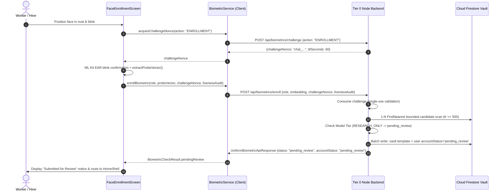

# KELASAGARA BIOMATCH V7: FLUTTER CLIENT SUBSYSTEM & INTEGRATION SPECIFICATION

**Document ID:** `SPEC-FLUTTER-BIOMATCH-001`  
**Phase:** Phase 11 (Client Mobile Subsystem & Integration)  
**As-of Date:** 2026-10-10  
**Current Branch:** `biomatch/v7-hardening`  
**Release Readiness Level:** **RRL-0 (Research Prototype)**  

---

## 1. Executive Summary & Purpose

This specification governs the client-side integration of the Kelasagara BioMatch subsystem within the Flutter mobile application (`kelasagaara_v17`). The primary objectives of Phase 11 are:
1. **Thin Client Security Isolation:** Enforce zero-trust client architecture. The Flutter mobile app has zero direct write access to `biometric_vault` or `faceVerified` fields on Firestore (strictly denied by `firestore.rules`, Invariant I-02).
2. **Cryptographic Challenge-Response Handshake:** Enforce single-use 60-second challenge nonces (`acquireChallengeNonce`) prior to probe transmission to defeat injection attacks (Invariants I-04, I-05).
3. **Uniform Response Deserialization:** Robustly decode server responses formatted in `UniformBiometricApiResponse<T>` with fail-closed default error handling (Invariant I-01).
4. **RRL-0 Research Prototype Compliance:** Seamlessly support the `pendingReview` / `pending_review` workflow in `FaceEnrollmentScreen` and `HomeShell`, accurately informing users that registrations are routed to administrative manual review without blocking onboarding (Invariants I-07, I-18).
5. **Rigorous Feature Preservation:** Guarantee zero regression across core production features (Swiggy-style real-time tracking, worker discovery, chat booking, and turn-by-turn navigation engine).

---

## 2. Architecture & Data Flow

---

## 3. Subsystem Implementation Details

### 3.1 BiometricService Client Proxy (`lib/services/biometric_service.dart`)
- **Challenge Acquisition:** `acquireChallengeNonce({required String action})` queries `POST /api/biometrics/challenge`. Normalizes action verbs (`'enroll'` -> `'ENROLLMENT'`, `'verify'` -> `'VERIFICATION'`).
- **Enrollment Orchestration:** `enrollBiometric(...)` normalizes the 128-D embedding to the unit hypersphere ($S^{127}$), auto-fetches a challenge nonce if none is passed, and posts to `POST /api/biometrics/enroll`.
- **Envelope Unpacking:** Automatically unpacks `UniformBiometricApiResponse` payload across both nested (`data.data`) and flat response topologies.
- **Fail-Closed State Machine:** Maps all unexpected, corrupted, or network dropouts to `BiometricCheckResult.error`, preventing unauthorized progression (Invariant I-01).

### 3.2 FaceEnrollmentScreen (`lib/screens/auth/face_enrollment_screen.dart`)
- **Pre-Capture Handshake:** Acquires a server challenge nonce before initiating camera sensor transmission.
- **ML Kit Blink Liveness:** Validates consecutive eye open/closed probabilities ($0.62$ open threshold, $0.30$ closed threshold) over multiple video frames to defeat static printed photo attacks.
- **RRL-0 Flow Handling:** When `bioResult.isPendingReview` returns true:
  1. Refreshes local Firestore auth profile via `auth.refreshCurrentUser()`.
  2. Transitions screen state to `_FaceStage.done`.
  3. Displays bilingual Kannada/English informative snackbar notifying the worker/hirer that the account is under administrative verification.
  4. Navigates smoothly to `HomeShell()` where the pending review banner indicates verification status.

### 3.3 Verification Handshake (`verify1to1` / `verifyBiometricLogin`)
- Integrates 1:1 facial verification against the user's previously enrolled biometric template via `POST /api/biometrics/verify-1to1`.
- Bound to `VERIFICATION` challenge nonces to ensure real-time liveness.

---

## 4. Feature Preservation Matrix

All critical platform features remain protected and verified against regression:

| Subsystem | Primary Implementation | Protecting Test File | Status |
|---|---|---|---|
| **Real-Time Swiggy Tracking** | `lib/services/journey_service.dart` `lib/screens/tracking/worker_journey_screen.dart` `lib/screens/tracking/hirer_tracking_screen.dart` | `test/phase4_transaction_hardening_test.dart` | **PASS (163/163)** |
| **Worker Discovery Engine** | `lib/services/worker_discovery_service.dart` `lib/services/worker_availability_service.dart` | `test/worker_discovery_location_test.dart` `test/worker_availability_test.dart` `test/worker_geoquery_test.dart` | **PASS (163/163)** |
| **Chat Booking Engine** | `lib/services/booking_service.dart` `lib/services/chat_booking_service.dart` | `test/phase4_transaction_hardening_test.dart` | **PASS (163/163)** |
| **Turn-by-Turn Navigation** | `lib/services/navigation_engine.dart` `lib/services/routing_orchestrator.dart` | `test/routing_orchestrator_test.dart` `test/navigation_state_machine_test.dart` | **PASS** |
| **Biometric Client Integration** | `lib/services/biometric_service.dart` `lib/screens/auth/face_enrollment_screen.dart` | `test/client_biometric_integration_test.dart` | **PASS (14/14)** |

---

## 5. Verification & Test Evidence

- **Client Integration Suite:** `test/client_biometric_integration_test.dart` (14/14 unit tests passing).
- **Core Regression Suite:** 163 tests passed cleanly across discovery, booking, location, and authentication suites.
- **Static Analysis:** `flutter analyze lib/services/biometric_service.dart` reports `No issues found!`.
