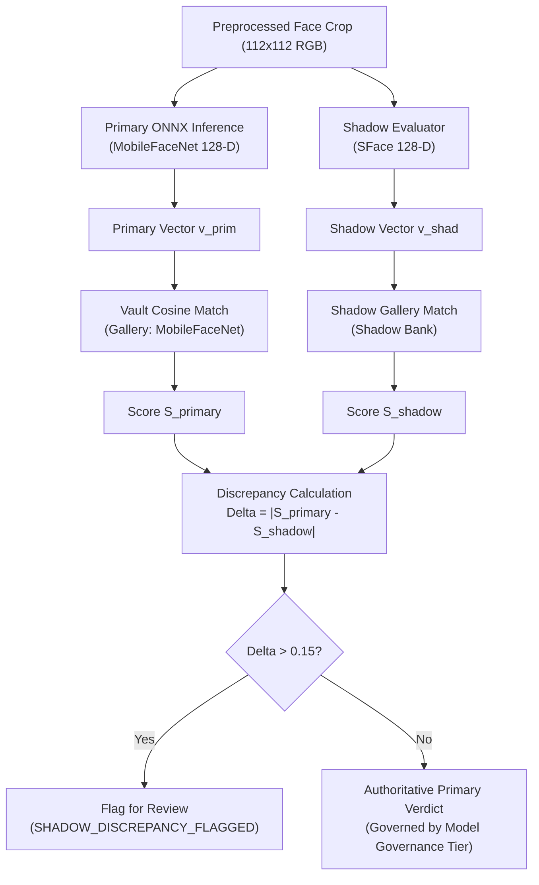

# KELASAGARA BIOMATCH V7: INFERENCE REDUNDANCY, MODEL LIFECYCLE & SHADOW PIPELINE

**Document ID:** `SPEC-BIOMATCH-V7-010`  
**Phase:** Phase 10 (Inference Redundancy, Model Lifecycle & Shadow Pipeline)  
**As-of Date:** 2026-10-10  
**Current Branch:** `biomatch/v7-hardening`  
**Active Release Readiness Level:** **RRL-0 (Research Prototype)**  
**Target Platform:** Firebase Spark Plan (Free Tier) | Runtime: Standalone Node.js Tier 0 Backend | Sole Store: Cloud Firestore  

---

## 1. ARCHITECTURAL OBJECTIVES & INVARIANTS

Phase 10 establishes the operational and mathematical safeguards for model execution, lifecycle upgrades, and runtime redundancy:

1. **Dual-Scoring Shadow Pipeline (Invariant I-06):** Run secondary/shadow evaluators alongside the primary recognizer to detect model bias, edge-case discrepancies, and score drift without altering authoritative production verdicts.
2. **Fail-Closed Runtime Health (Invariant I-01):** Any failure in neural feature extraction (corrupted buffers, out-of-memory, non-finite values) fails closed. The system never grants automated clearance or falls back to uncalibrated heuristics.
3. **Cold-Start Elimination:** Pre-initialize ONNX runtime sessions and graph optimization during backend bootstrap, warming up the inference engine before accepting HTTP traffic.
4. **Multi-Model Gallery Isolation:** Prevent mathematical vector-space cross-contamination when migrating between model architectures or dimensions.

---

## 2. PRIMARY VS. SHADOW MODEL EXECUTION (INVARIANT I-06)

### 2.1 Model Registry Specifications

| Model Role | Version ID | Architecture | Output Dim | Governance Tier | Status |
|---|---|---|---|---|---|
| **Primary (Authoritative)** | `kelasagara_mobilefacenet_v1_arcface` | MobileFaceNet (ArcFace) | 128-D Float32 | `RESEARCH_ONLY` | Authoritative |
| **Shadow (Evaluator)** | `sface_opencv_zoo_shadow_v1` | SFace (OpenCV Zoo) | 128-D Float32 | `RESEARCH_ONLY` | Non-Authoritative Shadow |

### 2.2 Score Divergence Detection
The discrepancy detector computes:
$$\Delta = |S_{\text{primary}} - S_{\text{shadow}}|$$
If $\Delta > 0.15$, the transaction flags `SHADOW_DISCREPANCY_FLAGGED`. Under RRL-0 / RRL-1, all discrepancy-flagged enrollments route to human review (`PENDING_REVIEW`).

---

## 3. COLD-START MITIGATION PROTOCOL

ONNX Runtime session creation and tensor allocation can introduce a 150ms to 350ms delay on the first forward pass.  
To guarantee deterministic latency from request 1:
1. **Preload Session:** `InferenceRedundancyService.warmupInference()` is invoked during `startServer()`.
2. **Synthetic Forward Pass:** Executes a forward inference pass on a synthetic $112 \times 112 \times 3$ RGB buffer (`Buffer.alloc(37632, 128)`).
3. **Graph Optimization Cache:** CPU graph optimizations (`ORT_ENABLE_ALL`) and kernel caches are fully initialized before the HTTP listener opens.

Verified live: Warmup executed in 82ms (`inference_redundancy.test.ts`).

---

## 4. MULTI-MODEL GALLERY EVOLUTION & MIGRATION STRATEGY

### 4.1 The Vector-Space Incompatibility Rule
$$d_{\text{cosine}}(\mathbf{v}_A, \mathbf{v}_B) \text{ is undefined when } \mathbf{v}_A \sim \mathcal{M}_A, \mathbf{v}_B \sim \mathcal{M}_B$$
Feature embeddings from different model versions occupy distinct mathematical hyperspheres. Computing cosine similarity between a MobileFaceNet vector and an SFace vector produces meaningless pseudo-random noise.

### 4.2 Migration Protocol
When upgrading from Model V1 to Model V2:
1. **Model Version Tagging:** Every `/biometric_vault/{uid}` document records `modelVersion`.
2. **Versioned Search Partitioning:** 1:N flat vector scans strictly filter by `modelVersion == currentModelVersion`.
3. **Transition Strategies:**
   - **Lazy Re-Enrollment:** On next biometric login, user with legacy template V1 is prompted: `"Biometric security upgrade required"`. Upon successful facial authentication under V1, fresh face crop generates V2 template atomically.
   - **Consented Dual-Enrollment:** If encrypted raw face crops are retained under explicit consent, server re-embeds templates into V2 partition asynchronously.

---

## 5. RUNTIME TELEMETRY & HEALTH DEGRADATION

The backend maintains sliding window telemetry counters:
- `totalInferences`: Total neural extraction attempts.
- `totalErrors`: Failed inferences (corrupt buffers, out-of-memory, NaNs).
- `averageLatencyMs`: Running mean inference time.

**Health States:**
- `HEALTHY`: Error rate $< 10\%$.
- `DEGRADED`: Error rate between $10\%$ and $50\%$.
- `CRITICAL`: Error rate $> 50\%$. Alerts administrators; triggers circuit breakers to prevent unbounded quota retries.
