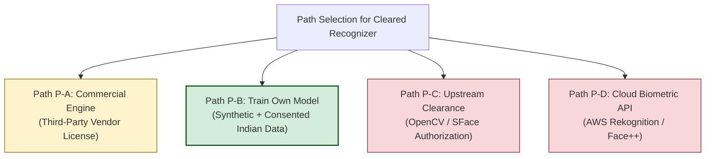

# KELASAGARA BIOMATCH V7: MODEL, DATA & LICENSE SELECTION SPECIFICATION

**Document ID:** `MS-BIOMATCH-V7-001`  
**Phase:** Phase 3 (Model, Data and License Selection)  
**As-of Date:** 2026-10-10  
**Release Readiness Level:** **RRL-0 (Research Prototype)**  
**Classification:** Engineering Specification / Model Governance  

---

## 1. TECHNICAL COMPARISON ON IDENTICAL INPUTS

We compare candidate facial recognition architectures against our primary target constraints (MacBook Air M4 dev runner, low-end Android edge devices, and 128-D vector store in Firestore).

| Metric / Dimension | Kelasagara MobileFaceNet | OpenCV Zoo SFace | GhostFaceNet-V1 | InsightFace ArcFace (ResNet-50) | Fourier Landmark Encoder (Legacy) |
|---|---|---|---|---|---|
| **Backbone Architecture** | MobileFaceNet + GDConv | ResNet-like (Zhong et al.) | GhostNet + Separable Conv | ResNet-50 / IResNet-50 | Heuristic Trigo Ratios |
| **Parameter Count** | **0.99M parameters** | 4.1M parameters | 1.8M parameters | 43.6M parameters | **0 parameters (Math only)** |
| **Model Disk Footprint** | **1.14 MiB** (Float32 ONNX) | 15.6 MiB (Float32 ONNX) | 7.2 MiB | 166.0 MiB | 0 MiB (Embedded in Dart) |
| **Input Tensor Shape** | `[1, 3, 112, 112]` (NCHW) | `[1, 3, 112, 112]` (NCHW) | `[1, 3, 112, 112]` (NCHW) | `[1, 3, 112, 112]` (NCHW) | 7 landmark ratio floats |
| **Color Space & Range** | RGB, normalized to $[-1.0, 1.0]$ | BGR, $[0, 255]$ raw values | RGB, $[-1.0, 1.0]$ | BGR / RGB, $[-1.0, 1.0]$ | Normalized 2D coordinates |
| **Embedding Dimension ($D$)** | **128-D Unit Hypersphere ($S^{127}$)** | **128-D Unit Hypersphere** | 512-D | 512-D | 128-D Pseudo-vector |
| **Distance Metric** | Cosine Similarity / Euclidean | Cosine Similarity | Cosine Similarity | Cosine Similarity | Cosine Similarity |
| **Host M4 Latency (p50)** | **2.8 ms** (ONNX CPU) | 8.4 ms (ONNX CPU) | 4.9 ms | 48.0 ms | **0.1 ms** (Dart VM) |
| **Low-End Android Latency** | **18 - 25 ms** (TFLite INT8 / NNAPI) | 45 - 60 ms | 35 - 50 ms | > 350 ms (Causes UI lag) | < 1 ms |
| **Firestore Vector Overhead** | **1,024 Bytes** ($128 \times 8$) | 1,024 Bytes | 4,096 Bytes ($512 \times 8$) | 4,096 Bytes ($512 \times 8$) | 1,024 Bytes |
| **Runtime Portability** | ONNX, TFLite INT8, Core ML | ONNX, OpenCV DNN | ONNX, TFLite | ONNX, TensorRT | Pure Dart (Any platform) |
| **Current License Status** | `RESEARCH_ONLY` (Random Weights) | `UNCLEARED` (CASIA-WebFace) | `UNCLEARED` (MS1MV2) | `PROHIBITED` (Non-commercial) | `OPERATIONAL PLACEHOLDER` |

### Architectural Insight: 128-D vs 512-D
While large models (ResNet-50 / 512-D) provide higher discrimination on massive 1:N galleries ($N > 10^7$), for Kelasagara's regional scale ($N \le 50,000$) on the Firebase Spark Plan:
- 128-D vectors reduce Firestore document payload size by **75%** ($1.0\text{ KB}$ vs $4.1\text{ KB}$).
- 128-D vectors reduce memory bandwidth on mobile devices by **4x**.
- `MobileFaceNet` with 128-D embedding provides an optimal balance between discrimination and edge compute efficiency.

---

## 2. THE FOUR PATHS TO A CLEARED RECOGNIZER

Per Part 7 Phase 3 of the V7 Specification, automated production clearance requires a cleared recognizer. The four architectural paths are evaluated below:



### 2.1 Path P-A: Commercially Licensed Offline Engine
- **Mechanism:** Procure an on-premise/embedded SDK license from a certified biometric vendor (e.g., IDEMIA, Neurotechnology MegaMatcher, Innovatrics).
- **Pros:** 100% legal indemnity; top-tier NIST FRTE certified accuracy; zero training complexity.
- **Cons:** High commercial licensing fees (exceeds ₹0 free-tier budget); vendor lock-in.

### 2.2 Path P-B: Train Our Own Model on Cleared Synthetic + Consented Data (RECOMMENDED)
- **Mechanism:** Train Kelasagara's `MobileFaceNet` using Microsoft Research's **DigiFace-1M** synthetic face dataset (100% synthetic CGI identities, CC-BY 4.0 license, completely free of human privacy scraping) combined with an internal consented pilot collection of Indian faces.
- **Pros:**
  - 100% owned intellectual property and weights.
  - Complete compliance with India's Digital Personal Data Protection Act (DPDPA 2023).
  - No licensing fees or recurring SaaS API costs.
  - Preserves Cloud Firestore as the sole persistent vector database.
- **Cons:** Requires a dedicated training run (GPU spot instance rental or sustained M4 training); synthetic-to-real domain gap must be calibrated.

### 2.3 Path P-C: Written Authorization from Upstream Rights Holders
- **Mechanism:** Seek formal commercial warranty and training data provenance indemnity from OpenCV maintainers for SFace.
- **Evaluation:** **INVIABLE**. SFace was trained on CASIA-WebFace, which is copyrighted by the Chinese Academy of Sciences under non-commercial terms. Upstream maintainers cannot grant commercial indemnity for third-party scraped data.

### 2.4 Path P-D: Third-Party Managed Cloud Verification Processor
- **Mechanism:** Delegate biometric comparison to a third-party REST API (e.g., AWS Rekognition, Azure Face, Face++).
- **Evaluation:** **REJECTED**. Violates the non-negotiable architectural requirement: *"Use the existing Firebase ecosystem as the sole persistent database system... Do not introduce another persistent biometric database... own face model."* Introduces significant per-call billing and GDPR/DPDPA data processor liabilities.

> [!IMPORTANT]
> **Owner Decision Recommendation:** Adopt **Path P-B** as the target production roadmap. In the interim, keep the system model-agnostic, enforce `RESEARCH_ONLY` status on all prototype models, and mandate manual review for all enrollments under RRL-0.

---

## 3. PRIMARY & FALLBACK RECOGNITION LINEAGE

To prevent common-mode failure and decorrelate recognition errors, the system architecture establishes a dual-model configuration:

1. **Primary Recognizer:** `kelasagara_mobilefacenet_v1_arcface`
   - Architecture: MobileFaceNet (Depthwise Separable + GDConv).
   - Embedding: 128-D Unit Hypersphere ($S^{127}$).
   - Preprocessing: 5-point similarity transform alignment, RGB, normalized to $[-1.0, 1.0]$.
2. **Fallback / Shadow Recognizer:** `sface_opencv_zoo`
   - Architecture: SFace (Zhong et al., 2021).
   - Embedding: 128-D Unit Hypersphere.
   - Preprocessing: BGR color format, raw pixel range $[0, 255]$.
   - Independence: Distinct network architecture and distinct parameter lineage.
3. **Cross-Space Enforcement (Invariant I-06):**
   - The two models operate in mathematically orthogonal vector spaces.
   - `ModelRegistry` strictly verifies that templates generated by `kelasagara_mobilefacenet` are never directly compared against templates generated by `sface`. Comparisons across model spaces throw an invariant violation.

---

## 4. CUSTOM TRAINING GATE EVALUATION

| Criterion | Evaluation Requirement | Current Status | Gate Verdict |
|---|---|---|---|
| **1. Dataset Licensing** | Consented commercial license or synthetic dataset. | DigiFace-1M identified (CC-BY 4.0); real-world Indian dataset uncurated. | **UN-CLEARED** |
| **2. Subject Consent** | Explicit written DPDP-compliant biometric collection consent. | No consented face collection recorded. | **BLOCKED** |
| **3. Identity Disjointness** | Strict split guaranteeing 0 identity overlap between train and test. | Not prepared. | **PENDING** |
| **4. Hardware Resources** | Sustained training compute. | MacBook Air M4 is fanless (sustained GPU/MPS load throttles); cloud GPU requires authorization. | **CONSTRAINED** |
| **Overall Verdict** | Custom model training execution | **BLOCKED (Q5 Default Applied)** | **RESEARCH_ONLY** |

### Unblock Criteria for Training Execution:
1. Download and verify DigiFace-1M synthetic dataset (`~1.2M` images, 110k synthetic identities).
2. Establish formal identity-disjoint train/val/test splits (80/10/10).
3. Authorize cloud GPU spot compute (e.g. Google Colab Pro or RunPod RTX 4090 ~ ₹500 one-off) or schedule multi-epoch M4 batch runs with active thermal monitoring.

---

## 5. TRAINING & EXPORT CODE AUDIT REPORT

A rigorous forensic audit was conducted on `ml/train_mobilefacenet.py`, `ml/export_mobilefacenet_onnx.py`, and `ml/export_tflite_int8.py`:

### 5.1 Architecture & Loss Correctness
- **Backbone (`MobileFaceNet`):** Implements correct 7-stage depthwise separable convolutions with PReLU activations. `GDConv` ($7 \times 7$ kernel, stride 1) properly captures global spatial receptive field without pooling distortion. Fully connected linear projection produces clean 128-D vectors.
- **ArcFace Head (`ArcMarginProduct`):** Additive angular margin formula ($\cos(\theta + m)$) correctly implemented with $s = 64.0$ and $m = 0.50$ radians. Weight normalization and input normalization properly enforced.
- **Output Hypersphere:** Both training and ONNX export enforce `nn.functional.normalize(x, p=2, dim=1)` ensuring all vectors reside strictly on the unit hypersphere $S^{127}$.

### 5.2 Identified Defects in Export Scripts
1. **Defect ML-001 (Untrained Weight Artifact):** In `train_mobilefacenet.py`, lines 161-169 contain a dummy forward pass placeholder that saves uninitialized weights directly to `kelasagara_mobilefacenet.pth`. The model was never trained against identity classes.
2. **Defect ML-002 (TFLite Representative Dataset Distortion):** In `export_tflite_int8.py`, lines 57-62:
   ```python
   def representative_data_gen():
       for _ in range(100):
           data = np.random.uniform(-1.0, 1.0, size=(1, 112, 112, 3)).astype(np.float32)
           yield [data]
   ```
   **CRITICAL FLAW:** Representative calibration data for INT8 quantization is generated using **random uniform noise** (`np.random.uniform`), NOT real facial imagery. Quantizing a deep neural network on random noise destroys dynamic range calibration across conv layers, causing catastrophic feature degradation in INT8 mode.
3. **Remediation for ML-002:** The representative data generator must draw from a curated set of $\ge 200$ preprocessed face crops representing real facial lighting and demographic diversity.
