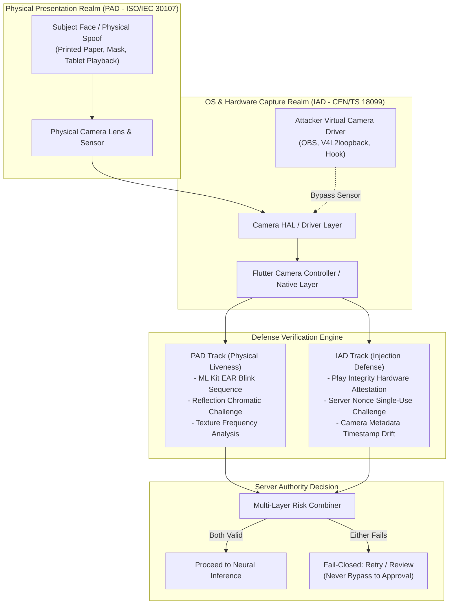

# KELASAGARA BIOMATCH V7: PRESENTATION ATTACK (PAD) & INJECTION ATTACK (IAD) DEFENSE SPECIFICATION

**Document ID:** `PID-BIOMATCH-V7-001`  
**Phase:** Phase 6 (Liveness, Presentation-Attack and Injection-Attack Defense)  
**As-of Date:** 2026-10-10  
**Release Readiness Level:** **RRL-0 (Research Prototype)**  
**Classification:** Defensive Security Architecture  
**Standards Alignment:** ISO/IEC 30107-3 (Biometric Presentation Attack Detection) & CEN/TS 18099 (Biometric Injection Attack Detection).

---

## 1. TWO-TRACK ARCHITECTURE (NEVER MERGED PER R-13)

Presentation attacks (physical spoofs at the camera lens) and Injection attacks (digital payload tampering bypassing the camera sensor) represent fundamentally distinct threat vectors. In adherence to research invariant R-13, the two tracks maintain separate detection pipelines, separate error budgets, and separate reporting.

---

## 2. PRESENTATION ATTACK DETECTION (PAD) LAYERS

### Layer 1: Client On-Device Eye Aspect Ratio (EAR) Blink Guidance
- **Technology:** Google ML Kit Face Mesh / Contour tracking.
- **Formula:**
  $$\text{EAR} = \frac{\|p_2 - p_6\|_2 + \|p_3 - p_5\|_2}{2 \|p_1 - p_4\|_2}$$
  Where $p_1 \dots p_6$ represent the 6 canonical 2D eyelid landmarks.
- **State Machine:** Baseline open state ($\text{EAR} \ge 0.25$) $\rightarrow$ Closed blink dip ($\text{EAR} \le 0.16$ for $100\text{ to }400\text{ ms}$) $\rightarrow$ Recovery open state.
- **Architectural Caveat (R-13):** EAR blink alone is advisory UX only. A replayed tablet video easily passes simple blink checks; hence, Layer 1 never produces authoritative clearance.

### Layer 2: Server-Verified Frame Burst Bound to Nonce
- The client captures a 3-frame burst $(F_{\text{pre}}, F_{\text{blink}}, F_{\text{post}})$ across $1.5\text{ seconds}$.
- Each frame header is stamped with the server-issued cryptographic nonce and monotonic microsecond timestamp.

### Layer 3: Passive Texture & Frequency Analysis
- Evaluates high-frequency Fourier spectral distribution. Printed paper and tablet screens exhibit characteristic specular moiré fringes and loss of high-frequency micro-texture.

### Layer 4: Screen Reflection Challenge (Active Flash Response)
- Client screen displays a randomized sequence of two pastel colors (e.g. Cyan $\rightarrow$ Amber) for $250\text{ ms}$ each.
- Facial skin reflection must correlate with the challenge color sequence; static printouts reflect diffuse ambient light without dynamic chromatic shifts.

---

## 3. INJECTION ATTACK DETECTION (IAD) LAYERS

### Layer A: Google Play Integrity (App Check) Token Binding
- Every enrollment request must present a limited-use Firebase App Check token backed by Google Play Integrity hardware verdict (`MEETS_DEVICE_INTEGRITY`).
- Emulators and rooted devices running Magisk/Xposed fail device attestation and are rejected at the gateway.

### Layer B: Server Cryptographic Challenge Nonce Protocol
- **Specification:** Implemented in `SessionChallengeService`.
- **Lifecycle:**
  1. Client calls `POST /api/biometrics/challenge` with authenticated UID.
  2. Server generates `challengeId` (`chal_<16-byte-hex>`) and 32-byte cryptographically secure random `nonce` with a **strict 60-second Time-To-Live (TTL)**.
  3. Client includes `(challengeId, nonce)` in the enrollment payload.
  4. Server validates:
     - Challenge exists in memory/cache.
     - Authenticated UID matches bound UID (Invariant I-04).
     - Action matches intended flow (`enrollment` vs `verification`).
     - Nonce is single-use: **immediately invalidated upon first consumption** (Invariant I-05).
     - Any replay attempt throws an invariant violation.

### Layer C: Camera Metadata & Frame Stream Forensics
- Native Android camera capture validates hardware characteristics:
  - Sensor exposure time consistency.
  - Absence of `v4l2loopback`, `android.hardware.camera2.virtual`, or OBS virtual camera driver signatures.
  - Frame delivery jitter: Synthetic video injection exhibits perfectly uniform delta timestamps ($33.333\text{ ms}$), whereas physical hardware cameras exhibit natural micro-jitter ($33 \pm 4\text{ ms}$).

---

## 4. ACCESSIBILITY & INCLUSIVITY PROTOCOL

To ensure biometric liveness does not become an engine of discrimination or exclusion for persons with disabilities:

1. **Facial Motor Impairments / Ptosis / Ocular Prosthetics:**
   - Users unable to execute the eye blink challenge are provided an accessible alternative prompt (e.g. small head nod or smiling action).
2. **Camera Hardware Degradation:**
   - If an entry-level smartphone camera fails the high-frequency texture gate due to low sensor resolution, the app automatically offers an alternative verification path:
     - 6-digit physical OTP verification sent to registered phone number.
     - Document upload (Voter ID / Driving License) for asynchronous administrative review.
3. **Core Invariant:** Alternative accessibility paths route to **manual human review queues**, never to unverified automated approval.
