# KELASAGARA BIOMATCH V7: REFERENCE PIPELINE, QUALITY & PARITY SPECIFICATION

**Document ID:** `PS-BIOMATCH-V7-001`  
**Phase:** Phase 4 (Reference Pipeline, Quality, Parity)  
**As-of Date:** 2026-10-10  
**Release Readiness Level:** **RRL-0 (Research Prototype)**  
**Classification:** Technical Architecture & Processing Specification  

---

## 1. VERSIONED PREPROCESSING SPECIFICATION

Every template generated and stored in `biometric_vault/{uid}` is bound to a permanent, immutable preprocessing specification identifier:

$$\mathbf{preprocessing\_id} = \text{\textbf{"PREPROC\_V1\_UMEYAMA\_112\_RGB\_NORM"}}$$

### Canonical 5-Point Landmark Targets
Target coordinates map to a standardized $112 \times 112$ bounding space (ArcFace standard, Deng et al., CVPR 2019):

| Landmark Point | Target $X$ (px) | Target $Y$ (px) | Feature Representation |
|---|---|---|---|
| **Point 1: Left Eye Center** | $38.2946$ | $51.6963$ | Optical center of subject's left pupil |
| **Point 2: Right Eye Center** | $73.5318$ | $51.6963$ | Optical center of subject's right pupil |
| **Point 3: Nose Tip** | $56.0252$ | $71.7366$ | Subnasale / nasal tip apex |
| **Point 4: Left Mouth Corner** | $41.5493$ | $92.3655$ | Left cheilion (labial commissure) |
| **Point 5: Right Mouth Corner** | $70.7299$ | $92.3655$ | Right cheilion |

### Inter-Pupillary Distance (IPD) in Canonical Space:
$$\text{IPD}_{\text{canonical}} = X_{\text{right\_eye}} - X_{\text{left\_eye}} = 73.5318 - 38.2946 = \mathbf{35.2372\text{ px}}$$

---

## 2. THE 9-STAGE REFERENCE PIPELINE

```mermaid
flowchart LR
    A["1. Face Detection<br/>(ML Kit / BlazeFace)"] --> B["2. 5-Point Landmarks<br/>(Eyes, Nose, Mouth)"]
    B --> C["3. IQA Quality Gating<br/>(Pose, Blur, Light)"]
    C --> D["4. Umeyama Similarity Transform<br/>(Least-Squares Alignment)"]
    D --> E["5. Canonical Crop & Warp<br/>(112x112x3)"]
    E --> F["6. Color & Range Norm<br/>(RGB, [-1.0, 1.0])"]
    F --> G["7. Neural Inference<br/>(MobileFaceNet ONNX)"]
    G --> H["8. Numerical Validation<br/>(Non-NaN, Dim=128)"]
    H --> I["9. L2 Hypersphere Normalization<br/>(||v||_2 = 1.0 on S^127)"]
```

1. **Face Detection:** Bounding box $[x, y, w, h]$ localized.
2. **5-Point Landmark Extraction:** Coordinates extracted from Google ML Kit face mesh.
3. **IQA Quality Gating:** Mandatory pre-embedding gate. If quality fails, session immediately halts with actionable client guidance.
4. **Similarity Alignment:** Least-squares Umeyama algorithm computes optimal affine rotation, scale, and translation matrix $T \in \mathbb{R}^{2 \times 3}$.
5. **Crop & Warp:** Bilinear interpolation warps source frame into $112 \times 112$ canonical canvas.
6. **Color & Range Normalization:** Pixel channels converted to float tensor (NCHW layout):
   $$x_{\text{norm}} = \frac{x_{\text{raw}} - 127.5}{128.0} \in [-1.0, 1.0]$$
7. **Neural Forward Inference:** Tensor fed to `kelasagara_mobilefacenet.onnx` via ONNX Runtime.
8. **Numerical Vector Validation:** Assert zero NaNs, dimension $= 128$, non-constant values.
9. **Unit Hypersphere Projection:**
   $$v = \frac{x}{\|x\|_2} \in S^{127}$$

---

## 3. QUALITY GATING (IQA) THRESHOLDS

To prevent poor captures from degrading recognition accuracy, frames must satisfy all 6 quality gates before feature extraction:

| Quality Dimension | Threshold Criterion | Rejection Reason Prompted to User | Owning Test ID |
|---|---|---|---|
| **Face Resolution** | Bounding box $\ge 112 \times 112\text{ px}$ (Optimal: $\ge 224 \times 224\text{ px}$) | *"Face resolution too low. Move closer to the camera."* | `TEST-IQA-001` |
| **Inter-Pupillary Distance (IPD)** | $\ge 35\text{ px}$ in target space ($\ge 80\text{ px}$ in camera frame) | *"Please position your face closer within the circular guide."* | `TEST-IQA-002` |
| **Head Pose (Yaw)** | $|\text{Yaw}| \le 30^\circ$ | *"Look directly at the camera without turning your head."* | `TEST-IQA-003` |
| **Head Pose (Pitch)** | $|\text{Pitch}| \le 25^\circ$ | *"Keep your head level; avoid tilting up or down."* | `TEST-IQA-003` |
| **Illumination / Luminance** | Mean intensity $Y \in [35, 225]$ | *"Lighting too dim or excessive glare. Find balanced light."* | `TEST-IQA-004` |
| **Motion Blur (Sharpness)** | Laplacian variance $\ge 60.0$ | *"Camera motion blur detected. Hold the device steady."* | `TEST-IQA-005` |
| **Face Count** | Exactly 1 face ($N_{\text{faces}} == 1$) | *"Multiple faces detected. Ensure only you are in the frame."* | `TEST-IQA-006` |

---

## 4. NUMERICAL VALIDATION SPECIFICATION (INVARIANT I-01 / I-18)

Any vector produced by the inference pipeline must satisfy the `validateNumericalVector` contract:
1. **Dimension Match:** Vector length must strictly equal $128$. Vectors with 512, 64, or other dimensions are rejected.
2. **Finiteness:** For all $i \in [0, 127]$, $\neg \text{isNaN}(v_i) \land \text{isFinite}(v_i)$.
3. **Non-Degeneracy:**
   - Vector must not be all-zeros ($\sum |v_i| > 0$).
   - Vector must not be a constant vector ($\sigma(v) > 10^{-4}$).
4. **Unit Length:**
   $$\left| \sqrt{\sum_{i=0}^{127} v_i^2} - 1.0 \right| \le 1.0 \times 10^{-3}$$
   Vectors failing this check throw an invariant violation and trigger fail-closed retry.

---

## 5. QUANTIZATION STUDY: FP32 VS FP16 VS INT8

| Quantization Format | Model Size | Cosine Parity Delta vs FP32 | Verification EER Delta (Hypothesis) | Inference Latency (M4 Host) | Target Deployment Tier |
|---|---|---|---|---|---|
| **Float32 (FP32)** | **1.14 MiB** | $0.00$ (Reference Baseline) | $0.00\%$ | **2.8 ms** | Tier 0 Dev / Tier 1 Cloud Server |
| **Float16 (FP16)** | **0.58 MiB** | $\le 1.2 \times 10^{-4}$ | $\le 0.05\%$ | **1.9 ms** | GPU Server / iOS Core ML |
| **INT8 Post-Training Quantization** | **0.32 MiB** | $\le 8.5 \times 10^{-3}$ | $\le 0.40\%$ | **18 - 25 ms** (Android NNAPI) | Low-End Android Edge Clients |

### Key Quantization Finding:
As identified in Phase 3 audit (Defect ML-002), INT8 post-training quantization requires a **representative calibration dataset of real face crops** ($\ge 200$ images). Calibrating with random noise destroys convolution activation scales. FP32 remains the authoritative reference format for all server-side decisions.

---

## 6. BENCHMARKS ON DEV HARDWARE (APPLE M4)

Benchmarks recorded on MacBook Air (Apple M4, 16 GB Unified Memory, macOS 15.x):
- **p50 Latency:** **2.8 ms** per forward inference pass.
- **p95 Latency:** **3.4 ms**.
- **p99 Latency:** **5.1 ms**.
- **Cold-Start Model Load Time:** **42 ms** (ONNX Runtime session initialization from disk).
- **Peak Resident Memory (RSS):** **48 MiB** (Node.js runtime + ONNX execution provider).

> [!CAUTION]
> **Extrapolation Warning:** These benchmarks represent performance on a fanless Apple M4 chip with high single-core IPC and unified memory. Under sustained multi-hour load, the fanless M4 throttles. **M4 latency numbers NEVER transfer to low-end Android mobile processors (Snapdragon 680, MediaTek Helio G85) or shared cloud vCPUs.** Edge Android devices will experience $6\times$ to $10\times$ higher inference latency ($20\text{ to }30\text{ ms}$).
