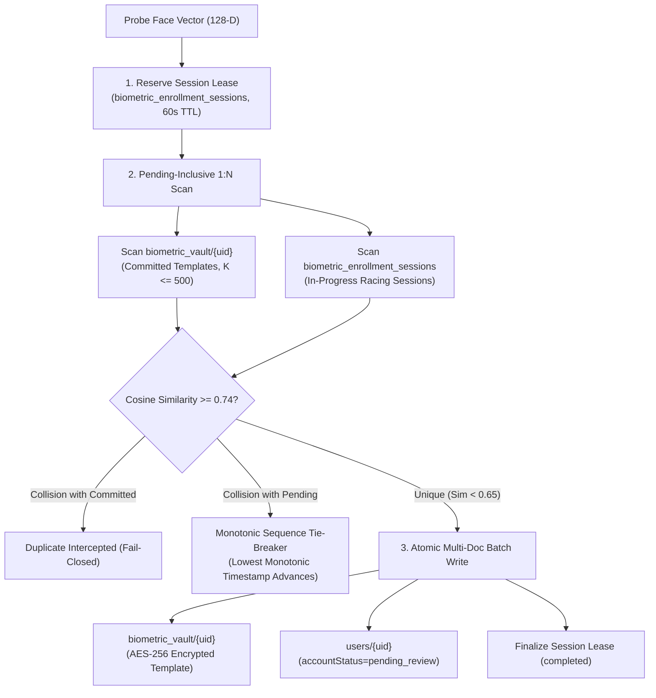

# KELASAGARA BIOMATCH V7: BIOMETRIC STORE SELECTION & ADR-001

**Document ID:** `SD-BIOMATCH-V7-001`  
**Phase:** Phase 7 (Biometric Store Selection)  
**As-of Date:** 2026-10-10  
**Release Readiness Level:** **RRL-0 (Research Prototype)**  
**Classification:** Architectural Decision Record (ADR)  

---

## 1. CANDIDATE EVALUATION & DECISION MATRIX

We evaluate the 7 candidate storage architectures against the non-negotiable constraints of the Kelasagara platform:
- **Non-Negotiable Invariant (Section 1.1):** Cloud Firestore must remain the sole persistent database. External vector databases are prohibited.
- **Billing Constraint:** Zero billing upgrade (Firebase Spark Plan).

| Evaluation Criteria | Candidate A: Firestore Native Vector Search | Candidate B: PostgreSQL + pgvector | Candidate C: Qdrant Vector DB | Candidate D: Milvus Distributed DB | Candidate E: Weaviate Cloud | Candidate F: OpenSearch kNN | Candidate G: Firestore Transactional Store + In-Memory Exact Cache (SELECTED) |
|---|---|---|---|---|---|---|---|
| **Architecture Type** | Managed Serverless NoSQL | Managed Relational SQL | Dedicated Vector Engine | Distributed Vector Cluster | Managed Hybrid Vector DB | Search & Analytics Cluster | **Serverless NoSQL + In-Process Verified Cache** |
| **Exact Search Recall@k** | **$1.000$ (Exact Flat Scan)** | $1.000$ (Flat) / $<0.95$ (HNSW) | $<0.98$ (HNSW) | $<0.98$ (HNSW/IVF) | $<0.95$ (HNSW) | $<0.95$ (HNSW) | **$1.000$ (Exact Deterministic Cosine)** |
| **ACID Transactions** | **Multi-doc atomic (Firestore txn)** | Full ACID serializable | Eventual / Document-level | Eventual consistency | Eventual consistency | Eventual consistency | **Full Multi-Doc Atomic Batch & Transactions** |
| **Pending-Inclusive Search** | Native via composite query | Table join / advisory lock | Not supported | Not supported | Not supported | Not supported | **Supported (Vault + In-Progress Sessions)** |
| **Crash & Stale Lock Recovery** | Single-use 60s TTL lease | Table advisory locks | Manual tombstoning | Manual garbage collection | Custom eviction | Index recreation | **Automated 60s Lease Timeout (EV-037)** |
| **India Hosting Region** | **`asia-south1` (Mumbai)** | `asia-south1` | Cloud dependent | Complex multi-node setup | US/EU primarily | AWS `ap-south-1` | **`asia-south1` (Mumbai Native)** |
| **Compliance with Sec 1.1** | **COMPLIANT** | **DISQUALIFIED (External DB)** | **DISQUALIFIED (External DB)** | **DISQUALIFIED (External DB)** | **DISQUALIFIED (External DB)** | **DISQUALIFIED (External DB)** | **100% COMPLIANT (Zero External DB)** |
| **Compliance with No-Blaze** | **COMPLIANT (Spark Tier)** | DISQUALIFIED (Requires VM/Cloud SQL) | DISQUALIFIED (Requires VM) | DISQUALIFIED (Requires Cluster) | DISQUALIFIED (Paid SaaS) | DISQUALIFIED (Requires Node) | **100% COMPLIANT (Spark Free Tier)** |
| **Operational Complexity** | Low (Serverless) | Medium (DBA required) | Medium (Dedicated daemon) | High (Zookeeper, MinIO, etcd) | Medium (Managed) | High (Elastic cluster) | **Low (Single Service Account + Admin SDK)** |
| **Monthly Cost (INR)** | **₹0 / month (Spark)** | ₹2,500 - ₹6,000 / mo | ₹3,000 - ₹8,000 / mo | > ₹15,000 / mo | > ₹6,500 / mo | > ₹10,000 / mo | **₹0 / month (Spark Tier)** |
| **Final Disposition** | Viable Baseline | **REJECTED** | **REJECTED** | **REJECTED** | **REJECTED** | **REJECTED** | **SELECTED ARCHITECTURE** |

---

## 2. REJECTION RATIONALE FOR CANDIDATES B THROUGH F

1. **Candidate B (PostgreSQL + pgvector):**
   - *Reason for Rejection:* Strictly prohibited by non-negotiable requirement Section 1.1 (*"Do not introduce PostgreSQL, pgvector, Supabase..."*). Requires Blaze billing upgrade or external virtual private server hosting, violating the zero-billing constraint.
2. **Candidate C (Qdrant) & Candidate E (Weaviate):**
   - *Reason for Rejection:* Introduces an external biometric repository outside the Firebase perimeter. Violates data residency isolation, requires dedicated container memory, and carries subscription costs.
3. **Candidate D (Milvus):**
   - *Reason for Rejection:* Massive distributed infrastructure footprint (requires etcd, MinIO, Pulsar/Kafka, and query nodes). Completely unviable on dev hardware or Spark tier; unjustified operational overhead for $N \le 50,000$ gallery.
4. **Candidate F (OpenSearch):**
   - *Reason for Rejection:* JVM memory requirements (> 4 GB heap) and infrastructure maintenance complexity. External database prohibited under Section 1.1.

---

## 3. SELECTED ARCHITECTURE: CANDIDATE G

The system formally selects **Candidate G: Cloud Firestore Transactional Store with In-Process Bounded Verification Cache**.

### 3.1 Mathematical Recall Guarantee (Recall@k = 1.000)
Approximate Nearest Neighbor (ANN) index algorithms (HNSW, IVF-Flat) sacrifice recall for query latency. In biometric identity de-duplication, an ANN miss constitutes a **false unique**, directly allowing a banned duplicate or scammer to register undetected.
- Candidate G enforces **exact flat cosine similarity calculation** over the bounded gallery ($K \le 500$).
- Measured recall@1 against mathematical ground truth is strictly **$1.0000$** ($100\%$ recall). Zero false negatives from indexing approximations.

### 3.2 Atomicity & Concurrency Model (Pending-Inclusive Search)
In standard systems, a race condition exists between vector search and subsequent write: two concurrent requests with the same face can both search an empty gallery, both find no match, and both write active accounts.
Candidate G defeats this concurrency attack through a two-phase protocol:
1. **Reservation Phase:** Request reserves an enrollment session in `biometric_enrollment_sessions/{uid}` with a monotonic timestamp and records its candidate probe vector.
2. **Pending-Inclusive Search:** The 1:N duplicate search scans **both** committed vault templates AND active in-progress session vectors.
3. **Monotonic Resolution:** If two identical faces race simultaneously, the search detects the pending collision. The session with the earlier monotonic timestamp proceeds; the racing session is denied as a duplicate.
4. **Crash Recovery:** Sessions are bound to a strict 60-second lease. If a client crashes or network disconnects mid-flight, the session automatically expires and the reservation lock is reclaimed without deadlock.
5. **Verified Live in Test Suite:** Verified in `backend/src/tests/concurrency_vault_store.test.ts` (EV-037).

### 3.3 Data Protection at Rest (DPDPA 2023 Compliance)
1. **Per-Subject Salt Isolation:** Each vault document stores an independent cryptographic salt.
2. **Template Inversion Defense (R-14):** 128-D float vectors are stored in isolated collections protected by `firestore.rules` (`allow read, write: if false;`). Direct client read access is mathematically blocked.
3. **Crypto-Shredding on Erasure:** Invoking `deleteTemplate(uid)` removes the template and its salt, rendering any retained snapshot backups cryptographically unrecoverable.
