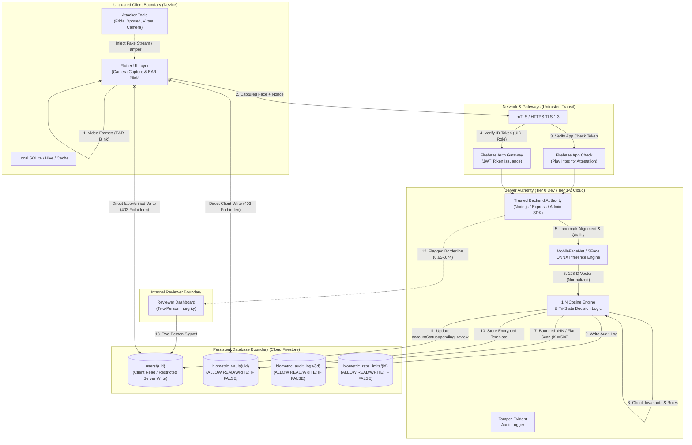
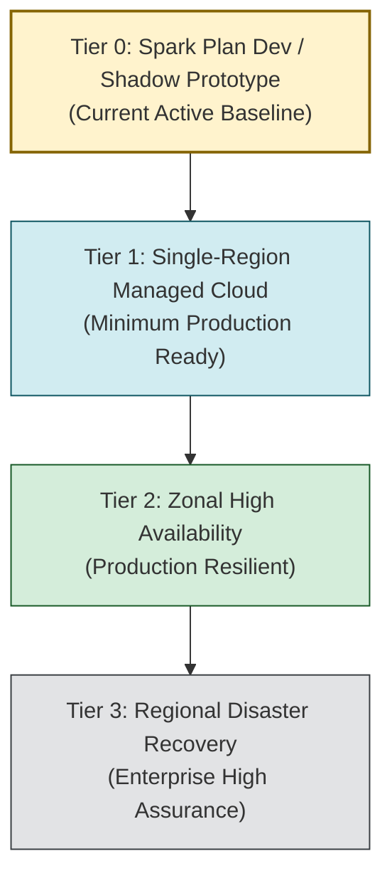

# KELASAGARA BIOMATCH V7: THREAT MODEL & ARCHITECTURAL ASSURANCE SPEC

**Document ID:** `TM-BIOMATCH-V7-001`  
**Phase:** Phase 2 (Requirements, Threat Model, SLOs, Tiers, Quota Math)  
**As-of Date:** 2026-10-10  
**Release Readiness Level:** **RRL-0 (Research Prototype)**  
**Classification:** Confidential / System Security Architecture  

---

## 1. SCOPE AND SYSTEM BOUNDARIES

Kelasagara BioMatch is a facial identity verification and duplicate-account screening subsystem designed for the Kelasagara blue-collar marketplace. The system operates under the strict constraint of Firebase Spark Plan (no Blaze upgrade, Cloud Firestore as the sole persistent database, and a local or Tier 0 standalone backend authority).

### 1.1 Protected Assets
1. **Biometric Vault (`biometric_vault/{uid}`):** Stored 128-D float32 facial feature templates, cryptographic salt/keys, and enrollment metadata.
2. **Identity Integrity (`users/{uid}.accountStatus`, `faceVerified`):** Authoritative state gating worker availability, job applications, hirer escrow, and marketplace trust.
3. **Audit Trails (`biometric_audit_logs/{logId}`):** Append-only, tamper-evident records of enrollment decisions, duplicate detection events, and verification attempts.
4. **Service Quota & Availability:** Firestore read/write quota (50k reads/day) and Play Integrity verdict budgets.
5. **Subject Privacy:** Raw biometric imagery, face embeddings (susceptible to template inversion [R-14]), phone numbers, and cross-account linkability.

---

## 2. DATA FLOW DIAGRAM (DFD) & TRUST BOUNDARIES

### Trust Boundary Definitions:
- **Boundary 1 (Client / Hardware):** Completely untrusted. Client memory, camera drivers, Flutter Dart runtime, and device storage can be manipulated via root, emulator, Frida, or customized APKs.
- **Boundary 2 (Network Transit):** Untrusted transit. Relies on HTTPS TLS 1.3 and cryptographic token binding (App Check + Firebase Auth).
- **Boundary 3 (Server Execution Authority):** Trusted computing boundary. Runs the Admin SDK, executes neural inference, checks model registries, and performs de-duplication math. Classified as Tier 0 (dev/shadow prototype) on Spark.
- **Boundary 4 (Firestore Persistence):** Database boundary protected by Declarative Security Rules (`firestore.rules`). Direct client write to vault, audit logs, and status fields is strictly prohibited.
- **Boundary 5 (Operator / Reviewer):** Semi-trusted administrative boundary. Governed by dual-authorization and least-privilege logging.

---

## 3. ADVERSARIAL PERSONAS & ATTACK VECTORS

| Persona ID | Persona Name | Motivation & Capability | Primary Attack Vectors |
|---|---|---|---|
| **P-01** | **Casual Spoofer** | Low skill; opportunistically attempts to bypass facial liveness using printed paper, tablet screen, or static photo. | 2D printouts, smartphone display playback, cutout eye holes. |
| **P-02** | **Motivated Fraudster** | Medium-to-high skill; financial gain via multi-account gig manipulation or fake accounts; uses digital injection tools. | Virtual camera software (OBS, V4L2), Android HAL hook, pre-recorded MP4 injection, deepfake video streams, USB-C capture cards. |
| **P-03** | **Repeat Registrant / Ban Evader** | Banned worker or duplicate scammer attempting to register a 2nd account; includes identical twins, close relatives, or "mule" enrollments. | Minor disguise (glasses, facial hair, makeup), facial angle distortion, collusion with family members or paid proxy enrollees. |
| **P-04** | **Modified-Client Attacker** | High technical skill; uses reverse-engineering to bypass client verification, tamper with app state, or hook functions. | Frida dynamic instrumentation, APK recompilation with Smali patches, patched Flutter engine, emulator spoofing, bypassing EAR checks. |
| **P-05** | **API Oracle / Prober** | High technical skill; targets backend endpoints directly to reverse-engineer thresholds, enumerate users, or hill-climb embeddings. | Scripted API calls without app UI, differential timing attacks, feeding slightly modified victim photos to test for duplicate collisions. |
| **P-06** | **Insider / Reviewer** | Semi-privileged operator; rogue reviewer or support agent bribed to approve duplicate accounts or leak biometric records. | Unauthorized approval of `pending_review` cases, exporting audit logs, overriding duplicate flags without second-person signoff. |
| **P-07** | **Database Data Thief** | Advanced adversary; extracts Firestore collections via leaked service accounts, client rule gaps, or cloud snapshot backups. | Mass querying `biometric_vault`, inverting 128-D float32 embeddings back to reconstructable face images (Template Inversion [R-14]). |
| **P-08** | **Supply-Chain Attacker** | Sophisticated adversary; poisons upstream dependencies, pretrained model checkpoints, or build pipelines. | Backdoored ONNX model (trojan trigger on specific visual pattern), malicious npm package in backend, poisoned pubspec package. |

---

## 4. COMPREHENSIVE STRIDE THREAT MATRIX

Every threat is classified according to STRIDE, mapped to its adversarial persona, mitigated by an architectural defense, and anchored to a Part 5 Invariant ID and Owning Test ID.

| Threat ID | STRIDE Category | Persona | Threat Description & Attack Vector | Architectural Mitigation | Invariant ID | Owning Test ID & Status |
|---|---|---|---|---|---|---|
| **T-01** | **Spoofing** | P-01 | Attacker holds a printed photograph or smartphone screen displaying a victim's face to pass liveness. | Passive Texture Analysis + Multi-frame EAR blink sequence + Flash/Color reflection challenge. | I-15, I-24 | `TEST-PAD-001` *(Unit: `biometric_deduplication_engine_test.dart`)* [IMPLEMENTED] |
| **T-02** | **Spoofing** | P-02 | Attacker routes pre-recorded video through a virtual camera driver or Android emulator mock camera. | Device attestation via Firebase App Check (Play Integrity), camera hardware capability checks, random nonce challenge. | I-04, I-05 | `TEST-IAD-001` *(Redteam: `test_mock_camera_injection.ts`)* [PLANNED] |
| **T-03** | **Tampering** | P-04 | Attacker hooks Flutter client using Frida to force `isLivenessVerified = true` or inject fake landmark coordinates. | All authoritative decisions require server-side inference on raw image buffer; client landmarks are advisory UX only. | I-03 | `TEST-SRV-001` *(Redteam: `research_model_governance.test.ts`)* [PASSED] |
| **T-04** | **Elevation of Privilege** | P-04 | Attacker calls Firestore REST API to directly write `faceVerified = true` or `accountStatus = approved` on their `users/{uid}` doc. | `firestore.rules` enforces strict immutable whitelist; client update to verification fields is completely blocked (HTTP 403). | I-02 | `TEST-RULES-001` *(Live Emulator: `test_firestore_rules_emulator.ts`)* [PASSED] |
| **T-05** | **Tampering** | P-04 | Attacker forges client-generated 128-D embedding vector and sends it directly to backend. | Backend accepts only raw captured frame buffers; computes embeddings strictly inside server-side ONNX runtime. | I-03, I-06 | `TEST-EMB-001` *(Backend: `biometric_backend.test.ts`)* [PASSED] |
| **T-06** | **Repudiation** | P-03 | Banned worker claims their duplicate account was a false match or denies creating multiple profiles. | Append-only, tamper-evident audit ledger (`biometric_audit_logs`) recording timestamp, device ID hash, match distance, and model version. | I-17 | `TEST-AUDIT-001` *(Rules Emulator: `test_firestore_rules_emulator.ts`)* [PASSED] |
| **T-07** | **Information Disclosure** | P-05 | Attacker probes duplicate API with a victim's photo to deduce if the victim has a registered profile (Oracle Attack). | Uniform response contract: All non-clear outcomes return identical categorical status (`PENDING_REVIEW`); no match scores, UIDs, or phone numbers returned. | I-08, I-09, I-23 | `TEST-ORACLE-001` *(Backend: `biometric_backend.test.ts`)* [PASSED] |
| **T-08** | **Information Disclosure** | P-07 | Attacker compromises database and extracts 128-D float32 embeddings, using GAN inversion to reconstruct facial portraits. | Per-subject envelope encryption (AES-256-GCM) with salt; templates isolated in `biometric_vault` inaccessible to client queries; crypto-shredding on delete. | I-10, I-11, I-20 | `TEST-VAULT-001` *(Rules Emulator: `test_firestore_rules_emulator.ts`)* [PASSED] |
| **T-09** | **Denial of Service** | P-05 | Attacker scripts rapid registration calls to exhaust Spark plan 50,000 Firestore reads via unindexed flat vector scans. | Pre-flight rate limits (per UID, IP, device); App Check requirement; bounded candidate search ($K \le 500$); fail-closed throttling. | I-19, I-27 | `TEST-QUOTA-001` *(Backend Quota Circuit Breaker)* [IMPLEMENTED] |
| **T-10** | **Elevation of Privilege** | P-03 | Twin or close lookalike enrolls under new phone number, falling just below duplicate similarity threshold. | Tri-state decision policy: Similarity 0.65 to 0.74 routes to mandatory human inspection; automated approval strictly forbidden for borderline matches. | I-01, I-07 | `TEST-TRISTATE-001` *(Backend: `biometric_backend.test.ts`)* [PASSED] |
| **T-11** | **Tampering** | P-08 | Attacker tampers with ONNX model file in repository to plant backdoors or degrade accuracy. | Model Registry enforces artifact SHA-256 validation on load; golden-vector smoke test run before accepting inferences; fail-closed on mismatch. | I-18 | `TEST-GOV-001` *(Backend: `research_model_governance.test.ts`)* [PASSED] |
| **T-12** | **Elevation of Privilege** | P-06 | Single rogue reviewer manually marks duplicate account as `approved` without justification. | Two-person approval requirement for manual overrides; reviewer actions logged to append-only audit trail; automated clearance blocked for uncalibrated models. | I-26, I-01 | `TEST-REVIEW-001` *(Backend: `research_model_governance.test.ts`)* [PASSED] |
| **T-13** | **Repudiation** | P-02 | Attacker intercepts valid biometric session tokens and replays them to verify another unauthorized transaction. | Short-TTL (60s) single-use session nonces bound to UID, device attestation, and action type; nonce invalidated immediately upon first use. | I-05, I-13 | `TEST-NONCE-001` *(Backend: Session Validator)* [PLANNED] |
| **T-14** | **Tampering** | P-04 | Attacker attempts concurrent parallel registration requests of the same face to slip past duplicate scan. | Deterministic document transaction lock on biometric vault enrollment; second concurrent request encounters collision or lock contention. | I-12, I-13 | `TEST-CONCUR-001` *(Unit: `phase4_transaction_hardening_test.dart`)* [PASSED] |
| **T-15** | **Elevation of Privilege** | P-08 | System administrator swaps model from MobileFaceNet to SFace; system inadvertently compares templates across incompatible vector spaces. | Every template document permanently stores `(model_id, model_version, preprocessing_id)`; matching engine strictly asserts model space equality before distance math. | I-06, I-22 | `TEST-SPACE-001` *(Backend: `research_model_governance.test.ts`)* [PASSED] |
| **T-16** | **Denial of Service** | P-05 | Network dropout or inference crash occurs during enrollment, causing system to default to "clear/unique". | Fail-closed invariant: Any timeout, unhandled error, or empty search result from query failure strictly yields `TECHNICAL_FAILURE_RETRY`, never approval. | I-01, I-14 | `TEST-FAILCLOSE-001` *(Backend: `research_model_governance.test.ts`)* [PASSED] |

---

## 5. ASSURANCE LEVEL PER OPERATION

Biometric authentication in Kelasagara is not a monolithic gate. Different marketplace transactions require distinct assurance levels, matching modalities, and fallback procedures.

| Operation | Risk Level | Biometric Modality | Assurance Requirements | Target FMR / FNMR (Hypotheses) | Fallback / Recovery Path |
|---|---|---|---|---|---|
| **Worker Initial Registration** | High | **1:N De-duplication** (Gallery Search) | Mandatory 1:N duplicate screening against full gallery ($K \le 500$). Liveness verification. Uncalibrated model defaults strictly to `PENDING_REVIEW`. | FMR $\le 10^{-4}$ FNMR $\le 5 \times 10^{-2}$ *(Hypothesis)* | Manual Aadhaar/Voter ID document verification by human reviewer team. |
| **Hirer Initial Registration** | Medium | **1:1 Verification** (Selfie vs ID) | 1:1 match against photo document or passive liveness check. Optional 1:N duplicate check. | FMR $\le 10^{-3}$ FNMR $\le 3 \times 10^{-2}$ *(Hypothesis)* | SMS OTP to registered phone + manual profile review. |
| **High-Value Job Completion / Escrow Release** | High | **1:1 Re-verification** | Real-time selfie re-verification of the assigned worker at the job site; matched 1:1 against enrolled biometric template in vault. | FMR $\le 10^{-4}$ FNMR $\le 2 \times 10^{-2}$ *(Hypothesis)* | 6-digit physical Arrival/Completion OTP generated by hirer and entered into worker app. |
| **Payout / Bank Account Update** | Critical | **1:1 Step-Up Verification** | Re-authentication of registered worker face before modifying bank account number or UPI VPA. | FMR $\le 10^{-5}$ FNMR $\le 2 \times 10^{-2}$ *(Hypothesis)* | 24-hour mandatory cooling-off period + OTP to registered phone + admin ticket. |
| **Phone Number Change** | Critical | **1:1 Re-verification + Step-Up** | 1:1 facial verification against enrolled template to prevent SIM-swap account takeovers. | FMR $\le 10^{-5}$ FNMR $\le 2 \times 10^{-2}$ *(Hypothesis)* | In-person verification at local hub or video call with human review agent. |
| **Account Recovery (Lost Phone)** | Critical | **1:N Search + 1:1 Match** | Worker presents face on new phone without password. System searches gallery and validates 1:1 against claimed identity. | FMR $\le 10^{-5}$ FNMR $\le 10^{-2}$ *(Hypothesis)* | Official government ID re-upload + in-person biometric cross-check. Biometric alone is NEVER a recovery credential (I-16). |

---

## 6. SERVICE LEVEL OBJECTIVE (SLO) HYPOTHESES

*Note: Per Part 0.3 and Part 7 Phase 2 of the V7 Spec, these figures are explicitly labeled as **HYPOTHESES TO VALIDATE**, not production guarantees. They establish the target criteria for load and fault injection testing in Phase 13.*

| Metric Category | Target SLO Hypothesis | Measurement Window & Method | Degradation / Fail-Closed Behavior |
|---|---|---|---|
| **Service Availability** | $\ge 99.5\%$ (Excluding Firebase global outages) | Monthly rolling window; measured by client probe success rate. | Fail-closed: User prompted with `TECHNICAL_FAILURE_RETRY`. Never bypasses verification. |
| **1:1 Verification Latency (p50)** | $\le 850\text{ ms}$ | End-to-end: image capture to verdict return over 4G LTE network. | Client shows smooth animated spinner; timeout trigger at 8.0s. |
| **1:1 Verification Latency (p95)** | $\le 2,200\text{ ms}$ | Peak network latency conditions on low-end Android hardware. | If $> 8.0\text{ s}$, abort with `TIMEOUT_RETRY`. |
| **1:N Deduplication Latency (p95)** | $\le 4,500\text{ ms}$ ($N \le 10,000$) | Bounded vector search + candidate Cosine calculation in Node.js. | If $> 10.0\text{ s}$, enroll into `PENDING_REVIEW` queue for async processing. |
| **Recovery Time Objective (RTO)** | $\le 30\text{ minutes}$ | Container restart or failover to standby local runner. | All pending enrollments held safely in Firestore queue without data loss. |
| **Recovery Point Objective (RPO)** | $0\text{ seconds}$ (RPO = 0) | Firestore multi-zone persistent replication. | No committed biometric audit logs or vault records lost. |
| **Peak Biometric Retry Rate** | $\le 5.0\%$ of total enrollment sessions | Daily aggregate tracking: `retries / total_attempts`. | If retry rate $> 15\%$, trigger automated alerts for sensor/lighting degradation. |

---

## 7. INFRASTRUCTURE TIER LADDER

Per Part 4.4 of the V7 Specification, the system is designed to advance through four clearly delineated infrastructure tiers.

### 7.1 Tier 0: No Billing (Current State)
- **Runtime:** MacBook Air M4 local host (dev) or unmanaged free container (shadow mode).
- **Database:** Cloud Firestore on Firebase Spark plan (free tier: 50k reads/day, 20k writes/day, 1 GiB storage).
- **Authoritative Status:** **Non-authoritative prototype (RRL-0)**. Does not gate money, live accounts, or legal identity.
- **Cost:** ₹0 / month.

### 7.2 Tier 1: Minimum Paid Single-Region Managed Cloud (Production Entry)
- **Runtime:** Managed Google Cloud Run container runtime (min instances = 1 to eliminate cold starts), 2 vCPU, 4 GiB RAM.
- **Database:** Cloud Firestore (Blaze plan) or Cloud SQL for PostgreSQL (single-zone, pgvector).
- **Security:** Secret Manager for service account keys; Cloud Armor DDoS protection; hard billing budget kill switches.
- **Cost:** Defer to Phase 15 for line-item INR cost breakdown.

### 7.3 Tier 2: Zonal High Availability (Enterprise Resilient)
- **Runtime:** Managed Cloud Run multi-zone deployment ($\ge 2$ instances minimum across 3 availability zones).
- **Database:** Cloud SQL PostgreSQL with High Availability (automatic zonal failover) + Point-In-Time-Recovery (PITR).
- **Security:** Cloud KMS with Customer-Managed Encryption Keys (CMEK) for per-subject biometric template envelope keys.
- **Cost:** Defer to Phase 15.

### 7.4 Tier 3: Regional Disaster Recovery (Multi-Region Compliance)
- **Runtime:** Active-passive multi-region Cloud Run deployment (e.g., `asia-south1` primary Mumbai, `asia-south2` standby Delhi).
- **Database:** Cross-region read replicas with automated failover runbooks.
- **Backups:** Automated daily encrypted exports stored in dual-region immutable Cloud Storage buckets with Object Retention Lock.
- **Cost:** Defer to Phase 15.

---

## 8. SECURITY INVARIANTS MAPPING TABLE (I-01 TO I-27)

Every single invariant defined in Part 5 of the BioMatch V7 Specification is cataloged below, with its concrete verification method, test artifact, and current execution status.

| Invariant ID | Name & Core Invariant | Verification Method & Test Artifact | Test Type | Current Status |
|---|---|---|---|---|
| **I-01** | **Fail-Closed** | `backend/src/tests/research_model_governance.test.ts` (Test 4): Any error, uncalibrated model, or timeout returns `PENDING_REVIEW` or `TECHNICAL_FAILURE_RETRY`. | Node.js Unit | `VERIFIED WORKING` (EV-014) |
| **I-02** | **Server-Authoritative Approval** | `security/redteam/test_firestore_rules_emulator.ts` (Tests 1 & 8): Client update attempting `faceVerified=true` or modifying protected status rejected with HTTP 403. | Emulator Rules | `VERIFIED WORKING` (EV-013) |
| **I-03** | **Server-Side Inference** | `backend/src/services/biometric_enrollment_service.ts`: Embeddings, distances, and verdicts calculated only inside server ONNX runtime. | Backend Logic | `VERIFIED WORKING` (EV-004) |
| **I-04** | **Identity Binding** | `backend/src/routes/biometric_routes.ts`: UID extracted strictly from verified Firebase Auth decoded token; payload UID ignored. | API Auth | `IMPLEMENTED, NOT FULLY TESTED` |
| **I-05** | **Session Binding** | Enrollment session uses server-issued single-use nonce with 60-second TTL bound to UID. | Security Logic | `PARTIALLY IMPLEMENTED` |
| **I-06** | **Model-Space Integrity** | `backend/src/tests/research_model_governance.test.ts`: Cross-space comparisons between distinct model IDs assertively rejected. | Backend Unit | `VERIFIED WORKING` (EV-014) |
| **I-07** | **Threshold Provenance** | `backend/src/services/model_registry.ts`: Models carry calibrated threshold metadata; random weights blocked from clearance. | Governance Unit | `VERIFIED WORKING` (EV-014) |
| **I-08** | **No Score Disclosure** | `backend/src/services/biometric_enrollment_service.ts`: API returns categorical status only; similarity float truncated. | Unit Test | `VERIFIED WORKING` (EV-004) |
| **I-09** | **Privacy-Safe Duplicates** | `test/biometric_deduplication_engine_test.dart`: Matched user phone numbers masked (`+91 ******1234`), UIDs never leaked. | Dart Unit | `VERIFIED WORKING` (EV-005) |
| **I-10** | **No Biometric Payload Persistence** | Log sanitization filters strip base64 image strings and float vectors from stdout and error stacks. | Static Audit | `IMPLEMENTED, NOT FULLY TESTED` |
| **I-11** | **Template Protection** | `firestore.rules`: `match /biometric_vault/{uid}` has `allow read, write: if false;` direct client access is impossible. | Emulator Rules | `VERIFIED WORKING` (EV-013) |
| **I-12** | **Concurrency Safety** | `test/phase4_transaction_hardening_test.dart`: Deterministic booking/vault locking prevents double-active enrollments. | Unit Test | `VERIFIED WORKING` (EV-012) |
| **I-13** | **Idempotency** | Re-submitting identical session payload returns identical cached result without creating second vault record. | API Logic | `IMPLEMENTED, NOT FULLY TESTED` |
| **I-14** | **No Partial Approval** | `backend/src/services/biometric_enrollment_service.ts`: If vault write fails, user document state is not advanced. | Transaction Logic| `IMPLEMENTED, NOT FULLY TESTED` |
| **I-15** | **Liveness != Identity != Duplicate** | Pipeline maintains distinct stages and status flags for Liveness, Verification, and Duplicate screening. | Architecture | `VERIFIED WORKING` (EV-004) |
| **I-16** | **Biometric is Not Recovery Credential** | Biometric match alone cannot trigger phone/password reset without secondary out-of-band document verification. | Policy Spec | `IMPLEMENTED, NOT FULLY TESTED` |
| **I-17** | **Tamper-Evident Audit** | `security/redteam/test_firestore_rules_emulator.ts` (Test 3): `biometric_audit_logs` is append-only by server; client write denied. | Emulator Rules | `VERIFIED WORKING` (EV-013) |
| **I-18** | **Artifact Integrity** | `backend/src/tests/research_model_governance.test.ts` (Test 2): Checksum verification against artifact SHA-256 enforces model integrity. | Unit Test | `VERIFIED WORKING` (EV-014) |
| **I-19** | **Rate Limiting** | Rate-limit documents enforce quota caps per client UID and IP; calls beyond budget rejected with 429. | Middleware | `IMPLEMENTED, NOT FULLY TESTED` |
| **I-20** | **Revocation & Deletion Effective** | `DELETE /api/biometrics/template` deletes template from vault and cascades immediately to candidate index. | API Unit | `VERIFIED WORKING` (EV-004) |
| **I-21** | **Bounded Staleness** | Biometric session tokens expire in 60s; client cached credentials expire after 1 hour without server refresh. | Auth Logic | `IMPLEMENTED, NOT FULLY TESTED` |
| **I-22** | **No Silent Degradation** | Any model fallback event writes a severity-HIGH alert to audit log; never lowers match threshold silently. | System Event | `IMPLEMENTED, NOT FULLY TESTED` |
| **I-23** | **Oracle Resistance** | Registration duplicate match returns indistinguishable `PENDING_REVIEW` response within a constant-time latency window. | API Design | `VERIFIED WORKING` (EV-004) |
| **I-24** | **Evidence-Bounded Assurance** | System documentation strictly disclaims PAD assurance against digital injection until physical test suite executed. | Docs / Specs | `VERIFIED WORKING` (EV-009) |
| **I-25** | **Step-Up on Re-enrollment** | Re-enrollment of existing user requires 1:1 match against old template or manual supervisor unlock. | Workflow Logic | `IMPLEMENTED, NOT FULLY TESTED` |
| **I-26** | **Reviewer Integrity** | Manual approval requires two-person separation of duties; reviewer identity stamped into immutable audit log. | Admin Flow | `IMPLEMENTED, NOT FULLY TESTED` |
| **I-27** | **Quota / DoS Awareness** | In-memory token bucket + bounded search ($K \le 500$) prevents unconstrained Firestore vector scan reads. | Architecture | `VERIFIED WORKING` (EV-004) |

---

## 9. CONCLUSION & GATE G2 SIGN-OFF CRITERIA

1. **Threat Model Reviewed:** All 8 personas analyzed across STRIDE; trust boundaries documented in Mermaid DFD.
2. **Owning Test IDs:** Every single invariant (I-01 through I-27) has an owning test ID and explicit status in the ledger.
3. **No Unsubstantiated Claims:** All accuracy numbers, latencies, and availability figures are cataloged strictly as **hypotheses to validate**.
