# Biometric Template Migration, Re-Enrollment, and Rollback Specification
## Version Guardrails, Migration State Machine, In-Place Re-Enrollment, and Failure Contingency

**Platform:** Kelasagara Biometric Engine V5.0  
**Current Production Version:** `kelasagara_biomatch_v2_whitened`  
**Legacy Incompatible Version:** `kelasagara_v1_raw`  
**Classification:** Operational Engineering Runbook  
**Last Updated:** 2026-10-22  

---

## 1. Problem Statement: Mathematical Version Incompatibility

Legacy V1 biometric templates were generated using un-whitened positive Euclidean coordinates residing in $\mathbb{R}_{\ge 0}^{128}$.
V2 whitened templates are zero-centered across the empirical human population distribution $\mathcal{N}(\mathbf{0}, I_{128})$ on $\mathbb{S}^{127}$.

**Critical Invariant (I-06 / I-09):** Cross-version comparisons are mathematically undefined. Comparing a V1 template against a V2 template produces arbitrary, corrupted cosine scores. Therefore:
$$\text{If } \text{template}_A.\text{modelVersion} \neq \text{template}_B.\text{modelVersion} \implies \text{Comparison STRICTLY PROHIBITED}$$

Incompatible templates must **never** be silently compared or treated as zero-distance matches.

---

## 2. Migration State Machine & Zero Blind-Spot Policy

A major security vulnerability during biometric upgrades is the "Migration Blind Spot": if legacy templates are simply ignored or skipped during 1:N deduplication, a malicious user could register a duplicate account during the migration window.

Kelasagara implements a **Zero Blind-Spot Migration Architecture**:

```mermaid
stateDiagram-v2
    [*] --> ReadProfile
    ReadProfile --> ActiveV2 : modelVersion == 'kelasagara_biomatch_v2_whitened'
    ReadProfile --> MigrationRequired : modelVersion == 'kelasagara_v1_raw'
    ReadProfile --> Unenrolled : No biometric document

    MigrationRequired --> RetroactivePrompt : User Logs In (App Opens)
    RetroactivePrompt --> LiveCapture : Consent Granted
    LiveCapture --> ExtractV2 : 513 Markers + Whitened Embedding Generated
    ExtractV2 --> ScanDeduplication : 1:N Check against all V2 Templates
    ScanDeduplication --> CommitV2 : Deduplication Passed (Unique)
    CommitV2 --> ActiveV2 : Firestore Document Updated to V2

    ScanDeduplication --> FlaggedAdjudication : Collision Detected (>= 0.74)
```



### 2.1 Handshake & Retroactive Prompting
1. When a worker opens the mobile app, `AuthProvider` checks the user's `biometric_vault` document.
2. If `modelVersion != kCurrentModelVersion`, the dashboard renders the `RetroactiveEnrollmentBanner`.
3. The banner informs the worker in Kannada and English that a security upgrade is active.
4. The user completes a 10-second capture. A fresh V2 template is extracted, validated against 1:N deduplication, and committed atomically to `biometric_vault`.

---

## 3. Worker In-Place Re-Enrollment Protocol (`FaceReEnrollTile`)

Workers who experience natural physical changes (weight change, glasses, facial hair, cataract surgery) can re-enroll directly from their mobile profile screen:
- File: [`lib/widgets/face_reenroll_tile.dart`](file:///Users/ananda/KELASAGARA%20MAJOR%20PROJECT/kelasagaara_v17/lib/widgets/face_reenroll_tile.dart)
- Accessible in **Profile $\to$ Security Settings**.
- **Security Control:** Requires the worker to pass an immediate kinematic blink liveness check (`BlinkVerifySheet`) before the re-enrollment camera opens.
- The new capture runs full 1:N deduplication before replacing the stored template in `biometric_vault`.

---

## 4. Rollback Contingency Procedures

In the unlikely event that a production defect requires rolling back a biometric deployment:

### 4.1 Automated Dry-Run Validation (`MIG-01`)
The backend migration harness provides a dry-run tool (`dryRunMigrate()` in `backend/src/services/template_migration.ts`) that verifies decryption, vector re-normalization, and schema compatibility on a copy of the database without altering production records.

### 4.2 Idempotent Batch Migration (`MIG-03`)
If a batch migration is interrupted halfway through, re-running the migration script is completely idempotent:
- Already-migrated records (`modelVersion == 'kelasagara_biomatch_v2_whitened'`) are detected and skipped.
- Corrupted source records are safely isolated in `biometric_migration_quarantine` without halting the batch.

### 4.3 Emergency Rollback Flag
If the server-side SFace neural model experiences an unexpected runtime fault, `face_inference.ts` provides an automatic fail-safe fallback:
```typescript
if (process.env.BIOMETRIC_ENGINE_EMERGENCY_FALLBACK === 'true') {
  // Gracefully routes to MobileFaceNet secondary model
  // while preserving ISO 24745 encryption and zero-PII contracts
}
```

---

## 5. Deletion & Data Retention Propagation (DPDPA Section 12)

When an account is deleted or a worker invokes their right-to-erasure:
1. The document `/biometric_vault/{userId}` is deleted in Firestore.
2. The template is purged from `InMemoryBiometricIndex` in RAM via `InMemoryBiometricIndex.remove(userId)`.
3. An audit event `BIOMETRIC_TEMPLATE_ERASED` is recorded with `userId`, `timestamp`, and zero biometric vector payload.
4. Encrypted offline backup snapshots expire automatically after 30 days under Firestore TTL policies.
