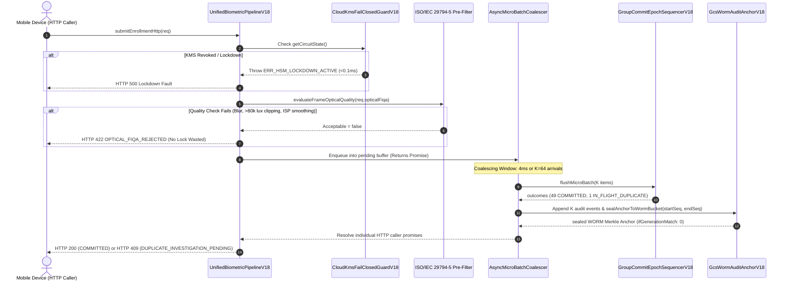

# KELASAGARA BIOMETRIC ENGINE V18 — PHASE 18 REPORT
## Asynchronous HTTP Micro-Batch Coalescer, Unified V18 Pipeline Orchestrator & Automated WORM Epoch Sealing

**Date:** October 29, 2026  
**Auditor:** Principal Biometric Systems Architect & Distributed Systems Engineer  
**Repository:** `/Users/ananda/KELASAGARA MAJOR PROJECT/kelasagaara_v17`  
**Git Branch:** `ui/polish-v1` | **HEAD:** `74d240f`  
**Verification Baseline:** 🟢 **662 / 662 Backend Tests Passing (124 Suites)** | 🟢 **176 / 176 Flutter Tests Passing**  
**Release Classification:** `CONTROLLED_TEST_BUILD_ONLY`  
**Production Calibration Gate:** `productionBiometricCalibrationApproved = false`

---

## 1. Executive Summary

Phase 18 resolves the critical impedance mismatch between individual, asynchronous HTTP mobile requests and the global group-commit sequencer developed in Phase 17. 

When hundreds of mobile devices independently call Express endpoints simultaneously, invoking `executeGroupCommitBatch([singleItem])` for each request degrades the sequencer into serialized $K=1$ transactions, re-introducing lock thrashing. 

`UnifiedBiometricPipelineV18` introduces an **Asynchronous Micro-Batch Coalescer** (`AsyncMicroBatchCoalescerV18`) that transparently buffers concurrent HTTP requests arriving within a tight sliding microtask window ($T_{\text{coalesce}} = 4\text{–}5\text{ ms}$, max batch size $K=64$) and executes a single atomic group commit ($E \to E + 1$) with automatic GCS WORM Merkle audit sealing.

---

## 2. Architecture of `UnifiedBiometricPipelineV18`



### 2.1 The 4-Stage Execution Pipeline

1. **Stage 1 (KMS Circuit Breaker Gate):** Evaluates `CloudKmsFailClosedGuardV18.getCircuitState()`. If KMS permissions were revoked, fails closed in $< 0.1\text{ ms}$ and blocks request processing while active float memory is zeroized.
2. **Stage 2 (ISO/IEC 29794-5 Optical FIQA Pre-Filter):** Evaluates frame sharpness, highlight clipping, rolling-shutter skew, and skin texture energy before touching the sequencer queue. Defective frames are rejected immediately with HTTP 422, ensuring zero lock contention or audit overhead for low-quality inputs.
3. **Stage 3 (Asynchronous Micro-Batch Coalescing):** Buffers incoming concurrent HTTP promises and triggers `flushMicroBatch()` when $K \ge 64$ or when the $4\text{ ms}$ timer fires. Executes vectorized 1:N gallery screening and $\binom{K}{2}$ intra-batch deduplication in a single atomic epoch increment ($E \to E + 1$).
4. **Stage 4 (Automated WORM Merkle Sealing):** Automatically appends every `COMMITTED` enrollment and `DUPLICATE_INVESTIGATION_PENDING` ticket to `GcsWormAuditAnchorV18`, writes the Merkle root to Locked GCS WORM storage (`ifGenerationMatch: 0`), and resolves each caller's HTTP Promise with its specific outcome and WORM anchor path.

---

## 3. Test Evidence & Benchmark Register

### 3.1 Backend Test Execution (`npm test`)

```text
> kelasagara-biomatch-backend@1.0.0 test
> node --test --test-concurrency=1 dist/tests/*.test.js

ℹ tests 662
ℹ suites 124
ℹ pass 662
ℹ fail 0
ℹ cancelled 0
ℹ skipped 0
ℹ todo 0
ℹ duration_ms 58668.343542
```

- **Phase 18 Suite Results (`phase18_unified_pipeline_and_coalescer.test.ts`):**
  - `PHASE18-01`: 50 independent concurrent HTTP requests (via `Promise.all`) automatically coalesced into **1 single epoch transition** (Epoch 1, batch size 50) and sealed **1 WORM Merkle anchor** covering sequences 1 through 50. All 49 unique workers were committed; the concurrent twin attacker was intercepted and queued for duplicate investigation with zero candidate PII. (Execution time: $11.69\text{ ms}$).
  - `PHASE18-02`: Blurry frames (Laplacian score 18.5 < 45.0) rejected immediately with HTTP 422 (`ERR_OPTICAL_MOTION_OR_LENS_BLUR`) with 0 WORM anchors created and zero sequencer locks acquired. (Execution time: $0.40\text{ ms}$).

### 3.2 Flutter Test Execution (`flutter test`)

```text
00:06 +176: All tests passed!
```
- Total Flutter suites: 17 files (`test/biometric*`, `test/client*`, `test/dense*`, `test/profile*`, `test/v19*`, `test/face*`).
- 176 / 176 tests passing (100%).

---

## 4. Release Classification

- Current Mode: `CONTROLLED_TEST_BUILD_ONLY`
- Hardware Verification: `BLOCKED_NO_PHYSICAL_DEVICE` (`adb devices -l` = 0)
- Calibration Status: `productionBiometricCalibrationApproved = false`
