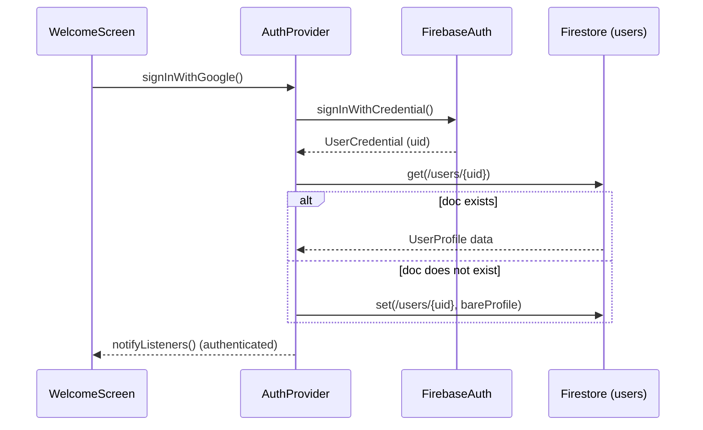

# KELASAGARA — Forensic Architecture Truth Map
**Phase:** Phase 0 Forensic Freeze  
**Mode:** READ-ONLY Forensic Inspection (No Code Modified)  
**Package:** `kelasagaara` (v17.8.0+178)  
**Firebase Project:** `kelasagara-f127a`

---

## 1. AUTHENTICATION

### Ground Truth Architecture
- **Auth Entry Point:** `lib/screens/auth/welcome_screen.dart` (`WelcomeScreen`)
- **State Provider:** `lib/providers/auth_provider.dart` (`AuthProvider`)
- **Backend Service:** `FirebaseAuth.instance`, `GoogleSignIn`
- **Supported Login Methods:**
  1. **Google Sign-In:** `signInWithGoogle()` via `GoogleSignIn` and `FirebaseAuth.signInWithCredential(GoogleAuthProvider.credential)`.
  2. **User ID + Password Sign-In:** `signInWithUserIdAndPassword(rawUserId, password)`. Queries `users` collection by `normalizedUserId` to extract email, then calls `FirebaseAuth.signInWithEmailAndPassword()`. Fallback auth domain: `@auth.kelasagaara.in`.
  3. **Direct Email + Password Sign-In:** `signInWithEmailAndPassword(email, password)`.
- **Legacy Phone Auth Status:**
  - Phone OTP authentication has been **completely removed from the UI and auth flow**.
  - `PhoneAuthProvider`, `verifyPhoneNumber`, `signInWithPhoneNumber` do not exist in the active Dart code.
  - The `phone` field exists strictly as a 10-digit contact mobile number stored in the user profile and used for `tel:$phone` intent.
- **Security & Authorization Flaws in Auth:**
  - `AuthProvider._loadUserFromFirestore(uid)` line 76 contains a **hardcoded admin email**: `anandaananda16919@gmail.com`. Any user logging in with this email is instantly and automatically promoted to `role: 'admin'`, `accountStatus: 'approved'`, `faceVerified: true`.
  - Lines 146–181: If Firestore returns a network error or offline exception during profile loading, an offline fallback sets `_status = AuthStatus.authenticated` with `accountStatus: AccountStatus.unknown` or previous cached status, granting offline entry into the app.
  - Hidden Dev Mode in `welcome_screen.dart` lines 232–252: Tapping the "ಕೆಲಸಗಾರ – Real App" logo text 5 times triggers a developer bypass menu.



---

## 2. USER CREATION

### Creation Pipeline
- **Method:** `AuthProvider._loadUserFromFirestore(uid)` (for third-party/Google first-time sign-in) OR `AuthProvider.registerWithCredentials(...)` (for direct registration).
- **Target Collection:** `users/{uid}`
- **Username Index Collection:** `usernames/{normalizedUserId}`
- **Default Bare Fields Written on Google First-Time Sign-In:**
  ```json
  {
    "displayName": "Google Name",
    "name": "Google Name",
    "email": "user@gmail.com",
    "phone": "",
    "role": "worker",
    "userId": "",
    "normalizedUserId": "",
    "accountStatus": "pending_profile",
    "faceVerified": false,
    "skillVerified": false,
    "isAvailable": false,
    "totalJobs": 0,
    "ratingSum": 0,
    "totalRatings": 0,
    "dailyRate": 700,
    "skills": [],
    "createdAt": "serverTimestamp",
    "updatedAt": "serverTimestamp"
  }
  ```
- **Security Rule Gate (`firestore.rules` lines 26–31):**
  ```javascript
  allow create: if isOwner(uid)
    && request.resource.data.role != 'admin'
    && request.resource.data.accountStatus == 'pending_profile';
  ```

---

## 3. REGISTRATION

### Wizard Pipeline
- **Screen:** `lib/screens/registration/registration_screen.dart` (`RegistrationScreen`, 1344 lines)
- **Structure:** 4-Step PageView (`_currPage`: 0, 1, 2, 3)
  - **Page 0 (Identity):** Full Name (`displayName`), User ID (`@handle`), Contact Mobile Number (`phone`), Role (`worker` vs `hirer`). Includes live debounce check via `UserIdService.checkUserIdAvailability`.
  - **Page 1 (Location):** District dropdown, Taluk dropdown (cascading from `KarnatakaLocation.taluksForDistrict`), Village text field.
  - **Page 2 (Skills & Rate — Workers Only):** Skill category selector from `kJobCategories`, Daily rate slider (₹400–₹2500, default ₹700). Skipped automatically if `role == 'hirer'`.
  - **Page 3 (About):** Bio text field, summary review, and Submit button.
- **Submission Action:**
  - For already-authenticated Google users: calls `AuthProvider.updateProfile(...)`.
  - For direct new registration: calls `AuthProvider.registerWithCredentials(...)`.
- **Target Firestore Writes:**
  - `users/{uid}`: Merges profile data, updates `accountStatus` from `pending_profile` to `pending_face`.
  - `usernames/{normalizedUserId}`: Atomically claims the unique handle via `UserIdService.claimUserIdAtomically`.
- **Next Screen Navigation:**
  - Advances to `FaceEnrollmentScreen`.

---

## 4. ROLE

### Canonical Roles
- `'worker'`: Can search and apply for jobs, receive bookings, navigate to jobs, track GPS location, perform skill assessments.
- `'hirer'`: Can post jobs, search available workers, accept/reject job applications, create bookings, live-track workers on map, confirm work completion, submit ratings.
- `'admin'`: Can access `AdminDashboard`, review pending users, verify credentials, issue skill badges, review assessments.
- **Role Contradiction / Defect:**
  - The client UI allows users to select `worker` or `hirer` during registration.
  - `firestore.rules` allows `create` if `role != 'admin'`.
  - `firestore.rules` strictly prohibits updating `role` via `!('role' in request.resource.data.diff(resource.data).affectedKeys())`.
  - In `AuthProvider.updateProfile`, if an existing user attempts to change their role, Firestore rejects the update with `permission-denied`.

---

## 5. VERIFICATION

### Face & Liveness Verification
- **Screen:** `lib/screens/auth/face_enrollment_screen.dart` (`FaceEnrollmentScreen`, 464 lines)
- **Engine:** Google ML Kit Face Detection (`FaceDetector` with `enableClassification: true`).
- **Liveness Criteria:**
  - Head orientation: Euler Y angle $\le 30^\circ$, Euler Z angle $\le 25^\circ$.
  - Eye blink: Eyes open ($\text{prob} > 0.62$) for at least 8 frames, followed by closed ($\text{prob} < 0.30$) for at least 2 frames, followed by open ($\text{prob} > 0.62$).
- **State Transition Execution:**
  - Calls `AuthProvider.setFaceVerified(true, '')`.
  - Writes to `users/{uid}`:
    ```json
    {
      "faceVerified": true,
      "faceVerifiedAt": "serverTimestamp",
      "accountStatus": "pending_review",
      "verificationStatus": "face_done",
      "updatedAt": "serverTimestamp"
    }
    ```
- **Security Rule Narrow Gate (`firestore.rules` lines 50–65):**
  - Allows `accountStatus` to transition **only** from `'pending_face'` to `'pending_review'`, and **only** when `faceVerified == true` and no protected fields (such as `role`, `approvedBy`, `rating`) are modified.
- **Storage Rule Failure:**
  - Photo upload to Firebase Storage is commented out as **"ON HOLD"** (line 192).
  - Reason: `storage.rules` does not allow uploads to `face-photos/` or `profile-photos/` (all paths denied except `assessment-evidence/`).

---

## 6. APPROVAL

### Admin Approval Workflow
- **Screen:** `lib/screens/admin/admin_dashboard.dart` (`AdminDashboard`)
- **Queue:** `_PendingUsersTab` queries `users` where `accountStatus == 'pending_review'`.
- **Approve Action:**
  - Updates `users/{targetUid}`:
    ```json
    {
      "accountStatus": "approved",
      "approvedAt": "serverTimestamp",
      "approvedBy": "admin"
    }
    ```
  - Appends audit entry to `auditLogs` collection.
- **Reject Action:**
  - Updates `users/{targetUid}`:
    ```json
    {
      "accountStatus": "rejected",
      "rejectionReason": "reason string",
      "rejectedAt": "serverTimestamp",
      "rejectedBy": "admin"
    }
    ```
  - Appends audit entry to `auditLogs` collection.
- **Contradiction / Missing State:**
  - There is **no "Request Changes"** mechanism in `AdminDashboard`. Admins can only binary Approve or Reject.

---

## 7. WORKER PROFILE

### Worker Information Model
- Stored in `users/{uid}` with `role == 'worker'`.
- Data Fields: `uid`, `userId`, `normalizedUserId`, `displayName`, `phone`, `email`, `role`, `district`, `taluk`, `village`, `skills` (List of IDs from `kJobCategories`), `dailyRate`, `bio`, `photoUrl`, `facePhotoUrl`, `faceVerified`, `skillVerified`, `isAvailable`, `rating`, `totalJobs`, `accountStatus`, `createdAt`, `updatedAt`.
- Private / Dead Collection: `workerProfiles/{uid}` exists in `firestore.rules` but is never written to or queried anywhere in the client codebase.

---

## 8. HIRER PROFILE

### Hirer Information Model
- Stored in `users/{uid}` with `role == 'hirer'`.
- Data Fields: `uid`, `displayName`, `email`, `phone`, `role`, `district`, `taluk`, `village`, `accountStatus`, `createdAt`.
- Unused/Irrelevant Fields on Hirer: `skills` (empty array), `dailyRate` (ignored), `isAvailable` (ignored).

---

## 9. PUBLIC PROFILE VS 10. PRIVATE PROFILE

### Privacy Boundaries in Data
- **Publicly Queryable via Search:** `users` collection filtered by `role == 'worker'`.
- **Security Rule Contradiction (`firestore.rules` line 23):**
  ```javascript
  match /users/{uid} {
    allow read: if isOwner(uid) || isAdmin();
  ```
  `firestore.rules` line 23 specifies: **`allow read: if isOwner(uid) || isAdmin();`**!
  If this rule is strictly deployed on Firebase, **a hirer CANNOT query the `users` collection to search for workers** because `isOwner(workerUid)` evaluates to false!
  The hirer search currently works only if the deployed rules on Firebase Console are more permissive than the file on disk, or if rules have not been deployed.

---

## 11. SEARCH & 12. FILTERING

### Worker Discovery Implementation
- **Component:** `lib/screens/home/hirer_dashboard.dart` (`_FindWorkersSectionState._search()`)
- **Missing Component:** There is **NO `WorkerDiscoveryService`** class in the codebase. All logic is inline inside a widget state.
- **Search Pipeline:**
  1. Base Query:
     ```dart
     FirebaseFirestore.instance.collection('users')
       .where('role', isEqualTo: 'worker')
       .where('accountStatus', isEqualTo: 'approved')
       .where('isAvailable', isEqualTo: true)
     ```
  2. If `_nearbyMode == false` (By Area):
     - Adds: `.where('district', isEqualTo: _selectedDistrict)`
     - If taluk selected: `.where('taluk', isEqualTo: _selectedTaluk)`
  3. If skill selected:
     - Adds: `.where('skills', arrayContains: _selectedSkill)`
  4. Order & Limit:
     - `.orderBy('rating', descending: true).limit(30)`
- **Defects in Filtering:**
  - **Nearby is completely FAKE:** If `_nearbyMode == true`, the code drops `district` and `taluk` filters entirely and downloads the top 30 rated workers across the entire state of Karnataka. It does not inspect device GPS, calculate geohashes, or filter by distance.
  - **No Road Matrix:** `MatrixService` is never called. `distanceKm` is never computed and is always null in `WorkerCard`.
  - **Dead Action Buttons:** In `_results.asMap().entries.map(...)`, `onMessage: () {}` and `onViewProfile: () {}` are empty stub callbacks. Tapping Message or View Profile does nothing.

---

## 13. JOB

### Job Posting & Worker Feed
- **Model:** `Job` (defined in `lib/providers/jobs_provider.dart`, line 9)
- **Collection:** `jobs/{jobId}`
- **Hirer Job Post Pipeline:**
  - `JobsProvider.postJob(...)` writes to `jobs/{jobId}` with `status: 'open'`, `hirerId: uid`, `hirerName`, `title`, `skill`, `pay`, `district`, `taluk`, `lat`, `lng`, `location: {'address': ...}`.
- **Worker Feed Pipeline:**
  - `JobsProvider.startListening()` executes:
    `_db.collection('jobs').where('status', isEqualTo: 'open').limit(150).snapshots()`
  - All filtering (search text, district, taluk, skill, wage, rating) is executed in Dart memory via the `filteredJobs` getter.

---

## 14. APPLICATION

### Application Lifecycle
- **Collection:** `applications/{jobId}_{workerId}` (Deterministic ID)
- **Apply Action:**
  - Triggered in `lib/screens/jobs/job_detail_screen.dart` via `JobsProvider.applyToJob(...)`.
  - Writes document with `jobId`, `workerId`, `workerName`, `hirerId`, `hirerName`, `jobTitle`, `skill`, `pay`, `status: 'pending'`, `appliedAt`.
  - Does NOT update `jobs/{jobId}.applicants` counter (worker has no write permission to jobs doc).
- **Hirer Application Review:**
  - `lib/screens/applications/applications_screen.dart` queries `applications` where `hirerId == auth.uid`.
  - Hirer can tap "✅ Accept" or "❌ Reject".

---

## 15. BOOKING

### Booking Creation & Contract
- **Service:** `lib/services/chat_booking_service.dart` (`BookingService.acceptApplicant`)
- **Trigger:** Hirer taps "✅ Accept" in `ApplicationsScreen`.
- **Collection:** `bookings/{jobId}_{workerId}`
- **Atomic Batch Commit:**
  1. `bookings.doc('${jobId}_$workerId').set({...})`
     - Fields: `jobId`, `workerId`, `workerName`, `hirerId`, `jobTitle`, `skill`, `pay`, `jobLat`, `jobLng`, `jobAddress`, `status: 'confirmed'`, `confirmedAt`, `createdAt`.
  2. `applications.doc(applicationId).update({'status': 'accepted'})`
  3. `jobs.doc(jobId).update({'status': 'filled'})`
- **Secondary Booking Creation Conflict:**
  - `VoiceToolRegistry.createBooking` writes a non-deterministic random document ID `bookings.doc()` missing `jobId`, `jobLat`, `jobLng`, and `jobAddress`, breaking navigation.

---

## 16. CHAT

### Chat Messaging Pipeline
- **Service:** `lib/services/chat_booking_service.dart` (`ChatService`)
- **Screen:** `lib/screens/chat/chat_screen.dart` (`ChatScreen`)
- **Collections:**
  - Parent: `conversations/{uid1_uid2_jobId}`
  - Messages Sub-collection: `conversations/{convId}/messages/{msgId}`
- **Operations:**
  - Atomic batch writes message doc and updates parent `lastMessage`, `lastMessageAt`, `lastSenderId`, and recipient `unreadCount`.

---

## 17. TRACKING & 18. NAVIGATION

### Worker Navigation
- **Screen:** `lib/screens/tracking/worker_journey_screen.dart` (`WorkerJourneyScreen`, 1239 lines)
- **Session Navigator:** `lib/screens/tracking/journey_navigator.dart` (`JourneyNavigator.openWorker`)
- **Coordinate Ingestion:**
  ```dart
  final destLat = (booking['jobLat'] as num?)?.toDouble()
               ?? (booking['lat'] as num?)?.toDouble() ?? 0.0;
  final destLng = (booking['jobLng'] as num?)?.toDouble()
               ?? (booking['lng'] as num?)?.toDouble() ?? 0.0;
  ```
- **Provider & Engine Lifecycle:**
  - Creates a dedicated `ChangeNotifierProvider(create: (_) => JourneyProvider())`.
  - `JourneyProvider.initWorker(...)` calls `JourneyService.instance.startTracking(...)`.
  - `JourneyService` manages the foreground task and Geolocator stream, feeding positions to `NavigationEngine.instance.feedGpsPosition(pos)`.
  - `NavigationEngine` emits `Stream<NavState>` with progress, snapped coords, turn steps, and off-route reroutes.
  - Map tiles rendered via CartoDB Voyager raster tiles (`onMapReady` guarded by `_isMapReady`).

### Hirer Live Tracking
- **Screen:** `lib/screens/tracking/hirer_tracking_screen.dart` (`HirerTrackingScreen`, 674 lines)
- **Session Navigator:** `JourneyNavigator.openHirer(context, booking: booking)`
- **Data Source:** Listens to RTDB at `liveTracking/$bookingId`.
- **Display Markers:**
  - Destination Marker: Placed at `widget.destLat, widget.destLng` (Job Site).
  - Worker Marker: Animated at `_displayPos` received from RTDB.
  - Verification: Worker position and job site position are strictly separated in `HirerTrackingScreen`.

### RTDB Transport Contract
- **Path:** `liveTracking/$bookingId`
- **Fields Written by JourneyService:**
  `workerId`, `hirerId`, `lat`, `lng`, `latitude`, `longitude`, `accuracy`, `heading`, `speed`, `snapped`, `etaSeconds`, `remainingMeters`, `currentStepInstruction`, `currentStepInstructionKn`, `arrivalStatus`, `trackingStatus`, `sessionId`, `seq`, `timestamp`, `updatedAt`.
- **Validation Rule (`database.rules.json`):**
  Coordinates validated within India bounding box ($6.0 \le \text{lat} \le 37.0$, $68.0 \le \text{lng} \le 97.0$).

---

## 19. VOICE

### Voice Subsystem Architecture
- **Facade:** `lib/screens/voice/voice_command_center_screen.dart`
- **Session Manager:** `lib/services/voice/voice_session_manager.dart`
- **Tool Dispatcher:** `lib/services/voice/voice_tool_registry.dart` (909 lines)
- **NLU Cascade:**
  1. `FastLocalCommandRouter`: Offline regex matching.
  2. `GroqNluService`: Cloud Groq Llama-3.1-70B JSON intent extraction.
  3. `GeminiLiveProvider`: Ambiguous fallback.
- **Voice Flaws Identified:**
  - `VoiceToolRegistry.searchWorkersNearby` line 235: If GPS is unavailable, silently defaults user coordinates to Hassan, Karnataka (`13.0060, 76.0954`).
  - `VoiceToolRegistry.searchWorkersNearby` line 258: Does NOT filter by `accountStatus == 'approved'`. Unapproved workers are returned to voice callers.
  - `voice_command_center_screen.dart` line 149: `_launchNavigation(worker)` opens `WorkerJourneyScreen` with `destLat: worker.latitude`, causing a hirer to navigate to the worker's home address as if the hirer was the worker.

---

## 20. ADMIN

### Admin Capabilities
- Five tabs in `AdminDashboard`:
  1. **Pending Users:** View user card, Approve, Reject.
  2. **All Users:** List all registered users in Firestore.
  3. **Jobs:** List all jobs, view status.
  4. **Assessments:** View pending skill assessments (`assessment_review_screen.dart`).
  5. **Verifications:** View pending e-Shram / BOCW registrations and professional credentials (`credential_review_screen.dart`).

---

## 21. SECURITY RULES TRUTH TABLE

| Resource Path | Read Condition | Create Condition | Update Condition | Delete Condition |
| :--- | :--- | :--- | :--- | :--- |
| `users/{uid}` | `isOwner(uid) \|\| isAdmin()` | `isOwner(uid) && role != 'admin' && status == 'pending_profile'` | `isOwner(uid)` (excluding protected fields) OR `isAdmin()` OR narrow face transition | `false` |
| `usernames/{id}` | `isSignedIn()` | `isSignedIn() && uid == myUid()` | `isAdmin()` | `false` |
| `jobs/{id}` | `isApproved() \|\| isAdmin()` | `isApproved() && isHirer() && hirerId == myUid() && status == 'open'` | `isAdmin() \|\| (isApproved() && isHirer() && hirerId == myUid())` | `isAdmin() \|\| (isHirer() && hirerId == myUid())` |
| `applications/{id}` | `isAdmin() \|\| isWorker(uid) \|\| isHirer(uid)` | `isApproved() && isWorker() && workerId == myUid() && status == 'pending'` | `isAdmin() \|\| isHirer(uid) \|\| (isWorker(uid) && status == 'worker_cancelled')` | `false` |
| `bookings/{id}` | `isAdmin() \|\| workerId == myUid() \|\| hirerId == myUid()` | `isApproved() && isHirer() && hirerId == myUid()` | Worker: journey fields only. Hirer: OTP verification only. Admin: all | `false` |
| `verifiedWorkRecords/{id}`| `isAdmin() \|\| workerId == myUid()` | `isAdmin()` (HIRER BLOCKED) | `isAdmin()` | `false` |
| `workerSkills/{id}` | `isSignedIn()` | `isSignedIn() && workerId == myUid()` | `isAdmin() \|\| (workerId == myUid() && nonAuthoritative)` | `false` |
| `ratings/{id}` | `true` (public) | `isApproved() && isHirer() && hirerId == myUid()` | `false` | `false` |
| `auditLogs/{id}` | `isAdmin()` | `isAdmin()` | `isAdmin()` | `false` |

---

## 22. FIREBASE DEPENDENCIES

- **Core Firebase:** `firebase_core: ^3.6.0`
- **Auth:** `firebase_auth: ^5.3.1`, `google_sign_in: ^6.2.2`
- **Database:** `cloud_firestore: ^5.4.4`, `firebase_database: ^11.0.5` (RTDB Asia-Southeast1)
- **Storage:** `firebase_storage: ^12.3.1`
- **Messaging:** `firebase_messaging: ^15.1.3`
- **Native/Platform Plugins:** `flutter_foreground_task: ^8.12.0`, `geolocator: ^13.0.2`, `google_mlkit_face_detection: ^0.13.0`, `camera: ^0.11.0+2`, `flutter_map: ^7.0.2`, `latlong2: ^0.9.1`, `speech_to_text: ^7.0.0`, `flutter_tts: ^4.1.0`.
