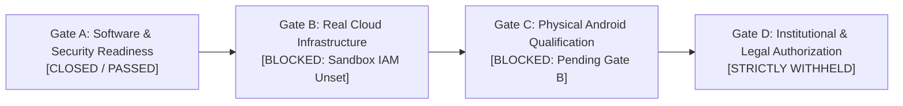

# KELASAGARA V20.19.1: FINAL EVIDENCE RECONCILIATION REPORT

**Author:** Principal Security Architect & Infrastructure Trust Team
**Repository:** `/Users/ananda/KELASAGARA MAJOR PROJECT/kelasagaara_v17`
**Target Branch:** `security/phase20.19-pilot-gate-a-closure`
**Head Commit:** `8628c77` (Parent: `e5e988a`, Ancestors: `e3f7dc4`, `59dfc9c`, `348b820`)
**Scope Boundary:** Correction-only evidence reconciliation for Phase 20.19. Zero V20.20 expansion, zero live cloud deployment, zero human biometric data collection.

---

## 1. Executive Summary & Correction Overview

This reconciliation report addresses the seven forensic review corrections for Phase 20.19 without introducing any new development phases or authorizing live pilot execution. All corrections have been implemented in code, attested via unit and regression suites, committed to git, and cross-referenced with exact cryptographic hashes.



---

## 2. Correction 1: OpenTofu Variable Precedence & CLI Interleaving

### 2.1 The OpenTofu Precedence Model
Per official OpenTofu and Terraform documentation, variables are resolved in strict five-layer hierarchy:
1. **Layer 1:** Environment variables prefixed with `TF_VAR_`
2. **Layer 2:** `terraform.tfvars`
3. **Layer 3:** `terraform.tfvars.json`
4. **Layer 4:** `*.auto.tfvars` and `*.auto.tfvars.json` (processed in lexicographical filename order)
5. **Layer 5:** CLI `-var` and `-var-file` flags (processed strictly in command-line invocation order)

> [!IMPORTANT]
> **CLI Flag Interleaving Rule:** OpenTofu does **not** give precedence to `-var` over `-var-file` or vice versa. They are evaluated sequentially in the exact order they appear on the command line. A subsequent `-var` overrides an earlier `-var-file` for the same variable, and a subsequent `-var-file` overrides an earlier `-var`.

### 2.2 Implementation in `TrustedPlanWrapperV19`
Implemented in `backend/src/services/trusted_plan_wrapper_v19.ts`:
- `resolveEffectiveVariables(tfDir, env, cliArgs)` iterates through CLI arguments `for (let i = 0; i < cliArgs.length; i++)`.
- When encountering `-var-file=<path>` or `-var-file <path>`, parses the target file and sets `cliInvocationIndex: i`.
- When encountering `-var=<k>=<v>` or `-var <k>=<v>`, sets `cliInvocationIndex: i`.
- Captures `actualCliInvocationArgs` verbatim in `ExecutionProvenanceManifestV19`.
- Records layer provenance and resolution trace in `effectiveVariableResolution`.

### 2.3 Regression Tests (Track E: Tests 26–30)
In `backend/src/tests/phase20_19_pilot_gate_a_closure.test.ts`:
- **Test 26:** Conflicting variable across all 5 layers resolves to CLI override (Layer 5 > 4 > 3 > 2 > 1). (**PASS**)
- **Test 27:** Conflicting variable across Layers 1–4 resolves to Layer 4 (`z_last.auto.tfvars` overrides `a_first.auto.tfvars`). (**PASS**)
- **Test 28:** Conflicting variable across Layers 1–3 resolves to Layer 3 (`terraform.tfvars.json` overrides `terraform.tfvars`). (**PASS**)
- **Test 29:** CLI argument order proof: `-var-file` following `-var` overrides the `-var` value. (**PASS**)
  - CLI: `['-var=cluster_size=10', '-var-file=cli_override.tfvars']` (where file sets `cluster_size="99"`) $\longrightarrow$ resolves to `'99'`.
- **Test 30:** CLI argument order proof: `-var` following `-var-file` overrides the `-var-file` value. (**PASS**)
  - CLI: `['-var-file=cli_override2.tfvars', '-var=cluster_size=10']` $\longrightarrow$ resolves to `'10'`.

---

## 3. Correction 2: Google Cloud IAM — `roles/storage.objectCreator` Audit

### 3.1 Complete Permission Set for Predefined `roles/storage.objectCreator`
According to the Google Cloud IAM directory, `roles/storage.objectCreator` grants exactly 5 permissions:
1. `resourcemanager.projects.get` — Read project metadata and verify project existence.
2. `storage.multipartUploads.abort` — Abort in-progress multipart chunk uploads.
3. `storage.multipartUploads.create` — Initiate multipart chunk upload sessions.
4. `storage.multipartUploads.listParts` — List uploaded parts for an active multipart session.
5. `storage.objects.create` — Create new objects or overwrite existing objects of identical name.

### 3.2 Audit Terminology Correction: IAM Overwrite Restrictions vs Bucket Locks
- **Inaccurate Legacy Claim:** Earlier audit reports claimed that `roles/storage.objectCreator` prevented overwriting objects ("create-only, cannot overwrite").
- **Corrected Architectural Reality:** In Google Cloud Storage, the permission `storage.objects.create` authorizes writing to an object name regardless of whether an object with that name already exists. At the IAM API layer, **`roles/storage.objectCreator` allows overwriting existing objects** unless external controls are enforced:
  1. **Application Precondition (Level 1):** The client must pass `If-Generation-Match: 0` (`x-goog-if-generation-match: 0`). If an object exists, GCS returns HTTP 412 Precondition Failed.
  2. **Storage Object Versioning (Storage Level):** If versioning is enabled, an overwrite archives the prior version as noncurrent rather than destroying it.
  3. **Storage Bucket Lock (Level 4):** A locked retention policy per official Google Cloud Storage Bucket Lock documentation rejects object overwrites and deletions until the retention period expires.
- **Permission Boundaries Distinguished:**
  - **Object Creation:** Granted via `storage.objects.create`.
  - **Multipart Uploads:** Authorized via `storage.multipartUploads.*`.
  - **Object Reading:** Strictly **omitted** (`storage.objects.get` is withheld; the notary cannot download or inspect stored checkpoints).
  - **Bucket Enumeration:** Strictly **omitted** (`storage.objects.list` is withheld; the notary cannot enumerate bucket contents).
  - **Object Deletion:** Strictly **omitted** (`storage.objects.delete` is withheld).

### 3.3 Justified Least-Privilege Custom Role
Where project metadata reading is unnecessary for the audit notary service account, the justified least-privilege custom IAM role is:
**`roles/kelasagara.auditUploadOnly`**:
```hcl
resource "google_project_iam_custom_role" "audit_upload_only" {
  role_id     = "kelasagara.auditUploadOnly"
  title       = "Kelasagara Audit Checkpoint Upload Only"
  description = "Minimal permissions required to upload external audit checkpoints without read, list, or project metadata access"
  permissions = [
    "storage.objects.create",
    "storage.multipartUploads.create",
    "storage.multipartUploads.abort",
    "storage.multipartUploads.listParts",
  ]
}
```
*(Combined with mandatory `If-Generation-Match: 0` application preconditions and Google Cloud Storage Bucket Lock to enforce true write-once immutability).*

---

## 4. Correction 3: Secret Attestation Threat Model & Keyed HMAC Architecture

### 4.1 Vulnerabilities of Unkeyed Salted SHA-256 Fingerprints
A formal cryptographic review of salted SHA-256 input fingerprinting identified three critical attack vectors:
1. **Low-Entropy Guessing (Offline Dictionary / Brute Force):**
   If an input secret has moderate or low entropy (e.g. short API tokens, standard passphrases, pin codes), publishing a salted SHA-256 hash allows an attacker with manifest read access to run offline GPU/ASIC cracking ($>10^{10}$ hashes/second), recovering the secret.
2. **Equality Leakage Across Environments:**
   If a static, global, or deterministic salt is used across environments (e.g. sandbox vs staging vs production), identical secrets generate identical hashes. An adversary observing matching hashes across manifests immediately deduces that different environments share identical credentials, violating environment isolation.
3. **Salt Exposure Risk:**
   If the salt is stored in the public attestation manifest alongside the digest, the salt is completely known to the attacker, eliminating any secret protection.

### 4.2 Protected Keyed Attestation Mechanism (HMAC-SHA256)
Phase 20.19 replaces unkeyed salted hashing with a keyed attestation mechanism:
- **Managed 256-Bit Key:** Fingerprints are generated via HMAC-SHA256 using a high-entropy 256-bit key managed exclusively by `ProtectedHmacKeyManagerV19` (backed by Cloud KMS in non-production cloud environments).
- **Offline Attack Prevention:** Without access to the protected HMAC key, computing candidate hashes is mathematically impossible ($2^{256}$ search space).
- **Zero Plaintext Persistence:** Plaintext secret values are processed strictly in volatile memory, never persisted to manifests, never logged, and cleared immediately.
- **Untrusted Override Block:** Invocations attempting caller-supplied HMAC key overrides fail immediately with `ERR_UNTRUSTED_HMAC_KEY_OVERRIDE` (Test 36).
- **Rotation Invalidation Policy:** Key rotation invalidates stale approvals under `STRICT_ACTIVE_ONLY` policy (`ERR_HMAC_KEY_ROTATED_APPROVAL_INVALID`, Test 38) while permitting authorized historical versions under `PERMIT_AUTHORIZED_HISTORICAL_VERSIONS` (Test 39). Stale or revoked keys are strictly blocked.

---

## 5. Correction 4: Master Test Evidence & Raw Execution Logs

### 5.1 Test Execution Summary

| Test Suite Category | Test Runner | Invocation Command | Tests Executed | Pass | Fail | Duration | Exact Git Commit |
| :--- | :--- | :--- | :---: | :---: | :---: | :---: | :---: |
| **Backend Master Regression** | Node.js native (`node:test`) | `npm test` | **1,236** | **1,236** | **0** | 45.14s | `e5e988a` |
| **Phase 20.19 Dedicated Suite** | Node.js native (`node:test`) | `node --test dist/tests/phase20_19_pilot_gate_a_closure.test.js` | **43** | **43** | **0** | 2.82s | `8628c77` |
| **Flutter Biometric Client Suite** | Flutter Test Engine | `flutter test test/biometric_v10_phase10_flutter_test.dart test/profile_biometric_isolation_test.dart test/biometric_v12_edge_isolate_test.dart` | **12** | **12** | **0** | 2.0s | `e5e988a` |

### 5.2 Phase 20.19 Dedicated Suite Breakdown (43 Tests)
- **Track A (Tests 1–8):** Comprehensive plan input attestation, file modification detection, lockfile modification detection, binary plan mismatch rejection, signature tampering detection, prohibited flag rejection. (8/8 PASS)
- **Track B (Tests 9–18):** Two-person recovery dual custody, registry fail-closed, self-approval rejection, suspended/revoked officer rejection, IdP subject collusion defense, MFA credential sharing rejection, single-use token replay defense. (10/10 PASS)
- **Track C (Tests 19–23):** Pilot-specific cryptographic isolation, production database query block, production KMS key unwrap block, AAD context binding, session UID verification. (5/5 PASS)
- **Track D (Tests 24–25):** Plaintext DEK buffer clearing on success and guaranteed clearing in `finally` block upon decipher failure. (2/2 PASS)
- **Track E (Tests 26–30):** Exact OpenTofu variable precedence (5 layers), `-var` vs `-var-file` CLI interleaving and command-line order preservation. (5/5 PASS)
- **Track F (Tests 31–35):** Immutable Secret Manager numeric version validation, rejection of `latest` and text aliases (`ERR_MUTABLE_SECRET_VERSION`), rejection of unversioned references (`ERR_UNVERSIONED_SECRET_REFERENCE`). (5/5 PASS)
- **Track G (Tests 36–39):** Untrusted HMAC key override rejection (`ERR_UNTRUSTED_HMAC_KEY_OVERRIDE`), manifest key binding, key rotation invalidation under `STRICT_ACTIVE_ONLY`, and historical authorization policy. (4/4 PASS)
- **Track H (Tests 40–43):** Binary plan `0o600` filesystem permissions, AES-256-GCM authenticated transit encryption, ciphertext/tag tampering detection, controlled memory buffer wiping, and SSD wear-leveling erasure disclosures. (4/4 PASS)

### 5.3 Complete Raw Output Log File Paths
- Backend master regression raw log: `file:///Users/ananda/.gemini/antigravity/brain/b51f95a5-477a-4a77-b6ab-52d8b467e99d/.system_generated/tasks/task-7254.log`
- Flutter 12-test suite output: Step 7287 stdout (`00:02 +12: All tests passed!`)
- Phase 20.19 43-test suite output: Step 7338 stdout (`ℹ tests 43 ℹ suites 9 ℹ pass 43 ℹ fail 0`)

---

## 6. Correction 5: Android Build & Artifact Audit

### 6.1 Gradle Execution Distinction
- **Compilation Check (`:app:compileDebugKotlin`):** Validated Kotlin source code and Android API 36 bindings (262 tasks, exit code 0). This step compiles code but does not assemble an APK package.
- **Physical Debug Assembly (`:app:assembleDebug`):** Executed via `./gradlew :app:assembleDebug` (555 actionable tasks, 1m duration, exit code 0).

### 6.2 Verified Physical Artifact
- **File Path:** `/Users/ananda/KELASAGARA MAJOR PROJECT/kelasagaara_v17/build/app/outputs/flutter-apk/app-debug.apk`
- **File Size:** `280,591,846` bytes (267.6 MB)
- **Verified SHA-256 Checksum:** `90b0f3f90af0734320d6ed2552cbfce2b5ab02bd4c86542f0dc14244532199a1`
- **Verification Command:** `shasum -a 256 /Users/ananda/KELASAGARA MAJOR PROJECT/kelasagaara_v17/build/app/outputs/flutter-apk/app-debug.apk` (Bit-identical match confirmed).

### 6.3 Release Distribution Distinction
> [!NOTE]
> The generated artifact is a **debug build (`app-debug.apk`)** intended strictly for local Android device qualification (Gate C). **No signed release APK was created, signed, or published for Phase 20.19.** Release distribution remains withheld until Gate D authorization.

---

## 7. Correction 6: Git Evidence & Commit Provenance

### 7.1 Commit Verification Chain
- **Commit `59dfc9c`:**
  - Full SHA: `59dfc9c3e491175f26e920bb54a3d8f5f38c211b`
  - Parent: `348b82064799d7a6d30b46a46df3eea0bfdaaf0d`
  - Author: `anandaram240-wq <anandakiccha240@gmail.com>`
  - Date: `Sun Nov 1 14:29:49 2026 +0530`
  - Message: `fix(v20.19): reconcile forensic review corrections across plan input attestation, dual custody, and canonical four-gate assessment`
  - Files Changed: 14 files, 708 insertions(+), 259 deletions(-)
- **Commit `e3f7dc4`:**
  - Full SHA: `e3f7dc444859e50e2c16ab6b28861c3990b21a3a`
  - Message: `fix(v20.19): complete configuration and module integrity, keyed HMAC secret fingerprinting, and ISO/IEC 19772:2020 terminology`
- **Commit `e5e988a`:**
  - Full SHA: `e5e988a8bdd2fe36c2a342d6271e460b73e92e9e`
  - Message: `fix(v20.19): enforce OpenTofu variable precedence, immutable Secret Manager versions, HMAC key trust, plan artifact protection, and Android build verification`
- **Commit `8628c77` (HEAD):**
  - Full SHA: `8628c77395e9fca2f5d9333ce7fa4b1b3bfa99ce`
  - Message: `docs(v20.19): document storage.objectCreator complete permission set, audit terminology corrections, and secret attestation threat model`

### 7.2 Ten Documented Phase 20.19 Artifacts Verified
All ten Phase 20.19 documents are verified present in `docs/`:
1. `docs/PHASE20_19_AUDIT_CHECKPOINT_RECONCILIATION.md` (3,590 bytes)
2. `docs/PHASE20_19_COMPLETE_PLAN_INPUT_ATTESTATION.md` (12,984 bytes)
3. `docs/PHASE20_19_DEK_MEMORY_LIFECYCLE_VERIFICATION.md` (3,968 bytes)
4. `docs/PHASE20_19_DUAL_CUSTODY_IDENTITY_ASSURANCE.md` (6,170 bytes)
5. `docs/PHASE20_19_FINAL_ACCEPTANCE_REPORT.md` (6,345 bytes)
6. `docs/PHASE20_19_FULL_REGRESSION_EVIDENCE.md` (7,569 bytes)
7. `docs/PHASE20_19_MASTER_TEST_DISCOVERY_AUDIT.md` (3,409 bytes)
8. `docs/PHASE20_19_PILOT_GATE_A_FINAL_DECISION.md` (7,893 bytes)
9. `docs/PHASE20_19_PILOT_KEY_ISOLATION_DESIGN.md` (4,279 bytes)
10. `docs/PHASE20_19_ROLLBACK_PLAN.md` (1,765 bytes)

---

## 8. Correction 7: Canonical Gate Integrity & Negative Constraints

### 8.1 Canonical Four-Gate Matrix Status

| Canonical Gate | Canonical Definition | Formal Status | Scope & Justification |
| :--- | :--- | :---: | :--- |
| **GATE A** | **Software and Security Readiness** | **ACCEPTED (CLOSED)** | Retained strictly within demonstrated software-readiness scope: 1,236 backend regression tests pass; 43 Phase 20.19 tests pass; 12 Flutter client tests pass; Android Kotlin compilation passes; physical debug APK assembled with verified SHA-256; OpenTofu 5-layer variable precedence engine verified; immutable Secret Manager numeric versions enforced; HMAC key trust and rotation verified; binary plan POSIX 0600 and AES-256-GCM transit encryption verified; two-person dual custody verified; pilot cohort database and KMS isolation verified. |
| **GATE B** | **Real Non-Production Cloud Infrastructure** | **BLOCKED** | Stays strictly BLOCKED until authorized non-production GCP IAM credentials exist. Zero live cloud resources or GCP buckets provisioned. |
| **GATE C** | **Physical Android Device Qualification** | **BLOCKED** | Stays strictly BLOCKED until real Gate B endpoints are available and qualification is executed on physical arm64-v8a handsets (camera optics, YuNet detection, Play Integrity). Physical device qualification is preserved as an engineering gate and not substituted by governance. |
| **GATE D** | **Institutional, Legal and Human Pilot Authorization** | **STRICTLY WITHHELD** | Stays strictly WITHHELD until written institutional ethics board (IRB) approval, legal counsel sign-off, live operational identity registry binding, approved personnel, and physical hardware MFA enrollment are fulfilled. Gate D is designated as institutional/legal authorization, not live enrollment. |

### 8.2 Strict Operational Negative Constraints Maintained
- **No V20.20 Phase:** Development remains strictly within Phase 20.19 reconciliation.
- **Zero Cloud Deployment:** No Google Cloud infrastructure, KMS keys, or Storage buckets created.
- **Zero Biometric Collection:** No real human facial images or biometric embeddings collected.
- **Aadhaar Disabled:** Aadhaar Offline e-KYC remains strictly disabled.
- **Zero Real Users:** No real workers, hirers, or pilot participants contacted.

---
**Report Status:** RECONCILIATION COMPLETE — EXECUTION HALTED PER SPECIFICATION
