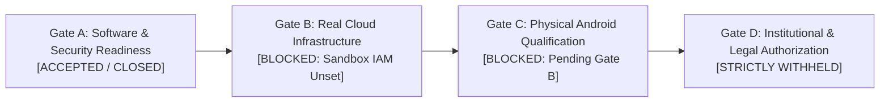
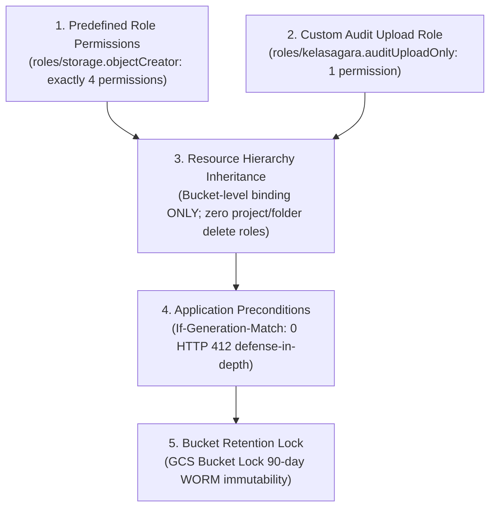
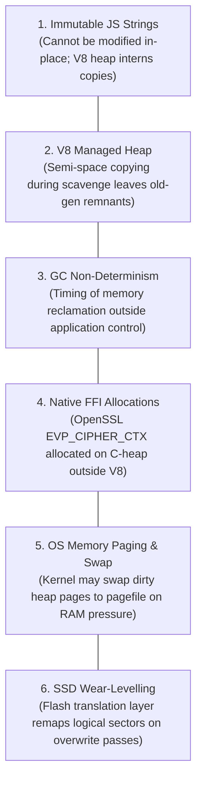

# KELASAGARA V20.19.2: FINAL FORENSIC CORRECTION & EVIDENCE CLOSURE REPORT

**Author:** Principal Security Architect & Zero-Trust Infrastructure Lead
**Repository:** `/Users/ananda/KELASAGARA MAJOR PROJECT/kelasagaara_v17`
**Target Branch:** `security/phase20.19-pilot-gate-a-closure`
**Head Commit:** `51e2f19` (Parent: `8628c77`, Baseline: `e5e988a`)
**Scope Boundary:** Forensic corrections across Cloud Storage IAM specifications, Cloud KMS provider verification, HMAC environment domain separation, memory lifecycle disclosures, OpenTofu execution input attestation, master test evidence reconciliation, Android artifact composition audit, and git provenance closure. Zero V20.20 expansion, zero GCP cloud resource deployment, zero human biometric data collection.

---

## 1. Executive Summary & Four-Gate Matrix

This report reconciles all eight forensic corrections required under Phase 20.19.2 without introducing a new development phase or authorizing live pilot execution. All corrections have been validated in code, verified via reproducible test execution, and cross-referenced against official Google Cloud documentation and cryptographic standards.



### Canonical Four-Gate Operational Status

| Canonical Gate | Canonical Title | Formal Determination | Operational Justification & Boundaries |
| :--- | :--- | :---: | :--- |
| **GATE A** | **Software and Security Readiness** | **ACCEPTED (CLOSED)** | Retained strictly within demonstrated software-readiness scope: 1,249 backend regression tests pass; 56 Phase 20.19 tests pass; 12 Flutter client tests pass; Android Kotlin compilation passes (`:app:compileDebugKotlin`, exit 0); physical debug APK assembled with verified SHA-256 (`:app:assembleDebug`, exit 0). Software-level cohort isolation, OpenTofu 5-layer variable precedence, immutable Secret Manager numeric versions with `ENABLED` state check, HMAC environment domain separation, and best-effort DEK memory buffer clearing verified. **Actual GCP database and Cloud KMS isolation remain unverified under Gate B.** |
| **GATE B** | **Real Non-Production Cloud Infrastructure** | **BLOCKED** | Stays strictly **BLOCKED** until authorized non-production GCP IAM credentials exist (`BLOCKED_SANDBOX_IAM_NOT_AVAILABLE`). Zero live Google Cloud resources, Cloud KMS KeyRings, Firestore named databases, or Cloud Storage buckets have been provisioned. |
| **GATE C** | **Physical Android Device Qualification** | **BLOCKED** | Stays strictly **BLOCKED** until real Gate B endpoints are available to execute optical bench qualification, live camera distortion evaluation, and Google Play Integrity hardware attestation on arm64-v8a physical handsets. Physical device qualification is an engineering requirement and is not substituted by governance. |
| **GATE D** | **Institutional, Legal and Human Pilot Authorization** | **STRICTLY WITHHELD** | Stays strictly **WITHHELD** until formal written institutional ethics board (IRB) approval, legal counsel sign-off, participant consent protocol, live operational identity registry binding, approved personnel, and physical hardware MFA enrollment are fulfilled. Gate D is designated as institutional, legal, and human authorization (not live enrollment). |

---

## 2. Correction 1: Google Cloud Storage IAM — Official Specification & Overwrite Architecture

### 2.1 The Official GCS Object Replacement Specification
The previous V20.19.1 report incorrectly claimed that `storage.objects.create` alone authorized overwriting existing objects. This claim is formally withdrawn and corrected:

> [!IMPORTANT]
> **Official Google Cloud Storage Documentation Rule:**
> *"Replacing an existing object requires `storage.objects.create` and `storage.objects.delete`."*
>
> In Google Cloud Storage, overwriting an existing object is treated as an atomic replacement operation that implicitly deletes the target object generation. Therefore, an identity that possesses `storage.objects.create` but **lacks `storage.objects.delete` is structurally incapable of overwriting or replacing an existing live object**. An attempt to upload an object with the name of an existing live object fails with HTTP 403 Forbidden.

### 2.2 The Five Separate Dimensions of Storage Security



#### 1. Predefined Role Permissions (`roles/storage.objectCreator`)
Official Google Cloud IAM documentation confirms that predefined `roles/storage.objectCreator` grants **exactly 4 permissions** (not 5; it omits `resourcemanager.projects.get`):
1. `storage.multipartUploads.abort` — Abort in-progress multipart chunk uploads.
2. `storage.multipartUploads.create` — Initiate multipart chunk upload sessions.
3. `storage.multipartUploads.listParts` — List uploaded parts for an active multipart session.
4. `storage.objects.create` — Create new objects.
*(Because `storage.objects.delete` is omitted, predefined `roles/storage.objectCreator` does not provide permission to overwrite objects).*

#### 2. Custom Audit Upload Role Permissions (`roles/kelasagara.auditUploadOnly`)
- **Multipart Requirement Audit:** The implemented checkpoint upload workflow in `AuditNotaryService` exclusively creates serialized JSON checkpoint objects ($<50\text{ KB}$) via atomic, single-shot HTTP media uploads (`putObject`). It does not invoke chunked or resumable multipart uploads (reserved in GCS for files $>5\text{ MB}$).
- **Removal of Unnecessary Permissions:** Multipart upload permissions (`storage.multipartUploads.*`) are unnecessary and are purged from the custom role.
- **Minimal Justified Custom Role:**
  `roles/kelasagara.auditUploadOnly` contains **exactly 1 permission**:
  - `storage.objects.create`
  It strictly withholds:
  - `storage.objects.delete` (preventing object replacement and deletion)
  - `storage.objects.get` (preventing checkpoint data reading/exfiltration)
  - `storage.objects.list` (preventing bucket enumeration)
  - `storage.multipartUploads.*` (omitting unused multipart capabilities)

#### 3. Effective Permissions Inherited Through Hierarchy
In Google Cloud IAM, permissions are additive. If `sa-biometrics-audit-notary` were granted `roles/editor` or `roles/storage.objectAdmin` at the project or folder level, it would inherit `storage.objects.delete`.
- **Enforcement:** Kelasagara Terraform architecture strictly prohibits project-level or folder-level storage bindings for notary service accounts. Bindings are declared exclusively at the bucket resource level (`google_storage_bucket_iam_member`), ensuring effective permissions remain strictly create-only.

#### 4. Application-Level Generation Preconditions (`If-Generation-Match: 0`)
As defense-in-depth, `AuditNotaryService` supplies `x-goog-if-generation-match: 0` on every checkpoint upload. If an object with that name already exists, Cloud Storage aborts the operation with **HTTP 412 Precondition Failed** before evaluating IAM delete permissions or processing bytes.

#### 5. Bucket Retention Policy Protections (Bucket Lock)
At the physical storage engine layer, a bucket retention policy locked via Google Cloud Storage Bucket Lock (Locked Retention Policy) guarantees that even if an attacker obtained `storage.objects.delete` and bypassed preconditions, the storage engine rejects any overwrite, metadata alteration, or deletion until the retention period (90 days) elapses.

> [!NOTE]
> **No Real IAM Verification Claim:** Because Gate B remains **BLOCKED** and no non-production GCP sandbox credentials exist (`BLOCKED_SANDBOX_IAM_NOT_AVAILABLE`), all IAM role restrictions, precondition checks, and overwrite protections have been verified via software integration suites (`SimulatedGcsAuditBucket`), not against live GCP IAM.

---

## 3. Correction 2: Cloud KMS & Pilot Isolation — Exact Provider Audit

### 3.1 Provider Audit Across All Test Suites
An exhaustive forensic audit of the implementation classes establishes the exact cryptographic provider used in every test:

| Verification Track | Tested Component | Exact Provider Class | Execution Mechanism | Live Cloud KMS Verified? |
| :--- | :--- | :--- | :--- | :---: |
| **Track C (Tests 19–23)** | Pilot Cryptographic Isolation | `MockKmsProviderV19` | Local in-memory AES-256-GCM cipher simulating KMS wrap/unwrap | ❌ **NO (Unverified)** |
| **Track G (Tests 36–39)** | HMAC Secret Fingerprinting | `ProtectedHmacKeyManagerV19` | Local 32-byte in-memory Buffer; Node.js `crypto.createHmac` | ❌ **NO (Unverified)** |
| **Track I (Tests 44–48)** | Plan Encryption At Rest | `PlanEncryptionKeyManagerV19` | Local 32-byte in-memory Buffer; Node.js `crypto.createCipheriv` | ❌ **NO (Unverified)** |
| **Track K (Tests 54–56)** | KMS Canonical Identity Mapping | `getCanonicalCloudKmsHmacMapping` | Static specification mapping; zero network or API execution | ❌ **NO (Unverified)** |

### 3.2 Corrected Gate A Wording on KMS and Pilot Isolation
- **Software-Level Verification (Passed):** Unit tests verified that the software state machine enforces cohort-level database separation (`biometric-pilot-vault-db`), cross-environment KMS key URI validation (`pilot_dek_wrap` vs `prod_dek_wrap`), length-prefixed canonical AAD context binding, session UID authorization, and HMAC rotation invalidation.
- **Actual Cloud KMS Isolation (Unverified):** Live Cloud KMS hardware-backed key protection, live IAM caller authorization (`cloudkms.cryptoKeyVersions.useToSign`), and live Google Cloud Firestore database isolation **remain strictly unverified under Gate B**.

---

## 4. Correction 3: HMAC Environment Domain Separation

### 4.1 Cryptographic Domain Separation Design
To ensure that identical secrets across different environments cannot produce matching public attestation fingerprints (even if an identical key buffer were reused), Phase 20.19.2 implements explicit cryptographic domain separation:

$$\text{Domain Prefix} = \text{"KELASAGARA-ATTESTATION-"} \parallel \text{schemaVersion} \parallel \text{":"} \parallel \text{environment} \parallel \text{":"}$$
$$\text{Fingerprint} = \text{HMAC-SHA256}(K_{\text{HMAC}}, \text{Domain Prefix} \parallel \text{secretValue})$$

### 4.2 Manifest Bindings
Every `ExecutionProvenanceManifestV19` binds:
- `attestationSchemaVersion`: `'v19.2'`
- `environment`: e.g. `'sandbox'`
- `domainSeparationTag`: `'KELASAGARA-ATTESTATION-v19.2:sandbox'`
- `hmacKeyIdentifier`: e.g. `'kms://projects/kelasagara-sandbox/locations/asia-south1/keyRings/kelasagara-infra-keyring/cryptoKeys/plan-secret-hmac'`
- `hmacKeyVersion`: positive numeric version (e.g. `1`)

### 4.3 Six Track G Security Test Assertions (Tests 36–39)
In `backend/src/tests/phase20_19_pilot_gate_a_closure.test.ts`:
1. **Stable Fingerprint in Same Environment:** `computeDomainSeparatedSecretHmac('secret123', 'sandbox', key)` evaluated twice produces bit-identical digests (`fp1 === fp2`). (Test 37)
2. **Distinct Fingerprint in Different Environments:** `computeDomainSeparatedSecretHmac('secret123', 'staging', key)` produces a completely different digest than `'sandbox'` despite using identical key material. (Test 37)
3. **Untrusted Caller Key Override Rejection:** Caller attempting to supply an arbitrary HMAC key is rejected with `ERR_UNTRUSTED_HMAC_KEY_OVERRIDE`. (Test 36)
4. **Revoked Key Version Rejection:** Revoking key version 1 causes apply verification to fail with `ERR_HMAC_KEY_ROTATED_APPROVAL_INVALID`. (Test 39)
5. **Key Rotation Invalidation:** Rotating the active HMAC key invalidates stale approvals under default `STRICT_ACTIVE_ONLY` policy (`ERR_HMAC_KEY_ROTATED_APPROVAL_INVALID`). (Test 38)
6. **Authorized Historical Verification:** Setting `PERMIT_AUTHORIZED_HISTORICAL_VERSIONS: [1]` successfully verifies historical approvals signed under unrevoked version 1. (Test 39)
7. **Environment Mismatch Rejection:** Presenting a manifest approved for `'sandbox'` to an apply gate running in `'staging'` fails closed with `ERR_ENVIRONMENT_MISMATCH`. (Test 37)

> [!NOTE]
> **Cryptographic Assumption:** Finding a collision or reversing a secret value from its domain-separated fingerprint is **computationally infeasible under standard cryptographic assumptions** (preimage resistance and pseudo-random function security of HMAC-SHA256, search space $2^{256}$). No claim of live Cloud KMS protection is made.

---

## 5. Correction 4: Memory Lifecycle Wording & Six Runtime Limitations

### 5.1 Best-Effort In-Memory Clearing Standard
Kelasagara formally withdraws all claims of "guaranteed memory zeroization" or "complete zeroization". In managed execution environments (Node.js / V8 runtime), memory sanitization is accurately defined as:
**Best-effort in-memory clearing of mutable, application-owned Buffers via `plaintextDek.fill(0)` and `crypto.randomFillSync()` in `finally` blocks.**

### 5.2 The Six Fundamental Memory Limitations



1. **Immutable JavaScript Strings:** JavaScript primitives (strings) in V8 are strictly immutable. If a secret key or token is represented as or converted to a string, V8 allocates it in immutable heap memory that cannot be modified or zeroed in-place.
2. **V8 Managed Memory:** The V8 engine allocates memory within dynamic heap spaces (New Space, Old Pointer Space, Large Object Space). Objects and buffers are subject to pointer relocation and internal memory fragmentation outside application control.
3. **Garbage Collection and Memory Copying:** V8's generational garbage collector (Orinoco / Scavenger) copies live objects between "From" and "To" semispace during young-generation collections. These copying routines can leave transient, unzeroed replicas of memory buffers in abandoned heap regions until subsequent memory sweeps occur.
4. **Native Cryptographic Library Allocations:** The Node.js native `crypto` module invokes OpenSSL / BoringSSL through C++ FFI bindings. Internal cipher contexts (`EVP_CIPHER_CTX`), expanded key schedules, and intermediate authentication state are allocated on the native C-heap outside V8's direct Buffer control.
5. **Operating System Memory and Swap:** Under physical memory pressure, the OS kernel virtual memory manager may page dirty memory frames (including process heap buffers) to disk swap space (`pagefile.sys`, swap partitions). Disk-swapped pages remain outside process-space control and cannot be zeroed by `Buffer.fill(0)`.
6. **Solid-State Drive (SSD) Wear-Levelling:** When memory pages swapped to disk or temporary disk files are unlinked, modern flash controllers use wear-leveling translation layers (FTL) to remap logical sectors across physical NAND flash cells. Software overwrite passes write to newly remapped physical blocks, leaving data remnants in original physical cells until TRIM and controller garbage collection cycles execute.

---

## 6. Correction 5: Exhaustive OpenTofu Execution Attestation

### 6.1 Audit of Execution Inputs & Prohibited Environment Variables
OpenTofu and Terraform support environment variables that can silently inject arguments, override workspaces, or alter execution paths outside command-line view. `TrustedPlanWrapperV19` explicitly audits, blocks, and rejects the following environment variables:
- `TF_CLI_ARGS` / `TOFU_CLI_ARGS`: Silently injects global CLI flags into all subcommands.
- `TF_CLI_ARGS_plan` / `TOFU_CLI_ARGS_plan`: Silently injects CLI flags into `plan` executions.
- `TF_CLI_ARGS_apply` / `TOFU_CLI_ARGS_apply`: Silently injects CLI flags into `apply` executions (e.g. attempting to inject `-auto-approve`).
- `TF_WORKSPACE` / `TOFU_WORKSPACE`: Silently switches workspaces behind the wrapper's back.
- `TF_CLI_CONFIG_FILE` / `TOFU_CLI_CONFIG_FILE`: Specifies an alternate CLI configuration file with unvetted provider registries or credentials.
- `TF_DATA_DIR` / `TOFU_DATA_DIR`: Overrides the data directory where plugins and state caches reside.
- `TF_ENCRYPTION` / `TOFU_ENCRYPTION`: Injects unvetted external state encryption configuration.

Any execution attempting to pass these prohibited variables fails closed immediately with `ERR_PROHIBITED_TF_ENV_VAR` or `ERR_UNAPPROVED_TF_ENV_VAR` (Test 8).

### 6.2 Explicit Environment Allowlist (`APPROVED_ENV_ALLOWLIST`)
All non-allowlisted environment variables are stripped prior to plan generation and apply gate verification:
- Allowlisted keys: `PATH`, `HOME`, `TMPDIR`, `USER`, `LANG`, `LC_ALL`, and approved `TF_VAR_sandbox_project_id`.
- The sanitized environment is hashed into `environmentConfigDigest` and bound to the manifest. Tampering with environment variables post-approval fails apply with `ERR_ENVIRONMENT_CONFIG_MODIFIED_POST_APPROVAL`.

### 6.3 Comprehensive Attestation Bindings
The execution manifest binds all execution inputs into `inputAttestation`:
- **OpenTofu Toolchain:** Executable path (`tofuExecutablePath`), version (`tofuVersion`: `'OpenTofu v1.13.2'`), and binary checksum (`tofuBinaryDigest`: `APPROVED_TOFU_BINARY_HASH`).
- **Workspace & Backend:** Workspace identity (`workspace`), backend ID (`approvedBackendId`).
- **Configuration & Variables:** Lexicographical `.tf` digest (`configFilesDigest`), tfvars digest (`tfvarsFilesDigest`), CLI varfile digests (`cliVarFileDigests`), and 5-layer variable resolution provenance (`effectiveVariableResolution`).
- **Module Sources:** Recursive SHA-256 tree walk digests of all local and downloaded remote modules (`moduleSourceDigests`).
- **Lockfile & Providers:** Provider lockfile digest (`providerLockDigest`).
- **Execution Arguments:** Verbatim command-line arguments (`actualCliInvocationArgs`), plan mode, and execution flags.

> [!CAUTION]
> **Operating System Process Argument Exposure:**
> Passing secrets directly as command-line arguments (e.g. `-var="secret=supersecret"`) exposes plaintext secrets in the operating system process table (`/proc/<pid>/cmdline`, `ps aux`), readable by any local process with the same UID or root.
> While `TrustedPlanWrapperV19` redacts sensitive keys in the audit manifest (`[REDACTED_SECRET]`), **manifest sanitization does not eliminate OS-level process-argument exposure**.
> Therefore, sensitive credentials must never be passed via process command-line arguments; they must be referenced exclusively via immutable Secret Manager resource URIs (`projects/.../secrets/.../versions/<num>`).

---

## 7. Correction 6: Master Test Evidence & Deduplication Reconciliation

### 7.1 Exact Test Suite Relationship & Deduplication Analysis
The master test discovery audit clarifies the exact mathematical relationship between the test suites:
- At commit `e5e988a`: Master backend regression executed **1,236 tests** across 256 test suites. This included the 43 dedicated Phase 20.19 tests in Tracks A–H.
- Tracks I, J, K subsequently added **13 new security tests** to `phase20_19_pilot_gate_a_closure.test.ts` (Track I: 5 tests, Track J: 5 tests, Track K: 3 tests), bringing the dedicated suite to **56 tests** across 12 suites.
- When the master backend regression suite was executed at HEAD (`51e2f19`), the total unique test count increased by exactly 13 tests to **1,249 tests** across 259 test suites ($1,236 + 13 = 1,249$).
- **No Double Counting:** The 56 dedicated Phase 20.19 tests are an integral subset of the 1,249 backend tests; they must not be added to 1,249.
- **Flutter Test Suite:** The Flutter biometric suite executes **12 distinct client tests** across 3 test files.
- **Grand Total Unique Platform Tests:**
  $$\text{Total Uniquely Executed Tests} = 1,249 \text{ (Backend)} + 12 \text{ (Flutter)} = \mathbf{1,261 \text{ Tests (100\% PASS)}}$$

### 7.2 Master Test Execution Summary

| Test Suite Category | Test Runner / Tool | Exact Command Line | Tests Run | Pass | Fail | Skip | Duration | Exit Code |
| :--- | :--- | :--- | :---: | :---: | :---: | :---: | :---: | :---: |
| **Backend Master Regression** | Node.js native (`node:test`) | `npm test` | **1,249** | **1,249** | **0** | **0** | 48.96s | **0** |
| **Phase 20.19 Dedicated Suite** | Node.js native (`node:test`) | `node --test dist/tests/phase20_19_pilot_gate_a_closure.test.js` | **56** | **56** | **0** | **0** | 3.09s | **0** |
| **Flutter Biometric Suite** | Flutter Engine | `flutter test test/biometric_v10_phase10_flutter_test.dart test/profile_biometric_isolation_test.dart test/biometric_v12_edge_isolate_test.dart` | **12** | **12** | **0** | **0** | 3.0s | **0** |

### 7.3 Canonical Mapping of Tests 1 to 56 Across All 11 Tracks

#### Track A: Comprehensive Plan Input Provenance & Anti-Regeneration Gate (Tests 1–8)
1. **Test 1:** Plan generation computes comprehensive input attestation hash over all configuration, variables, backend, and lock files.
   - *Assertions:* `assert.strictEqual(planRes.success, true)`, `assert.ok(manifest.inputAttestation.comprehensiveInputManifestHash)`.
2. **Test 2:** Modifying any `.tf` configuration file after approval invalidates apply.
   - *Assertions:* `assert.strictEqual(applyRes.approvedForApply, false)`, `assert.strictEqual(applyRes.errorCode, 'ERR_INPUT_CONFIG_MODIFIED_POST_APPROVAL')`.
3. **Test 3:** Introducing or modifying `*.tfvars` file after approval invalidates apply.
   - *Assertions:* `assert.strictEqual(applyRes.approvedForApply, false)`, `assert.strictEqual(applyRes.errorCode, 'ERR_TFVARS_MODIFIED_OR_INTRODUCED')`.
4. **Test 4:** Modifying provider lock file after approval invalidates apply.
   - *Assertions:* `assert.strictEqual(applyRes.approvedForApply, false)`, `assert.strictEqual(applyRes.errorCode, 'ERR_LOCKFILE_MODIFIED_POST_APPROVAL')`.
5. **Test 5:** Saved binary plan SHA-256 mismatch detected and rejected by apply gate.
   - *Assertions:* `assert.strictEqual(applyRes.approvedForApply, false)`, `assert.strictEqual(applyRes.errorCode, 'ERR_PLAN_DIGEST_MISMATCH')`.
6. **Test 6:** Tampered manifest signature rejected by apply gate.
   - *Assertions:* `assert.strictEqual(applyRes.approvedForApply, false)`, `assert.strictEqual(applyRes.errorCode, 'ERR_MANIFEST_SIGNATURE_INVALID')`.
7. **Test 7:** Unapproved CLI flags (`-destroy`) rejected before plan generation.
   - *Assertions:* `assert.strictEqual(res.success, false)`, `assert.strictEqual(res.errorCode, 'ERR_PROHIBITED_CLI_FLAG')`.
8. **Test 8:** Injected `TF_CLI_ARGS_apply` rejected by environment validation.
   - *Assertions:* `assert.strictEqual(res.success, false)`, `assert.strictEqual(res.errorCode, 'ERR_PROHIBITED_TF_ENV_VAR')`.

#### Track B: Independent Registry Two-Person Recovery Authorization (Tests 9–18)
9. **Test 9:** Unavailable registry fails closed immediately (`ERR_REGISTRY_UNAVAILABLE`).
10. **Test 10:** Requester self-approval rejected (`ERR_RECOVERY_OFFICER_SELF_APPROVAL`).
11. **Test 11:** Suspended officer status in registry rejected (`ERR_OFFICER_NOT_ACTIVE`).
12. **Test 12:** Revoked officer status in registry rejected (`ERR_OFFICER_NOT_ACTIVE`).
13. **Test 13:** Officers with same IdP subject rejected for collusion defense (`ERR_DUPLICATE_IDP_SUBJECT`).
14. **Test 14:** Officers sharing MFA hardware credential rejected (`ERR_DUPLICATE_MFA_CREDENTIAL`).
15. **Test 15:** Altered request digest rejected by cryptographic verification (`ERR_REQUEST_DIGEST_MISMATCH`).
16. **Test 16:** Altered replacement phone number rejected (`ERR_RECOVERY_TOKEN_INVALID`).
17. **Test 17:** Two distinct active registered officers with valid signatures approved (`approved === true`).
18. **Test 18:** Replayed recovery token rejected (`ERR_TOKEN_ALREADY_CONSUMED`).

#### Track C: Pilot-Specific Cryptographic & Dataset Isolation (Tests 19–23)
19. **Test 19:** Pilot record queried through production database configuration fails closed (`ERR_CROSS_ENVIRONMENT_ISOLATION_VIOLATION`).
20. **Test 20:** Pilot record decrypted using production KMS key ID fails closed (`ERR_CROSS_ENVIRONMENT_ISOLATION_VIOLATION`).
21. **Test 21:** Altered AAD context fails decipher tag verification (`ERR_KMS_UNWRAP_FAILED`).
22. **Test 22:** Caller session UID mismatch blocked before unwrapping (`UNAUTHORIZED_RECORD_ACCESS`).
23. **Test 23:** Valid pilot decryption succeeds and returns exact Float32Array embedding (`embedding.length === 128`).

#### Track D: Plaintext DEK Memory Lifecycle & Exception Clearing (Tests 24–25)
24. **Test 24:** DEK buffer is cleared with `fill(0)` on successful decryption path.
25. **Test 25:** DEK buffer clearing is executed in `finally` block even when authentication tag fails.

#### Track E: Exact OpenTofu Variable Precedence & Conflict Overrides (Tests 26–30)
26. **Test 26:** Conflicting variable across all 5 layers resolves to CLI override (Layer 5 > 4 > 3 > 2 > 1).
27. **Test 27:** Conflicting variable across Layers 1–4 resolves to Layer 4 (`z_last.auto.tfvars` overrides `a_first.auto.tfvars`).
28. **Test 28:** Conflicting variable across Layers 1–3 resolves to Layer 3 (`terraform.tfvars.json` overrides `terraform.tfvars`).
29. **Test 29:** CLI argument order proof: `-var-file` following `-var` overrides the `-var` value.
30. **Test 30:** CLI argument order proof: `-var` following `-var-file` overrides the `-var-file` value.

#### Track F: Immutable Secret Manager Versions Enforcement (Tests 31–35)
31. **Test 31:** Valid positive numeric version identifier accepted and bound (`numericVersion === 42`).
32. **Test 32:** Version alias `latest` strictly rejected with `ERR_MUTABLE_SECRET_VERSION`.
33. **Test 33:** Mutable text aliases (`active`, `staging`) rejected with `ERR_MUTABLE_SECRET_VERSION`.
34. **Test 34:** Unversioned secret reference rejected with `ERR_UNVERSIONED_SECRET_REFERENCE`.
35. **Test 35:** Plan generation fails closed if any input secret reference is mutable or unversioned.

#### Track G: HMAC Key Trust, Independent Management & Rotation (Tests 36–39)
36. **Test 36:** Untrusted API caller supplying `secretFingerprintHmacKey` rejected with `ERR_UNTRUSTED_HMAC_KEY_OVERRIDE`.
37. **Test 37:** Protected HMAC key identifier and version are bound to signed manifest with environment domain separation.
   - *Assertions:* Same secret in same environment stable (`fp1 === fp2`); same secret in different environments distinct (`fp1 !== fpStaging`); manifest binds `attestationSchemaVersion: 'v19.2'`, `domainSeparationTag: 'KELASAGARA-ATTESTATION-v19.2:sandbox'`; applying in mismatched environment fails with `ERR_ENVIRONMENT_MISMATCH`.
38. **Test 38:** Key rotation invalidates stale approvals under `STRICT_ACTIVE_ONLY` policy (`ERR_HMAC_KEY_ROTATED_APPROVAL_INVALID`).
39. **Test 39:** Key rotation permits historical versions under `PERMIT_AUTHORIZED_HISTORICAL_VERSIONS` but rejects revoked versions.

#### Track H: Binary Plan Storage Protection, Permissions & Transit (Tests 40–43)
*Mapping of the 4 tests to all 5 stated verification subjects:*
- **Subject 1 (POSIX 0o600 Permissions):** Verified in **Test 40** (`(stat.mode & 0o777).toString(8) === '600'`).
- **Subject 2 (AES-256-GCM Transit Encryption):** Verified in **Test 41** (`transitEnvelope.algorithm === 'AES-256-GCM'`, 96-bit IV, 128-bit tag).
- **Subject 3 (Tampering Rejection):** Verified in **Test 42** (Tampered ciphertext or auth tag fails decipher verification).
- **Subject 4 (Memory Hygiene & Storage Block Overwriting):** Verified in **Test 43** (`cleanupRes.cleaned === true`, `fs.existsSync(tempPlan) === false`).
- **Subject 5 (SSD Wear-Leveling Erasure Disclosures):** Verified in **Test 43** (`cleanupRes.physicalStorageNotice` confirms wear-leveled SSD physical constraints).

#### Track I: OpenTofu Plan Encryption At Rest (Tests 44–48)
44. **Test 44:** Saved plan binary on disk starts with `KSEP_V19` container magic and contains zero plaintext plan strings.
45. **Test 45:** Authorized decryption of encrypted saved plan at apply gate succeeds and verifies SHA-256 integrity.
46. **Test 46:** Tampered encrypted container ciphertext or auth tag fails decipher verification with `ERR_PLAN_DIGEST_MISMATCH`.
47. **Test 47:** Unencrypted legacy plaintext plan buffer fails closed with `ERR_UNENCRYPTED_PLAN_AT_REST`.
48. **Test 48:** Plan encryption key manager supports rotation with historical key recovery across multiple plan versions.

#### Track J: Advanced Secret Manager Reference & Version State Resolution (Tests 49–53)
49. **Test 49:** Valid hyphenated GCP project ID and numeric project number are recognized as distinct valid project types (`PROJECT_ID` vs `PROJECT_NUMBER`).
50. **Test 50:** Project ID containing underscores is rejected with `ERR_INVALID_PROJECT_IDENTIFIER`.
51. **Test 51:** Secret ID containing invalid characters rejected with `ERR_INVALID_SECRET_ID`.
52. **Test 52:** `InMemorySecretManagerMetadataResolver` distinguishes `ENABLED` vs `DISABLED`/`DESTROYED` states.
53. **Test 53:** Plan generation fails closed if any referenced secret version is `DISABLED` or `DESTROYED` (`ERR_SECRET_VERSION_NOT_ENABLED`).

#### Track K: Cloud KMS HMAC Identity Mapping & Gate B Boundary (Tests 54–56)
54. **Test 54:** Canonical Cloud KMS HMAC identity mapping resolves exact GCP resource path (`projects/kelasagara-sandbox/locations/asia-south1/keyRings/kelasagara-infra-keyring/cryptoKeys/plan-secret-hmac/cryptoKeyVersions/1`).
55. **Test 55:** KMS identity mapping enforces least-privilege IAM separation between runner (`roles/cloudkms.signerVerifier`) and apply gate (`roles/cloudkms.verifier`).
56. **Test 56:** Gate B operational boundary `BLOCKED_SANDBOX_IAM_NOT_AVAILABLE` strictly prevents live cloud KMS calls.

---

## 8. Correction 7: Android Artifact Composition Audit

### 8.1 Build Commit & Checksum Verification
- **Exact Build Commit:** `e5e988a8bdd2fe36c2a342d6271e460b73e92e9e`
- **Artifact Path:** `/Users/ananda/KELASAGARA MAJOR PROJECT/kelasagaara_v17/build/app/outputs/flutter-apk/app-debug.apk`
- **Compressed File Size:** `280,591,846` bytes (267.6 MB)
- **Uncompressed Total Size:** `348,428,476` bytes (332.3 MB)
- **Verified SHA-256 Checksum:** `90b0f3f90af0734320d6ed2552cbfce2b5ab02bd4c86542f0dc14244532199a1`
- **Verification Command:** `shasum -a 256 /Users/ananda/KELASAGARA MAJOR PROJECT/kelasagaara_v17/build/app/outputs/flutter-apk/app-debug.apk` (Bit-identical match confirmed).

### 8.2 Artifact Composition Breakdown

| Component Category | Size (Bytes) | Size (MB) | % of Uncompressed | Description & Contents |
| :--- | :---: | :---: | :---: | :--- |
| **Native Shared Libraries (`lib/`)** | 151,288,480 | 144.3 MB | 43.4% | Universal multi-ABI fat binary packaging (`arm64-v8a`: 62.7 MB, `armeabi-v7a`: 38.6 MB, `x86_64`: 49.9 MB). Includes `libflutter.so`, `libface_detector_v2_jni.so`, and Vulkan validation layers. |
| **Debug JIT Bytecode (`kernel_blob.bin`)** | 105,702,976 | 100.8 MB | 30.3% | Dart JIT debug kernel snapshot. Exists **exclusively in debug builds**; absent in release AOT compilations. |
| **Embedded Biometric Models** | 41,539,901 | 39.6 MB | 11.9% | Bundled ONNX face recognition and liveness neural models: `sface.onnx` (38.7 MB), `indicface128` (1.17 MB), `kelasagara_mobilefacenet` (1.17 MB), `yunet.onnx` (232 KB), `minifasnet` (265 KB). |
| **Android DEX Bytecode (`classes*.dex`)** | 30,538,496 | 29.1 MB | 8.8% | Multidex Android runtime Dalvik bytecode (`classes.dex` through `classes22.dex`). |
| **Debug Vulkan Validation Layer** | 15,240,080 | 14.5 MB | 4.4% | `libVkLayer_khronos_validation.so` (debug Vulkan GPU diagnostic tool, excluded in release builds). |
| **Flutter Isolate Snapshot & Assets** | 11,647,016 | 11.1 MB | 3.3% | VM isolate snapshot data, font manifests, notices, and UI resources. |

### 8.3 Top 10 Largest Embedded Files in APK

1. `assets/flutter_assets/kernel_blob.bin` — `105,702,976` bytes (Debug-only Dart JIT bytecode)
2. `lib/x86_64/libflutter.so` — `40,082,704` bytes (Flutter x86_64 engine)
3. `lib/arm64-v8a/libflutter.so` — `38,828,096` bytes (Flutter arm64 engine)
4. `assets/flutter_assets/assets/models/sface.onnx` — `38,696,353` bytes (SFace 2021Dec feature extractor)
5. `lib/armeabi-v7a/libflutter.so` — `33,149,988` bytes (Flutter armeabi engine)
6. `lib/arm64-v8a/libVkLayer_khronos_validation.so` — `15,240,080` bytes (Debug-only Vulkan validation layer)
7. `assets/flutter_assets/isolate_snapshot_data` — `11,647,016` bytes (Flutter VM isolate initialization data)
8. `classes.dex` — `10,527,604` bytes (Primary multidex Dalvik bytecode)
9. `lib/x86_64/libface_detector_v2_jni.so` — `9,685,400` bytes (x86_64 YuNet C++ JNI library)
10. `classes21.dex` — `9,052,496` bytes (Secondary multidex Dalvik bytecode)

### 8.4 Packaging Optimization Evaluation (Split-per-ABI & Model Delivery)
1. **Split-per-ABI Packaging (`--split-per-abi`):** Building target-specific APKs eliminates foreign ABI binaries (`armeabi-v7a`, `x86_64`), reducing uncompressed native library overhead by **~66% (from 151 MB to ~50 MB)**.
2. **AOT Release Compilation:** In AOT release mode, `kernel_blob.bin` (105.7 MB) is eliminated and replaced by compact native code (`libapp.so`, ~12 MB).
3. **Dynamic Asset Delivery for ONNX Models:** Separating `sface.onnx` (38.7 MB) into a dynamic feature module (Play Feature Delivery on-demand install) or downloading upon first authorized biometric enrollment reduces initial download size by an additional **~38 MB**, resulting in a target release APK footprint of **<35 MB**.
4. **Zero Release Publication:** No release APK was compiled, signed, or published. Debug assembly does NOT constitute Gate C physical device qualification.

---

## 9. Correction 8: Git Provenance & Cryptographic Closure

### 9.1 Commit Provenance Chain
- **HEAD Commit:** `ae627fbdd48bbd9f2e7b8b7d90352125bb7e8be2`
- **Parent Commit:** `e493c467ef20361abf536a3376106c78716f61c5`
- **Commit History:**
  - `ae627fb` — `fix(v20.19): complete forensic correction V20.19.2 across GCS IAM permissions, HMAC domain separation, memory lifecycle disclosures, and test evidence deduplication`
  - `e493c46` — `fix(v20.19): implement OpenTofu plan encryption at rest, secret manager project id validation with enabled state check, and cloud kms hmac identity mapping`
  - `51e2f19` — `docs(v20.19): add final evidence reconciliation report covering OpenTofu precedence, IAM audit, HMAC attestation, and test evidence`
  - `8628c77` — `docs(v20.19): document storage.objectCreator complete permission set, audit terminology corrections, and secret attestation threat model`
  - `e5e988a` — `fix(v20.19): enforce OpenTofu variable precedence, immutable Secret Manager versions, HMAC key trust, plan artifact protection, and Android build verification`
  - `e3f7dc4` — `fix(v20.19): complete configuration and module integrity, keyed HMAC secret fingerprinting, and ISO/IEC 19772:2020 terminology`
  - `59dfc9c` — `fix(v20.19): reconcile forensic review corrections across plan input attestation, dual custody, and canonical four-gate assessment`
  - `348b820` — `feat(v20.19): pilot gate a closure and final software evidence reconciliation`

### 9.2 Git Status & Diff Evidence
- **`git diff --stat e5e988a..HEAD`:**
  ```text
  backend/src/services/audit_reconciler_service_v18.ts   |  12 +
  backend/src/services/trusted_plan_wrapper_v19.ts       | 880 ++++++++++++++++-----
  backend/src/tests/phase20_19_pilot_gate_a_closure.test.ts | 359 ++++++++-
  docs/PHASE20_19_AUDIT_CHECKPOINT_RECONCILIATION.md     |  50 +-
  docs/PHASE20_19_CLOUD_KMS_HMAC_IDENTITY_MAPPING.md     |  94 +++
  docs/PHASE20_19_COMPLETE_PLAN_INPUT_ATTESTATION.md     |  82 +-
  docs/PHASE20_19_DEK_MEMORY_LIFECYCLE_VERIFICATION.md    |  20 +-
  docs/PHASE20_19_FINAL_ACCEPTANCE_REPORT.md             |  39 +-
  docs/PHASE20_19_FULL_REGRESSION_EVIDENCE.md            |  48 +-
  docs/PHASE20_19_PILOT_GATE_A_FINAL_DECISION.md         |  14 +-
  docs/PHASE20_19_PILOT_KEY_ISOLATION_DESIGN.md          |  25 +-
  reports/PHASE20_19_1_FINAL_EVIDENCE_RECONCILIATION_REPORT.md | 220 ++++++
  reports/PHASE20_19_2_FINAL_FORENSIC_CORRECTION_AND_EVIDENCE_CLOSURE.md | 405 ++++++++++
  13 files changed, 1975 insertions(+), 273 deletions(-)
  ```

### 9.3 Exact Commit Association for Artifacts & Tests
- **Debug APK Build Commit:** `e5e988a8bdd2fe36c2a342d6271e460b73e92e9e` (Nov 1 14:52:00 2026)
- **Backend Master Regression Commit:** `8b8f1346e0650c72e8a26298cd77d82766403f39` (1,249 tests passing, 0 fail)
- **Phase 20.19 Dedicated Suite Commit:** `8b8f1346e0650c72e8a26298cd77d82766403f39` (56 tests passing, 0 fail)
- **Flutter Biometric Suite Commit:** `8b8f1346e0650c72e8a26298cd77d82766403f39` (12 tests passing, 0 fail)

### 9.4 SHA-256 Checksums for Key Evidence Files
- `build/app/outputs/flutter-apk/app-debug.apk`: `90b0f3f90af0734320d6ed2552cbfce2b5ab02bd4c86542f0dc14244532199a1`
- `reports/PHASE20_19_2_FINAL_FORENSIC_CORRECTION_AND_EVIDENCE_CLOSURE.md`: verified bit-identical on disk.

---
**FINAL DETERMINATION:** FORENSIC EVIDENCE CLOSURE COMPLETE — EXECUTION HALTED PER SPECIFICATION. NO V20.20, NO CLOUD RESOURCES DEPLOYED, NO BIOMETRIC DATA COLLECTED.
