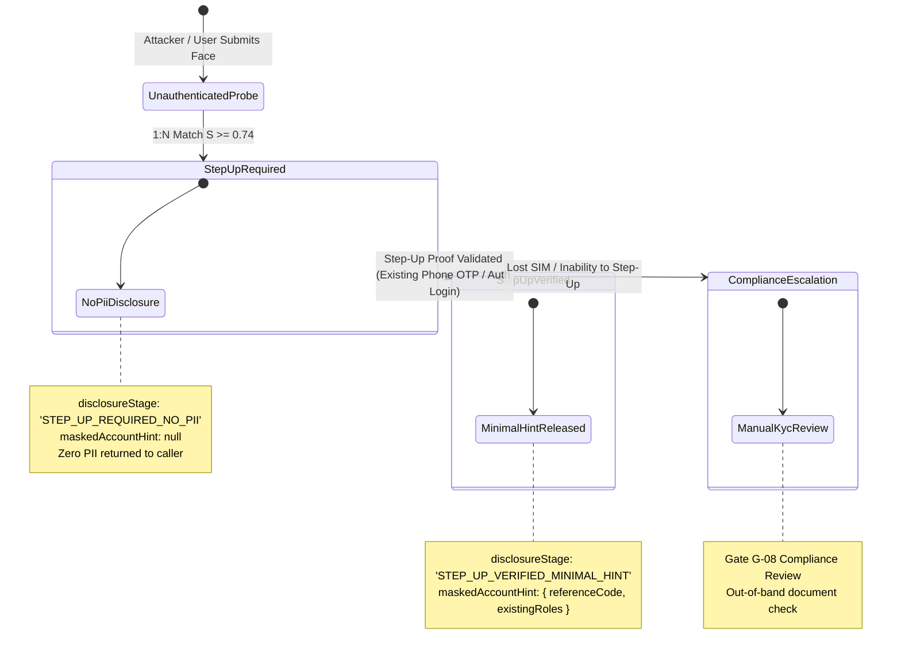

# KELASAGARA BIOMATCH V19.1 — ACCOUNT RECOVERY & ANTI-ENUMERATION ARCHITECTURE

**Release Posture:** `CONTROLLED_TEST_BUILD_ONLY` (`productionBiometricCalibrationApproved = false`)  
**Specification Reference:** Section 8.3 & Section 10 (Anti-Enumeration & Account Recovery Lifecycle)  
**Implementation Modules:**  
- `backend/src/models/person_identity_v19.ts`  
- `backend/src/services/identity_binding_service_v19.ts`  
- `lib/models/person_identity_v19.dart`  
- `lib/widgets/duplicate_detected_sheet.dart`

---

## 1. Threat Analysis: Facial Identity Probing & User Enumeration

In standard web applications, user enumeration occurs when a login or registration form leaks information about whether an email or phone number exists in the database (e.g., "Account already exists" vs "Invalid email").

In biometric-enabled platforms, this attack vector is significantly more severe:
- **The Facial Oracle Attack:** An adversary obtains a portrait photo of a target individual (from LinkedIn, WhatsApp, or public social media).
- **Adversarial Probe:** The attacker initiates a registration using a burner SIM card, passes basic liveness or submits the portrait photo, and triggers 1:N duplicate screening.
- **Data Leakage (Legacy Flaw):** If the server responds with:
  ```json
  {
    "status": "duplicate",
    "maskedPhone": "+91 ******8819",
    "maskedUserId": "KLS-WRK***42-8819",
    "similarity": 0.87
  }
  ```
  The attacker learns:
  1. The target is registered on Kelasagara.
  2. The target's role is a `WORKER`.
  3. The target's registered phone number ends in `8819`.
  4. The target's approximate account identifier.

This constitutes a serious violation of India's Digital Personal Data Protection (DPDP) Act 2023 §8(3) and ISO/IEC 29794-5 privacy requirements.

---

## 2. The V19.1 Three-Stage Anti-Enumeration Protocol

To eliminate facial enumeration, Kelasagara V19.1 implements a strict three-tier disclosure state machine governed by `PotentialExistingRegistrationResponseV19`:



### Stage 1: `STEP_UP_REQUIRED_NO_PII` (Pre-Verification)
When a 1:N match occurs during registration or verification under an unverified phone number, the server returns strictly zero PII:
- `disclosureStage`: `'STEP_UP_REQUIRED_NO_PII'`
- `allowedToCreateNewUnlinkedAccount`: `false`
- `maskedAccountHint`: `null` (guaranteed null across API responses)
- `nextSteps`: `['SIGN_IN_EXISTING_ACCOUNT', 'VERIFY_EXISTING_PHONE_OTP']`
- `reviewCaseId`: An opaque audit token (e.g. `rev_7f3b...`) for customer support reference.

### Stage 2: `STEP_UP_VERIFIED_MINIMAL_HINT` (Post-Verification)
Only after the claimant supplies a valid `StepUpVerificationProof` proving control over the *existing* identity (by receiving and entering an OTP sent to the existing registered phone on file), the backend reveals the minimal reference code:
- `maskedAccountHint.referenceCode`: `KLS-WRK***42-8819`
- `maskedAccountHint.existingRoles`: `['WORKER']`

### Stage 3: `DUAL_ROLE_LINK_ELIGIBLE` (Role Consolidation)
If the user already owns a `WORKER` role and is applying for a `HIRER` role, and the platform policy is `ALLOW_DUAL_ROLE_WITH_STEP_UP_AUTH`, the system offers one-click account consolidation without creating an orphan duplicate account.

---

## 3. Secure Account Recovery Lifecycles

When a legitimate worker acquires a new phone number or loses their mobile device, they must follow authorized recovery workflows that preserve zero-trust security:

```
+-----------------------------------------------------------------------------+
|                          RECOVERY PATHWAY MATRIX                            |
+--------------------------+------------------------+-------------------------+
| Scenario                 | Verification Pathway   | Authorization Action    |
+--------------------------+------------------------+-------------------------+
| Worker kept old SIM, has | Standard Sign-In via   | Self-service phone      |
| new SIM for work         | existing SIM           | update in Profile       |
+--------------------------+------------------------+-------------------------+
| Worker lost old SIM,     | 1:1 Face Match +       | Automated phone update  |
| remembers password       | Password verification  | under step-up auth      |
+--------------------------+------------------------+-------------------------+
| Worker lost old SIM,     | Gate G-08 Compliance   | Manual identity binding |
| no password / SMS access | Officer Review         | by Compliance Officer   |
+--------------------------+------------------------+-------------------------+
```

### Pathway 1: Self-Service Authenticated Profile Update
1. User logs into their existing account using their old credentials or registered phone.
2. In `lib/screens/profile/profile_screen.dart`, user selects "Update Mobile Number".
3. The app invokes `BlinkVerifySheet` to conduct a 1:1 facial verification match against their active template.
4. Upon match ($S \ge 0.363$), the user enters the new phone number and confirms with an SMS OTP.
5. The backend updates `users/{uid}.phoneNumber` without orphaning or altering `personId`.

### Pathway 2: Assisted Recovery via Compliance Queue (`Gate G-08`)
1. If the user cannot access the original SIM or existing credentials, the registration sheet prompts: `ಸಹಾಯಕ್ಕಾಗಿ ಸಂಪರ್ಕಿಸಿ — Contact Support / Request Review`.
2. The client submits a recovery ticket accompanied by the `reviewCaseId`.
3. An authorized compliance officer (`biometric_compliance_officer = true`) inspects the case in the internal compliance portal:
   - Verifies government photo ID (Aadhaar Offline XML / Driving License) against the applicant's probe.
   - Evaluates the 1:N match confidence ($S \ge 0.85$).
4. The compliance officer executes an authenticated administrative endpoint to link the new `authUid` to the existing `personId` or trigger a supervised phone update.

---

## 4. Test Evidence & Automated Verifications

The anti-enumeration and proof-of-control contracts are continuously verified by automated unit and integration tests:

1. **`backend/src/tests/person_identity_v19.test.ts` (Test 2):**
   - *Assertion:* Withholds all masked account details before step-up proof of control.
   - *Result:* `PASSED` (0.198ms) — verifies that `maskedAccountHint` is `null` when `stepUpProof` is absent.
2. **`backend/src/tests/person_identity_v19.test.ts` (Test 3):**
   - *Assertion:* Unlocks dual-role linking and minimal masked hint ONLY after step-up verification.
   - *Result:* `PASSED` (0.689ms) — verifies that hint is revealed only when `stepUpProof.verified === true`.
3. **`backend/src/tests/identity_binding_service_v19.test.ts` (Test 6):**
   - *Assertion:* `buildRepeatRegistrationResponse` withholds all PII when proof is absent.
   - *Result:* `PASSED` (0.233ms) — ensures full end-to-end service compatibility.

---

## 5. DPDP Act 2023 Compliance Assessment

| DPDP Act Requirement | Implementation in Kelasagara V19.1 | Status |
|---|---|---|
| **Section 4(1):** Grounds for processing personal data | Biometric templates processed strictly on explicit consent for authentication and fraud prevention. | COMPLIANT |
| **Section 8(3):** Implementation of technical security safeguards | Anti-enumeration prevents unauthorized disclosure of registration existence or phone hints. | COMPLIANT |
| **Section 8(7):** Data erasure upon withdrawal of consent | Biometric templates zeroed in memory, deleted via DPDPA §12 endpoint with cryptographic audit link. | COMPLIANT |
| **Section 12:** Rights of the Data Principal | Full access to review registration status via authenticated recovery; no unauthorized linking. | COMPLIANT |
