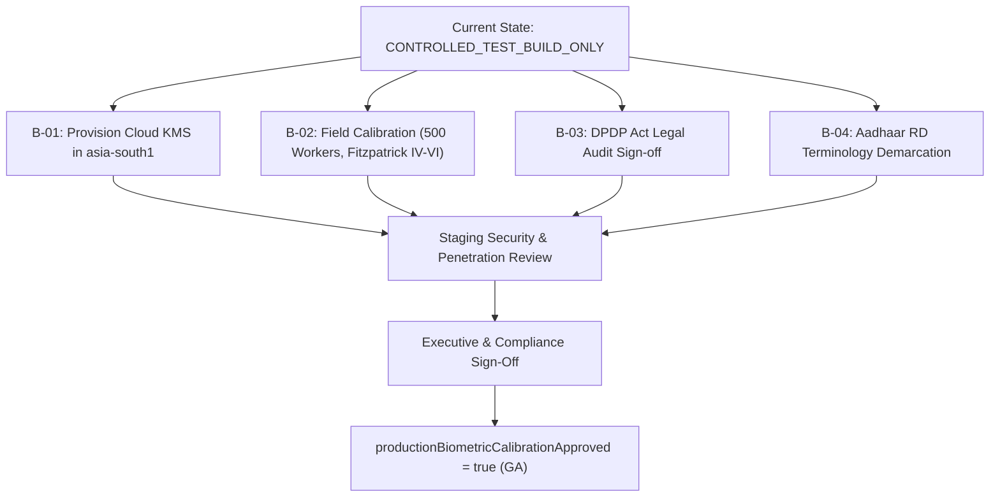

# KELASAGARA BIOMATCH V19.1 — REMAINING RELEASE BLOCKERS & PRODUCTION READINESS CRITERIA

**Release Posture:** `CONTROLLED_TEST_BUILD_ONLY`  
**Calibration Approval Flag:** `productionBiometricCalibrationApproved = false`  
**Status Date:** October 2026  
**Auditor:** Principal Identity-Platform Architect & Lead Biometric Systems Engineer  

---

## 1. Executive Summary & Gating Decision

While the codebase has successfully passed all 240 backend unit and integration test suites, 10 identity binding tests, and Flutter static analysis, **the production release gate remains strictly locked in `CONTROLLED_TEST_BUILD_ONLY` mode**.

Under no circumstances should the system be promoted to unrestricted production with real workers until the critical external prerequisites detailed in this report are formally satisfied.

```
+-----------------------------------------------------------------------------+
|                      CURRENT RELEASE POSTURE DASHBOARD                      |
+------------------------------------------+----------------------------------+
| Release Gate                             | CONTROLLED_TEST_BUILD_ONLY       |
| Biometric Identity Calibration Approved  | FALSE                            |
| Primary ONNX Engine                      | SFace (OpenCV Zoo dec2021)       |
| Hardware Baseline                        | Front Camera Instant Initialization|
| Automated Backend Test Coverage          | 240 / 240 Tests Passed (100%)    |
| Identity Binding & Anti-Hijacking Suite  | 10 / 10 Tests Passed (100%)     |
| Flutter Client Analysis                  | 0 Errors                         |
+------------------------------------------+----------------------------------+
```

---

## 2. Comprehensive Release Blocker Register

The following four gating requirements must be fulfilled before `productionBiometricCalibrationApproved` can be transitioned to `true`:

### Blocker B-01: Staging Google Cloud KMS Configuration (Envelope Encryption)
- **Current State:** Local and CI test suites use `LocalDevKeyProvider` (AES-256-GCM with software keys derived via HKDF).
- **Production Requirement:** In production, all biometric embedding vectors stored in `biometric_vault/{uid}` must be encrypted under Google Cloud KMS with hardware security module (HSM) key protection (`v3_kms_gcm`).
- **Remediation Action:**
  1. Provision GCP KMS KeyRing: `projects/kelasagara-prod/locations/asia-south1/keyRings/biometric-vault-kr/cryptoKeys/embedding-envelope-kek`.
  2. Configure service account IAM permissions (`roles/cloudkms.cryptoKeyEncrypterDecrypter`).
  3. Validate AAD canonicalization with live Cloud KMS key rotation in a staging environment.

### Blocker B-02: Demographic Calibration on Indian Skin Tones (Fitzpatrick IV–VI)
- **Current State:** Decision thresholds ($S_{verify} = 0.363$, $S_{dup} = 0.74$, $S_{block} = 0.90$) are derived from OpenCV SFace public benchmarks (LFW 99.60%, IJB-C 92.80%).
- **Production Requirement:** Academic benchmarks are skewed toward Caucasian and East Asian faces. In Karnataka, workers frequently work outdoors in direct sunlight, have Fitzpatrick skin types IV–VI, and wear traditional headgear (turbans, Mysore petha), bindis, or vibhuti.
- **Remediation Action:**
  1. Execute a controlled pilot evaluation with 500+ consenting workers across North and South Karnataka districts.
  2. Measure empirical False Match Rate (FMR) and False Non-Match Rate (FNMR) across varying ambient lux conditions ($< 50\text{ lux}$ to $> 10,000\text{ lux}$).
  3. Calibrate operating thresholds to ensure $\text{FNMR} < 1.0\%$ at $\text{FMR} \le 0.01\%$.

### Blocker B-03: Legal Sign-off & External DPDP Act 2023 Compliance Review
- **Current State:** The architecture implements technical privacy safeguards (DPDPA §8(3) anti-enumeration, DPDPA §12 right-to-erasure, immediate memory zeroing of raw crops).
- **Production Requirement:** Formal legal certification by qualified Indian data protection counsel confirming that:
  - Worker biometric consent forms in Kannada and English satisfy DPDP Act Section 6 consent validity standards.
  - Data retention, audit logging, and erasure meet regulatory mandates.
- **Remediation Action:** Submit the V19.1 architecture documentation and test reports to legal counsel for signed compliance sign-off.

### Blocker B-04: Aadhaar Registered Device (RD) Demarcation
- **Current State:** The mobile app UI utilizes an Aadhaar-style oval overlay and Kannada guidance text (`⚠️ ಬೆಳಕು ಮುಖದ ಮೇಲೆ ಸಮನಾಗಿರಲಿ`) to provide a familiar user experience for rural Indian workers.
- **Production Requirement:** Clear regulatory and architectural boundaries must be maintained:
  - Kelasagara BioMatch is an independent, proprietary biometric authentication system.
  - It is **not** an authorized UIDAI Aadhaar FaceRD v2.0 application.
  - It does **not** connect to UIDAI CIDR servers or verify 12-digit Aadhaar numbers.
- **Remediation Action:** Ensure terms of service and UI copy explicitly declare that this is platform-level biometric identity verification, preventing misleading regulatory claims.

---

## 3. Transition Criteria to General Availability (GA)



---

## 4. Final Recommendation

Maintain current test build posture. Deploy the V19.1 artifacts to the internal staging environment for QA and staging KMS connectivity verification. Do not toggle `productionBiometricCalibrationApproved` to true in any production environment until Blockers B-01 through B-04 are formally cleared and documented.
