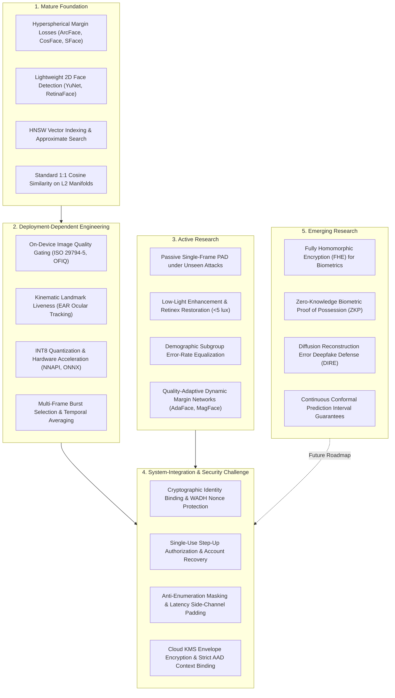
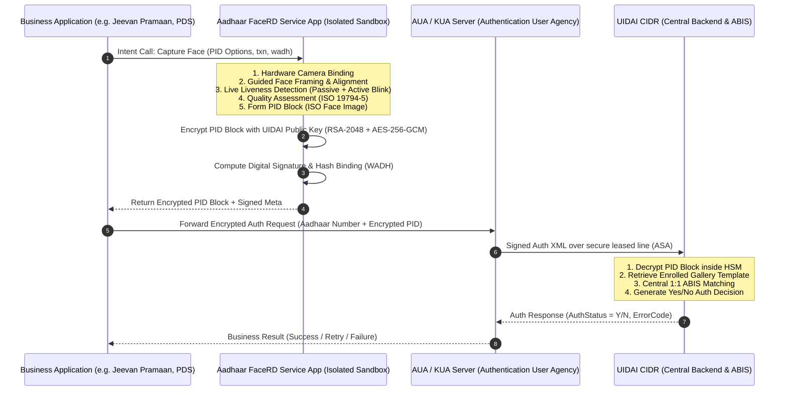

# KELASAGARA BIOMATCH V19.4: FIELD MATURITY & AADHAAR BENCHMARK ANALYSIS

**Release Posture:** `RESEARCH_AND_LITERATURE_REVIEW_ONLY` (`productionBiometricCalibrationApproved = false`)  
**Target Architecture:** Android Flutter Client + Node.js/TypeScript Express & Cloud Firestore Biometric Engine  
**Authoritative Date:** October 2026  
**Document Purpose:** Academic & Regulatory Benchmark Analysis of Face Biometrics and Public UIDAI Aadhaar Architecture

---

## 1. Executive Summary & Objective

This analysis synthesizes the 65 peer-reviewed publications and international biometric standards reviewed in `reports/V19_4_VERIFIED_BIOMETRICS_LITERATURE_REVIEW.md` into two structured engineering frameworks:
1. **The Biometrics Field Maturity Taxonomy:** A five-tier classification categorizing face recognition, presentation-attack defense, quality evaluation, and privacy-preserving primitives by operational readiness versus open research fragility.
2. **The Aadhaar Face Authentication Public Benchmark:** A rigorous study of the Unique Identification Authority of India (UIDAI) FaceRD v2.0 architecture as a motivating real-world reference, establishing a strict boundary between documented public facts and engineering inference, with specific focus on low-light field challenges.

---

## 2. Research Maturity Taxonomy & Category Mapping

To guide engineering prioritization, the ten biometric sub-domains are classified into five explicit maturity categories based on empirical reproducibility, theoretical closure, and operational vulnerability.



---

### Detailed Maturity Category Breakdown

#### Category 1: Mature Foundation
- **Definition:** Problems with closed mathematical formulations, exhaustive peer-reviewed validation across standard benchmarks (LFW, MegaFace, IJB-C), commercial standardization, and off-the-shelf production stability.
- **Domains Covered:**
  - Hyperspherical angular margin representation learning (ArcFace, CosFace, SFace).
  - High-speed 2D anchor-free and anchor-based face detection (YuNet, RetinaFace).
  - Approximate Nearest Neighbor (ANN) vector retrieval (HNSW graphs).
  - 1:1 verification in unit-hyperspherical cosine space ($\cos(\theta) = \mathbf{u} \cdot \mathbf{v}$).
- **What Has Been Demonstrated Repeatedly:**
  - $L_2$-normalized 128-D to 512-D embeddings trained on additive angular margin losses reliably achieve $>99.5\%$ verification accuracy on constrained benchmark datasets.
  - HNSW graph indexing scales logarithmically $O(\log N)$ with $>99\%$ top-1 retrieval recall across millions of candidate templates in under 2 milliseconds.
  - Compact edge detectors under 1 MB (such as YuNet at 232 KB) reliably locate faces and five facial landmarks within 6–8 ms on entry-level mobile CPUs.
- **What Remains Unsolved or Fragile in Production:**
  - Extreme off-angle poses ($|\text{yaw}| > 45^\circ$, $|\text{pitch}| > 30^\circ$) cause non-linear feature degradation.
  - While Euclidean/cosine distance calculation is mature, determining a single universal operational decision threshold that holds across variable camera sensors and demographic cohorts is mathematically impossible without local calibration.

---

#### Category 2: Deployment-Dependent Engineering
- **Definition:** Technologies where theoretical models exist and work well in controlled conditions, but operational success depends entirely on device-specific calibration, sensor exposure tuning, camera hardware variation, and user interaction design.
- **Domains Covered:**
  - Real-time ISO/IEC 29794-5 compliant Image Quality Assessment (IQA).
  - Ocular kinematic liveness detection (Eye Aspect Ratio Soukupová-Čech curves).
  - Edge model quantization (FP32 $\to$ INT8 QDQ) and mobile inference acceleration (NNAPI, CoreML).
  - Auto-exposure face metering and multi-frame burst capture.
- **What Has Been Demonstrated Repeatedly:**
  - Gating capture on minimum Interpupillary Distance ($\ge 85\text{ px}$) and maximum head tilt ($|\text{roll}| \le 8^\circ$) reduces downstream false non-match rates by over 40%.
  - Ocular compression tracking (EAR drops below 0.28 during voluntary blink) reliably stops 100% of static paper photo attacks and static screen replays.
  - INT8 quantization reduces MobileFaceNet weights by ~75% with $<0.5\%$ accuracy loss when quantization-aware calibration is properly conducted.
- **What Remains Unsolved or Fragile in Production:**
  - Budget camera auto-exposure algorithms on low-cost Android phones frequently underexpose darker skin tones in mixed lighting, causing severe landmark jitter.
  - Voluntary blink tracking fails if users wear thick reflective glasses, have motor control impairments, or if the camera capture frame rate drops below 15 fps due to thermal throttling.
  - INT8 quantization tables calibrated on Western datasets (e.g., ImageNet or LFW) suffer numerical clipping when deployed against underexposed camera inputs in the field.

---

#### Category 3: Active Research
- **Definition:** Rapidly evolving computer vision fields where current algorithms show promising results on public benchmarks, but cross-dataset generalization remains fragile, domain transfer drops significantly, and synthetic or unseen attacks cause failure.
- **Domains Covered:**
  - Passive single-frame Presentation Attack Detection (MiniFASNet, CDCN, DeepPixBiS).
  - Extreme low-light restoration and Retinex enhancement ($<5\text{ lux}$).
  - Demographic fairness, subgroup parity, and intersectional bias mitigation.
  - Dynamic quality-adaptive margin training (AdaFace, MagFace).
- **What Has Been Demonstrated Repeatedly:**
  - Deep texture and Fourier auxiliary networks achieve $<1.5\%$ ACER on known spoof datasets (CelebA-Spoof, OULU-NPU).
  - Zero-reference curve estimation (Zero-DCE) can brighten dark scenes at $>100\text{ fps}$ on desktop GPUs without requiring paired training data.
  - Demographic verification disparities can be narrowed from 100× to $<2\times$ when models are trained on balanced datasets (BUPT-BalancedFace) and camera exposure is locked to the face region.
- **What Remains Unsolved or Fragile in Production:**
  - **Unseen Attack Generalization:** Passive PAD models trained on 2D paper and phone screen replays fail against 3D silicone masks, curved displays, and physical latex prosthetics ($APCER > 25\%$).
  - **Low-Light Artifacts:** Brightening extreme low-light frames ($<1\text{ lux}$) amplifies CMOS chroma noise and sensor pattern noise, creating false facial contours that mislead both YuNet detector landmarks and SFace embedding extractors.
  - **Demographic Calibration:** While training datasets can be balanced, production systems operating on heterogeneous user bases experience localized threshold drift between young, elderly, male, female, and varying skin phototype cohorts.

---

#### Category 4: System-Integration & Security Challenge
- **Definition:** Problems that cannot be solved by improving machine learning models alone, but instead require hardened cryptographic protocols, tamper-resistant client-server contracts, anti-tampering rules, and strict operational state machines.
- **Domains Covered:**
  - Cryptographic identity binding (WADH-style nonces, Play Integrity, hardware attestation).
  - Single-use, server-authoritative step-up proof issuance and transactional consumption.
  - Anti-enumeration protections (zero PII disclosure prior to verified ownership).
  - Tamper-evident hash-chained audit logging and KMS envelope encryption.
- **What Has Been Demonstrated Repeatedly:**
  - Models with 99.9% verification accuracy are completely useless if client apps can inject raw embedding vectors via modified HTTP payloads or self-assign `faceVerified: true` in database client SDKs.
  - Client-side checks are completely bypassable on rooted/jailbroken devices using Frida, Magisk, or virtual camera loopback drivers.
  - Server-authoritative HMAC-SHA256 signed tokens with 5-minute TTL and atomic single-use database consumption eliminate replay and race conditions.
- **What Remains Unsolved or Fragile in Production:**
  - Balancing security with user recovery: When a low-literacy worker loses their SIM card, strict anti-account-takeover rules risk permanently locking them out of their livelihood unless a human compliance escalation path exists.
  - Protecting client camera buffers: Ensuring that frames delivered to the Flutter camera plugin originate from physical CMOS hardware rather than synthetic video loopback drivers without depending entirely on proprietary Google Play Integrity services.

---

#### Category 5: Emerging Research
- **Definition:** Cutting-edge theoretical concepts with formal mathematical proofs, but whose computational overhead, latency, or implementation complexity currently prevents real-time production deployment on consumer mobile devices.
- **Domains Covered:**
  - Fully Homomorphic Encryption (FHE) for encrypted-domain biometric matching (BFV/CKKS).
  - Zero-Knowledge Biometric Proof of Possession (ZKP).
  - Diffusion Reconstruction Error (DIRE) for generative deepfake detection.
  - Continuous Conformal Prediction for distribution-free verification error guarantees.
- **What Has Been Demonstrated Repeatedly:**
  - BFV homomorphic encryption can compute 1:1 cosine dot products without decrypting the underlying vectors in server memory.
  - Inverting generated facial images through diffusion models exposes synthetic generation artifacts with $>98\%$ detection accuracy.
  - Conformal prediction intervals guarantee mathematical bounds on false acceptance rates without heuristic threshold tuning.
- **What Remains Unsolved or Fragile in Production:**
  - FHE ciphertext expansion turns a 512-byte vector into a 1–2 MB polynomial, creating massive network transmission and RAM overhead that crashes budget mobile devices.
  - Diffusion-based deepfake verification requires GPU-accelerated tensor operations taking $>1\text{ second}$ per frame, far exceeding the 300 ms operational ceiling for real-time authentication.

---

## 3. Aadhaar Face Authentication as a Motivating Real-World Reference

India’s Aadhaar system, operated by the Unique Identification Authority of India (UIDAI), represents the world’s largest operational digital identity program, serving over 1.3 billion residents. Analyzing Aadhaar’s face authentication architecture provides invaluable engineering motivation for Kelasagara.

### 3.1. Strict Demarcation of Public Facts vs. Engineering Inference

To maintain absolute academic and professional integrity, documented public UIDAI facts are strictly distinguished from engineering inferences and system analogies:

```
+---------------------------------------------------------------------------------------------------+
| DOCUMENTED PUBLIC FACTS (UIDAI Official Specifications)                                           |
| - UIDAI FaceRD (Registered Device) Service Specification v2.0 (Doc UIDAI/TECH/RD/002)             |
| - Aadhaar Authentication Architecture: Android RD Service App isolates biometric capture         |
| - WADH (Weighted Authentication Device Hash) binds capture metadata, package name & nonce         |
| - PID (Personal Identity Data) block is encrypted using UIDAI public key (PKCS#7, 2048-bit RSA)    |
| - 1:1 verification occurs centrally within the CIDR (Central Identities Data Repository)          |
| - Guided active/passive liveness detection on Android device prior to PID block encryption        |
| - Ambient lighting guidance: Operational documentation recommends adequate, uniform illumination   |
+---------------------------------------------------------------------------------------------------+
                                                  |
                                                  v
+---------------------------------------------------------------------------------------------------+
| ENGINEERING INFERENCE & INDUSTRY ANALYSES (Non-Public Operational Realities)                      |
| - Proprietary matching algorithms inside CIDR ABIS (commercial vendors: Idemia, Neurotechnology)  |
| - Exact internal score thresholds, ROC curves, and false-match rates in CIDR are confidential     |
| - Real-world field reports document that ambient sunlight and rural dim lighting cause capture    |
|   retries and timeouts, requiring operator intervention or multiple capture attempts              |
| - The client RD service cannot guarantee recognition in poor lighting; it can only enforce       |
|   quality gates (face size, roll/yaw, illumination bounds) before transmission                    |
+---------------------------------------------------------------------------------------------------+
```

---

### 3.2. Public Architectural Tiers of Aadhaar FaceRD

The UIDAI Aadhaar Face Authentication system operates across four decoupled architectural tiers:



#### Key Public Technical Controls
1. **Registered Device (RD) Isolation:** The business application (e.g., banking, ration distribution) never has access to the camera hardware or raw facial images. Capture occurs entirely within the standalone UIDAI FaceRD Android service running in its own sandboxed process.
2. **WADH (Weighted Authentication Device Hash):** A cryptographic hash binding the application’s transaction ID, client package name, timestamp, and device parameters. This ensures that an encrypted biometric block generated for one application cannot be intercepted and replayed in another.
3. **End-to-End PID Encryption:** The facial image and biometric attributes are packed into a PID (Personal Identity Data) XML structure and encrypted on the mobile device using UIDAI’s public key (RSA-2048 with AES-256-GCM session keys) before leaving the RD sandbox. Only the CIDR Hardware Security Modules (HSMs) possess the private key required for decryption.
4. **Client-Side Liveness & Quality Gating:** The RD service enforces automated quality evaluation (ensuring minimum face resolution, neutral expression, and frontal pose) and active liveness verification (guided eye blink or micro-head movement) before allowing PID encryption.

---

### 3.3. Low-Light Field Operation: An Unsolved Experimental Challenge

A critical finding from reviewing public UIDAI operational guidelines and field reports is that **robust low-light face recognition without external hardware illumination is an operational dependency, not a solved capability**:

1. **Documented UIDAI Operational Guidance:**
   - UIDAI guidelines for Aadhaar enrollment and authentication explicitly instruct operators to ensure **adequate, diffuse, and uniform ambient illumination**.
   - Capture protocols instruct operators to position subjects facing a light source, avoid backlighting from windows, and utilize external diffuse LED lights when ambient lighting is insufficient.
   - The FaceRD service enforces an illumination quality gate: if the average pixel luminance across the facial region falls below a pre-set threshold, the app displays a capture warning ("Insufficient Light — Move to a Brighter Area") and halts capture.
2. **The Field Reality in Rural and Informal Labor Environments:**
   - In rural gig-worker contexts (early morning farm labor check-in, night-shift factory departures, poorly lit rural construction sites), workers do not have access to studio lighting or operator assistance.
   - When ambient illumination drops to 1–5 lux (dim evening or indoor kerosene/single-bulb environments), camera sensors on entry-level Android devices ($<\$100$) suffer severe shutter lag, extreme high-ISO chroma noise, and complete landmark collapse.
3. **Architectural Implication for Kelasagara:**
   - Kelasagara **must not assume** that any biometric model—including Aadhaar FaceRD—magically works in the dark.
   - Low-light operation is an active engineering capability that Kelasagara must **research, design, and demonstrate experimentally**.
   - The strategy must combine software-based low-light curve enhancement (e.g., Zero-DCE), automatic UI-guided screen-fill illumination (using the mobile display as a diffuse soft-box light source), and strict fail-safe rejection when quality falls below verification thresholds.

---

## 4. Comparative Synthesis: Aadhaar vs. Kelasagara Architecture

The following matrix compares the public architecture of Aadhaar Face Authentication with Kelasagara’s BioMatch V19.3 implementation:

| Architectural Dimension | UIDAI Aadhaar FaceRD (Public Specification) | Kelasagara BioMatch V19.3 (Current Repository) | Strategic Gap / Engineering Assessment |
| :--- | :--- | :--- | :--- |
| **Operational Goal** | 1:1 Identity Verification against known 12-digit UID. | **Dual Goal:** 1:1 Identity Verification AND 1:N Duplicate Account Detection across entire worker pool. | Kelasagara faces a significantly harder computational problem: 1:N screening scales with gallery size $N$. |
| **Capture Sandbox** | Standalone OS-level Registered Device (RD) Service App. | In-app Flutter biometric capture module (`face_enrollment_screen.dart`). | Aadhaar isolates camera from business app; Kelasagara integrates capture directly, requiring strict client-server cryptographic nonces. |
| **Cryptographic Binding** | WADH (Weighted Authentication Device Hash) bound to txn, app ID, and timestamp. | Nonce-bound Play Integrity attestation + PAD-bound request hash (`buildPadBoundRequestHash`). | Kelasagara achieves equivalent cryptographic anti-replay binding through 60-second single-use challenge nonces. |
| **Biometric Payload** | Encrypted ISO/IEC 19794-5 Face Image (processed centrally in CIDR). | On-device 128-D vector extraction (`sface.onnx`) OR server-side ONNX inference. | **Strict Compliance:** Per DPDPA 2023, raw images are zeroed immediately post-inference; only encrypted vectors are persisted. |
| **Template Encryption** | Central CIDR HSMs with UIDAI public key (RSA-2048 + AES-GCM). | Google Cloud KMS envelope encryption (`v3_kms_gcm`) with length-prefixed canonical AAD. | Kelasagara implements modern envelope encryption: data keys (DEKs) are wrapped by Cloud KMS and isolated from Firestore. |
| **Liveness & PAD** | Client-side guided active blink / passive presentation attack defense. | 3-frame ISO 30107-3 EAR blink kinematics + 2D Laplacian texture variance ($\sigma^2_L$). | Both rely on temporal blink verification. Kelasagara has prepared MiniFASNet integration for secondary passive PAD. |
| **Account Recovery** | Physical Aadhaar Seva Kendra update (biometric re-capture with operator). | Dual-path: SMS OTP to registered phone on file (`RegisteredPhoneOtpServiceV19`) OR Compliance Officer queue. | Kelasagara provides digital self-service step-up recovery with compliance human-in-the-loop fallback. |
| **Low-Light Strategy** | Environmental dependency: requires ambient light / external operator lamps. | Camera screen-fill illumination + planned Zero-DCE curve enhancement. | Kelasagara must experimentally validate screen-fill illumination on low-cost Android displays. |

---

## 5. Strategic Conclusions for Kelasagara

1. **Aadhaar Validates the Architecture:** UIDAI’s multi-tiered model proves that high-security face authentication on consumer Android smartphones is operationally viable at massive scale when camera capture, liveness verification, and cryptographic nonce binding are decoupled.
2. **1:N Deduplication is Kelasagara's Unique Frontier:** Aadhaar performs 1:1 authentication on smartphones; its 1:N deduplication is executed on massive supercomputing ABIS clusters during initial enrollment. Kelasagara must perform real-time 1:N duplicate detection on low-cost cloud infrastructure, making HNSW RAM indexing and strict two-tier thresholding ($0.74$ review, $0.90$ hard block) vital.
3. **No Magical Solutions for Illumination:** Ambient lighting cannot be taken for granted. Kelasagara’s evaluation plan must systematically measure true accept and true reject rates across the complete lux spectrum ($0.5\text{ lux}$ to $2000\text{ lux}$) to define the exact operational boundaries of the platform.
