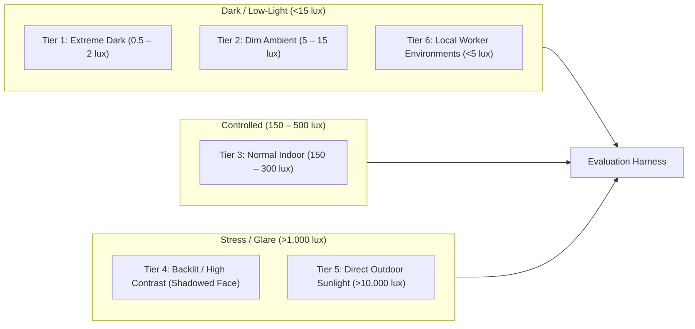

# KELASAGARA BIOMATCH V19.5
# BASELINE EXPERIMENTAL PROTOCOL & LOW-LIGHT BENCHMARK SPECIFICATION
## Controlled Environmental Illumination Bands, Calibrated Lux Metrology, Research Ethics & Operational Boundaries

**Release Posture:** `CONTROLLED_TEST_BUILD_ONLY` (`productionBiometricCalibrationApproved = false`)  
**Document Purpose:** Baseline Experimental Protocol for Low-Light & Environmental Illumination Stress Testing  
**Standards Compliance:** ISO/IEC 19795-1:2021 (Biometric Performance Testing), ISO/IEC 30107-3:2023 (Presentation Attack Detection), India DPDPA 2023 §8(3) & §12  
**Target Platform:** Kelasagara Mobile Worker Marketplace (Android Flutter Client + Node.js/TypeScript Biometric Engine)  
**Authoritative Date:** October 2026  

---

## 1. Executive Mandate & Operational Governance

In accordance with the **V19.5 directive**, this document defines the standardized, reproducible experimental protocol to evaluate the existing facial biometric pipeline (`sface.onnx` FP32 / INT8, 128-D hyperspherical embeddings, 5-point Umeyama similarity alignment, and 3-frame Soukupová-Čech EAR blink kinematics) under realistic environmental stress.

### 1.1. Invariable System Release Posture
The production release gate remains strictly locked:
```typescript
releaseGateStatus = "CONTROLLED_TEST_BUILD_ONLY";
productionBiometricCalibrationApproved = false;
```
No experimental protocol detailed herein authorizes altering production recognition thresholds, disabling server-side security checks, or deploying biometric gating to live end users.

### 1.2. Strict Human-Subject Research Boundaries
1. **Zero Autonomous Collection:** The AI coding agent and automated software harnesses must **never** automatically acquire face images, execute web-scraping for human faces, or conduct unconsented biometric data collection.
2. **Explicit Operator Approval Required:** Physical experiments involving human participants require independent Institutional Review Board (IRB) or Ethics Committee clearance, verifiable written consent, and supervision by a designated human research lead.
3. **Absolute Prohibition on Repository Biometric Data:** Raw human facial photographs, video bursts, or plaintext embedding vectors must **never** be committed to the Git repository, staged in version control, or transmitted to external unapproved endpoints.

---

## 2. Experimental Illumination Tiers & Environmental Capture Conditions

Informal labor workers in Karnataka operate in extreme and unpredictable optical conditions—from unlit rural agricultural musters at 04:30 AM to intense, direct afternoon sunlight ($>50,000\text{ lux}$) on construction sites.

> [!IMPORTANT]
> **Experimental Settings Notice:**
> The illuminance bands defined below are **experimental target settings** for empirical calibration and benchmark testing. They do **not** represent guaranteed operational specifications of the current production app.



---

### Tier 1: Extreme Darkness ($0.5\text{ to }2\text{ lux}$)
- **Description:** Enclosed indoor environment at night with all primary lighting turned off. Residual light from distant rooms or cracked doorways ($0.5\text{--}2.0\text{ lux}$).
- **Sensor Impact:** Camera CMOS sensors operate at maximum analog gain (ISO 3200–6400). Shutter speeds drop to $\ge 1/15\text{ s}$, inducing severe motion blur from hand tremor. Heavy fixed-pattern and chrominance noise obliterates subtle facial gradients.
- **Experimental Objective:** Measure the exact threshold where YuNet face detection drops below $90\%$ and assess whether client display screen-fill illumination (white UI canvas at $100\%$ display brightness) recovers detection and alignment without distorting embedding vectors.

### Tier 2: Dim Indoor Ambient ($5\text{ to }15\text{ lux}$)
- **Description:** Typical evening domestic lighting in rural housing, poorly lit corridors, or roadside tea stalls under a single low-wattage LED bulb or single distant street lamp.
- **Sensor Impact:** Auto-exposure algorithms attempt to brighten the frame, introducing mid-frequency luminance noise. Eyelid landmarks begin to jitter, potentially disrupting the 3-frame EAR blink kinematics.
- **Experimental Objective:** Evaluate whether SFace 128-D cosine similarity against standard enrollment templates drifts by $\Delta s > 0.10$, and quantify the rise in False Non-Match Rate ($FNMR$).

### Tier 3: Standard Indoor Baseline ($150\text{ to }300\text{ lux}$)
- **Description:** Well-diffused domestic, retail, or office lighting without direct glare or harsh shadows. Meets the lower baseline of UIDAI Aadhaar FaceRD recommended operating conditions.
- **Sensor Impact:** Optimal camera sensor performance. Low sensor gain (ISO 100–400), fast shutter ($\le 1/60\text{ s}$), sharp edge contrast, and minimal landmark jitter.
- **Experimental Objective:** Establish the reference baseline for True Accept Rate ($TAR$), False Match Rate ($FMR$), Decidability Index ($d'$), and processing latency.

### Tier 4: Uneven Lighting & Harsh Backlighting
- **Description:** Subject positioned directly in front of a bright window, outdoor doorway, or unshielded overhead light fixture during daylight hours.
- **Physical Dynamics:** Background illuminance exceeds $5,000\text{ lux}$, while frontal illuminance at the subject's face is $<50\text{ lux}$ (contrast ratio $>100:1$).
- **Sensor Impact:** Without localized face-priority auto-exposure (AE metering), camera sensors expose for the bright background, plunging the face into severe underexposure (silhouette effect). Conversely, if face-priority AE is active, the background blows out completely ($255$ clipping).
- **Experimental Objective:** Test the resilience of 5-point landmark detection and Umeyama alignment when eye sockets are heavily shadowed, and verify if the quality gate (`laplacianBlurScore` and `meanLuminance`) cleanly rejects silhouetted frames before vector extraction.

### Tier 5: Outdoor Daylight & Direct Sunlight ($>10,000\text{ lux}$)
- **Description:** Open-air midday outdoor conditions (sunny or partly cloudy, $10,000\text{ to }60,000\text{ lux}$).
- **Sensor Impact:** Very fast shutter ($\le 1/1000\text{ s}$), minimal noise, but potential optical glare, lens flare, and severe squinting by the subject (altering eye aspect ratio and facial expression).
- **Experimental Objective:** Quantify the False Non-Match Rate caused by sun-induced squinting (falsely triggering closed-eye state in `Iso30107PadController`) and assess face detection stability under harsh specular highlights on forehead and cheekbones.

### Tier 6: Context-Specific Informal Labor Environments
- **Specific Scenarios Documented:**
  1. **Early-Morning Agricultural Labor Muster (04:45 AM):** Ambient illuminance $1\text{--}4\text{ lux}$, heavy fog/mist, damp air causing optical condensation on camera lens cover glass.
  2. **Night-Shift Industrial Gate Departure (11:30 PM):** High-pressure sodium or harsh overhead fluorescent lighting casting strong vertical shadows under brow, nose, and chin.
  3. **Rural Construction Check-In:** High airborne particulate matter (dust, cement powder), smudged camera lenses, workers wearing head coverings (cloth wraps, turbans, safety helmets).

---

## 3. Calibrated Metrology & Data Collection Protocol

To eliminate subjective guesswork, all experimental trials must record physical measurements using dedicated hardware instrumentation.

```
+----------------------------------------------------------------------------------------------------+
| INSTRUMENTATION & METROLOGICAL LOGGING PARAMETERS                                                  |
+----------------------------------------------------------------------------------------------------+
| 1. Calibrated Lux Meter at Subject Plane: Measured lux perpendicular to facial surface (E_face)   |
| 2. Calibrated Lux Meter at Camera Plane: Measured lux incident on mobile camera sensor (E_cam)     |
| 3. Metrological Classification: Explicitly flag isCalibratedLuxMeter: true vs false (estimate)   |
| 4. Hardware Sensor Exif: ISO sensitivity, shutter speed (ms), lens aperture (f-number)             |
| 5. Physical Geometry: Distance from lens to subject eye plane (cm), vertical tilt angle (degrees)  |
| 6. Environmental Context: Ambient temperature (°C), relative humidity (%), light source spectrum  |
+----------------------------------------------------------------------------------------------------+
```

### 3.1. Photometric Calibration Equipment Standards
1. **Calibrated Lux Meter Specification:** Illuminance measurements must be acquired using a cosine-corrected, photopic illuminance meter complying with **DIN 5032 Class C or better** (e.g., Testo 540, Extech LT45, or equivalent factory-calibrated lux meter).
2. **Measurement Procedure:**
   - **Facial Plane ($E_{\text{face}}$):** Sensor placed at nose level, facing directly toward the camera lens.
   - **Camera Plane ($E_{\text{cam}}$):** Sensor placed directly adjacent to the smartphone front camera, facing toward the subject.
   - **Distinction of Measured vs. Estimated:** The manifest must explicitly tag each record with `isCalibratedLuxMeter: true` only when an instrument reading was captured; rough visual estimates must be recorded with `isCalibratedLuxMeter: false` and analyzed separately.

### 3.2. Camera Hardware & Optical Logging
For every video capture sequence, the client evaluation harness must record:
- **Device Model & OS:** Exact model string (e.g., `Samsung Galaxy A03 Core SM-A032F`, `Android 11 Go`).
- **Optical Parameters:** Native focal length ($mm$), physical aperture (e.g., $f/2.4$), fixed vs. autofocus mode.
- **Dynamic Capture State:** Exposure time ($ms$), ISO gain, frame arrival timestamp delta ($\Delta t$ between frames to monitor thermal throttling below $15\text{ fps}$).
- **Physical Distance:** Subject-to-camera distance (target band: $35\text{ to }50\text{ cm}$).

---

## 4. Human-Subject Research Ethics, Privacy & Legal Compliance

All biometric evaluations must adhere strictly to the **India Digital Personal Data Protection Act (DPDPA) 2023** and international ethical principles for human research (**Declaration of Helsinki**).

### 4.1. Explicit Informed Consent
1. Prior to any capture, participants must receive a written and verbal explanation in their native language (**Kannada** or **English**) detailing:
   - The exact purpose of the research (evaluating face authentication reliability in low light).
   - What data is recorded (short video sequences of facial movements).
   - How the data is protected and who has access.
   - The absolute right to withdraw consent at any time without penalty or impact on their marketplace standing.
2. Written or verifiable digital consent must be archived under a unique Consent Record ID.

### 4.2. Pseudonymization & De-Identification Architecture
- **No Direct Identifiers:** Real names, phone numbers, Aadhaar numbers, or worker marketplace IDs must **never** be associated with research image manifests.
- **Cryptographic Pseudonyms:** Every subject is assigned a pseudonymous subject token generated via HMAC-SHA256:
  $$\text{SubjectPseudonym} = \text{HMAC-SHA256}(\text{SubjectUUID}, \text{ResearchSecretKey})$$
- The mapping between real identities and pseudonyms must be stored in a separate, encrypted key-vault accessible only to the designated compliance officer.

### 4.3. Data Storage, Encryption & Cryptographic Erasure
1. **Encryption at Rest:** All approved evaluation datasets stored on research workstations must reside on encrypted volumes using **AES-256-XTS** or **AES-256-GCM**.
2. **Encryption in Transit:** Local network transmission between mobile test rigs and local research evaluation servers must mandate **TLS 1.3** with strict certificate pinning.
3. **Retention & Scheduled Deletion:** Research datasets must have a predetermined maximum retention period (not exceeding 180 days post-calibration). Upon project completion or participant withdrawal, cryptographic erasure (destroying encryption keys and overwriting sectors) must be executed in compliance with DPDPA 2023 §12.
4. **Git Version Control Safeguard:** The root `.gitignore` must permanently enforce rules preventing any image files (`.jpg`, `.jpeg`, `.png`, `.webp`, `.bin`, `.npy`) from being committed:
   ```gitignore
   # Biometric Research Data Quarantine
   research_data/
   test_datasets/
   *.bin
   *.npy
   ```

---

## 5. Operational Workflow & Role Responsibilities

The execution of baseline experiments is strictly partitioned between human-operator responsibilities and automated offline software evaluation.

| Workflow Stage | Responsible Entity | Explicit Actions & Controls | Operational Gate |
| :--- | :--- | :--- | :--- |
| **Stage 1: Protocol Approval** | Ethics Committee / Project Sponsor | Formal review of protocol, consent forms, and data governance. | `IRB_ETHICS_CLEARED` |
| **Stage 2: Participant Consent** | Human Research Operator | Administer vernacular consent, verify voluntary participation, log consent tokens. | `CONSENT_VERIFIED` |
| **Stage 3: Photometric Capture** | Human Research Operator | Position lux meter, set environmental lighting, record instrument lux, supervise capture. | `PHOTOMETRIC_LOGGED` |
| **Stage 4: Dataset Quarantine** | Human Security Engineer | Verify pseudonymization, encrypt dataset on isolated storage, verify zero Git leaks. | `STORAGE_QUARANTINED` |
| **Stage 5: Offline Execution** | Automated Test Harness (`v19_5_research_harness.ts`) | Ingest manifest, run detection, alignment, SFace inference, and compute statistical metrics. | `METRICS_COMPUTED` |
| **Stage 6: Calibration Audit** | Principal Biometrics Lead | Review Wilson score bounds, DET curves, and failure cases. Approve or reject release. | `CALIBRATION_AUDITED` |

---

## 6. Summary: Experimental Governance Checklist

Prior to initiating any physical trial under this protocol, the research lead must verify:
- [ ] Institutional ethics/IRB clearance documented.
- [ ] Vernacular Kannada/English consent forms prepared.
- [ ] Calibrated lux meter battery and calibration certificate verified.
- [ ] Test mobile devices (entry-level Android) configured in airplane mode with local USB debugging.
- [ ] Local evaluation storage encrypted with AES-256.
- [ ] `.gitignore` quarantine rules verified active.
- [ ] Production release gate confirmed locked to `CONTROLLED_TEST_BUILD_ONLY`.
