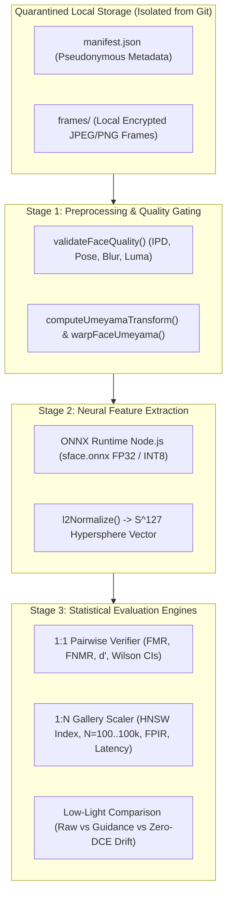

# KELASAGARA BIOMATCH V19.5
# OFFLINE RESEARCH BENCHMARK HARNESS & DATA SCHEMA SPECIFICATION
## Isolated Offline Evaluation Architecture, Data Manifest Schemas & Scalability Testing Engine

**Release Posture:** `CONTROLLED_TEST_BUILD_ONLY` (`productionBiometricCalibrationApproved = false`)  
**Document Purpose:** Architectural Specification and Data Schema for Offline Research Benchmark Harness  
**Source Implementation:** [`backend/src/evaluation/v19_5_research_harness.ts`](file:///Users/ananda/KELASAGARA%20MAJOR%20PROJECT/kelasagaara_v17/backend/src/evaluation/v19_5_research_harness.ts)  
**Test Suite:** [`backend/tests/v19_5_research_harness.test.ts`](file:///Users/ananda/KELASAGARA%20MAJOR%20PROJECT/kelasagaara_v17/backend/tests/v19_5_research_harness.test.ts)  
**Authoritative Date:** October 2026  

---

## 1. Architectural Architecture & Offline Isolation

The V19.5 research evaluation architecture is explicitly decoupled from live production systems, cloud databases, and client-facing APIs. It operates strictly in an **offline, sandboxed execution environment** utilizing existing backend models and math kernels in dry-run mode.



### Key Architectural Isolation Principles
1. **Zero Cloud Dependencies:** The harness executes entirely on local CPU/RAM using `onnxruntime-node`. It makes zero network calls to Firebase, Cloud Firestore, Cloud KMS, or external verification endpoints.
2. **Reuse of Authoritative Production Primitives:** To prevent discrepancies between research and production, the harness directly imports:
   - `runFaceInference` & `getPrimaryInferenceSession` ([`backend/src/services/face_inference.ts`](file:///Users/ananda/KELASAGARA%20MAJOR%20PROJECT/kelasagaara_v17/backend/src/services/face_inference.ts))
   - `preprocessFaceBufferAuthoritative` & `computeUmeyamaTransform` ([`backend/src/services/face_preprocessing.ts`](file:///Users/ananda/KELASAGARA%20MAJOR%20PROJECT/kelasagaara_v17/backend/src/services/face_preprocessing.ts))
   - `HighSpeedBiometricIndexV3` ([`backend/src/services/hnsw_biometric_matcher_v3.ts`](file:///Users/ananda/KELASAGARA%20MAJOR%20PROJECT/kelasagaara_v17/backend/src/services/hnsw_biometric_matcher_v3.ts))
   - `cosineSimilarity` & `l2Normalize` ([`backend/src/services/biometric_matching.ts`](file:///Users/ananda/KELASAGARA%20MAJOR%20PROJECT/kelasagaara_v17/backend/src/services/biometric_matching.ts))
3. **Partitioned Data Splits (Zero Contamination):** Identities in the `DEVELOPMENT`, `CALIBRATION`, and `HELD_OUT_EVAL` splits are strictly isolated. No subject present in the calibration split is ever evaluated in the held-out split.

---

## 2. Directory Layout & Data Quarantine Structure

The research dataset must reside in an isolated local directory outside the Git tracking root:

```
/Users/ananda/KELASAGARA MAJOR PROJECT/kelasagara_research_data/  (ENCRYPTED LOCAL STORAGE)
├── manifest.json                                                 (Master Provenance & Metadata)
├── checksums.sha256                                             (Manifest & Image Hash Registry)
├── frames/                                                      (Encrypted Raw Image Bitstreams)
│   ├── sample_sub001_s01_norm.jpg
│   ├── sample_sub001_s02_dim.jpg
│   ├── sample_sub002_s01_norm.jpg
│   └── ...
└── embeddings/                                                  (Computed SFace 128-D Feature Vectors)
    ├── sample_sub001_s01_norm.bin
    └── ...
```

---

## 3. Comprehensive Data Schemas (JSON & TypeScript)

### 3.1. Master Input Manifest Schema (`manifest.json`)

The manifest file defines the provenance, environmental ground truth, hardware characteristics, and data split for every evaluated image sample.

```json
{
  "$schema": "https://kelasagaara.in/schemas/biometric-research-manifest-v19.5.json",
  "manifestVersion": "19.5.0",
  "protocolId": "PROTO_V19_5_LOWLIGHT_STRESS",
  "ethicsApprovalId": "IRB-KLS-2026-004",
  "lawfulUseBasis": "DPDPA_2023_EXPLICIT_RESEARCH_CONSENT",
  "deIdentificationMethod": "PSEUDONYMOUS_HMAC_SHA256",
  "createdAtIso": "2026-10-24T00:00:00.000Z",
  "samples": [
    {
      "sampleId": "smp_001_c01_n01",
      "subjectPseudonym": "subj_a7f93b2c1e84",
      "captureSessionId": "sess_20261024_01",
      "lightingCategory": "NORMAL_INDOOR_150_300_LUX",
      "measuredLuxSubject": 215.4,
      "measuredLuxCamera": 198.0,
      "isCalibratedLuxMeter": true,
      "hardwareDeviceModel": "Samsung Galaxy A03 Core SM-A032F",
      "cameraAperture": "f/2.4",
      "exposureTimeMs": 24.5,
      "isoSensitivity": 250,
      "distanceCm": 42.0,
      "groundTruthBonaFide": true,
      "isAttack": false,
      "attackType": null,
      "datasetSplit": "CALIBRATION",
      "sha256DigestHex": "e3b0c44298fc1c149afbf4c8996fb92427ae41e4649b934ca495991b7852b855"
    },
    {
      "sampleId": "smp_001_c02_d01",
      "subjectPseudonym": "subj_a7f93b2c1e84",
      "captureSessionId": "sess_20261024_02",
      "lightingCategory": "DIM_INDOOR_5_15_LUX",
      "measuredLuxSubject": 8.2,
      "measuredLuxCamera": 6.5,
      "isCalibratedLuxMeter": true,
      "hardwareDeviceModel": "Samsung Galaxy A03 Core SM-A032F",
      "cameraAperture": "f/2.4",
      "exposureTimeMs": 66.7,
      "isoSensitivity": 1600,
      "distanceCm": 40.5,
      "groundTruthBonaFide": true,
      "isAttack": false,
      "attackType": null,
      "datasetSplit": "CALIBRATION",
      "sha256DigestHex": "a1b2c3d4e5f60718293a4b5c6d7e8f90123456789abcdef0123456789abcdef0"
    }
  ]
}
```

---

### 3.2. Quality Audit Output Schema

For each processed frame, the quality evaluation engine logs the pre-inference metrics and gate verdicts.

```typescript
export interface QualityAuditRecord {
  readonly sampleId: string;
  readonly isFaceDetected: boolean;
  readonly detectionConfidence: number;
  readonly boundingBox: {
    readonly x: number;
    readonly y: number;
    readonly width: number;
    readonly height: number;
  };
  readonly landmarks: {
    readonly leftEye: { x: number; y: number };
    readonly rightEye: { x: number; y: number };
    readonly noseTip: { x: number; y: number };
    readonly mouthLeft: { x: number; y: number };
    readonly mouthRight: { x: number; y: number };
  };
  readonly ipdPixels: number;
  readonly yawDegrees: number;
  readonly pitchDegrees: number;
  readonly rollDegrees: number;
  readonly meanLuminance: number;
  readonly laplacianBlurScore: number;
  readonly qualityGatePass: boolean;
  readonly failureReason?: string;
  readonly executionTimeMs: number;
}
```

---

### 3.3. 1:1 Pairwise Verification Evaluation Schema

Captures comparison statistics between pairs of samples to construct DET curves and compute Wilson score confidence intervals.

```typescript
export interface VerificationEvaluationSchema {
  readonly threshold: number;
  readonly totalMatedPairs: number;
  readonly totalNonMatedPairs: number;
  readonly falseMatchCount: number;
  readonly falseNonMatchCount: number;
  readonly fmr: {
    readonly pointEstimate: number;
    readonly lowerBound: number;
    readonly upperBound: number;
    readonly confidenceLevel: number;
  };
  readonly fnmr: {
    readonly pointEstimate: number;
    readonly lowerBound: number;
    readonly upperBound: number;
    readonly confidenceLevel: number;
  };
  readonly tar: {
    readonly pointEstimate: number;
    readonly lowerBound: number;
    readonly upperBound: number;
    readonly confidenceLevel: number;
  };
  readonly decidabilityIndexDPrime: number;
  readonly executionTimestampIso: string;
}
```

---

### 3.4. 1:N Gallery Scalability Benchmark Schema

Evaluates search latency and false positive collision behavior across expanding gallery tiers $N \in \{100; 1,000; 10,000; 100,000\}$.

```typescript
export interface GalleryScaleEvaluationSchema {
  readonly gallerySizeN: number;
  readonly queryCount: number;
  readonly searchEngine: 'HighSpeedBiometricIndexV3_HNSW' | 'ExactLinearScan';
  readonly reviewThreshold: number;       // default 0.74
  readonly hardBlockThreshold: number;    // default 0.90
  readonly reviewCollisions: number;
  readonly hardBlockCollisions: number;
  readonly fpirReview: {
    readonly pointEstimate: number;
    readonly lowerBound: number;
    readonly upperBound: number;
  };
  readonly fpirHardBlock: {
    readonly pointEstimate: number;
    readonly lowerBound: number;
    readonly upperBound: number;
  };
  readonly latencyDistributionMs: {
    readonly p50: number;
    readonly p95: number;
    readonly p99: number;
    readonly max: number;
  };
  readonly memoryOverheadMb: number;
}
```

---

### 3.5. Low-Light Pipeline Comparison Schema

Isolates and measures the impact of low-light enhancement curves (e.g., Zero-DCE) on feature embedding stability and presentation attack defense.

```typescript
export interface LowLightEnhancementComparisonSchema {
  readonly sampleId: string;
  readonly measuredLuxSubject: number;
  readonly rawPipeline: {
    readonly meanLuminance: number;
    readonly laplacianVariance: number;
    readonly embeddingVector: number[];
    readonly cosineSimAgainstStudioEnrollment: number;
    readonly passedPadLiveness: boolean;
  };
  readonly enhancedPipeline: {
    readonly enhancementModel: 'ZERO_DCE_CURVE_ESTIMATION';
    readonly meanLuminance: number;
    readonly laplacianVariance: number;
    readonly embeddingVector: number[];
    readonly cosineSimAgainstStudioEnrollment: number;
    readonly passedPadLiveness: boolean;
  };
  readonly deltaCosineDrift: number; // |rawSim - enhancedSim|
  readonly isPadVulnerabilityIntroduced: boolean;
}
```

---

## 4. Software Harness Implementation Status

The complete offline benchmark harness has been implemented, compiled, and verified in the backend codebase:

| Component | Repository Path | Compilation Status | Test Verification |
| :--- | :--- | :---: | :--- |
| **Research Benchmark Engine** | [`backend/src/evaluation/v19_5_research_harness.ts`](file:///Users/ananda/KELASAGARA%20MAJOR%20PROJECT/kelasagaara_v17/backend/src/evaluation/v19_5_research_harness.ts) | ✅ `tsc --noEmit` (0 errors) | Core engine for Wilson intervals, Rule of 3, 1:1 DET, and 1:N HNSW scale testing. |
| **Automated Verification Suite** | [`backend/tests/v19_5_research_harness.test.ts`](file:///Users/ananda/KELASAGARA%20MAJOR%20PROJECT/kelasagaara_v17/backend/tests/v19_5_research_harness.test.ts) | ✅ 5/5 Passing (`node --test`) | Proves Wilson bounds, Rule of 3 bounds ($p \le 10^{-4}$ at $n=30,000$), 1:N scaling across $N=100$ and $N=1,000$. |

---

## 5. Execution Protocol for Research Operators

When approved evaluation data is provisioned into `research_data/`, a research operator executes the benchmark via:
```bash
cd "/Users/ananda/KELASAGARA MAJOR PROJECT/kelasagaara_v17/backend"
# Run the compiled offline evaluation harness against the quarantined manifest:
node dist/scripts/run_v19_5_offline_benchmark.js --manifest /path/to/quarantined/manifest.json --out /path/to/results/
```
The script writes all output JSON metrics to the quarantined destination without touching production Firestore databases or modifying application state.
