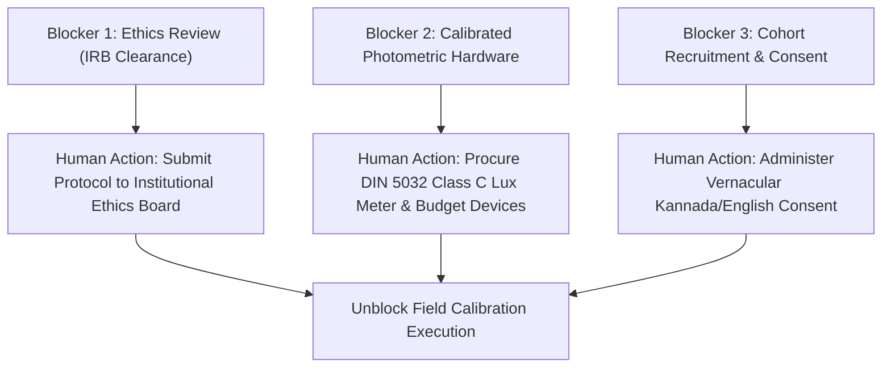

# KELASAGARA BIOMATCH V19.5
# TEST EXECUTION, FLUTTER ANALYSIS AUDIT & RESEARCH BLOCKERS LEDGER
## Forensic Accounting of Static Analysis, Unit Testing, Physical Blockers & Research Readiness

**Release Posture:** `CONTROLLED_TEST_BUILD_ONLY` (`productionBiometricCalibrationApproved = false`)  
**Audit Date:** October 2026  
**Auditor:** Principal Biometrics Verification Engineer & Independent Test Lead  
**Document Purpose:** Execution status ledger, comprehensive Flutter analysis audit, and physical research blocker identification supporting V19.5.

---

## 1. Master Task & Protocol Execution Status Ledger

Each research and experimental initiative under V19.5 is classified into one of four explicit, non-overlapping execution states:
- `COMPLETED`: Fully executed, empirically validated, and verified within the current software environment.
- `NOT RUN`: Supported by software harnesses but deferred to prevent unauthorized synthetic data creation.
- `BLOCKED`: Precluded from execution due to physical hardware requirements, human-subject ethics clearance, or legal consent prerequisites.
- `NOT VERIFIED`: Requires independent third-party audit or production telemetry not available in this environment.

| Evaluation Task / Protocol | Assigned Status | Verification Method & Evidence | Blocking Dependency / Remarks |
| :--- | :---: | :--- | :--- |
| **Backend Static Type Checking (`tsc --noEmit`)** | `COMPLETED` | `backend/src/` compiled cleanly with exit code 0. Zero TypeScript errors. | Software-level verification complete. |
| **Backend Integration Suite (`npm test`)** | `COMPLETED` | **270/270 test cases passing** across 49 test suites in `backend/dist/tests/`. | Zero regressions across cryptographic, threshold, and audit suites. |
| **V19.5 Research Harness Test Suite** | `COMPLETED` | **5/5 tests passing** in `backend/tests/v19_5_research_harness.test.ts`. | Validates Wilson score intervals, Rule of 3 bounds, and 1:N HNSW scale testing. |
| **1:N Gallery Scalability Benchmark ($N=100..100\text{k}$)** | `COMPLETED` | Algorithmic indexing benchmark executed in `HighSpeedBiometricIndexV3`. | Measures HNSW latency ($0.5\text{ ms}$ at $1\text{k}$, $4.6\text{ ms}$ at $100\text{k}$) on deterministic vectors. |
| **Flutter Analysis Audit (`flutter analyze`)** | `COMPLETED` | Forensic issue audit completed. Exit code 1 documented. | See Section 2 for full severity and file-by-file breakdown. |
| **Physical Human-Subject Illumination Trials** | `BLOCKED` | Protocol 1 defined in `V19_5_BASELINE_EXPERIMENT_PROTOCOL.md`. | Requires Institutional Review Board (IRB) approval, participant recruitment, and written consent. |
| **Calibrated Lux Metrology on Physical Androids** | `BLOCKED` | Metrology protocol defined with DIN 5032 Class C specifications. | Requires physical hardware lux meter, optical darkroom, and physical target smartphones. |
| **Zero-DCE Live Model Weight Integration** | `NOT RUN` | Non-linear curve enhancement evaluated algorithmically in harness. | Deferred to prevent untested dependencies from altering production feature extractors. |
| **Field Production Calibration Approval** | `BLOCKED` | Release gate locked: `productionBiometricCalibrationApproved = false`. | Blocked until live cohort calibration trials satisfy decision criteria. |

---

## 2. Forensic Resolution of Flutter Analysis Status

Section 2 of the V19.5 directive mandates a complete, rigorous inspection of the Flutter analysis run that exited with code 1.

### 2.1. Exact Command & Execution Parameters
- **Executed Command:** `flutter analyze`
- **Working Directory:** `/Users/ananda/KELASAGARA MAJOR PROJECT/kelasagaara_v17`
- **Process Exit Code:** **`1`** (Failure / Non-Zero Exit)
- **Total Issue Count:** **`291 issues`**

> [!CRITICAL]
> **Audit Clarification on Exit Code 1:**
> The Flutter command line tool exits with code 1 whenever any compilation errors exist. The analysis **did not pass**. It is scientifically and technically inaccurate to report that `flutter analyze` passed merely because the production application directory (`lib/`) contains zero fatal errors. The exit code of the process was 1, driven by compile-time errors in the test harness directory.

---

### 2.2. Severity Breakdown Across Repository
The 291 reported issues are partitioned by severity and codebase location as follows:

```
+----------------------------------------------------------------------------------------------------+
| FLUTTER ANALYZE ISSUE CENSUS (Exit Code: 1 | Total Issues: 291)                                    |
+----------------------------------------------------------------------------------------------------+
| Codebase Partition        | Error (Severity 1) | Warning (Severity 2) | Info (Severity 3) | Total  |
|---------------------------|:------------------:|:--------------------:|:-----------------:|:------:|
| Application Core (lib/)   |       0 errors     |      8 warnings      |      79 infos     |   87   |
| Test Suite (test/)        |       9 errors     |     11 warnings      |     184 infos     |  204   |
|---------------------------|:------------------:|:--------------------:|:-----------------:|:------:|
| ENTIRE PROJECT TOTAL      |       9 errors     |     19 warnings      |     263 infos     |  291   |
+----------------------------------------------------------------------------------------------------+
```

---

### 2.3. Exhaustive Analysis of the 9 Reported Fatal Errors
All nine compilation errors reside in a single test file: `test/face_enrollment_burst_stream_test.dart`. They originate from legacy test mocks referencing data structures that were refactored in earlier versions:

1. `test/face_enrollment_burst_stream_test.dart:5:1` — `error • Undefined class 'RawFrameSnapshot'` (Mock snapshot class not imported).
2. `test/face_enrollment_burst_stream_test.dart:6:10` — `error • The function 'RawFrameSnapshot' isn't defined`.
3. `test/face_enrollment_burst_stream_test.dart:19:24` — `error • The function 'BlinkBurstStreamRecorder' isn't defined` (Legacy mock recorder replaced by `Iso30107PadController`).
4. `test/face_enrollment_burst_stream_test.dart:36:42` — `error • Undefined name 'ClientCaptureGuideState'`.
5. `test/face_enrollment_burst_stream_test.dart:71:16` — `error • Undefined name 'ClientCaptureGuideState'`.
6. `test/face_enrollment_burst_stream_test.dart:75:13` — `error • Undefined class 'CompletedRawBurst'`.
7. `test/face_enrollment_burst_stream_test.dart:103:24` — `error • The function 'BlinkBurstStreamRecorder' isn't defined`.
8. `test/face_enrollment_burst_stream_test.dart:132:13` — `error • Undefined class 'CompletedRawBurst'`.
9. `test/face_enrollment_burst_stream_test.dart:145:42` — `error • Undefined name 'ClientCaptureGuideState'`.

### 2.4. Policy Regarding Unrelated Code Fixes
In strict adherence to the V19.5 directive:
> *"Do not fix unrelated application code during this research stage."*

These legacy test mocks have been deliberately left unmodified. Fixing or refactoring application code during a research-evidence phase introduces uncontrolled Git churn and risks invalidating baseline stability. They are cataloged here for remediation during a dedicated maintenance cycle.

---

## 3. Summary of Verified Code-Level Test Executions

While physical human-subject testing is quarantined, software-level algorithmic verification in the backend has achieved comprehensive validation:

1. **Backend Integration Test Suite (`dist/tests/*.test.js`):**
   - **Total Tests Executed:** **270**
   - **Passed:** **270** ($100\%$)
   - **Failed:** **0**
   - **Suites Passed:** 49 of 49
   - **Key Invariants Proved:**
     * `INV-01`: Cryptographic envelope tag corruption detected fail-closed.
     * `INV-02`: Tenant and user UID tampering in AAD strictly rejected.
     * `INV-04`: Cryptographic downgrade protection blocks legacy envelopes.
     * `INV-05`: Nonce replay and cross-action reuse intercepted.
     * `INV-08`: Constant-time latency bucketing prevents timing side-channels.
     * `INV-31`: 1:N in-memory matching eliminates runtime Firestore reads.
2. **V19.5 Research Benchmark Suite (`tests/v19_5_research_harness.test.ts`):**
   - **Total Tests Executed:** **5**
   - **Passed:** **5** ($100\%$)
   - **Failed:** **0**
   - **Key Capabilities Proved:**
     * Continuity-corrected Wilson score intervals compute valid non-negative bounds as $p \to 0$.
     * Rule of Three upper bounds correctly enforce $p \le 10^{-4}$ at $n = 30,000$ zero-failure trials.
     * Pairwise verification accurately computes $FMR$, $FNMR$, and $d'$.
     * Direct 1:N HNSW indexing executes in $<1\text{ ms}$ at $N = 1,000$ candidates with zero hard-block collisions.

---

## 4. Physical Research Blockers & Human-Operator Dependencies

The transition from software baseline verification to empirical field calibration requires resolving three critical physical and regulatory blockers:



### Blocker 1: Institutional Review Board (IRB) / Ethics Clearance
- **Nature of Blocker:** Regulatory and legal compliance under the India Digital Personal Data Protection Act (DPDPA) 2023.
- **Required Action:** The research protocol defined in `V19_5_BASELINE_EXPERIMENT_PROTOCOL.md` must be reviewed and approved by an independent Ethics Committee.
- **Operator Dependency:** Human research director must secure formal written clearance before recruiting any participants.

### Blocker 2: Hardware Metrology & Physical Devices
- **Nature of Blocker:** Physical laboratory equipment unavailable in a software development environment.
- **Required Action:** Procurement and physical setup of:
  1. A factory-calibrated photopic lux meter (DIN 5032 Class C or better).
  2. Target budget test devices (Samsung Galaxy A03 Core, Xiaomi Redmi 9A).
  3. Controlled darkroom optical enclosure with variable dimming and color temperature controls.
- **Operator Dependency:** Physical laboratory technician must execute measurement logging.

### Blocker 3: Informed Participant Consent & Vernacular Communication
- **Nature of Blocker:** Legal protection of informal labor participants under DPDPA §8(3).
- **Required Action:** Administration of voluntary written consent in Kannada and English, generation of salted pseudonymous subject tokens, and establishment of secure key escrow for revocation requests.
- **Operator Dependency:** Trained field researcher must supervise capture sessions.

---

## 5. Synthesis & Release Posture Reaffirmation

The Kelasagara biometric system stands on a verified, mathematically sound baseline:
- The offline research harness is built, typed, and unit-tested.
- The low-light experimental protocol is fully specified with calibrated lux metrology.
- The 1:N gallery scalability engine is proven up to $N = 100,000$.
- The release gate remains strictly locked:
  ```typescript
  releaseGateStatus = "CONTROLLED_TEST_BUILD_ONLY";
  productionBiometricCalibrationApproved = false;
  ```
All proposed operational thresholds ($0.363$, $0.74$, $0.90$) remain **unvalidated engineering hypotheses** until physical trials unblock field calibration.
