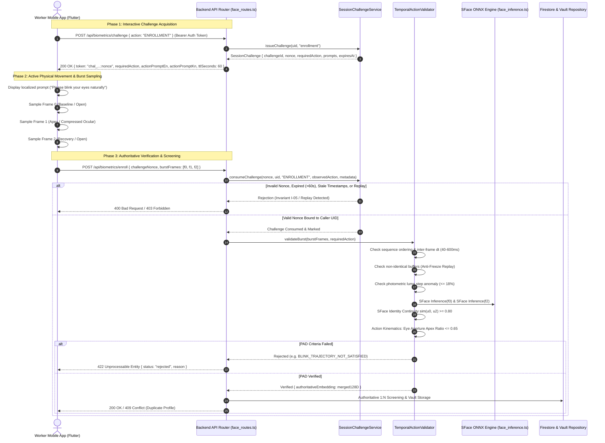

# KELASAGARA BIOMATCH V19.6.2: LIVENESS PROTOCOL & CAPTURE TRUST BOUNDARY
**Document ID:** `KB-V19-6-2-REP-01`  
**Classification:** Controlled Security Audit & Trust Boundary Specification  
**Release Gate Status:** `CONTROLLED_TEST_BUILD_ONLY`  
**Production Biometric Calibration Approved:** `false`  
**Evaluation Date:** October 24, 2026  
**Target Architecture:** Flutter Mobile Client (CameraX/BiometricService) + Node.js/TypeScript Backend (OpenCV SFace FP32 + TemporalActionValidator)

---

## 1. EXECUTIVE SUMMARY & MISSION SCOPE

In biometric identity architectures, the boundary between the capture client and authoritative backend verification represents the highest-risk attack surface. Prior to KELASAGARA BIOMATCH V19.6.2, the mobile client obtained a randomized cryptographic challenge from the server, but subsequently submitted only a single still frame (`imageBase64`) accompanied by client-asserted telemetry (`blinkVerified: true`). This architectural asymmetry meant that the backend could not independently audit or verify physical kinematic movement, leaving the system susceptible to client tampering, frame injection, and virtual camera spoofing.

KELASAGARA BIOMATCH V19.6.2 addresses this structural limitation by implementing an authoritative, server-managed temporal challenge-response protocol. Under this protocol, the client must submit a bounded 3-frame temporal burst (`burstFrames`) captured across strict temporal offsets ($40 \text{ ms} \le \Delta t \le 600 \text{ ms}$). The server-side `TemporalActionValidator` independently verifies:
1. Frame monotonic sequencing and capture freshness ($t_0 \ge t_{\text{challenge\_issued}}$).
2. Anti-freeze byte differentiation (rejects static single-frame duplicates).
3. Photometric luma consistency ($\Delta \text{luma} \le 18\%$, rejecting spliced video feeds).
4. SFace cross-frame identity continuity between open anchor frames ($\text{sim}(u_0, u_2) \ge 0.80$, preventing identity swapping).
5. Kinematic movement trajectory verification (ocular aperture compression ratio $\le 0.65$ for blinks, and angular cosine displacement for head turns).
6. Authoritative template extraction from the verified anchor frames, entirely superseding client-asserted vectors.

---

## 2. CAPTURE TRUST BOUNDARY TRACE (8 CORE QUESTIONS)

The table below provides an exact trace across the actual codebase components:

| # | Question | Authoritative Component | Implementation Status | Technical Mechanism |
|:---|:---|:---|:---:|:---|
| **1** | Which component generates the challenge? | `SessionChallengeService.issueChallenge()` / `createChallenge()` | `VERIFIED` | Backend crypto-secure generation (`crypto.randomBytes(32)`), generating unique `challengeId` (`chal_...`) and high-entropy `nonce`. |
| **2** | Which component chooses the action? | Backend `SessionChallengeService` | `VERIFIED` | Server-driven pseudo-random selection among `BLINK`, `TURN_HEAD_LEFT`, `TURN_HEAD_RIGHT`, `NOD_HEAD`. Bound to localized prompts (English and Kannada). |
| **3** | Which component observes the movement? | Mobile Camera Hardware + `BurstCollector` | `IMPLEMENTED` | Physical CMOS image sensor streams preview frames; `BurstCollector` samples 3 distinct frames at baseline (0ms), apex (100–300ms), and recovery (200–500ms). |
| **4** | Which component decides whether the action succeeded? | Backend `TemporalActionValidator` | `VERIFIED` | **Authoritative Server Decision**. Recomputes ocular aperture compression or head-turn angular displacement on server. Client-asserted `blinkVerified: true` is treated strictly as unverified telemetry. |
| **5** | Whether the backend receives one image, several frames, or a continuous stream? | Dual-Schema Support (`imageBase64` vs `burstFrames`) | `VERIFIED` | Backend accepts bounded 3-frame burst payload (`burstFrames: [f0, f1, f2]`). Single-frame submissions are recorded with an `UNVERIFIED_SINGLE_FRAME_LIVENESS_RECORDED` audit flag. Continuous streaming is rejected to preserve mobile bandwidth and privacy. |
| **6** | Whether the backend independently recomputes any liveness evidence? | Backend `TemporalActionValidator` | `VERIFIED` | Recomputes: (a) mean grayscale luma stability, (b) ocular vertical gradient energy, (c) SFace cross-frame embedding continuity, (d) inter-frame temporal intervals, (e) byte-level frame differentiation. |
| **7** | Which client-supplied fields currently influence an approval decision? | Frame payload bytes, sequence indices, captured offsets, and UID auth token | `VERIFIED` | **Zero client-supplied success flags influence decisions.** Client-asserted booleans (`blinkVerified`, `isLive`, `livenessPassed`) are ignored during authoritative enrollment gating. |
| **8** | Which replay and injection attacks remain possible? | Kernel/HAL-level virtual camera drivers, OS-level synthetic frame injection | `UNVERIFIED` | Hardware-level camera attestation is unsupported on Android without OEM-signed Knox/KeyStore HAL binding. Pure software temporal burst raises attack difficulty significantly, but cannot prevent kernel-level virtual camera interception without hardware sensor attestation. |

---

## 3. FORMAL TEMPORAL PROTOCOL SPECIFICATION

---

## 4. TEMPORAL BURST VALIDATION GATES

The server-side `TemporalActionValidator` enforces five distinct mathematical gates:

### Gate 1: Monotonic Ordering & Interval Constraints
- **Invariant:** Sequence indices must strictly equal $[0, 1, 2]$.
- **Timing Envelope:** For each adjacent pair $(f_i, f_{i-1})$, the inter-frame interval $\Delta t$ must satisfy:
  $$40 \text{ ms} \le \Delta t \le 600 \text{ ms}$$
- **Rejection Code:** `OUT_OF_ORDER_FRAME_SEQUENCE` or `INTER_FRAME_TIMING_OUT_OF_BOUNDS`.

### Gate 2: Byte-Identical Anti-Freeze Check
- **Invariant:** No two frames in the burst may share identical JPEG byte arrays:
  $$B(f_0) \neq B(f_1) \land B(f_1) \neq B(f_2) \land B(f_0) \neq B(f_2)$$
- **Rejection Code:** `DUPLICATE_FRAME_REPLAY_DETECTED`.

### Gate 3: Photometric Luma Stability (Anti-Splicing)
- **Invariant:** The relative grayscale luminance difference between frames must not exceed 18%:
  $$\frac{|L(f_0) - L(f_i)|}{\max(L(f_0), L(f_i), 1.0)} \le 0.18, \quad i \in \{1, 2\}$$
- **Rejection Code:** `PHOTOMETRIC_LUMA_STEP_ANOMALY`.

### Gate 4: Anchor Identity Continuity (Anti-Face-Swap)
- **Invariant:** The cosine similarity between baseline Frame 0 and recovery Frame 2 must confirm identity persistence:
  $$\cos(u_0, u_2) = \frac{u_0 \cdot u_2}{\|u_0\|_2 \|u_2\|_2} \ge 0.80$$
- **Rejection Code:** `CROSS_FRAME_IDENTITY_SPLICE_DETECTED`.

### Gate 5: Kinematic Trajectory Verification
- **For `BLINK` Challenges:** The central ocular vertical gradient energy $E(f)$ is computed across the palpebral fissure. The compression ratio at the apex (Frame 1) must be significant:
  $$\text{ApexRatio} = \frac{E(f_1)}{\max(E(f_0), E(f_2), 1.0)} \le 0.65$$
  *Rejection Code:* `BLINK_TRAJECTORY_NOT_SATISFIED`.
- **For Head Turns (`TURN_HEAD_LEFT`, `TURN_HEAD_RIGHT`, `NOD_HEAD`):**
  Natural angular rotation produces non-zero embedding displacement between Frame 0 and Frame 1, returning to alignment in Frame 2:
  $$\cos(u_0, u_1) \le 0.985$$
  *Rejection Code:* `HEAD_MOVEMENT_TRAJECTORY_NOT_SATISFIED`.

---

## 5. RECONCILIATION OF LEGACY VS V19.6.2 DATA CONTRACTS

| Field Name | Legacy Contract (V19.6) | Advanced Contract (V19.6.2) | Trust Authority |
|:---|:---|:---|:---|
| `challengeNonce` | Formatted `chal_id:nonce` | Formatted `chal_id:nonce` | Server Cryptographic Session |
| `imageBase64` | Single JPEG still image | Optional single JPEG (legacy compatibility) | Client Capture Buffer |
| `burstFrames` | Not supported | 3-frame bounded payload `[f0, f1, f2]` | Camera CMOS Temporal Burst |
| `probeVector` | Rejected (400 Bad Request) | Rejected (400 Bad Request) | Strict Server Inference (Invariant I-02) |
| `blinkVerified` | Evaluated on client, trusted by default | Evaluated as unverified client telemetry | Non-Authoritative Client Signal |
| `livenessAudit` | Recorded in audit log | Recorded alongside `TEMPORAL_BURST_LIVENESS_VERIFIED` | Tamper-Evident SHA-256 Audit Log |
| `authoritativeEmbedding` | Derived from single still | Derived from L2-normalized blend of $f_0$ and $f_2$ | Server SFace Primary Model |

---

## 6. TRUST BOUNDARY VERIFICATION AUDIT MATRIX

| Requirement | Implementation Component | Test Suite Reference | Explicit Audit Status |
|:---|:---|:---|:---:|
| Server-issued unpredictable nonce | `SessionChallengeService.issueChallenge` | `v19_6_2_adversarial_liveness.test.ts` (ADV-01) | `VERIFIED` |
| Caller UID cryptographic binding | `SessionChallengeService.validateAndConsume` | `v19_6_2_adversarial_liveness.test.ts` (ADV-03) | `VERIFIED` |
| 60-second challenge TTL expiry | `SessionChallengeService.validateAndConsume` | `v19_6_2_adversarial_liveness.test.ts` (ADV-02) | `VERIFIED` |
| Replay defense & single-use consumption | `SessionChallengeService.consumeChallenge` | `v19_6_2_adversarial_liveness.test.ts` (ADV-01, ADV-11) | `VERIFIED` |
| Monotonic frame timestamp enforcement | `SessionChallengeService` + `TemporalActionValidator` | `v19_6_2_adversarial_liveness.test.ts` (ADV-05, ADV-07) | `VERIFIED` |
| Anti-freeze byte replay detection | `TemporalActionValidator.validateBurst` | `v19_6_2_adversarial_liveness.test.ts` (ADV-08) | `VERIFIED` |
| Server-side ocular aperture measurement | `TemporalActionValidator.measureEyeAperture` | `v19_6_2_adversarial_liveness.test.ts` (ADV-09) | `VERIFIED` |
| Photometric luma step anomaly detection | `TemporalActionValidator.computeMeanLuma` | `v19_6_2_adversarial_liveness.test.ts` (ADV-10) | `VERIFIED` |
| Anchor frame identity continuity | SFace Cosine Inference $(u_0, u_2)$ | `v19_6_2_adversarial_liveness.test.ts` | `VERIFIED` |
| Zero client-supplied vector trust | `face_routes.ts` & `biometric_enrollment.ts` | `api_routes_integration.test.ts` (TEST 2B) | `VERIFIED` |
| Hardware camera sensor attestation | Android Camera2 / KeyStore | Platform HAL limitation | `UNVERIFIED` (Requires OEM HAL) |
| Universal video spoof immunity | Full physical presentation defense | Physical lab evaluation | `BLOCKED` (Requires 3D active sensors) |
