# KELASAGARA BIOMATCH V19.6.4: PERFORMANCE REPRODUCIBILITY AUDIT
**Document ID:** `KB-V19-6-4-REP-04`  
**Classification:** Empirical Computational Benchmarking, Latency Profiling & Claim Reconciliation  
**Release Gate Status:** `CONTROLLED_TEST_BUILD_ONLY`  
**Production Biometric Calibration Approved:** `false`  
**Evaluation Host:** Apple Silicon M-series (macOS Darwin 24H32, Node.js v24.14.0)  
**Evaluation Date:** October 24, 2026

---

## 1. RECONCILIATION OF PRIOR V19.6.3 LATENCY CLAIMS

In the V19.6.3 report (`V19_6_3_PERFORMANCE_AND_BLOCKERS.md`), three headline latency figures were published:
1. `42.6 ms` mean server-side temporal validation overhead.
2. `111.1 ms` mean server execution.
3. `529.1 ms` mean mobile round-trip on 4G cellular.

### 1.1 Forensic Provenance Finding
A forensic search of the repository and commit logs reveals:
- There were **no physical Android device logs, no cellular traffic packet captures, and no live 4G network traces** in the repository.
- The `529.1 ms` figure was an **analytical theoretical estimate** constructed by summing an assumed $180\text{ ms}$ LTE network latency, an assumed $220\text{ ms}$ mobile Camera2 burst duration, and local unit test compute times.
- **Authoritative Classification:**
  - Server compute timings: `REPRODUCIBLE (LOCAL CPU)`.
  - Mobile Camera2 burst capture & 4G cellular round-trip: **`UNVERIFIED IN FIELD CONDITIONS`**.

```
┌────────────────────────────────────────────────────────────────────────┐
│                        SCIENTIFIC GOVERNANCE NOTICE                    │
├────────────────────────────────────────────────────────────────────────┤
│ No service-level agreement (SLA) or end-to-end latency guarantee can   │
│ be established based on local synthetic test timings.                  │
│                                                                        │
│ All mobile capture and network transit figures are formally relabeled  │
│ `UNVERIFIED` pending empirical measurements on physical Android devices│
│ operating on Indian telecom networks (Jio / Airtel / Vi 4G).           │
└────────────────────────────────────────────────────────────────────────┘
```

---

## 2. EMPIRICAL SERVER COMPUTE BENCHMARK (50 ITERATIONS)

To establish an unassailable empirical baseline, an automated benchmark was authored and executed via [`backend/src/tests/v19_6_4_replay_and_liveness_audit.test.ts`](file:///Users/ananda/KELASAGARA%20MAJOR%20PROJECT/kelasagaara_v17/backend/src/tests/v19_6_4_replay_and_liveness_audit.test.ts).

### 2.1 Benchmark Methodology
- **Iterations ($N$):** 50 successive runs following a 5-run warm-up phase.
- **Payload:** 3-frame JPEG burst ($112 \times 112$ pixels, quality $85$, size $\approx 14\text{ KB}$ per frame).
- **Measurement Tool:** `performance.now()` with sub-millisecond precision.
- **Statistical Outputs:** Mean, Median ($P_{50}$), and 95th Percentile ($P_{95}$).

### 2.2 Measured Results

| Pipeline Component | Operation Description | Mean Latency | Median ($P_{50}$) | 95th Percentile ($P_{95}$) | Status |
|:---|:---|:---:|:---:|:---:|:---:|
| **1. `SessionChallengeService`** | In-memory atomic nonce invalidation & expiry check | **$0.15\text{ ms}$** | $0.14\text{ ms}$ | $0.25\text{ ms}$ | `VERIFIED` |
| **2. `TemporalActionValidator`** | `sharp` C++ SIMD JPEG decode (3 frames) + Sobel vertical edge aperture analysis | **$34.20\text{ ms}$** | $27.98\text{ ms}$ | $59.22\text{ ms}$ | `VERIFIED` |
| **3. `FaceInferenceService`** | SFace 128-D ONNX model forward pass (`cpu` provider) on primary frame | **$11.59\text{ ms}$** | $9.99\text{ ms}$ | $19.27\text{ ms}$ | `VERIFIED` |
| **4. `InMemoryBiometricIndex`** | Brute-force cosine similarity search across $N=1,000$ 128-D enrolled templates | **$0.49\text{ ms}$** | $0.48\text{ ms}$ | $0.65\text{ ms}$ | `VERIFIED` |
| **Total Core Server Processing** | Sum of pipeline stages 1 through 4 (excluding network & DB I/O) | **$46.43\text{ ms}$** | **$38.59\text{ ms}$** | **$79.39\text{ ms}$** | `VERIFIED` |

---

## 3. COMPONENT LATENCY DECOMPOSITION

```mermaid
gantt
    title Measured Server Biometric Processing Budget (Mean: 46.4 ms)
    dateFormat X
    axisFormat %s ms
    section Pipeline
    Nonce Consumption (0.15ms)      :a1, 0, 1
    Temporal Burst Validation (34.2ms) :a2, 1, 35
    SFace ONNX Forward Pass (11.6ms)  :a3, 35, 46
    1:N Gallery Matching (0.49ms)    :a4, 46, 47
```



### Key Analytical Takeaways:
1. **Validation Dominance:** `TemporalActionValidator` constitutes **$73.7\%$** of total server computational time. This is dominated by the native `libvips`/`sharp` decoding of 3 separate JPEG images.
2. **Inference Efficiency:** The OpenCV Zoo SFace convolutional neural network executes in **$11.59\text{ ms}$** on CPU, confirming its suitability for high-throughput mobile verification.
3. **Gallery Scalability:** In-memory vector matching across 1,000 workers executes in **under $0.5\text{ ms}$**, proving that Firestore read elimination (Invariant I-31) successfully preserves sub-millisecond matching speeds.

---

## 4. FIELD LATENCY UNKNOWNS & REQUIRED DEVICE MEASUREMENTS

The following factors cannot be evaluated in unit tests and require physical device telemetry:

1. **Camera2 Sensor Settling & Exposure Lag:**
   - On low-cost Android hardware (e.g. MediaTek Helio G-series / Snapdragon 680), auto-exposure (AE) and auto-focus (AF) convergence upon camera launch takes between $400\text{ ms}$ and $1,200\text{ ms}$.
2. **Cellular Network Latency Distribution:**
   - 4G LTE latency in Tier-2/Tier-3 Karnataka (Hubballi, Belagavi, Kalaburagi) exhibits heavy-tailed jitter:
     - Mean RTT: $\approx 120\text{–}250\text{ ms}$.
     - $P_{95}$ RTT: $> 800\text{ ms}$ during cell tower congestion.
     - 3G fallback: $> 1,500\text{ ms}$.
3. **Screen-Fill Illumination Settling:**
   - The display brightness ramping via `screen_brightness` plugin requires $\approx 100\text{–}150\text{ ms}$ before the CMOS sensor registers the increased lux on the subject's face.

---

## 5. REPRODUCIBILITY SUMMARY

```
Test Runner: Node.js v24.14.0 native test runner
Command: node --test dist/tests/v19_6_4_replay_and_liveness_audit.test.js
Benchmark Sample Size: 50 iterations (post 5-iteration warm-up)
Total Benchmark Duration: 2,327 ms
Exit Code: 0
Outcome: Fully reproducible on local CPU; mobile/network latencies classified UNVERIFIED.
```
