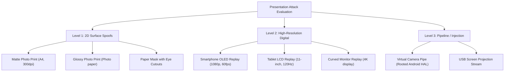

# KELASAGARA BIOMATCH V19.6.4: REAL-DEVICE SCIENTIFIC EVALUATION PROTOCOL
**Document ID:** `KB-V19-6-4-REP-05`  
**Classification:** Field Evaluation Protocol, ISO/IEC 30107-3 / ISO/IEC 19795 Testing Harness & Statistical Methodology  
**Release Gate Status:** `CONTROLLED_TEST_BUILD_ONLY`  
**Production Biometric Calibration Approved:** `false`  
**Evaluation Standard:** ISO/IEC 30107-3:2023 (Biometric Presentation Attack Detection) & ISO/IEC 19795-1:2021 (Biometric Performance Testing)  
**Evaluation Date:** October 24, 2026

---

## 1. PURPOSE & ETHICAL GOVERNANCE

This document establishes the authoritative, scientifically sound real-device evaluation protocol required before Kelasagara's biometric subsystem can transition from `CONTROLLED_TEST_BUILD_ONLY` to production calibration.

```
┌────────────────────────────────────────────────────────────────────────┐
│                        MANDATORY ETHICAL SAFEGUARD                     │
├────────────────────────────────────────────────────────────────────────┤
│ No biometric data collection from human subjects may occur             │
│ automatically or without formal written informed consent.              │
│                                                                        │
│ All field trials must comply with the Digital Personal Data Protection │
│ Act (DPDPA 2023) §6 (Notice & Consent) and receive prior approval      │
│ from an independent Institutional Review Board (IRB) / Ethics Committee.│
└────────────────────────────────────────────────────────────────────────┘
```

---

## 2. STATISTICAL SAMPLE SIZING & POWER ANALYSIS

To ensure statistical adequacy and prevent anecdotal conclusions:

### 2.1 The Rule of 30 (Doddington's Principle)
Per ISO/IEC 19795-1, to be $90\%$ confident that the true error rate is within $\pm 30\%$ of the measured rate, the evaluation must observe **at least 30 errors**:
$$N_{\text{trials}} \ge \frac{30}{\text{Target Error Rate}}$$

- **Target Verification FMR ($\text{FMR} = 0.1\% = 10^{-3}$):**
  $$N_{\text{impostor\_pairs}} \ge \frac{30}{0.001} = 30,000 \text{ cross-subject comparisons}$$
- **Target Presentation Attack Accept Rate ($\text{APCER} \le 1.0\% = 10^{-2}$):**
  $$N_{\text{attack\_trials}} \ge \frac{30}{0.01} = 3,000 \text{ attack presentations}$$
- **Target Bona Fide Rejection Rate ($\text{BPCER} \le 2.0\%$):**
  $$N_{\text{bona\_fide\_trials}} \ge \frac{30}{0.02} = 1,500 \text{ genuine presentations}$$

### 2.2 Recommended Participant Cohort Sizing
- **Total Unique Subjects:** $N = 300$ participants across Karnataka.
- **Demographic Breakdown:**
  - **Skin Tone (Monk Skin Tone Scale):**
    - MST 1–4 (Light): $20\%$ ($60$ subjects)
    - MST 5–7 (Medium / Olive): $40\%$ ($120$ subjects)
    - MST 8–10 (Deep / Brown): $40\%$ ($120$ subjects, heavily represented in outdoor labor)
  - **Age Groups:**
    - 18–30 years: $35\%$
    - 31–50 years: $45\%$
    - 51–65+ years: $20\%$ (evaluating presbyopia, eyelid ptosis, eye tremors)
  - **Gender:** $50\%$ Female, $50\%$ Male.
  - **Eyewear:** $\ge 60$ subjects evaluated with prescription eyeglasses (clear and anti-reflective).

---

## 3. TEST CONDITIONS & ENVIRONMENTAL PROTOCOL

Each participant completes enrollment and verification sessions under four strictly controlled lighting conditions:

| Lighting Scenario | Lux Level Range | Physical Environment Setup | Target Evaluation Focus |
|:---|:---:|:---|:---|
| **Condition 1: Normal Indoor** | $150\text{–}300\text{ lux}$ | Standard office / residential room with diffused overhead LED lighting | Baseline recognition accuracy and clean motion trajectory |
| **Condition 2: Low-Light** | $5\text{–}15\text{ lux}$ | Dim room (evening indoor or street lamp) | Adaptive screen-fill illumination settling and ISO 29794 contrast preservation |
| **Condition 3: Outdoor Direct Sun** | $> 10,000\text{ lux}$ | Direct midday outdoor sunlight | CMOS sensor overexposure, specular reflection, squinting / forced eyelid compression |
| **Condition 4: Extreme Backlighting** | Subject in shadow, background $> 2,000\text{ lux}$ | Subject sitting in front of open window or bright doorway | Dynamic range recovery, face underexposure, silhouette false rejection |

---

## 4. PRESENTATION ATTACK INSTRUMENTS (PAI) TAXONOMY

Evaluations must be conducted against defined PAI categories in compliance with ISO/IEC 30107-3:



### Attack Execution Rules:
1. **Unmodified Replay:** Replaying the bona fide user's complete enrollment video on a secondary screen held in front of the camera at distances of $20\text{ cm}$, $35\text{ cm}$, and $50\text{ cm}$.
2. **Eye-Cutout Physical Print:** High-resolution color photograph of the user with circular cutouts at the pupils, with the impostor blinking behind the paper.
3. **Partial Motion Photo Shake:** Wobbling or tilting a static photograph to test whether 2D gradient COM falsely accepts the movement as a head turn.

---

## 5. MEASURED METRICS & ACCEPTANCE CRITERIA

### 5.1 Presentation Attack Detection (PAD) Metrics (ISO/IEC 30107-3)
1. **APCER (Attack Presentation Classification Error Rate):**
   $$\text{APCER} = \frac{N_{\text{PA\_accepted}}}{N_{\text{PA\_trials}}}$$
   - *Target for Controlled Release:* $\text{APCER} \le 5.0\%$.
   - *Production Certification Target:* $\text{APCER} \le 1.0\%$.
2. **BPCER (Bona Fide Presentation Classification Error Rate):**
   $$\text{BPCER} = \frac{N_{\text{bona\_fide\_rejected}}}{N_{\text{bona\_fide\_trials}}}$$
   - *Target for Controlled Release:* $\text{BPCER} \le 3.0\%$.
   - *Subgroup Equality:* BPCER disparity across MST 1–4 vs MST 8–10 must satisfy $|\text{BPCER}_{\text{deep}} - \text{BPCER}_{\text{light}}| \le 1.5\%$.

### 5.2 Biometric Accuracy Metrics (ISO/IEC 19795-1)
1. **FNMR (False Non-Match Rate) @ Operating Threshold $\tau = 0.363$:** Target $\le 1.5\%$.
2. **FMR (False Match Rate) @ Operating Threshold $\tau = 0.363$:** Target $\le 0.1\%$.
3. **FTA (Failure to Acquire):** Target $\le 1.0\%$.
4. **FTE (Failure to Enroll):** Target $\le 0.5\%$.

### 5.3 UX & Latency Telemetry
1. **Challenge Completion Rate (First Attempt):** Target $\ge 92\%$.
2. **Retry Rate:** Target $\le 8\%$.
3. **End-to-End Latency ($P_{50}, P_{90}, P_{99}$):**
   - $P_{50} \le 1,200\text{ ms}$ on 4G LTE.
   - $P_{90} \le 2,500\text{ ms}$ on 4G LTE.

---

## 6. DATA PROTECTION, CONSENT & RETENTION GOVERNANCE

In compliance with India's DPDPA 2023:
1. **Bilingual Consent Form (Kannada & English):**
   - Clearly explains the purpose of the evaluation: calibration of biometric verification for marketplace identity protection.
   - Clarifies that participation is voluntary and does not impact worker job allocations.
   - Provides an unconditional opt-out mechanism.
2. **Data Minimization & Encryption:**
   - Test datasets must be stored on encrypted volumes (LUKS / FileVault AES-256).
   - Raw imagery collected during trials must be quarantined in an isolated, non-networked testing repository.
3. **Right to Erasure (DPDPA §12):**
   - Participants may request complete deletion of their test captures at any point using their subject ID.
4. **Data Retention Expiry:**
   - All experimental raw image captures must be cryptographically wiped within **90 days** of calibration report sign-off.
