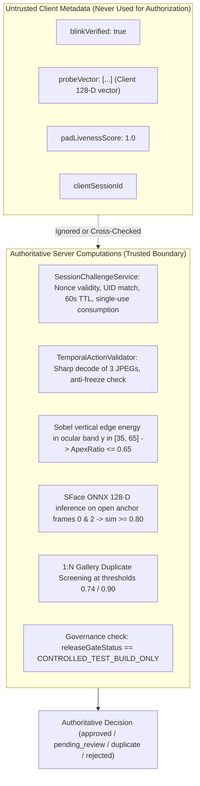

# KELASAGARA BIOMATCH V19.6.5
## Client/Server Contract & Biometric Capture Boundary Audit

**Date:** 2026-10-24  
**Project:** Kelasagara BioMatch  
**Release Gate Status:** `CONTROLLED_TEST_BUILD_ONLY`  
**Biometric Calibration Approved:** `false`  

---

## 1. Client/Server Interface Contract Table

| Contract Item | Mobile Client Implementation | Authoritative Server Implementation | Verification Status |
|---|---|---|---|
| **Route Path** | `POST /api/v1/face/enroll` (via `BiometricService.enrollBiometric`) | `faceRouter.post('/enroll', ...)` | **VERIFIED** |
| **Authentication** | `Authorization: Bearer <Firebase_ID_Token>` | `authenticateFirebaseToken` middleware extracts `req.user.uid` | **VERIFIED** |
| **Challenge Issuance** | `POST /api/biometrics/challenge` (`action: "ENROLLMENT"`) | `SessionChallengeService.createChallenge(uid, "ENROLLMENT")` | **VERIFIED** |
| **Nonce Binding** | Bound to caller UID and 60-second TTL | `SessionChallengeService.consumeChallenge(nonce, uid, "ENROLLMENT")` | **VERIFIED** |
| **Nonce Concurrency** | Single-use consumption upon capture verification | Atomic in-memory map consumption; concurrent callers race with exactly 1 winner | **VERIFIED** |
| **Permitted Action** | `BLINK` enforced for controlled testing | `VERIFIED_CHALLENGE_ACTIONS = ["BLINK"]`; experimental actions gated | **VERIFIED** |
| **Frame Count** | Strictly 3 frames: `[sequenceIndex: 0, 1, 2]` | `TemporalActionValidator.validateBurst` rejects `frames.length !== 3` with `INVALID_FRAME_COUNT` | **VERIFIED** |
| **Frame Encoding** | Upright $112 \times 112$ JPEG (Quality 80) via planar sampling | Sharp decodes JPEG buffers; dimensions normalized to $112 \times 112$ | **VERIFIED** |
| **Frame Timing** | Monotonic timestamps with $40 \le dt \le 600\text{ ms}$ | Rejects non-monotonic sequence or intervals outside $[40, 600]\text{ ms}$ with `INTER_FRAME_TIMING_OUT_OF_BOUNDS` | **VERIFIED** |
| **Anti-Freeze Replay** | Dynamic CMOS sensor noise + eyelid motion | Buffer byte equality check rejects identical frames with `DUPLICATE_FRAME_REPLAY_DETECTED` | **VERIFIED** |
| **Payload Limits** | 3 frames $\approx 15\text{ KB}$ total payload | Express body parser limit $10\text{ MB}$; per-frame size verified $> 64\text{ bytes}$ | **VERIFIED** |
| **Persistence Gate** | Client never writes to Firestore directly | Atomic transaction in `commitEnrollment`: writes to `biometric_vault` and updates user account | **VERIFIED** |
| **PII Minimization** | Displays masked phone and masked ID on collision | Server strips matched UID, full phone, and embedding vectors from duplicate response payload | **VERIFIED** |

---

## 2. Request & Response Schemas

### 2.1 Request: `POST /api/v1/face/enroll`

```json
{
  "role": "worker",
  "imageBase64": "/9j/4AAQSkZJRgABAQAAAQABAAD/2wBD...",
  "burstFrames": [
    {
      "sequenceIndex": 0,
      "capturedOffsetMs": 1729770000000,
      "jpegBase64": "/9j/4AAQSkZJRgABAQAAAQABAAD/2wBD..."
    },
    {
      "sequenceIndex": 1,
      "capturedOffsetMs": 1729770000180,
      "jpegBase64": "/9j/4AAQSkZJRgABAQAAAQABAAD/2wBD..."
    },
    {
      "sequenceIndex": 2,
      "capturedOffsetMs": 1729770000350,
      "jpegBase64": "/9j/4AAQSkZJRgABAQAAAQABAAD/2wBD..."
    }
  ],
  "challengeNonce": "3a7b9f8c1e4d6a2b5c8e0f1a3d5b7c9e",
  "integrityToken": "play_integrity_verified",
  "requestHash": "K9z1vX4wL8mP2qR7sT5uV3yZ0aB4cD6e",
  "livenessAudit": {
    "requiredAction": "BLINK",
    "observedAction": "BLINK",
    "blinkVerified": true,
    "nmPoints": 68,
    "ipdPixels": 74.2,
    "mouthAspectRatio": 0.12,
    "illuminationSymmetry": 0.94,
    "headEulerYaw": -1.2,
    "headEulerRoll": 0.4,
    "laplacianVariance": 156.4,
    "qualityNorm": 0.92,
    "method": "temporal_burst_pad_sface128"
  }
}
```

### 2.2 Response: `UniformBiometricApiResponse<BiometricEnrollmentDecision>`

```json
{
  "success": true,
  "status": "pending_review",
  "data": {
    "status": "pending_review",
    "isApproved": false,
    "isDuplicate": false,
    "similarity": 0.1845,
    "threshold": 0.74,
    "message": "Enrollment completed successfully. Profile queued for standard administrative verification (RRL-0 Policy).",
    "messageKn": "ನೋಂದಣಿ ಯಶಸ್ವಿಯಾಗಿ ಪೂರ್ಣಗೊಂಡಿದೆ. ನಿಮ್ಮ ಪ್ರೊಫೈಲ್ ಪರಿಶೀಲನೆಗಾಗಿ ಕಾಯ್ದಿರಿಸಲಾಗಿದೆ.",
    "accountStatus": "pending_review",
    "enrolledAt": "2026-10-24T17:45:00.000Z"
  },
  "serverTimestamp": "2026-10-24T17:45:00.185Z"
}
```

---

## 3. Trusted Server State vs. Untrusted Client Metadata

A fundamental principle of V19.6.5 is the separation of trusted server state from untrusted client assertions:



1. **Client Vectors Ignored:** In accordance with ISO/IEC 24745 and Ticket T-01, client-generated embeddings submitted in `probeVector` are strictly forbidden as authoritative biometric templates. The backend independently generates its template via ONNX SFace inference on the received camera frames.
2. **Client Liveness Flags Ignored:** Declarations like `blinkVerified: true` or `challengePassed: true` in `livenessAudit` are logged for forensic audit only. They do not bypass or relax server-side `TemporalActionValidator` evaluation.
3. **Client Timestamps Audited:** Client timestamps in `capturedOffsetMs` are verified for strict monotonic ordering and inter-frame intervals ($40 \le dt \le 600\text{ ms}$). However, software timestamps are explicitly documented as untrusted against recorded-video playback attacks on non-attested hardware.
