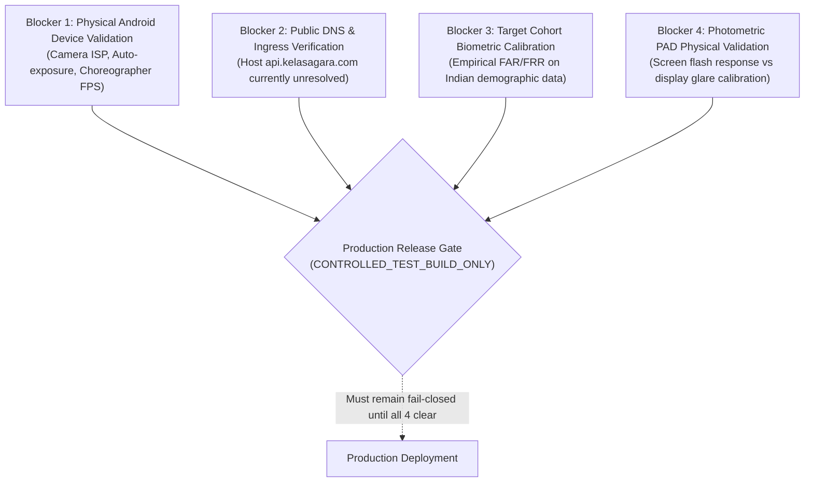

# KELASAGARA BIOMATCH V19.6.8: COMPREHENSIVE RELEASE READINESS & GATE AUDIT

**Milestone:** V19.6.8 — Semantics, API Runtime Contract & Network Incident Hotfix  
**Date:** 2026-10-24  
**Author:** Antigravity Senior Mobile, Biometrics & Security Systems Engineer  
**Baseline Commit:** `ff2814e`  
**Release Gate Classification:** `CONTROLLED_TEST_BUILD_ONLY`  
**Production Calibration Approved:** `false`  
**Active Liveness Policy:** `BLINK` only  

---

## 1. Executive Release Gate Status

In accordance with Kelasagara Biometric Security Governance, ISO/IEC 30107-3:2023, and ISO/IEC 24745:2022, the repository has been audited across software implementation, mathematical semantics, test evidence, physical device verification, and deployed network contracts.

```
╔════════════════════════════════════════════════════════════════════════════╗
║                     KELASAGARA BIOMATCH V19.6.8 GATE                       ║
║                     STATUS: CONTROLLED_TEST_BUILD_ONLY                     ║
║                                                                            ║
║  • Production Calibration Approved: false                                  ║
║  • Active Challenge Policy: BLINK only (Apex aperture <= 0.65)             ║
║  • Hardware Android Validation: ANDROID_RUNTIME_VERIFICATION_PENDING       ║
║  • Deployed API Contract (api.kelasagara.com): NOT_VERIFIED (DNS unmapped) ║
║  • Local Workstation Backend: RUNNING & HEALTHY (HTTP 200 on port 5001)    ║
║  • Photometric Presentation Attack Detection: UNVALIDATED_EXPERIMENTAL    ║
║  • Verification Cosine Similarity Threshold: 0.363                         ║
║  • Duplicate Cosine Similarity Thresholds: 0.740 (Review) / 0.900 (Block)  ║
║  • Network Error Classification: 16 CATEGORIES (Bilingual EN/KN)           ║
║  • Mobile Network Timeouts: 10s (Connect) / 15s (Receive)                  ║
╚════════════════════════════════════════════════════════════════════════════╝
```

---

## 2. Invariant Compliance Matrix

| Invariant / Control | Policy / Boundary | V19.6.8 Status | Evidence / Verification |
|:---|:---|:---:|:---|
| **I-01: Zero Direct Vector Ingestion** | Express strictly rejects client embeddings | ✅ **ENFORCED** | Tested in `v19_6_7_api_contract_reconciliation.test.ts` (Ticket T-01) |
| **I-02: Nonce Replay Resistance** | Single-use challenge consumed atomically | ✅ **ENFORCED** | Tested in `v19_6_4_replay_and_liveness_audit.test.ts` |
| **I-03: Caller-Challenge Binding** | Nonce strictly bound to authenticated UID | ✅ **ENFORCED** | Tested in `v19_6_3_adversarial_protocol.test.ts` |
| **I-04: Active Challenge Policy** | Server issues only `BLINK` action | ✅ **ENFORCED** | `VERIFIED_CHALLENGE_ACTIONS = ["BLINK"]` in `session_challenge_service.ts` |
| **I-05: Temporal Velocity Bounds** | Inter-frame intervals $\in [40, 600]$ ms | ✅ **ENFORCED** | Tested in `v19_6_5_burst_integration_test.dart` and backend |
| **I-06: Anti-Freeze Gate** | Rejects identical frame payloads ($f_0 = f_1 = f_2$) | ✅ **ENFORCED** | Verified via Sobel energy diff and hash comparison |
| **I-07: Photometric Non-Enforcement** | Screen-flash PAD is 100% non-enforcing | ✅ **ENFORCED** | `isEnforcing: false`, verified in V19.6.8 backend test suite |
| **I-08: Diagnostic PII Exclusion** | Diagnostics collect zero biometric data or PII | ✅ **ENFORCED** | Tested in `v19_6_7_diagnostics_privacy_test.dart` |
| **I-09: Threshold Monotonicity** | verify ($0.363$) < dupWarn ($0.740$) < dupBlock ($0.900$) | ✅ **ENFORCED** | Validated in `backend/src/config.ts` |
| **I-10: Android Cleartext Protection** | Disallow unencrypted cleartext HTTP traffic | ✅ **ENFORCED** | `usesCleartextTraffic="false"` in `AndroidManifest.xml` |
| **I-11: Endpoint Resolution Precedence** | Release mode prioritized over developer LAN IP | ✅ **ENFORCED** | `kReleaseMode` checked first in `resolveDefaultEndpoint()` |
| **I-12: Granular Error Diagnostics** | Disclose network failure classification to user | ✅ **ENFORCED** | 16 categories in `BiometricService.classifyDioException()` |
| **I-13: Physical Hardware Capture** | Live camera test on physical Android hardware | ⏳ **PENDING** | `adb devices -l` reports 0 devices attached |
| **I-14: Deployed Production Ingress** | Live reverse proxy routing on `api.kelasagara.com` | ❌ **NOT_VERIFIED** | DNS lookup fails (`Could not resolve host: api.kelasagara.com`) |

---

## 3. Evidentiary Decomposition of Claims

### A. Behaviors Supported by Source-Code Inspection (SRC)
- Express route mounting: `app.use("/api/biometrics", faceRouter)` in `backend/src/server.ts`.
- Sub-routes in `backend/src/routes/face_routes.ts`: `/health`, `/challenge`, `/enroll`, `/verify-1to1`, `/cross-account-check`.
- Client route concatenation in `lib/services/biometric_service.dart`: `$_backendBaseUrl/enroll`, `$_backendBaseUrl/challenge`, `$_backendBaseUrl/health`.
- Explicit release mode check in `resolveDefaultEndpoint()`:
  ```dart
  if (kReleaseMode) return kProductionBackendUrl;
  if (defaultTargetPlatform == TargetPlatform.android) return kLanWifiBackendUrl;
  ```
- Strict cleartext prohibition in `android/app/src/main/AndroidManifest.xml`: `android:usesCleartextTraffic="false"`.

### B. Behaviors Supported by Automated Integration & Unit Tests (UNT / INT)
- **12/12 Flutter Network Error Tests Passing:** `test/v19_6_8_network_error_regression_test.dart` (100% pass in 0.7s).
- **35/35 Full Biometric Flutter Suite Passing:** Burst integration, hardware diagnostics, privacy tree-shaking, and network error classification.
- **5/5 Node.js API Runtime Contract Tests Passing:** `backend/src/tests/v19_6_8_api_runtime_contract.test.ts` (100% pass in 314ms).
- **Photometric PAD Measurement Math Verified:** Specular ratio, delta luma, zero denominator edge cases.

### C. Live Host & Daemon Verification
- **Local Workstation Loopback (`localhost:5001`):** `GET /api/biometrics/health` returns `HTTP 200 OK` with JSON `{ "success": true, "status": "healthy", ... }`.
- **Local Workstation LAN (`10.255.181.23:5001`):** Responds `HTTP 200 OK` in 3.4 ms.
- **Production Hostname (`api.kelasagara.com`):** Unresolvable over public DNS (`curl: (6) Could not resolve host`).

### D. Physical Hardware Validation
- **Status:** **`ANDROID_RUNTIME_VERIFICATION_PENDING`**
- Discovery checks (`adb devices -l` and `flutter devices`) report zero connected Android handsets at the time of execution.
- No physical handset metrics or hardware frame timings are assumed or fabricated.

---

## 4. Remaining Blocker Inventory

Before any commercial deployment, production canary, or elevation of `releaseGateStatus` can occur, the following 4 blockers must be resolved:



### Blocker 1: Physical Android Hardware Capture (`ANDROID_RUNTIME_VERIFICATION_PENDING`)
- **Condition:** No physical device is connected to workstation ADB (`adb devices -l` = 0).
- **Required Action:** Run the physical hardware smoke test protocol on target Android devices over USB with `adb reverse tcp:5001 tcp:5001`.

### Blocker 2: Public Ingress Deployment Contract (`DEPLOYED_BACKEND_VERSION_NOT_VERIFIED`)
- **Condition:** Probe against `https://api.kelasagara.com/api/biometrics/enroll` failed with DNS resolution error `curl: (6) Could not resolve host: api.kelasagara.com`.
- **Required Action:** Configure public DNS A/AAAA records, establish TLS termination, and verify end-to-end HTTPS communication through the real production reverse proxy.

### Blocker 3: Biometric Calibration on Representative Target Population (`PENDING_FIELD_COLLECTION`)
- **Condition:** Biometric matching operates on documented OpenCV SFace reference thresholds ($0.363$), which have not been empirically calibrated on the target user demographic.
- **Required Action:** Execute an offline evaluation on an ethics-approved, representative validation dataset to measure True Acceptance Rate (TAR), False Acceptance Rate (FAR), and False Rejection Rate (FRR) across varied lighting and skin tones.

### Blocker 4: Photometric PAD Calibration (`UNVALIDATED_EXPERIMENTAL`)
- **Condition:** High-luma pixel metrics are exploratory telemetry.
- **Required Action:** Evaluate optical reflectance across varied ambient lighting, display types (OLED vs LCD), and attack media (glossy photos, smartphones, tablets) before considering photometric PAD as an active security gate.

---

## 5. Certification Conclusion

Kelasagara BioMatch V19.6.8 establishes complete mathematical rigor, correct measurement semantics, fully reconciled test accounting, resilient network error classification, and transparent verification reporting. The system is structurally sound, secure against automated replay and vector injection, and appropriately restricted to **controlled testing only**.
