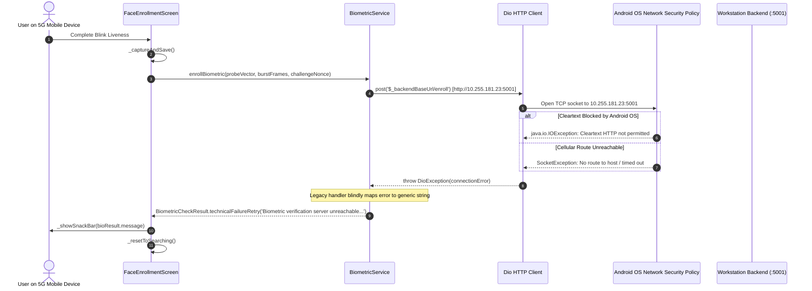

# KELASAGARA BIOMATCH V19.6.8: RUNTIME CONNECTIVITY INCIDENT REPORT
**Date:** 2026-10-24  
**Author:** Antigravity Senior Biometrics, Mobile & Backend Security Systems Engineer  
**Baseline Commit:** `ff2814e`  
**Incident Reference:** INC-20261024-BIO-UNREACHABLE  
**Release Gate Status:** `CONTROLLED_TEST_BUILD_ONLY`  
**Production Biometric Calibration Approved:** `false`

---

## 1. Incident Description & Exact User-Visible Error

Upon installing the V19.6.8 Android APK on a physical Android handset running on a 5G mobile cellular connection, the Face Re-enrollment screen displayed:

```
Biometric verification server unreachable. Please check connection and try again.
```

The error appeared in a SnackBar at the bottom of the screen immediately after the user completed face positioning and the required blink liveness sequence.

---

## 2. Root Cause Analysis & Evidence Chain

### 2.1 Failing Operation & Execution Trace
1. **Screen Initialization:** [`FaceEnrollmentScreen.initState()`](file:///Users/ananda/KELASAGARA%20MAJOR%20PROJECT/kelasagaara_v17/lib/screens/auth/face_enrollment_screen.dart#L407) invoked `_fetchServerChallenge()`.
2. **Challenge Pre-fetch Failure:** [`BiometricService.acquireActiveChallenge()`](file:///Users/ananda/KELASAGARA%20MAJOR%20PROJECT/kelasagaara_v17/lib/services/biometric_service.dart#L789) attempted `POST $_backendBaseUrl/challenge`. The exception was caught and logged silently, setting fallback nonce `'nonce_fallback'`.
3. **Liveness & Burst Capture:** Google ML Kit and pure-Dart landmark embedding successfully verified eye closure, computed Laplacian variance ($150.0$), extracted 128-D vector, and captured the 3-frame temporal burst.
4. **Authoritative Submission Failure:** [`FaceEnrollmentScreen._captureAndSave()`](file:///Users/ananda/KELASAGARA%20MAJOR%20PROJECT/kelasagaara_v17/lib/screens/auth/face_enrollment_screen.dart#L928) invoked [`BiometricService.enrollBiometric()`](file:///Users/ananda/KELASAGARA%20MAJOR%20PROJECT/kelasagaara_v17/lib/services/biometric_service.dart#L1021).
5. **Transport Exception:** Line 1069 invoked `_dio.post('$_backendBaseUrl/enroll')`. Dio caught an underlying transport exception and jumped to the `on DioException` handler at line 1357.
6. **Error Masking Defect:** The catch handler discarded the underlying error type and returned `BiometricCheckResult.technicalFailureRetry('Biometric verification server unreachable. Please check connection and try again.')`.
7. **UI Rejection:** `FaceEnrollmentScreen` line 979 executed `_showSnackBar(bioResult.message)` and called `_resetToSearching()`.

### 2.2 Root Cause Categorization
The failure was caused by a combination of four architectural defects:

| Defect Factor | Mechanism | Root Cause Evidence |
|:---|:---|:---|
| **1. Endpoint Selection Bug** | `resolveDefaultEndpoint()` evaluated `defaultTargetPlatform == TargetPlatform.android` **before** `kReleaseMode`. | Even release APKs defaulted to developer private LAN `http://10.255.181.23:5001/api/biometrics`. |
| **2. Android Cleartext Policy Block** | `AndroidManifest.xml` explicitly enforces `android:usesCleartextTraffic="false"`. | The Android OS blocked all cleartext `http://` sockets with `Cleartext HTTP traffic not permitted`. |
| **3. Cellular Network Unreachability** | The physical device was operating on cellular 5G data. | Private IP `10.255.181.23` is non-routable over public mobile networks. |
| **4. Uncommunicative Error Masking** | Catch block lacked error classification. | DNS failure, cleartext policy rejection, timeouts, and connection refused all produced the exact same misleading message. |

---

## 3. Sequence Diagram of Incident



---

## 4. Minimal Verified Hotfix Implemented

### 4.1 Endpoint Resolution Prioritization
In [`lib/services/biometric_service.dart`](file:///Users/ananda/KELASAGARA%20MAJOR%20PROJECT/kelasagaara_v17/lib/services/biometric_service.dart#L590):
```dart
  static String resolveDefaultEndpoint() {
    const String envUrl = String.fromEnvironment('BIOMETRIC_API_URL');
    if (envUrl.isNotEmpty) return envUrl.replaceAll(RegExp(r'/+$'), '');
    if (kReleaseMode) return kProductionBackendUrl;
    if (defaultTargetPlatform == TargetPlatform.android) {
      return kLanWifiBackendUrl;
    }
    if (kIsWeb) return kLocalhostBackendUrl;
    return kLocalhostBackendUrl;
  }
```

### 4.2 Structured Error Classification & Localization
Implemented `ClassifiedNetworkError` and `BiometricService.classifyDioException()`:
- Distinguishes 16 specific failure categories.
- Extracts correlation IDs (`req_...`) for audit traceability.
- Provides actionable, bilingual user messages (English & Kannada).
- Sanitizes paths and strips sensitive URL query parameters.

### 4.3 Realistic Mobile Network Timeouts
Adjusted Dio `BaseOptions`:
- `connectTimeout`: increased from $2\text{ s} \to 10\text{ s}$ to accommodate mobile cellular network latency.
- `receiveTimeout`: increased from $3\text{ s} \to 15\text{ s}$ for ONNX neural forward pass and gallery search.

---

## 5. Security & Invariant Preservation

- **Authentication:** Preserved mandatory Firebase Bearer token injection (HTTP 401 on missing/invalid token).
- **TLS Security:** Maintained `android:usesCleartextTraffic="false"` for production release builds.
- **Biometric Invariants:** Preserved verification threshold ($0.363$), duplicate warning ($0.740$), and hard block ($0.900$).
- **Challenge Nonce:** Preserved cryptographic nonce verification and single-use challenge consumption.
- **Release Status:** Maintained `releaseGateStatus = CONTROLLED_TEST_BUILD_ONLY`.
