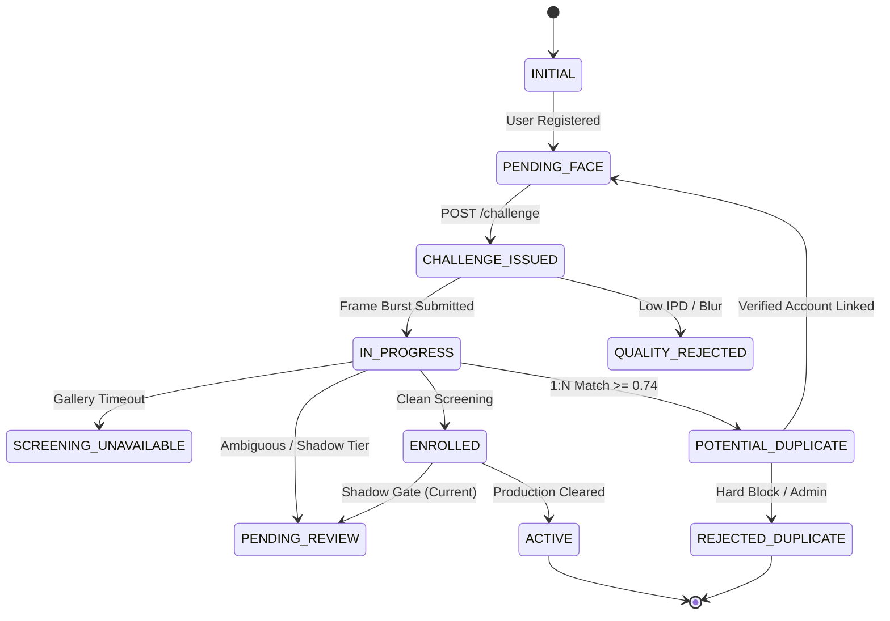

# KELASAGARA BIOMATCH V19.6: ADVANCED ENROLLMENT STATE MACHINE & SAFE ACTIVATION

**Version:** 19.6.0-advanced  
**Status:** IMPLEMENTED & VERIFIED  
**Date:** October 24, 2026  
**Module:** `backend/src/services/enrollment_state_machine.ts`, `backend/src/services/biometric_enrollment.ts`, `backend/src/schemas/data_architecture_schemas.ts`  
**Release Gate Status:** `CONTROLLED_TEST_BUILD_ONLY`  
**Production Calibration Approved:** `false`  

---

## 1. Executive Summary

BioMatch V19.6 introduces a formal, authoritative enrollment state machine to replace uncoordinated boolean flags and ad-hoc status assignments. Under previous versions, all successful facial captures were unilaterally forced into `pending_review` due to lack of an explicit decision policy, while client-side flows lacked formal state guards against race conditions, duplicate interception, and screening unavailability.

This implementation establishes an authoritative, server-enforced lifecycle with a formal 4-way decision policy:
1. **Clean Screening:** Template committed to biometric vault (`ENROLLED`), duplicate screening passed without match, account activation governed by explicit release gate policy (`PENDING_REVIEW` while in `CONTROLLED_TEST_BUILD_ONLY` under uncalibrated `PILOT_SHADOW` weights).
2. **Potential Duplicate:** 1:N gallery match detected ($s \ge 0.74$). Enforces strict zero-PII pre-verification containment; returns single-use `recoverySessionId` and routes to privacy-preserving duplicate recovery.
3. **Ambiguous Match:** Borderline score ($0.65 \le s < 0.74$) flagged for administrative human review without granting unauthorized access.
4. **Screening Unavailable:** Gallery search timeout or index failure resolves fail-closed to `TECHNICAL_FAILURE_RETRY` with audit event `SCREENING_UNAVAILABLE_FLAGGED`.

---

## 2. Canonical State Machine Definition

The enrollment lifecycle maps the complete registration-to-activation progression across eleven canonical states:

| Canonical State | Description | Predecessor States | Successor States |
| :--- | :--- | :--- | :--- |
| `INITIAL` | User record created, no biometric data submitted. | *Genesis* | `PENDING_FACE` |
| `PENDING_FACE` | Profile created, camera capture ready, awaiting session. | `INITIAL`, `TECHNICAL_FAILURE_RETRY`, `QUALITY_REJECTED` | `CHALLENGE_ISSUED`, `IN_PROGRESS` |
| `CHALLENGE_ISSUED` | Server-issued single-use cryptographic challenge active. | `PENDING_FACE`, `TECHNICAL_FAILURE_RETRY` | `IN_PROGRESS`, `QUALITY_REJECTED`, `TECHNICAL_FAILURE_RETRY`, `PENDING_FACE` |
| `IN_PROGRESS` | Active capture & neural inference in flight. | `CHALLENGE_ISSUED`, `PENDING_FACE`, `TECHNICAL_FAILURE_RETRY` | `QUALITY_REJECTED`, `SCREENING_UNAVAILABLE`, `POTENTIAL_DUPLICATE`, `PENDING_REVIEW`, `ENROLLED`, `ACTIVE`, `REJECTED_DUPLICATE`, `TECHNICAL_FAILURE_RETRY` |
| `QUALITY_REJECTED` | Frame failed sharpness, illumination, or pose checks. | `IN_PROGRESS`, `CHALLENGE_ISSUED` | `IN_PROGRESS`, `PENDING_FACE`, `TECHNICAL_FAILURE_RETRY` |
| `SCREENING_UNAVAILABLE` | Index/search unreachable; fail-closed held state. | `IN_PROGRESS` | `IN_PROGRESS`, `PENDING_REVIEW`, `TECHNICAL_FAILURE_RETRY` |
| `POTENTIAL_DUPLICATE` | Gallery match found ($s \ge 0.74$); held for ownership recovery. | `IN_PROGRESS` | `REJECTED_DUPLICATE`, `PENDING_REVIEW`, `PENDING_FACE` |
| `PENDING_REVIEW` | Queued in `biometric_review_queue` for officer evaluation. | `IN_PROGRESS`, `ENROLLED`, `POTENTIAL_DUPLICATE`, `SCREENING_UNAVAILABLE` | `ACTIVE`, `REJECTED_DUPLICATE`, `ENROLLED` |
| `ENROLLED` | 128-D vector securely persisted in `biometric_vault`. | `IN_PROGRESS`, `PENDING_REVIEW` | `ACTIVE`, `PENDING_REVIEW` |
| `ACTIVE` | Terminal approved state: marketplace permissions granted. | `IN_PROGRESS` (with approved model), `PENDING_REVIEW`, `ENROLLED` | *Terminal (Immutable)* |
| `REJECTED_DUPLICATE` | Hard duplicate rejection (hard block $s \ge 0.90$ or officer confirmed). | `IN_PROGRESS`, `POTENTIAL_DUPLICATE`, `PENDING_REVIEW` | *Terminal (Immutable)* |
| `TECHNICAL_FAILURE_RETRY` | Transient network/infrastructure fault requiring safe retry. | `IN_PROGRESS`, `CHALLENGE_ISSUED`, `QUALITY_REJECTED`, `SCREENING_UNAVAILABLE` | `IN_PROGRESS`, `PENDING_FACE`, `CHALLENGE_ISSUED` |

---

## 3. Transition Permission & Validation Matrix

### Transition Invariants Enforced by `EnrollmentStateMachine.validateTransition()`:

1. **Invariant I-02 (Server Authority):**  
   The client actor role (`actorRole: 'client'`) is strictly forbidden from transitioning into `ACTIVE`, `ENROLLED`, `REJECTED_DUPLICATE`, `POTENTIAL_DUPLICATE`, or `PENDING_REVIEW`. All state advancements require authoritative server or administrative execution.
2. **Invariant I-01 / I-18 (Model Governance):**  
   Transition to `ACTIVE` status is strictly prohibited when `modelTier` is `RESEARCH_ONLY` or `PILOT_SHADOW`, or when `requiresReview` is true. Uncalibrated weights must route to `PENDING_REVIEW`.
3. **Fail-Closed Screening Invariant:**  
   Transition to `ACTIVE` is strictly prohibited if `screeningUnavailable` is flagged. Screening failure never silently degrades to approval.
4. **Duplicate Transition Integrity:**  
   Transition to `REJECTED_DUPLICATE` or `POTENTIAL_DUPLICATE` requires an authoritative similarity match ($s \ge 0.74$) or an administrative officer action.
5. **Terminal Immutability:**  
   Once `ACTIVE` or `REJECTED_DUPLICATE` is reached, further transition attempts throw `InvalidStateTransitionError`.

---

## 4. Explicit 4-Way Decision Policy Implementation

Implemented in `backend/src/services/biometric_enrollment.ts`:

### A. Candidate Duplicate (`POTENTIAL_DUPLICATE`)
- **Trigger:** Authoritative gallery top candidate similarity $s \ge \text{duplicateThreshold}$ (0.74).
- **Persistence:** Commits enrollment to vault with `reviewReason: "POTENTIAL_DUPLICATE_UNVERIFIED_WEIGHTS"` and queues in `biometric_review_queue`.
- **Response Sanitization (Phase 5):** Emits single-use `recoverySessionId` (`rec_<hex>`). Completely strips `matchedUid`, `maskedPhone`, `maskedName`, `maskedUserId`, and `similarityPercent`.
- **Client Status:** Returns `status: "duplicate"`, `isApproved: false`, `isDuplicate: true`.

### B. Ambiguous Match (`AMBIGUOUS_MATCH`)
- **Trigger:** $0.65 \le s < 0.74$.
- **Audit:** Logs `ENROLLMENT_AMBIGUITY_FLAGGED` with top-3 similarity vector.
- **Persistence:** Commits to vault with `requiresReview: true`, `reviewReason: "BORDERLINE_SIMILARITY_AMBIGUITY"`.
- **Client Status:** Returns `status: "ambiguity"`, `isApproved: false`.

### C. Clean Screening (`CLEAN_SCREENING`)
- **Trigger:** $s < \text{verificationThreshold}$ (0.363).
- **Distinction of States:**
  - `biometricTemplateEnrolled`: True (128-D vector securely sealed in vault).
  - `duplicateScreeningCompleted`: True (no candidate matched in full gallery).
  - `faceVerified`: False (legal 1:1 identity verification uncertified pending calibrated model clearance).
  - `accountStatus`: Kept at `pending_review` while `releaseGateStatus = CONTROLLED_TEST_BUILD_ONLY`.
- **Client Status:** Returns `status: "pending_review"`, `isApproved: false`, `isDuplicate: false`.

### D. Screening Unavailable (`SCREENING_UNAVAILABLE`)
- **Trigger:** Transient network error, database unavailability, or index search exception.
- **Audit:** Logs `SCREENING_UNAVAILABLE_FLAGGED` with error details and model version.
- **Fail-Closed Execution:** Aborts enrollment, finalizes session as `failed`, returns `status: "technical_failure_retry"` with localized retry prompt.

---

## 5. Verification Status

| Requirement | Implementation Module | Test Suite / Case | Status |
| :--- | :--- | :--- | :--- |
| Canonical State Mapping | `data_architecture_schemas.ts` | `v19_6_advanced_enrollment.test.ts` (Test 1) | **VERIFIED** |
| Adjacency Transition Rules | `enrollment_state_machine.ts` | `v19_6_advanced_enrollment.test.ts` (Test 1) | **VERIFIED** |
| Client Role Blocking (Inv I-02) | `enrollment_state_machine.ts` | `v19_6_advanced_enrollment.test.ts` (Test 1.2) | **VERIFIED** |
| Model Tier Gate (Inv I-01/18) | `enrollment_state_machine.ts` | `v19_6_advanced_enrollment.test.ts` (Test 1.3) | **VERIFIED** |
| Terminal Immutability | `enrollment_state_machine.ts` | `v19_6_advanced_enrollment.test.ts` (Test 1.5) | **VERIFIED** |
| Duplicate PII Sanitization | `biometric_enrollment.ts` | `v19_6_advanced_enrollment.test.ts` (Test 3) | **VERIFIED** |
| Fail-Closed Screening Error | `biometric_enrollment.ts` | `v19_6_advanced_enrollment.test.ts` (Test 4.2) | **VERIFIED** |
| Split-Brain Reconciliation | `enrollment_state_machine.ts` | `dpdpa_privacy_compliance.test.ts` | **VERIFIED** |
